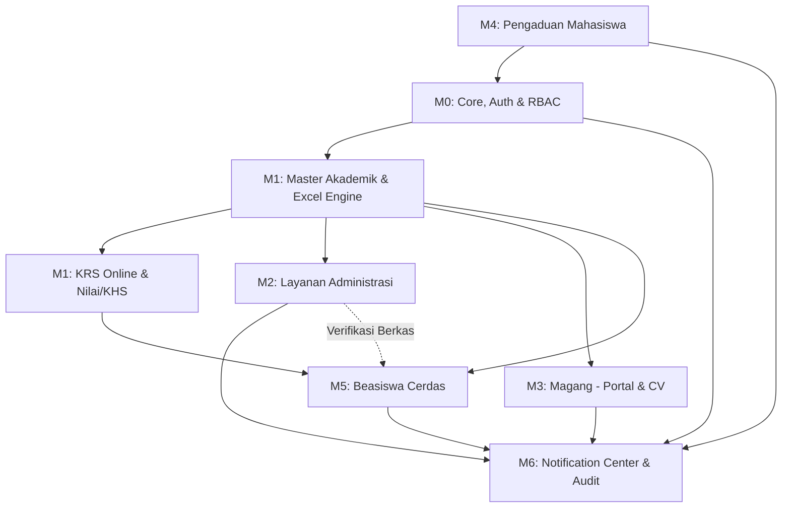
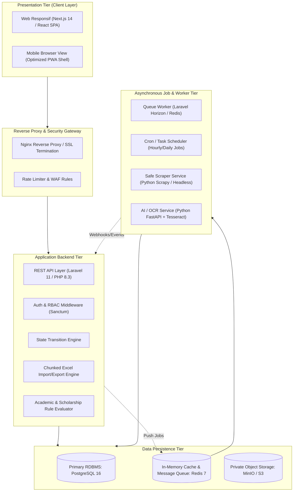
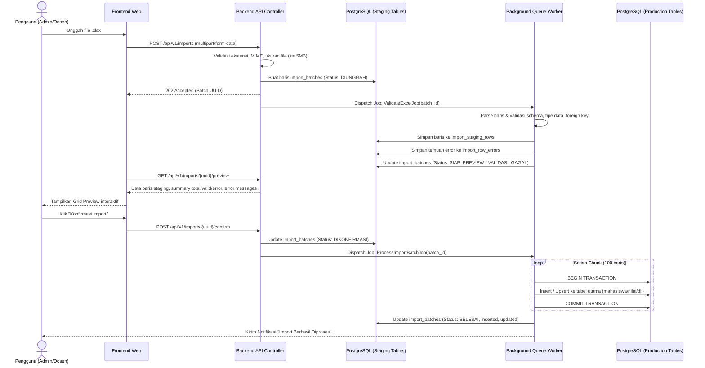
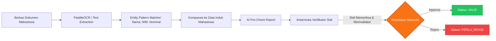
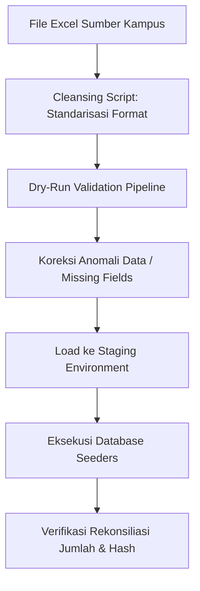

# DOKUMEN RENCANA IMPLEMENTASI SISTEM (SYSTEM IMPLEMENTATION PLAN)
# SIAP — Sistem Informasi Akademik & Pelayanan POLNES

> **Dokumen Rujukan:** [PRD_SIAP_Lengkap.md](PRD_SIAP_Lengkap.md) & [SIAP_PRD_Designed.html](SIAP_PRD_Designed.html)  
> **Target Sistem:** Platform Terintegrasi SIAKAD & Layanan Mahasiswa POLNES  
> **Penyusun:** Senior Product Manager, Lead Software Architect, & System Analyst  
> **Status Dokumen:** Master Implementation Blueprint (Production Ready)  
> **Versi:** 1.0.0  

---

## DAFTAR ISI

1. [Eksekutif Analisis PRD](#1-eksekutif-analisis-prd)
   - 1.1 Kekuatan dan Cakupan Spesifikasi PRD
   - 1.2 Analisis Kesenjangan & Parameter [PERLU VALIDASI]
   - 1.3 Matriks Dependensi Antar Modul
2. [Arsitektur Sistem & Spesifikasi Teknologi Baseline](#2-arsitektur-sistem--spesifikasi-teknologi-baseline)
   - 2.1 Arsitektur Aplikasi (Modular Monolith with Background Workers)
   - 2.2 Tech Stack Selection & Justifikasi
   - 2.3 Desain Repositori & Struktur Direktori Standar
   - 2.4 Standar Konvensi Kode & Kontrak Antarmuka
3. [Strategi Lingkungan Pengembangan & DevOps](#3-strategi-lingkungan-pengembangan--devops)
   - 3.1 Kontainerisasi & Docker Compose
   - 3.2 CI/CD Pipeline & Automated Testing
   - 3.3 Konfigurasi Environment & Manajemen Kredensial
4. [Work Breakdown Structure (WBS) & Tahapan Rilis](#4-work-breakdown-structure-wbs--tahapan-rilis)
5. [Rencana Implementasi Sprint-by-Sprint (10 Sprint / 20 Minggu)](#5-rencana-implementasi-sprint-by-sprint)
   - 5.1 Sprint 1: Foundation, Auth, RBAC & Core UI Shell
   - 5.2 Sprint 2: Master Akademik, Periode & Generic Excel Engine
   - 5.3 Sprint 3: KRS Online Engine & Nilai / KHS Workflow
   - 5.4 Sprint 4: Layanan Administrasi & Storage Engine Privat
   - 5.5 Sprint 5: Integrated Notification Center & Audit Trail
   - 5.6 Sprint 6: Magang Mahasiswa (Two-Sided Marketplace)
   - 5.7 Sprint 7: Sistem Pengaduan Mahasiswa & SLA Tracker
   - 5.8 Sprint 8: Beasiswa Cerdas — Scanner, Forecaster & Outreach
   - 5.9 Sprint 9: Beasiswa Cerdas — Document Verifier, Ranker & Seleksi
   - 5.10 Sprint 10: Dashboard Eksekutif, Security Hardening, UAT & Go-Live
6. [Spesifikasi Teknis Modul Kritis](#6-spesifikasi-teknis-modul-kritis)
   - 6.1 Generic Excel Import/Export Pipeline
   - 6.2 KRS Concurrency & Atomicity Engine (Anti-Overbooking)
   - 6.3 State Machine Engine untuk Layanan, Pengaduan, & Beasiswa
   - 6.4 AI & Assistive Intelligence Framework (Human-in-the-Loop)
7. [Rencana Migrasi Data & Data Seeding](#7-rencana-migrasi-data--data-seeding)
8. [Matriks Pengujian Kualitas (QA & Testing Strategy)](#8-matriks-pengujian-kualitas-qa--testing-strategy)
9. [Manajemen Risiko Implementasi & Rencana Kontinjensi](#9-manajemen-risiko-implementasi--rencana-kontinjensi)
10. [Definisi Selesai (Definition of Done) & Kriteria Akseptasi Rilis](#10-definisi-selesai-definition-of-done--kriteria-akseptasi-rilis)

---

## 1. EKSEKUTIF ANALISIS PRD

### 1.1 Kekuatan dan Cakupan Spesifikasi PRD
Berdasarkan telaah mendalam terhadap [PRD_SIAP_Lengkap.md](PRD_SIAP_Lengkap.md):
1. **Kejelasan Domain Bisnis**: PRD memecah sistem ke dalam 6 modul fungsional utama (Akademik, Layanan Administrasi, Magang, Pengaduan, Beasiswa Cerdas, Notifikasi Terintegrasi) ditambah Platform Core.
2. **Kekayaan Aturan Bisnis (Business Rules)**: Terdapat 72 aturan bisnis terperinci (`BR-001` s/d `BR-072`) yang menetapkan logika validasi atomik, seperti batas SKS dinamis (`BR-011`), mode import nilai all-or-nothing (`BR-023`), hak retensi data pribadi (`BR-044`), dan perhitungan slack deadline beasiswa (`BR-068`).
3. **Desain Data yang Terstruktur**: Skema basis data pada Bab 14 telah menetapkan relasi hingga level 3NF dengan integritas referensial ketat, pemisahan UUID publik untuk mitigasi *ID Enumeration Attack*, serta audit log terstruktur (`audit_logs`).
4. **Desain API yang Presisi**: Bab 15 mendokumentasikan spesifikasi RESTful endpoint secara terperinci lengkap dengan kode error semantik (400, 401, 403, 404, 409, 422, 423, 429).

### 1.2 Analisis Kesenjangan & Parameter [PERLU VALIDASI]
Dokumen PRD secara disiplin mencantumkan penanda `[PERLU VALIDASI]` untuk informasi internal POLNES yang belum final. Rencana implementasi ini mengadopsi prinsip **Dynamic Configuration via Database**:

| Parameter [PERLU VALIDASI] | Potensi Risiko Desain | Mitigasi Arsitektural dalam Rencana Implementasi |
|---|---|---|
| **Format NIM & NIP POLNES** | Validasi regex kaku dapat menggagalkan import mahasiswa/dosen. | Disimpan dalam `system_configs` tabel; validator menggunakan pattern dinamis yang dapat diubah Super Admin. |
| **Skala Nilai & Bobot (A, B+, dll)** | Perhitungan IPS/IPK salah jika hardcoded. | Skema `system_configs` + tabel `konversi_nilai` versi aktif dengan audit historis per kurikulum. |
| **Batas SKS per Indeks Prestasi** | Mahasiswa mengambil kelebihan beban SKS. | Rule Engine `SksLimitEvaluator` membaca matriks rentang IPS dari konfigurasi kampus. |
| **Katalog Layanan & Syarat Dokumen** | Jenis surat berubah-ubah antar semester. | Skema EAV/JSON Schema dinamis pada `jenis_layanan` dan `persyaratan_layanan`. |
| **Kategori Pengaduan & Satgas Khusus** | Pelanggaran kode etik / kekerasan seksual salah disposisi. | Flag `is_sensitif` membatasi visibilitas tiket hanya ke role `SATGAS_KHUSUS` dengan enkripsi payload. |
| **Struktur Organisasi Unit & Dosen Wali** | Hierarki persetujuan bertingkat tidak cocok. | Desain scope akses berbasis tabel `user_roles` dengan polimorfik scope (`scope_type`, `scope_id`). |

### 1.3 Matriks Dependensi Antar Modul
Implementasi modul tidak dapat dilakukan acak karena adanya ketergantungan aliran data (data flow dependencies):



---

## 2. ARSITEKTUR SISTEM & SPESIFIKASI TEKNOLOGI BASELINE

### 2.1 Arsitektur Aplikasi (Modular Monolith with Background Workers)
Mengingat skala perguruan tinggi (ribuan mahasiswa dan puluhan staf), arsitektur **Modular Monolith** dengan antarmuka REST API dan asinkronus worker dipilih untuk memaksimalkan kecepatan rilis, menjaga integritas transaksi database (ACID), dan mempermudah pemeliharaan bagi tim pengembang:



### 2.2 Tech Stack Selection & Justifikasi

| Lapisan | Pilihan Teknologi | Versi | Justifikasi Pemilihan |
|---|---|---|---|
| **Backend Framework** | **Laravel** | 11.x (PHP 8.3) | Ekosistem sangat matang untuk RBAC, database migrations, Eloquent ORM dengan transaksi andal, job queue terintegrasi (Horizon), dan library pemrosesan file (PhpSpreadsheet / FastExcel). |
| **Frontend Framework** | **Next.js (App Router)** | 14.x / 15.x | Rendering cepat, layouting modular, TypeScript type-safety end-to-end, dan kemudahan membangun tampilan mobile-responsive modern. |
| **Styling & Design System** | **Tailwind CSS + Headless UI** | v3.4+ | Fleksibel, ringan, tanpa overhead CSS besar, mempermudah adaptasi tema POLNES (Dark & Light mode). |
| **Database Utama** | **PostgreSQL** | 16.x | Dukungan native tipe `JSONB` dengan GIN Index (untuk skema form dinamis, log audit detail, profil snapshot), constraint checking kuat, dan performa tinggi untuk transaksi konkurensi (`FOR UPDATE`). |
| **Cache & Queue Broker** | **Redis** | 7.x | Manajemen antrean background worker (import Excel ribuan baris, pengiriman batch email, pemrosesan match beasiswa) serta atomic locking session. |
| **Object Storage** | **MinIO (Self-hosted)** | Latest S3-API | Penyimpanan dokumen berkas mahasiswa secara privat; dokumen tidak dapat diakses publik dan di-stream melalui *Pre-signed URL* dengan masa kedaluwarsa 15 menit. |
| **Micro-Engine AI/OCR** | **FastAPI + PaddleOCR/Tesseract** | Python 3.11 | Layanan terisolasi untuk text extraction pada KTM, KTP, SKTM, dan transkrip guna mendukung Document Verifier asistif tanpa membebani backend utama. |

### 2.3 Desain Repositori & Struktur Direktori Standar

Struktur monorepo terorganisir untuk mempermudah koordinasi tim:

```
siap-platform/
├── .github/workflows/          # CI/CD pipelines (test, lint, deploy)
├── docker/                     # Dockerfiles & reverse proxy configs
│   ├── nginx/
│   ├── php/
│   └── python-ai/
├── docker-compose.yml          # Local full-stack orchestration
├── backend/                    # Laravel 11 Backend API
│   ├── app/
│   │   ├── Modules/            # Domain-Driven Modular Layout
│   │   │   ├── Core/           # Auth, Users, Roles, Configs, Audit
│   │   │   ├── Academic/       # Curriculum, Courses, Classes, KRS, Grades
│   │   │   ├── Administration/ # Service Requests, Document Uploads, SLA
│   │   │   ├── Internship/     # Partners, Vacancies, Applications, CV
│   │   │   ├── Complaint/      # Tickets, Dispositions, Responses
│   │   │   ├── Scholarship/    # Registry, Matcher, Forecaster, Ranker
│   │   │   └── Notification/   # Dispatcher, In-App, Email, Reminders
│   │   ├── Services/           # ExcelEngine, StateMachine, StorageService
│   │   └── Models/
│   ├── database/migrations/    # Structured DB migrations (sequential)
│   ├── database/seeders/       # Production & Testing Seeders
│   └── tests/                  # Unit & Feature Test Suites
├── frontend/                   # Next.js 14 Web Application
│   ├── src/
│   │   ├── app/                # App router routes per user role
│   │   │   ├── (auth)/         # Login, forgot password
│   │   │   ├── (dashboard)/    # Portal views (mhs, dosen, staf, mitra, admin)
│   │   ├── components/         # Atomic UI Design System (Atoms, Molecules)
│   │   ├── hooks/              # Custom React hooks (useAuth, useNotification)
│   │   ├── lib/                # API client, date formatters (WITA timezone)
│   │   └── types/              # TypeScript interfaces mirroring API contracts
├── ai-service/                 # FastAPI Assistant & OCR Worker
│   ├── app/
│   │   ├── ocr_engine.py       # Tesseract/PaddleOCR adapter
│   │   ├── parser.py           # Document text extraction & pattern matching
│   │   └── main.py
└── docs/                       # Architecture diagrams & API OpenAPI specs
```

### 2.4 Standar Konvensi Kode & Kontrak Antarmuka
1. **Aturan Response API**: Semua endpoint mematuhi format seragam pada PRD Bagian 15 (`success`, `data`, `error`, `meta`, `request_id`).
2. **Zona Waktu Tunggal**: Komunikasi data selalu dalam format ISO 8601 UTC (`2026-10-04T15:00:00Z`). Frontend bertanggung jawab melakukan konversi visual ke format WITA (UTC+8).
3. **Idempotensi Transaksi**: Header `Idempotency-Key` (UUIDv4) wajib dikirim oleh frontend saat submit form finansial/akademik penting (KRS submit, Pengajuan dokumen, Lamaran magang) untuk mencegah multi-post akibat network lag.

---

## 3. STRATEGI LINGKUNGAN PENGEMBANGAN & DEVOPS

### 3.1 Kontainerisasi & Docker Compose
Setiap developer menjalankan stack lokal identik dengan skenario production melalui Docker Compose:
- `app`: PHP 8.3-FPM dengan ekstensi `pdo_pgsql`, `redis`, `gd`, `zip`, `bcmath`.
- `web`: Nginx 1.25 mengelola reverse proxy dan static content.
- `worker`: Container PHP independen yang menjalankan `php artisan horizon` (queue worker).
- `scheduler`: Container PHP menjalankan `cron` per menit (`php artisan schedule:run`).
- `db`: PostgreSQL 16 Alpine.
- `redis`: Redis 7 Alpine.
- `minio`: MinIO S3 Server + Web Console.
- `ai`: Python 3.11 FastAPI.

### 3.2 CI/CD Pipeline & Automated Testing
Pipeline otomatis berjalan di GitHub Actions pada setiap Pull Request:
1. **Linter & Code Style**: PHP CS-Fixer (PSR-12), ESLint, Prettier, TypeScript typecheck.
2. **Static Analysis**: PHPStan level 8 untuk backend; strict TypeScript check untuk frontend.
3. **Automated Unit & Feature Tests**: Menjalankan seluruh test suite dengan database in-memory/test PostgreSQL.
4. **Security Scan**: SonarQube / Trivy container scanner untuk mendeteksi dependency vulnerability (CVE).
5. **Auto Deployment (Staging)**: Merge ke branch `develop` otomatis membangun image docker dan men-deploy ke server staging kampus.

---

## 4. WORK BREAKDOWN STRUCTURE (WBS) & TAHAPAN RILIS

Pelaksanaan dibagi menjadi 4 Milestone Rilis:

```mermaid
gantt
    title Roadmap Implementasi SIAP POLNES (10 Sprint)
    dateFormat  YYYY-MM-DD
    section Fase 0: Inisiasi & Core
    Sprint 1: Fondasi, Auth, RBAC, UI Shell       :s1, 2026-10-12, 14d
    section Fase 1: Akademik & Layanan (P0 Core)
    Sprint 2: Master Akademik & Excel Engine      :s2, after s1, 14d
    Sprint 3: KRS Concurrency & Nilai/KHS         :s3, after s2, 14d
    Sprint 4: Layanan Administrasi & Storage      :s4, after s3, 14d
    Sprint 5: Notification Center & Audit Trail   :s5, after s4, 14d
    section Fase 2: Magang & Pengaduan (P0/P1)
    Sprint 6: Portal Magang & CV Snapshot         :s6, after s5, 14d
    Sprint 7: Pengaduan Mahasiswa & SLA Tracker   :s7, after s6, 14d
    section Fase 3: Beasiswa Cerdas (P1/P2 AI)
    Sprint 8: Beasiswa Database, Scanner & Forecast :s8, after s7, 14d
    Sprint 9: Verifikasi Dokumen, Shortlist Ranker :s9, after s8, 14d
    section Fase 4: Hardening & Go-Live
    Sprint 10: Reporting, Security Audit, UAT     :s10, after s9, 14d
```

---

## 5. RENCANA IMPLEMENTASI SPRINT-BY-SPRINT

### 5.1 SPRINT 1: Foundation, Auth, RBAC & Core UI Shell
*Durasi: 2 Minggu (Sprint 1)*  
*Fokus: Meletakkan pondasi keamanan, multi-role user, database migration dasar, dan layout dashboard responsif.*

#### Backend Tasks:
- [ ] Inisialisasi proyek Laravel 11 dengan PostgreSQL 16 & Redis 7.
- [ ] Pembuatan migrasi database tabel `users`, `roles`, `permissions`, `user_roles`, `role_permissions`, `units`, `system_configs`, dan `audit_logs` (lihat PRD Bagian 14.3.1).
- [ ] Implementasi Autentikasi (`FR-001`): Endpoint `/auth/login`, `/auth/logout`, `/auth/refresh`, rate limiter 5 percobaan gagal per 15 menit (`SEC-005`).
- [ ] Implementasi RBAC Middleware (`FR-002`): Evaluasi permission string format `modul.resource.aksi` dan validasi scope user (prodi/jurusan).
- [ ] Implementasi Session & Password Policy (`FR-004`): Argon2id hashing, token reset password sekali pakai (kedaluwarsa 30 menit), flag `must_change_password`.
- [ ] Engine Audit Trail Global (`FR-082`): Model Observer yang otomatis mencatat log `CREATE`, `UPDATE`, `DELETE` ke tabel `audit_logs` dengan masking data sensitif.

#### Frontend Tasks:
- [ ] Inisialisasi Next.js 14 dengan TypeScript, Tailwind CSS, dan struktur folder modular.
- [ ] Pembuatan Design System dasar: Color tokens (primary, surface, border, status badges), typography (Inter/Plus Jakarta Sans), responsive layouts.
- [ ] Implementasi Halaman Login publik dengan validasi input client & server.
- [ ] Implementasi Shell Dashboard (Sidebar, Topbar, User Profile Card, Active Role Switcher, Breadcrumb navigasi).
- [ ] Mekanisme proteksi rute (Route Guards) berbasis token JWT/Session cookie dan role aktif.

#### Database / Migration:
- `2026_10_01_000001_create_core_tables.php` (users, roles, permissions, audit_logs, configs).
- Seeder role default: `SUPER`, `ADM_AKD`, `DSN`, `DWL`, `MHS`, `STF_LYN`, `PTG_ADU`, `UNIT_ADU`, `KRD_MGG`, `MTR`, `ADM_BSW`, `KMT_BSW`, `PMP`.

#### Acceptance Criteria & DoD:
- Mahasiswa (`MHS`), Dosen (`DSN`), dan Admin (`ADM_AKD`) dapat login dan diarahkan ke dashboard masing-masing.
- Pengguna multi-role dapat berpindah konteks role aktif tanpa login ulang.
- Percobaan login salah ke-6 berturut-turut memicu penguncian akun selama 15 menit dan tercatat di audit log.

---

### 5.2 SPRINT 2: Master Akademik, Periode & Generic Excel Engine
*Durasi: 2 Minggu (Sprint 2)*  
*Fokus: Struktur data kurikulum, mata kuliah, penawaran kelas, dan pembangunan Generic Excel Import/Export Engine yang tangguh.*

#### Backend Tasks:
- [ ] Migrasi database modul akademik: `jurusan`, `program_studi`, `kurikulum`, `mahasiswa`, `dosen`, `mata_kuliah`, `prasyarat_mk`, `periode_akademik`, `kelas_kuliah`, `kelas_dosen`, `jadwal_kelas`.
- [ ] CRUD Master Akademik API (`FR-010`, `FR-011`, `FR-019`).
- [ ] Pembangunan **Generic Excel Engine Core** (`FR-014`, PRD Bagian 18):
  - Model `import_batches`, `import_row_errors`, `import_staging_rows`.
  - Pipeline 6 tahap: Upload → Async Validation → Staging/Preview → Confirmation → Processing Worker → Result Report.
  - Implementasi chunk reader (100 baris per chunk) menggunakan PhpSpreadsheet / OpenSpout untuk mencegah memory overflow.
  - Deteksi template Excel berdasarkan SHA-256 dan metadata sheet.
- [ ] Integrasi import tipe `MAHASISWA`, `DOSEN`, dan `MATA_KULIAH`.
- [ ] Pembuatan akun pengguna otomatis untuk mahasiswa/dosen baru hasil import dengan flag `must_change_password = true`.

#### Frontend Tasks:
- [ ] Halaman manajemen Master Data Akademik (tabel terpaginasi, modal form, filter per jurusan/prodi).
- [ ] Komponen UI Reusable **Excel Import Stepper**:
  - Drag-and-drop zone (.xlsx maks 5MB).
  - Progress bar validasi real-time.
  - Preview Data Grid dengan visualisasi status per baris (Hijau: Valid, Merah: Error dengan tooltip penyebab, Kuning: Warning).
  - Tombol Konfirmasi (Disabled jika mode all-or-nothing memiliki error).
  - Tombol Unduh Laporan Error (`.xlsx` berisi pesan error spesifik per sel).

#### Acceptance Criteria & DoD:
- Admin dapat mengunggah file data mahasiswa berisi 1.000 baris; preview muncul dalam < 10 detik tanpa timeout.
- Jika ada duplikasi NIM pada baris 45 dan 89, sistem menandai kedua baris sebagai error dan menolak konfirmasi jika mode = all-or-nothing.
- Data yang belum dikonfirmasi hanya berada di tabel staging dan tidak mengotori tabel `mahasiswa`.

---

### 5.3 SPRINT 3: KRS Online Engine & Nilai / KHS Workflow
*Durasi: 2 Minggu (Sprint 3)*  
*Fokus: Engine transaksi KRS dengan penanganan konkurensi kuota kelas ketat dan import nilai oleh dosen pengampu.*

#### Backend Tasks:
- [ ] Migrasi database: `krs`, `krs_detail`, `krs_status_history`, `nilai`, `nilai_koreksi`.
- [ ] **KRS Concurrency Engine** (`FR-012`):
  - Validasi aturan: Periode aktif (`BR-010`), Batas SKS (`BR-011`), Deteksi bentrok hari & jam (`BR-012`), Syarat lulus prasyarat (`BR-013`).
  - Mekanisme reservasi kuota menggunakan database transaction berisolasi tinggi dengan `SELECT kuota, terisi FROM kelas_kuliah WHERE id = ? FOR UPDATE`.
  - Transisi status KRS: `DRAFT` → `DIAJUKAN` → `DISETUJUI` / `PERLU_REVISI` (`BR-015`).
- [ ] Workflow Persetujuan KRS Dosen Wali (`FR-013`):
  - Endpoint daftar bimbingan, filter status, bulk approval, dan pengembalian revisi dengan catatan wajib minimal 10 karakter (`BR-024`).
- [ ] **Engine Import Nilai Kelas** (`FR-015`):
  - Generator template nilai Excel terisi otomatis dengan nama dan NIM mahasiswa yang KRS-nya telah `DISETUJUI`.
  - Validasi all-or-nothing: Seluruh mahasiswa dalam kelas harus valid nilainya (0–100 numerik).
  - Formula konversi nilai angka ke huruf dan bobot dinamis (`BR-017`).
  - Alur dua tahap: `DRAFT` → `DIFINALISASI` (Dosen) → `DIPUBLIKASI` (Admin Akademik).
- [ ] Perhitungan KHS & IPS/IPK berjalan (`FR-016`, `FR-017`, `BR-019`).
- [ ] Workflow Koreksi Nilai terkunci oleh Admin Akademik dengan kewajiban unggah berkas bukti fisik dan alasan (`BR-018`).

#### Frontend Tasks:
- [ ] Mahasiswa: Portal Pengisian KRS Online interaktif.
  - Kartu penawaran kelas dengan indikator sisa kuota dinamis.
  - Indikator akumulasi SKS vs kuota maksimal SKS.
  - Visual timeline bentrok jadwal kuliah (jadwal clash warning).
- [ ] Dosen Wali: Antarmuka review KRS bimbingan (tampilan KRS, perbandingan historis IPK, form catatan revisi).
- [ ] Dosen Pengampu: Halaman Input & Import Nilai (unduh template ber-NIM, upload, grid preview nilai, tombol finalisasi).
- [ ] Mahasiswa: Halaman KHS & Riwayat Transkrip Akademik Kumulatif dengan grafik tren IPS per semester.

#### Acceptance Criteria & DoD:
- Skenario tes beban konkurensi: 50 mahasiswa mengajukan kelas dengan sisa kuota 5 secara simultan; sistem berhasil mengalokasikan tepat 5 mahasiswa, 45 lainnya mendapat error `QUOTA_FULL`, dan nilai kuota `terisi` tidak pernah melebihi `kuota`.
- Dosen yang bukan pengampu kelas ditolak saat mencoba mengunggah nilai (HTTP 403 Forbidden).
- Mahasiswa tidak dapat melihat nilai sebelum Admin Akademik menetapkan status `DIPUBLIKASI`.

---

### 5.4 SPRINT 4: Layanan Administrasi & Storage Engine Privat
*Durasi: 2 Minggu (Sprint 4)*  
*Fokus: Digitalisasi pengajuan dokumen mahasiswa, verifikasi berkas staf, SLA tracking, dan integrasi object storage aman.*

#### Backend Tasks:
- [ ] Migrasi database: `jenis_layanan`, `persyaratan_layanan`, `pengajuan_layanan`, `pengajuan_dokumen`, `pengajuan_status_history`, `files`.
- [ ] **Storage Engine Privat** (`SEC-012` s/d `SEC-016`):
  - Integrasi MinIO S3 API.
  - Validator file: MIME-type sniffing via `finfo` (mencegah ekstensi palsu), batas ukuran 5MB, random UUID storage key path.
  - Endpoint download berotorisasi yang memproduksi short-lived pre-signed URL (15 menit).
- [ ] API Pengajuan Layanan Mahasiswa (`FR-020`, `FR-021`, `FR-022`):
  - Generator nomor referensi unik `ADM-YYYYMM-NNNNN` (`BR-005`).
  - Validasi kelengkapan dokumen wajib sebelum status berubah menjadi `DIAJUKAN` (`BR-030`).
- [ ] API Antrean & Verifikasi Staf Layanan (`FR-023`):
  - State machine transisi: `DIAJUKAN` → `DIVERIFIKASI` → `DIPROSES` → `SELESAI` (Digital: lampirkan file hasil) / `SIAP_DIAMBIL` (Fisik: input lokasi & jam ambil) → `DIAMBIL`.
  - Alur revisi berkas: `PERLU_REVISI` dengan countdown batas waktu 7 hari (`BR-032`).
  - Perhitungan SLA hari kerja dengan mengabaikan Sabtu, Minggu, dan hari libur nasional (`BR-004`, `BR-033`).

#### Frontend Tasks:
- [ ] Mahasiswa: Katalog Layanan Administrasi dengan informasi persyaratan dan estimasi SLA.
- [ ] Mahasiswa: Formulir Pengajuan Layanan Multi-step dengan live file preview (PDF/Image).
- [ ] Mahasiswa: Halaman Tracking Status Pengajuan dengan stepper visual vertikal, catatan petugas, dan tombol unduh berkas digital hasil.
- [ ] Staf Layanan: Antarmuka Antrean Kerja (Inbox) dengan badge SLA (Normal, Mendekati Batas, Overdue) dan panel split-screen (dokumen pemohon di kiri, checklist verifikasi di kanan).
- [ ] Staf Layanan: Modal konfirmasi pengambilan dokumen fisik (input nama pengambil & tanda pengenal).

#### Acceptance Criteria & DoD:
- Mahasiswa tidak dapat mengakses dokumen pengajuan milik mahasiswa lain baik via API maupun URL direct file (HTTP 404 / 403).
- Pengajuan fisik yang dialihkan ke `SIAP_DIAMBIL` memunculkan detail lokasi dan jadwal pengambilan secara jelas pada antarmuka mahasiswa.
- Waktu SLA otomatis berhenti bertambah saat status berada di `PERLU_REVISI`.

---

### 5.5 SPRINT 5: Integrated Notification Center & Audit Trail
*Durasi: 2 Minggu (Sprint 5)*  
*Fokus: Satu pusat notifikasi terintegrasi lintas modul (in-app & email) serta viewer audit trail kepatuhan.*

#### Backend Tasks:
- [ ] Migrasi database: `notifikasi`, `notifikasi_email_log`, `notifikasi_preferensi`, `notifikasi_template`, `reminder_sent`.
- [ ] **Notification Dispatcher Core** (`FR-070`, `FR-071`):
  - Event-Driven Architecture: Event domain (mis. `KrsApprovedEvent`, `ServiceDocumentReadyEvent`) memicu listener notifikasi.
  - Dukungan kanal ganda: Simpan ke database (`notifikasi`) dan antrean pengiriman email async via SMTP (`notifikasi_email_log`).
  - Logika deduplikasi & idempotensi pesan.
- [ ] **Cron Scheduler Pengingat (Reminder Engine)** (`FR-073`):
  - Job terjadwal yang berjalan setiap jam mengecek deadline H-7, H-3, H-1 untuk batas KRS, batas revisi layanan, dan batas pengambilan dokumen (`BR-071`).
- [ ] API Manajemen Notifikasi: Fetch daftar notifikasi (filter kategori & status baca), mark as read, mark all as read, unread count endpoint.
- [ ] API Audit Trail Viewer (`FR-082`): Filter log komprehensif berdasarkan aktor, rentang tanggal, jenis aksi, dan entitas.

#### Frontend Tasks:
- [ ] Komponen Global Header Notification Bell:
  - Badge counter unread real-time (polling ringan 30 detik).
  - Dropdown ringkasan notifikasi dengan grouping kategori (Akademik, Administrasi, Sistem).
  - Deep-link otomatis: Klik notifikasi langsung membuka detail pengajuan / KRS terkait.
- [ ] Halaman Pusat Notifikasi lengkap dengan tab kategori dan toggle preferensi notifikasi non-wajib (`FR-072`).
- [ ] Halaman Admin: Audit Trail Explorer dengan visualisasi diff (Before vs After) data yang mengalami perubahan.

#### Acceptance Criteria & DoD:
- Saat staf mengubah status layanan menjadi `SIAP_DIAMBIL`, mahasiswa menerima notifikasi in-app dan email dalam waktu < 60 detik.
- Notifikasi transaksional wajib (perubahan status layanan, hasil KRS) tidak dapat dinonaktifkan oleh pengguna melalui preferensi (`BR-070`).
- Audit trail mencatat IP address, user agent, dan data diff setiap kali terjadi perubahan nilai atau status transaksi.

---

### 5.6 SPRINT 6: Magang Mahasiswa (Two-Sided Marketplace)
*Durasi: 2 Minggu (Sprint 6)*  
*Fokus: Portal lowongan magang mitra industri, CV builder mahasiswa, pengiriman lamaran, dan pelacakan status kandidat.*

#### Backend Tasks:
- [ ] Migrasi database: `mitra`, `mitra_users`, `lowongan`, `cv_profil`, `lamaran`, `lamaran_dokumen`, `lamaran_status_history`, `lowongan_bookmark`.
- [ ] Workflow Registrasi & Verifikasi Mitra (`FR-030`): Pendaftaran mitra industri publik dengan captcha, verifikasi dan approval oleh Koordinator Magang (`KRD_MGG`).
- [ ] CRUD Lowongan Magang (`FR-031`): Pengelolaan lowongan oleh mitra (kuota, durasi, kriteria prodi, deskripsi tersanitasi anti-XSS). Scheduler auto-close saat tanggal tutup terlewati (`BR-041`).
- [ ] Engine CV & Snapshot Lamaran (`FR-034`, `FR-035`):
  - CV Builder: Data pendidikan otomatis tersinkronisasi dari akademik; keahlian, pengalaman, sertifikat, dan tautan portofolio.
  - Privasi Mahasiswa: Pilihan menyembunyikan IPK dari pandangan mitra (`BR-044`).
  - Snapshotting: Saat melamar, seluruh isi CV di-snapshot dalam format JSONB ke baris `lamaran` agar perubahan CV di masa depan tidak mengubah histori lamaran yang sudah dikirim.
- [ ] Manajemen Kandidat oleh Mitra (`FR-036`):
  - State machine kandidat: `DIKIRIM` → `DILIHAT` (otomatis saat profil dibuka mitra) → `SELEKSI` → `WAWANCARA` (input tanggal & link) → `DITERIMA` / `DITOLAK`.
  - Notifikasi otomatis ke mahasiswa pada setiap perubahan status.
- [ ] Fitur Konfirmasi Penerimaan Mahasiswa (`FR-037`, `BR-045`).

#### Frontend Tasks:
- [ ] Mahasiswa: CV Profile Builder interaktif dengan live preview format standar.
- [ ] Mahasiswa: Marketplace Lowongan Magang (pencarian kata kunci, filter mode kerja onsite/remote/hybrid, bidang, dan prodi).
- [ ] Mahasiswa: Halaman Detail Lowongan & Modal Kirim Lamaran (checklist kelengkapan CV, upload dokumen pelengkap, persetujuan berbagi data pribadi).
- [ ] Mahasiswa: Dasbor "Lamaran Saya" dengan pelacak status dan aksi tanggapan tawaran.
- [ ] Mitra: Dasbor Rekrutmen Mitra (manajemen lowongan, kanban/tabel kandidat pelamar, modal penjadwalan wawancara, form pengumuman status).
- [ ] Koordinator Magang: Panel verifikasi calon mitra dan pengawasan lowongan aktif.

#### Acceptance Criteria & DoD:
- Mitra hanya dapat melihat pelamar pada lowongan miliknya sendiri (terproteksi pada level SQL query / Eloquent scope).
- Mahasiswa tidak dapat melamar dua kali pada lowongan yang sama (`BR-042`).
- Jika mahasiswa menyembunyikan IPK pada pengaturan profil CV, mitra tidak melihat nilai IPK pada snapshot lamaran.

---

### 5.7 SPRINT 7: Sistem Pengaduan Mahasiswa & SLA Tracker
*Durasi: 2 Minggu (Sprint 7)*  
*Fokus: Kanal resmi pengaduan mahasiswa, penanganan kategori sensitif, disposisi unit, percakapan tindak lanjut, dan audit akuntabilitas.*

#### Backend Tasks:
- [ ] Migrasi database: `kategori_pengaduan`, `pengaduan`, `pengaduan_lampiran`, `tanggapan_pengaduan`, `pengaduan_status_history`.
- [ ] Endpoint Pembuatan Pengaduan (`FR-040`):
  - Generator nomor tiket unik `TKT-YYYYMM-NNNNN` (`BR-005`).
  - Opsi anonimitas: `rahasiakan_identitas = true` menyamarkan NIM dan nama pelapor dari unit penindak lanjut (`BR-051`).
  - Enkripsi field deskripsi pada database untuk kategori yang ditandai `is_sensitif = true` (mis. pelecehan/perundungan).
- [ ] Workflow Verifikasi & Disposisi Petugas Pengaduan (`FR-041`):
  - State machine: `DIAJUKAN` → `DIVERIFIKASI` → `DIPROSES` (didisposisikan ke unit penanggung jawab) / `PERLU_INFO` / `DITOLAK`.
  - Pencegahan konflik kepentingan: Peringatan jika unit tertuduh dipilih sebagai unit penyelesai (`BR-055`).
- [ ] Endpoint Tindak Lanjut & Tanggapan (`FR-042`):
  - Tanggapan Publik: Dapat dibaca mahasiswa pelapor.
  - Catatan Internal: Hanya terlihat antar petugas dan unit penindak lanjut.
  - Transisi akhir: `DITINDAKLANJUTI` → `SELESAI` (wajib uraian tanggapan akhir minimal 20 karakter, `BR-053`).
- [ ] Fitur Rating Kepuasan & Reopen Tiket (`FR-044`): Buka kembali tiket maksimal 7 hari setelah selesai (`BR-054`).

#### Frontend Tasks:
- [ ] Mahasiswa: Formulir Pengaduan Mahasiswa (kategori, judul, uraian masalah, tanggal/lokasi kejadian, drag-and-drop lampiran bukti, switch proteksi identitas).
- [ ] Mahasiswa: Timeline Detail Tiket Pengaduan (tampilan status stepper, thread percakapan dengan petugas, form respons tambahan jika status `PERLU_INFO`).
- [ ] Petugas Pengaduan: Dasbor Tiket Helpdesk (filter status, antrean prioritas darurat, modal disposisi ke unit terkait).
- [ ] Unit Penindak Lanjut: Antarmuka tindak lanjut pengaduan (input rencana aksi, unggah bukti penanganan, form tanggapan publik).
- [ ] Mahasiswa: Modal rating kepuasan (bintang 1–5 dan saran) saat tiket berstatus `SELESAI`.

#### Acceptance Criteria & DoD:
- Unit penindak lanjut tidak dapat melihat identitas asli mahasiswa pelapor jika opsi "rahasiakan identitas" diaktifkan.
- Catatan internal staf tidak pernah bocor ke payload respons API mahasiswa (diverifikasi via automated test).
- Petugas tidak dapat menutup tiket (`SELESAI`) tanpa mengisi tanggapan penyelesaian resmi.

---

### 5.8 SPRINT 8: Beasiswa Cerdas — Scanner, Forecaster & Outreach
*Durasi: 2 Minggu (Sprint 8)*  
*Fokus: Database beasiswa terstruktur, rule engine Profile Scanner, kalkulator kesiapan Deadline Forecaster, dan Personal Outreach Agent.*

#### Backend Tasks:
- [ ] Migrasi database: `sumber_beasiswa`, `crawl_jobs`, `beasiswa`, `kriteria_beasiswa`, `persyaratan_beasiswa`, `bobot_shortlist`, `scholarship_match`, `outreach_logs`.
- [ ] Manajemen Database Beasiswa Internal & Eksternal (`FR-050`, `FR-051`):
  - Definisi kriteria terstruktur: IPK min, Semester min-maks, Prodi whitelist, Penghasilan ortu maks, larangan double funding (`BR-063`).
  - Definisi checklist berkas persyaratan dan estimasi hari penyiapan per berkas.
- [ ] **Profile Scanner Engine** (`FR-053`, `AI-001`):
  - Algoritma deterministik rule-based pencocokan profil akademik & ekonomi mahasiswa terhadap kriteria beasiswa.
  - Output klasifikasi: `LAYAK`, `BERPOTENSI` (berkas/profil belum lengkap), `TIDAK_LAYAK`, lengkap dengan Match Score 0–100 dan log justifikasi per kriteria.
- [ ] **Deadline Forecaster Engine** (`FR-054`, `AI-002`, `BR-068`):
  - Perhitungan slack waktu: `slack = sisa_hari_kerja - (total_estimasi_hari_dokumen_kurang + 1)`.
  - Output kategori: `SIAP`, `AMAN`, `BERISIKO`, `KRITIS`, `TIDAK_TERKEJAR`, serta penyusunan action plan prioritas penyiapan berkas.
- [ ] **Personal Outreach Agent** (`FR-055`, `AI-003`):
  - Dispatcher pesan personalisasi berbasis template parameter ke mahasiswa berstatus `LAYAK`/`BERPOTENSI`.
  - Penegakan aturan frekuensi anti-spam: Maksimal 3 notifikasi rekomendasi per mahasiswa per minggu (`BR-067`).
  - Kepatuhan privasi: Pengecekan flag `opt_out_rekomendasi` mahasiswa (`BR-069`).

#### Frontend Tasks:
- [ ] Pengelola Beasiswa: Wizard Pembuatan Program Beasiswa (input kriteria bertingkat, penentuan dokumen syarat, pengaturan bobot shortlist).
- [ ] Mahasiswa: Dasbor "Beasiswa Cerdas Untuk Saya":
  - Kartu rekomendasi beasiswa dengan Match Score badge dan Readiness Category badge.
  - Modal "Mengapa Saya Cocok?": Rincian transparansi kriteria yang terpenuhi vs belum terpenuhi.
  - Action Plan Widget: Daftar dokumen yang harus segera diurus dilengkapi estimasi hari dan tautan ke Layanan Administrasi (jika surat kampus).
- [ ] Mahasiswa: Katalog Publik Seluruh Beasiswa Aktif dengan filter penyelenggara dan nilai bantuan.

#### Acceptance Criteria & DoD:
- Mahasiswa dengan IPK 3.10 pada beasiswa dengan syarat IPK minimal 3.25 otomatis berstatus `TIDAK_LAYAK` dan sistem menampilkan justifikasi "IPK 3.10 < 3.25".
- Formula slack Deadline Forecaster tepat menandai kategori `KRITIS` saat sisa hari kerja < estimasi penyiapan berkas.
- Mahasiswa yang memilih opt-out tidak pernah menerima notifikasi outreach rekomendasi beasiswa.

---

### 5.9 SPRINT 9: Beasiswa Cerdas — Document Verifier, Ranker & Seleksi
*Durasi: 2 Minggu (Sprint 9)*  
*Fokus: Alur pendaftaran mahasiswa, assistif document verification (Human-in-the-Loop), shortlist ranker berbobot, dan pelacakan pencairan.*

#### Backend Tasks:
- [ ] Migrasi database: `pendaftaran_beasiswa`, `dokumen_beasiswa`, `ai_precheck_results`, `verifikasi_dokumen`, `shortlist_score`, `shortlist_score_detail`, `wawancara_slot`, `wawancara`, `pencairan`, `pendaftaran_status_history`.
- [ ] API Pendaftaran Beasiswa Mahasiswa (`FR-056`): Validasi deadline server, upload seluruh berkas checklist, nomor referensi `BSW-YYYYMM-NNNNN`.
- [ ] **Document Verifier Subsystem (Human-in-the-Loop)** (`FR-057`, `AI-004`, `AI-005`):
  - Integrasi async worker ke microservice OCR/AI untuk mengekstrak teks dokumen.
  - Pre-check otomatis: Validasi kemunculan NIM/Nama pada berkas, deteksi keterbacaan, kecocokan nominal penghasilan.
  - Penegakan aturan: AI hanya memberi label rekomendasi (`LOLOS_PRECHECK` / `PERLU_PERHATIAN`); status sah `VALID` hanya bisa ditetapkan oleh verifikator manusia (`BR-064`).
- [ ] **Shortlist Ranker Engine** (`FR-058`, `AI-006`):
  - Locking bobot kriteria sebelum penilaian (`BR-065`).
  - Formula kalkulasi skor terbobot normalisasi: $\text{Total Score} = \sum (\text{Bobot}_i \times \text{Skor}_i)$.
  - Penyimpanan log audit justifikasi skor per kriteria ke tabel `shortlist_score_detail`.
- [ ] Workflow Wawancara, Pengumuman Hasil, dan Monitoring Pencairan (`FR-059`, `FR-060`, `FR-061`).

#### Frontend Tasks:
- [ ] Mahasiswa: Formulir Pendaftaran Beasiswa Online (upload checklist berkas dengan validasi ukuran/format).
- [ ] Pengelola Beasiswa: Workspace Verifikasi Berkas (Split-screen viewer dokumen, ringkasan temuan pre-check AI, checklist approval manual per item, form permintaan revisi).
- [ ] Pengelola Beasiswa: Layar Peringkat Shortlist Ranker (tabel ranking pendaftar, kolom rincian kontribusi skor tiap variabel, panel audit justifikasi).
- [ ] Komite Beasiswa: Penjadwalan slot wawancara dan form input nilai wawancara.
- [ ] Mahasiswa & Pengelola: Dasbor monitoring pencairan termin beasiswa dan upload bukti pencairan.

#### Acceptance Criteria & DoD:
- Sistem tidak pernah menetapkan dokumen menjadi `VALID` secara otomatis tanpa aksi klik persetujuan oleh staf verifikator manusia.
- Peringkat shortlist menampilkan kontribusi transparan tiap kriteria (mis. IPK kontribusi 36.0, Kondisi Ekonomi kontribusi 50.4).
- Admin yang memilih meloloskan pendaftar di luar urutan ranking wajib memasukkan alasan tertulis yang tersimpan di log audit (`BR-066`).

---

### 5.10 SPRINT 10: Dashboard Eksekutif, Security Hardening, UAT & Go-Live
*Durasi: 2 Minggu (Sprint 10)*  
*Fokus: Visualisasi analitik pimpinan, penetration testing, pemenuhan keamanan OWASP Top 10, UAT stakeholder kampus, dan cut-over deployment.*

#### Backend Tasks:
- [ ] Dasbor Analitik & Reporting API (`FR-080`, `FR-081`): Agregasi metrik performa layanan (rata-rata waktu pemrosesan, SLA adherence %, rasio kelulusan beasiswa, utilisasi kuota magang).
- [ ] Export Engine Hardening: Pencegahan CSV/Excel Formula Injection (`SEC-028`) dengan men-sanitize karakter awalan `=`, `+`, `-`, `@`.
- [ ] **Security Hardening Suite**:
  - Penegakan HTTPS HSTS, Content Security Policy (CSP), X-Frame-Options DENY, X-Content-Type-Options nosniff.
  - Perlindungan SQL Injection (parameterized query via Eloquent), XSS Sanitizer via HTMLPurifier, CSRF token validation.
  - Rate limiting komprehensif pada seluruh API sensitif (`SEC-018`).
- [ ] Automated Database Backup Script (daily pg_dump terenkripsi ke storage terpisah).
- [ ] Seeders Data Awal Kampus (Master Jurusan, Program Studi, Kurikulum POLNES).

#### Frontend Tasks:
- [ ] Dasbor Eksekutif untuk Pimpinan (`PMP`): Grafik tren pengajuan layanan bulanan, peta sebaran magang mitra, statistik kepuasan pengaduan.
- [ ] Optimasi bundle production Next.js (code splitting, dynamic imports, image optimization WebP).
- [ ] Audit Aksesibilitas (WCAG 2.1 Level AA compliance, navigasi keyboard, screen-reader friendly).
- [ ] PWA Configuration (offline shell indicator, manifest).

#### QA, Testing & Deployment Tasks:
- [ ] Pelaksanaan Penetration Testing internal (Vulnerability Assessment).
- [ ] Stress & Load Testing: Simulasi 2.000 user serentak saat traffic puncak KRS menggunakan k6 / Locust.
- [ ] Sesi User Acceptance Testing (UAT) formal bersama perwakilan Akademik, Staf Layanan, Dosen, dan Mahasiswa POLNES.
- [ ] Penandatanganan Berita Acara UAT & Cut-over Deployment ke server produksi kampus.

#### Acceptance Criteria & DoD:
- Semua temuan kerentanan keamanan level Critical dan High berstatus terselesaikan (Resolved).
- Respons time p95 di bawah 1,5 detik pada beban 1.000 concurrent requests.
- Sign-off formal diperoleh dari penanggung jawab proyek sebelum pembukaan akses umum.

---

## 6. SPESIFIKASI TEKNIS MODUL KRITIS

### 6.1 Generic Excel Import/Export Pipeline
Arsitektur import data massal dirancang mengikuti alur wajib pada PRD Bagian 18:



### 6.2 KRS Concurrency & Atomicity Engine (Anti-Overbooking)
Untuk mencegah perebutan kuota kelas yang menyebabkan kapasitas kelas terlampaui (*race condition* saat ribuan mahasiswa berebut kelas favorit), operasi reservasi kuota dilakukan dalam level transaksi database terisolasi:

```php
// Representasi Algoritma Backend pada Service Layer
public function submitKrs(Mahasiswa $mahasiswa, array $kelasIds): Krs
{
    return DB::transaction(function () use ($mahasiswa, $kelasIds) {
        // 1. Validasi Periode KRS & Status Mahasiswa
        $periode = PeriodeAkademik::where('status', 'AKTIF')->firstOrFail();
        $this->validateEligibility($mahasiswa, $periode);

        // 2. Lock baris kelas yang dipilih secara berurutan untuk mencegah Deadlock
        sort($kelasIds);
        $kelasList = KelasKuliah::whereIn('id', $kelasIds)
            ->lockForUpdate() // Mengaktifkan row-level exclusive lock (Pessimistic Locking)
            ->get();

        // 3. Evaluasi Bentrok Jadwal, Prasyarat, & Kuota
        $totalSks = 0;
        foreach ($kelasList as $kelas) {
            if ($kelas->terisi >= $kelas->kuota) {
                throw new BusinessRuleException("QUOTA_FULL", "Kuota kelas {$kelas->nama_kelas} telah penuh.");
            }
            $totalSks += $kelas->mataKuliah->sks;
        }

        $maxSks = $this->sksEvaluator->getMaxSks($mahasiswa);
        if ($totalSks > $maxSks) {
            throw new BusinessRuleException("SKS_LIMIT_EXCEEDED", "Total {$totalSks} SKS melebihi batas {$maxSks} SKS.");
        }

        $this->scheduleValidator->assertNoConflict($kelasList);

        // 4. Update atomic kuota terisi
        foreach ($kelasList as $kelas) {
            $kelas->increment('terisi');
        }

        // 5. Simpan Record KRS & KRS Detail
        $krs = Krs::create([
            'mahasiswa_id' => $mahasiswa->id,
            'periode_id' => $periode->id,
            'status' => 'DIAJUKAN',
            'total_sks' => $totalSks,
            'diajukan_at' => now(),
        ]);

        foreach ($kelasList as $kelas) {
            KrsDetail::create(['krs_id' => $krs->id, 'kelas_id' => $kelas->id]);
        }

        // 6. Catat Histori Status
        KrsStatusHistory::create([
            'krs_id' => $krs->id,
            'from_status' => 'DRAFT',
            'to_status' => 'DIAJUKAN',
            'actor_id' => auth()->id(),
        ]);

        return $krs;
    });
}
```

### 6.3 State Machine Engine untuk Layanan, Pengaduan, & Beasiswa
Seluruh status transaksi dikontrol oleh engine terpusat (`StateMachineService`) yang memverifikasi keabsahan transisi sebelum dieksekusi:

| Modul | Status Saat Ini | Status Tujuan yang Diizinkan | Syarat / Validasi |
|---|---|---|---|
| **Layanan Administrasi** | `DRAFT` | `DIAJUKAN`, `DIBATALKAN` | Seluruh berkas wajib terunggah. |
| | `DIAJUKAN` | `DIVERIFIKASI`, `PERLU_REVISI`, `DITOLAK`, `DIBATALKAN` | Dibatalkan hanya boleh oleh mahasiswa pemohon. |
| | `DIVERIFIKASI` | `DIPROSES`, `DITOLAK` | Staf verifikator mengisi checklist. |
| | `DIPROSES` | `SELESAI`, `SIAP_DIAMBIL`, `DITOLAK` | Digital: wajib ada file hasil. Fisik: wajib lokasi & jadwal ambil. |
| | `SIAP_DIAMBIL` | `DIAMBIL` | Konfirmasi staf atas identitas pengambil fisik. |
| **Pengaduan Mahasiswa** | `DIAJUKAN` | `DIVERIFIKASI`, `PERLU_INFO`, `DITOLAK` | Alasan penolakan wajib terisi. |
| | `DIVERIFIKASI` | `DIPROSES` | Wajib memilih unit penindak lanjut. |
| | `DIPROSES` | `DITINDAKLANJUTI`, `PERLU_INFO` | Unit menginput uraian tindakan. |
| | `DITINDAKLANJUTI` | `SELESAI` | Tanggapan resmi akhir wajib diisi. |
| | `SELESAI` | `DIBUKA_KEMBALI` | Hanya boleh oleh pelapor dalam waktu <= 7 hari. |

### 6.4 AI & Assistive Intelligence Framework (Human-in-the-Loop)
Komponen AI berjalan sebagai asisten pembantu proses verifikasi tanpa hak eksekusi final:



Prinsip Etika & Keamanan AI (`AI-008`, `AI-011`):
1. **Explainability**: Setiap rekomendasi scoring atau pre-check wajib memuat parameter penjelas (contoh: "KTM cocok 98% karena string NIM 2023123456 terdeteksi pada teks gambar baris 2").
2. **Audit Override**: Jika verifikator membatalkan temuan AI (misal AI menandai berkas salah namun verifikator menyetujuinya), sistem mencatat peristiwa tersebut di tabel `verifikasi_dokumen.override_ai = true` untuk evaluasi retraining model.
3. **Graceful Fallback**: Jika worker AI offline atau timeout (30 detik), pengajuan otomatis beralih ke mode verifikasi manual penuh tanpa menimbulkan error blocking bagi mahasiswa.

---

## 7. RENCANA MIGRASI DATA & DATA SEEDING

Migrasi data awal dari sistem lama POLNES / arsip Excel dilakukan sebelum UAT:



### Urutan Eksekusi Migrasi (Sequential Dependencies):
1. **Master Referensi**: Jurusan → Program Studi → Kurikulum.
2. **Master Pengguna & Civitas**: Dosen Pengampu & Dosen Wali → Akun Mahasiswa Aktif.
3. **Master Akademik**: Mata Kuliah → Prasyarat Mata Kuliah → Penawaran Kelas Kuliah Semester Aktif.
4. **Data Riwayat Historis**: Transkrip Nilai Semester Lampau (untuk perhitungan dasar IPK kumulatif).
5. **Master Layanan & Organisasi**: Master Unit Kampus → Katalog Jenis Layanan & Syarat → Kategori Pengaduan.

---

## 8. MATRIKS PENGUJIAN KUALITAS (QA & TESTING STRATEGY)

Pengujian kualitas mencakup 4 tingkat pengujian (*Test Pyramid*):

```
          /\
         /  \     E2E Tests (Playwright: Critical User Journeys)
        /----\
       /      \   Integration & API Tests (PHPUnit / Pest HTTP tests)
      /--------\
     /          \ Unit Tests (Business logic, SKS limits, scoring formulas)
    /------------\
```

| Tingkat Pengujian | Cakupan Area Utama | Target Minimal Coverage |
|---|---|---|
| **Unit Testing** | Formula IPK/IPS, Algoritma Deadline Forecaster (`BR-068`), Shortlist Ranker Scoring, Sanitasi formula Excel, Hash token generator. | $\ge 85\%$ line coverage |
| **Integration / Feature Testing** | API Request/Response contract, Middleware RBAC check, State machine transitions, Validasi multi-chunk Excel import, Storage presigned URL generation. | $\ge 80\%$ endpoint coverage |
| **Concurrency & Load Testing** | Rebutan kuota kelas (500-2.000 concurrent VUs pada endpoint submit KRS), Pengunduhan massal laporan. | 0 data mismatch / 0 race condition |
| **End-to-End (E2E) Testing** | Alur lengkap KRS (Isi → Ajukan → Setujui Dosen Wali), Alur Layanan (Ajukan → Verifikasi → Unggah Hasil → Ambil), Alur Pengaduan. | 100% Core Happy Paths |
| **Security Penetration Testing** | OWASP Top 10: SQLi, Stored/Reflected XSS, CSRF, IDOR / Broken Object-Level Authorization, File Upload Bypass, Rate Limit Flooding. | 0 High/Critical Vulnerabilities |

---

## 9. MANAJEMEN RISIKO IMPLEMENTASI & RENCANA KONTINJENSI

| Risiko Teridentifikasi | Probabilitas | Dampak | Rencana Mitigasi Pencegahan | Rencana Kontinjensi Jika Terjadi |
|---|---|---|---|---|
| **Keterlambatan Konfirmasi Data POLNES (`[PERLU VALIDASI]`)** | Tinggi | Sedang | Membangun skema konfigurasi dinamis (`system_configs`) sehingga nilai default dapat diubah seketika via admin UI tanpa rilis kode baru. | Gunakan nilai standar nasional perguruan tinggi vokasi Indonesia sebagai konfigurasi default. |
| **Lonjakan Beban Server saat Pembukaan KRS** | Tinggi | Tinggi | Optimasi kueri dengan row-locking cepat, caching data penawaran kelas di Redis, mematikan kueri berat yang tidak esensial selama window KRS. | Aktifkan antrean virtual (*waiting room*) berbasis Redis untuk membatasi jumlah pengguna aktif di form submit ke 200 req/detik. |
| **Format Excel Kampus Berantakan / Corrupt** | Tinggi | Sedang | Pembuatan template standar unduhan dari sistem yang dilengkapi proteksi struktur sel dan dropdown validasi data bawaan Excel. | Staging preview menyajikan laporan error detail per nomor baris dan nama kolom sehingga staf akademik mudah memperbaiki mandiri. |
| **Kekhawatiran Privasi Data Mahasiswa (UU PDP)** | Sedang | Tinggi | Enkripsi field-level data sensitif ekonomi keluarga, sanitasi profil CV ke mitra magang, pembatasan akses log audit. | Sediakan panel persetujuan pemrosesan data pribadi (*Consent Form*) saat pertama kali login dan hak penarikan persetujuan (*Opt-Out*). |
| **Resistensi / Kebingungan Staf Terhadap Sistem Baru** | Sedang | Sedang | Desain antarmuka modern yang simpel dengan visualisasi antrean kerja yang intuitif (badge warna status, instruksi jelas). | Sediakan panduan visual interaktif dalam aplikasi (*Product Tour / Tooltips*) dan pelatihan intensif sebelum go-live. |

---

## 10. DEFINISI SELESAI (DEFINITION OF DONE) & KRITERIA AKSEPTASI RILIS

Sebuah fitur dinyatakan **Selesai (Done)** dan siap masuk lingkungan produksi jika memenuhi seluruh kriteria berikut:

1. **Pemenuhan Fungsional**: Seluruh alur (Main Flow, Alternative Flow, Exception Flow) dan kriteria akseptasi (`AC`) pada PRD telah terimplementasi secara lengkap.
2. **Kepatuhan Aturan Bisnis**: Seluruh Business Rules (`BR-XXX`) yang bersangkutan tervalidasi secara otomatis pada backend (tidak hanya validasi tampilan frontend).
3. **Pengujian Otomatis**: Unit dan Feature tests lulus pada pipeline CI/CD dengan code coverage memenuhi target standar ($\ge 80\%$).
4. **Keamanan & Otorisasi**: Middleware otorisasi RBAC dan ownership check aktif pada setiap endpoint terkait (mencegah IDOR); input telah disanitasi dari bahaya XSS/SQLi.
5. **Audit Logging**: Perubahan status transaksi penting atau manipulasi data akademik wajib menghasilkan satu baris audit log terstruktur.
6. **Responsivitas Antarmuka**: Tampilan telah teruji responsif pada layar desktop (1920x1080), tablet (iPad portrait), dan smartphone (375px viewport).
7. **Pencatatan Dokumentasi**: API contracts terdokumentasi pada OpenAPI spec dan panduan operasional pengguna telah diperbarui.
8. **Persetujuan Stakeholder**: Telah diverifikasi dan diterima dalam sesi peninjauan Sprint Review oleh Product Owner / System Analyst.

---

> Rencana Implementasi ini disusun sebagai acuan kerja teknis komprehensif bagi seluruh anggota tim rekayasa perangkat lunak (*Software Engineering Team*), penjamin mutu (*Quality Assurance*), dan manajemen produk dalam mengeksekusi pembangunan sistem informasi **SIAP POLNES**.
