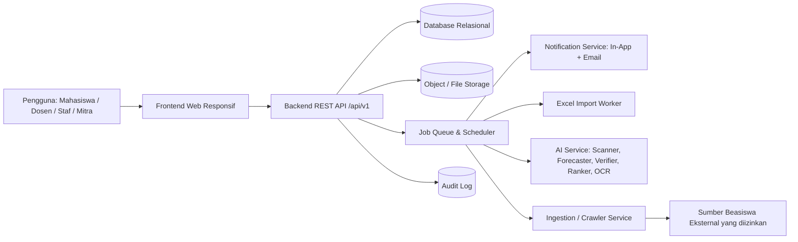
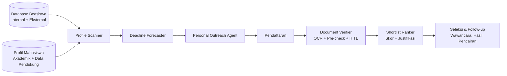
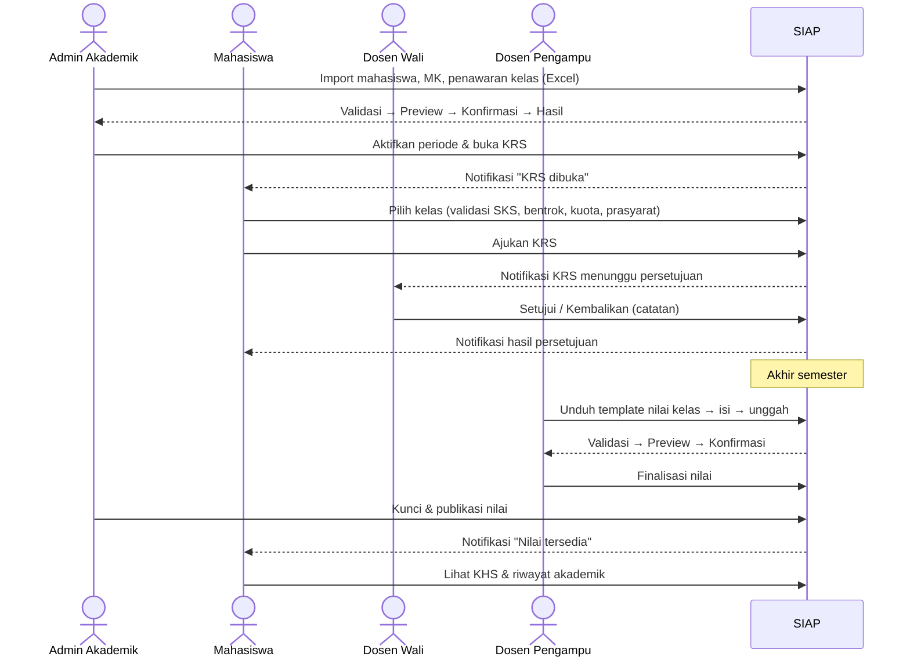
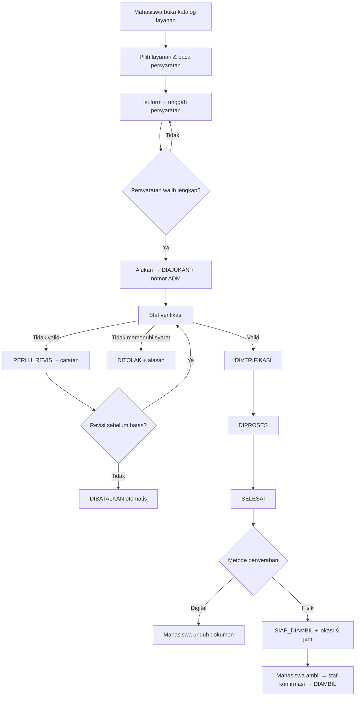
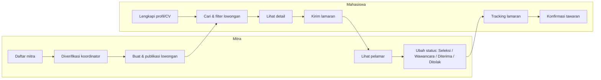
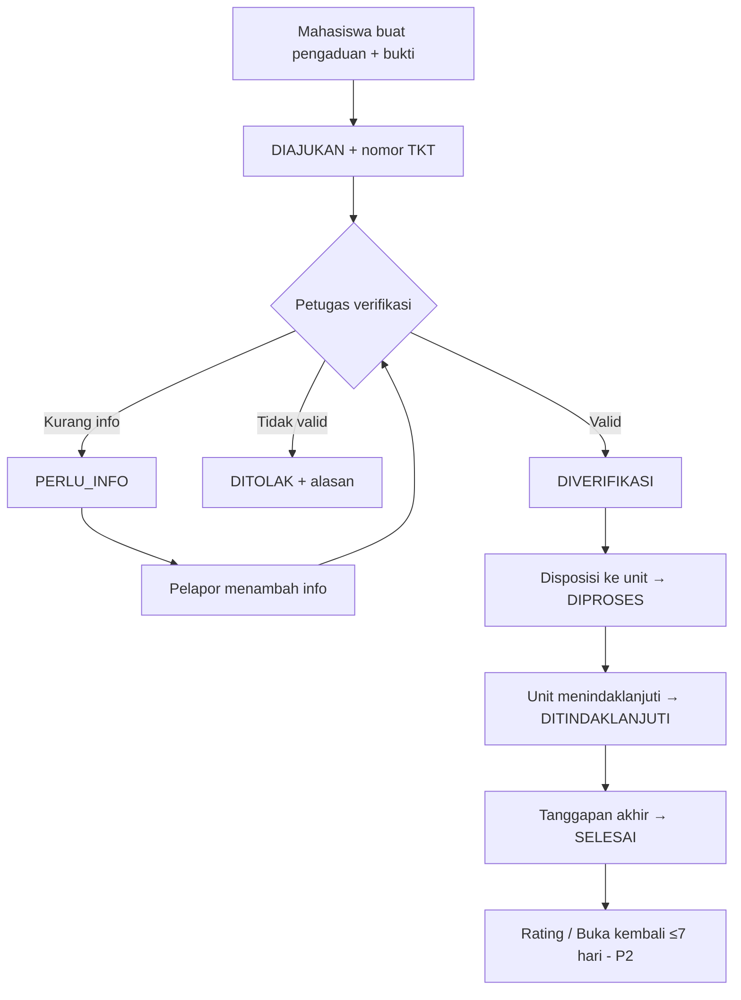
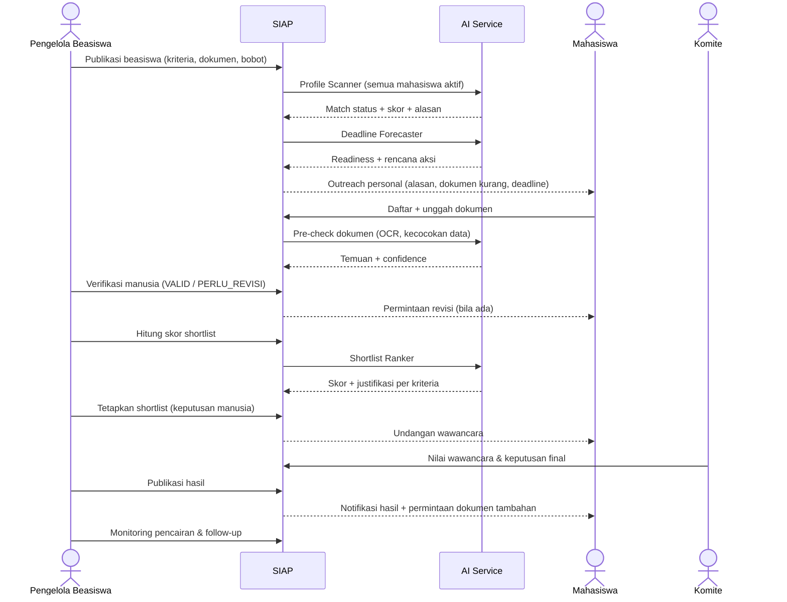
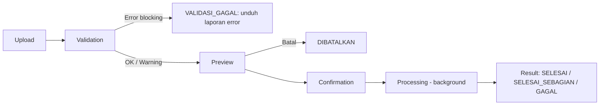

# PRD — SIAP (Sistem Informasi Akademik & Pelayanan)

> **Product Requirements Document**
> Platform terintegrasi SIAKAD dan Layanan Mahasiswa POLNES

---

## Daftar Isi

0. [Analisis Pra-PRD](#0-analisis-pra-prd)
1. [Document Information](#1-document-information)
2. [Product Overview](#2-product-overview)
3. [Background & Problem Statement](#3-background--problem-statement)
4. [Goals & Objectives](#4-goals--objectives)
5. [Non-Goals](#5-non-goals)
6. [Target Users & Personas](#6-target-users--personas)
7. [User Roles & Access Control](#7-user-roles--access-control)
8. [Product Scope](#8-product-scope)
9. [Functional Requirements](#9-functional-requirements)
10. [Detail Requirements Setiap Modul](#10-detail-requirements-setiap-modul)
11. [End-to-End User Flow](#11-end-to-end-user-flow)
12. [Business Rules](#12-business-rules)
13. [Data Requirements](#13-data-requirements)
14. [Database / ERD Requirements](#14-database--erd-requirements)
15. [API Requirements](#15-api-requirements)
16. [Non-Functional Requirements](#16-non-functional-requirements)
17. [Security Requirements](#17-security-requirements)
18. [Excel Import Requirements](#18-excel-import-requirements)
19. [AI Requirements](#19-ai-requirements)
20. [External Data / Crawling Requirements](#20-external-data--crawling-requirements)
21. [UI/UX Requirements](#21-uiux-requirements)
22. [Notification Matrix](#22-notification-matrix)
23. [Status & State Management](#23-status--state-management)
24. [Reporting & Analytics](#24-reporting--analytics)
25. [Audit Trail](#25-audit-trail)
26. [MVP Definition](#26-mvp-definition)
27. [Development Roadmap](#27-development-roadmap)
28. [Testing Requirements](#28-testing-requirements)
29. [Product Acceptance Criteria](#29-product-acceptance-criteria)
30. [Risk Analysis](#30-risk-analysis)
31. [Assumptions & Constraints](#31-assumptions--constraints)
32. [Open Questions](#32-open-questions)
33. [Definition of Done](#33-definition-of-done)
34. [Final Product Summary](#34-final-product-summary)

---

## Legenda Label Informasi

Dokumen ini membedakan sumber setiap pernyataan secara eksplisit:

| Label | Arti | Contoh Penggunaan |
|---|---|---|
| **[REQ]** | Requirement yang **diberikan langsung** oleh pemilik produk (brief awal). | KRS online, Excel import, tracking status layanan. |
| **[ASUMSI]** | Anggapan kerja tim penyusun agar desain dapat dilanjutkan. Harus dikonfirmasi, tetapi tidak menghambat pengembangan. | Kampus menggunakan email institusi. |
| **[REKOMENDASI]** | Usulan tim penyusun berdasarkan praktik terbaik; boleh diterima/ditolak. | Status `DIAMBIL` setelah `SIAP_DIAMBIL`. |
| **[PERLU VALIDASI]** | Informasi spesifik POLNES yang **belum tersedia** dan **wajib** dikonfirmasi ke pihak kampus sebelum diimplementasikan secara final. | Skala nilai, batas SKS, nama unit layanan. |

> [!IMPORTANT]
> Seluruh nilai default yang bersifat aturan kampus (batas SKS, skala nilai, SLA layanan, jenis layanan, kategori pengaduan, dsb.) dirancang **dapat dikonfigurasi** oleh admin sehingga keputusan final POLNES dapat diterapkan tanpa perubahan kode.

---

## 0. Analisis Pra-PRD

### 0.1 Analisis Masalah

| # | Masalah | Dampak | Sumber |
|---|---|---|---|
| P-01 | Mahasiswa harus datang ke kampus berkali-kali untuk mengurus layanan administrasi (pengajuan, cek status, pengambilan dokumen). | Waktu terbuang, antrean, kepastian status rendah. | [REQ] |
| P-02 | Fungsi akademik (SIAKAD) dan layanan mahasiswa berada di kanal terpisah / belum terintegrasi. | Data terfragmentasi, pengalaman pengguna tidak konsisten, input ganda. | [REQ] (konsep integrasi) — kondisi sistem eksisting [PERLU VALIDASI] |
| P-03 | Input data akademik dan nilai dilakukan manual / berulang. | Rentan salah ketik, lambat, sulit diaudit. | [REQ] (kebutuhan import Excel) |
| P-04 | Mahasiswa kesulitan mendapatkan tempat magang; mitra kesulitan menjangkau kandidat. | Keterlambatan magang, peluang kerja sama hilang. | [REQ] |
| P-05 | Pengaduan mahasiswa tidak memiliki kanal resmi yang terlacak (nomor tiket, status, tanggapan). | Pengaduan tidak tertangani, tidak ada akuntabilitas. | [REQ] |
| P-06 | Informasi beasiswa bersifat pasif (hanya daftar); mahasiswa yang layak sering tidak tahu atau terlambat menyiapkan dokumen. | Peluang beasiswa terlewat, beban verifikasi manual tinggi bagi pengelola. | [REQ] |
| P-07 | Notifikasi tersebar di berbagai kanal informal. | Informasi penting (deadline, perubahan status) terlewat. | [REQ] |
| P-08 | Data kuantitatif (jumlah mahasiswa, volume layanan, rata-rata waktu proses saat ini) belum tersedia. | Target KPI belum dapat dikalibrasi. | [PERLU VALIDASI] |

### 0.2 Analisis Stakeholder

| Stakeholder | Kepentingan | Pengaruh | Keterlibatan |
|---|---|---|---|
| Mahasiswa | Layanan cepat, transparan, dapat diakses dari mana saja. | Tinggi (pengguna utama) | Pengguna aktif, UAT |
| Dosen Wali / Pembimbing Akademik | Persetujuan KRS mudah, melihat progres mahasiswa bimbingan. | Sedang | Pengguna, UAT |
| Dosen Pengampu | Upload nilai cepat dan akurat. | Sedang | Pengguna |
| Bagian Akademik (nama unit [PERLU VALIDASI]) | Kelola data akademik, import, periode KRS. | Tinggi | Pengguna utama back-office, pemilik data akademik |
| Unit Layanan Administrasi (nama unit [PERLU VALIDASI]) | Mengelola pengajuan dokumen, mengurangi antrean. | Tinggi | Pengguna back-office |
| Unit Penanganan Pengaduan (nama unit [PERLU VALIDASI]) | Menangani pengaduan terstruktur. | Sedang | Pengguna back-office |
| Koordinator Magang / Unit Kerja Sama (nama unit [PERLU VALIDASI]) | Kurasi mitra dan lowongan. | Sedang | Pengguna back-office |
| Mitra Industri | Menjaring kandidat magang. | Sedang | Pengguna eksternal |
| Pengelola / Komite Beasiswa (nama unit [PERLU VALIDASI]) | Seleksi beasiswa efisien dan dapat diaudit. | Tinggi | Pengguna back-office, pengambil keputusan |
| Pimpinan (Direktur/Wakil Direktur/Ketua Jurusan) [PERLU VALIDASI struktur] | Data & laporan kinerja layanan. | Tinggi | Pembaca dashboard, sponsor |
| UPT TIK / Pengelola TI Kampus (nama unit [PERLU VALIDASI]) | Keamanan, infrastruktur, integrasi. | Tinggi | Deployment, operasional |
| Tim Pengembang (mahasiswa) | Scope realistis, dokumentasi jelas. | Sedang | Pembangun sistem |

### 0.3 Target Pengguna

- **Primer:** Mahasiswa aktif POLNES (jumlah [PERLU VALIDASI]).
- **Sekunder (internal):** Dosen wali, dosen pengampu, staf akademik, staf layanan, petugas pengaduan, koordinator magang, pengelola beasiswa.
- **Sekunder (eksternal):** Mitra industri/instansi penyedia magang.
- **Tersier:** Pimpinan (konsumen laporan), Super Admin/TI.

### 0.4 Kebutuhan Bisnis

| ID | Kebutuhan Bisnis | Sumber |
|---|---|---|
| KB-01 | Menyatukan SIAKAD dan layanan mahasiswa dalam satu platform. | [REQ] |
| KB-02 | Digitalisasi pengajuan layanan administrasi hingga pengambilan dokumen. | [REQ] |
| KB-03 | Mengurangi input manual data akademik melalui import Excel yang tervalidasi. | [REQ] |
| KB-04 | Memperluas akses mahasiswa ke peluang magang melalui ekosistem mitra. | [REQ] |
| KB-05 | Menyediakan kanal pengaduan resmi yang akuntabel. | [REQ] |
| KB-06 | Meningkatkan jumlah mahasiswa layak yang mendaftar beasiswa dan mempercepat seleksi secara auditable. | [REQ] |
| KB-07 | Menyediakan data operasional untuk pengambilan keputusan pimpinan. | [REKOMENDASI] |
| KB-08 | Kepatuhan terhadap perlindungan data pribadi (UU No. 27 Tahun 2022 tentang Pelindungan Data Pribadi). | [REKOMENDASI] — kebijakan internal kampus [PERLU VALIDASI] |

### 0.5 Kebutuhan Pengguna

| Pengguna | Kebutuhan Utama |
|---|---|
| Mahasiswa | Isi KRS online, lihat nilai/riwayat, ajukan layanan tanpa datang berulang, pantau status, cari magang, lapor masalah, dapat rekomendasi beasiswa yang relevan, satu pusat notifikasi. |
| Dosen Wali | Melihat dan menyetujui/menolak KRS mahasiswa bimbingan dengan catatan. |
| Dosen Pengampu | Upload nilai via Excel dengan preview dan validasi. |
| Staf Akademik | Kelola mata kuliah, periode, penawaran kelas, import data massal, riwayat import. |
| Staf Layanan | Antrean pengajuan, verifikasi persyaratan, ubah status, unggah dokumen hasil. |
| Petugas Pengaduan | Verifikasi, disposisi, tanggapan, tutup tiket. |
| Mitra | Buat lowongan, lihat & kelola pelamar. |
| Pengelola Beasiswa | Kelola database beasiswa, verifikasi dokumen dibantu sistem, shortlist dengan skor yang dapat dijelaskan, jadwal wawancara, monitoring pencairan. |
| Pimpinan | Dashboard ringkas lintas modul. |

### 0.6 Solusi yang Diusulkan

SIAP adalah aplikasi web responsif (mobile-friendly) dengan arsitektur modular:



**Rekomendasi teknologi** [REKOMENDASI] (dapat diganti sesuai kompetensi tim):

| Lapisan | Rekomendasi | Alternatif |
|---|---|---|
| Frontend | Next.js (React) + TypeScript, CSS Modules / Vanilla CSS | Vue/Nuxt, Laravel Blade/Inertia |
| Backend API | Laravel 11 (PHP 8.3) REST + Sanctum | NestJS (Node.js), Django REST |
| Database | PostgreSQL 16 | MySQL 8 / MariaDB |
| Queue/Cache | Redis | Database queue (untuk skala kecil) |
| File Storage | MinIO (S3-compatible) / disk privat server | Cloud S3 |
| AI/OCR Service | Python FastAPI + Tesseract/PaddleOCR + scikit-learn; LLM opsional | Rule engine di backend utama |
| Crawler | Python (Scrapy / httpx + BeautifulSoup), wajib cek robots.txt | Kurasi manual |
| Email | SMTP institusi [PERLU VALIDASI] | Layanan transactional email |
| Deployment | Docker Compose di server kampus [PERLU VALIDASI] | VPS |

### 0.7 Prioritas Fitur (Ringkas)

| Prioritas | Ringkasan |
|---|---|
| **P0 – Must Have** | Auth & RBAC, master data akademik, import Excel (mahasiswa, mata kuliah, nilai) dengan validasi-preview-konfirmasi, KRS + persetujuan, nilai/KHS/riwayat, layanan administrasi end-to-end, pengaduan end-to-end, magang inti, database beasiswa internal + Profile Scanner berbasis aturan + pendaftaran + checklist dokumen dengan verifikasi manusia, pusat notifikasi in-app, audit log. |
| **P1 – Should Have** | Email notification, reminder deadline, Deadline Forecaster, Shortlist Ranker, Personal Outreach Agent (berbasis template), kurasi beasiswa eksternal manual, wawancara & pengumuman, laporan & ekspor, viewer audit trail. |
| **P2 – Could Have** | OCR & AI pre-check dokumen, crawling beasiswa eksternal, monitoring pencairan, preferensi notifikasi, rekomendasi lowongan, rating & reopen pengaduan, cetak transkrip PDF. |
| **P3 – Future** | WhatsApp/push notification, aplikasi mobile native, SSO/integrasi SIAKAD eksisting & PDDikti, personalisasi pesan berbasis LLM, analitik prediktif. |

Detail lengkap di [Bagian 26](#26-mvp-definition).

### 0.8 Dependensi

| ID | Dependensi | Dampak Jika Tidak Terpenuhi | Status |
|---|---|---|---|
| D-01 | Data master mahasiswa, dosen, prodi, mata kuliah dari kampus (format Excel). | Modul akademik & beasiswa tidak dapat berjalan. | [PERLU VALIDASI] |
| D-02 | Aturan akademik resmi (skala nilai, batas SKS, prasyarat, periode KRS). | Validasi KRS/nilai tidak akurat. | [PERLU VALIDASI] |
| D-03 | Daftar jenis layanan administrasi beserta persyaratan & SLA. | Katalog layanan kosong. | [PERLU VALIDASI] |
| D-04 | Daftar kategori pengaduan & unit penanggung jawab. | Disposisi tidak dapat dilakukan. | [PERLU VALIDASI] |
| D-05 | Kriteria & bobot beasiswa internal. | Profile Scanner & Ranker tidak dapat dikonfigurasi. | [PERLU VALIDASI] |
| D-06 | Server/hosting & domain kampus, SMTP. | Deployment & email tertunda. | [PERLU VALIDASI] |
| D-07 | Izin penggunaan data pribadi mahasiswa untuk pemrosesan otomatis (profiling beasiswa). | Fitur proaktif beasiswa tidak boleh aktif. | [PERLU VALIDASI] |
| D-08 | Izin/ToS sumber beasiswa eksternal. | Crawling tidak boleh dilakukan; fallback kurasi manual. | [PERLU VALIDASI] |
| D-09 | Ketergantungan antar modul internal: Akademik → Beasiswa (IPK, semester), Akademik → Magang (prodi, semester), Notifikasi → semua modul. | Urutan pengembangan harus mengikuti dependensi ini. | Internal |

### 0.9 Risiko Utama (Ringkas)

Scope terlalu besar untuk tim mahasiswa; data akademik tidak tersedia/tidak bersih; kebocoran data pribadi; bias/kesalahan AI; crawling melanggar ToS; resistensi adopsi staf. Analisis lengkap di [Bagian 30](#30-risk-analysis).

### 0.10 Batasan Sistem

- SIAP **tidak** menjadi sumber kebenaran tunggal untuk data akademik resmi sampai ada keputusan kampus [PERLU VALIDASI]; pada MVP data akademik masuk melalui import Excel.
- SIAP **tidak** memproses pembayaran (UKT, biaya layanan).
- AI **tidak** mengambil keputusan final (verifikasi dokumen, penerimaan beasiswa).
- Crawling hanya untuk sumber yang diizinkan.
- Tanda tangan elektronik tersertifikasi pada dokumen resmi berada di luar scope MVP.

---

## 1. Document Information

| Atribut | Nilai |
|---|---|
| Nama Dokumen | Product Requirements Document — SIAP |
| Nama Produk | SIAP — Sistem Informasi Akademik & Pelayanan |
| Institusi | POLNES (Politeknik Negeri Samarinda) |
| Versi Dokumen | 1.0 (Draft untuk Validasi) |
| Tanggal | 4 Oktober 2026 |
| Status | Draft — menunggu validasi stakeholder kampus |
| Penyusun | Tim Produk SIAP (PM, SA, BA, UI/UX, Architect) |
| Pemilik Produk | [PERLU VALIDASI] |
| Reviewer | Perwakilan Akademik, Layanan, Kemahasiswaan, UPT TIK [PERLU VALIDASI] |
| Klasifikasi | Internal |
| Bahasa Antarmuka | Bahasa Indonesia |
| Zona Waktu Sistem | WITA (UTC+8) [ASUMSI: lokasi kampus di Samarinda] |

### 1.1 Riwayat Revisi

| Versi | Tanggal | Penulis | Perubahan |
|---|---|---|---|
| 0.1 | 2026-10-04 | Tim Produk | Analisis awal & kerangka |
| 1.0 | 2026-10-04 | Tim Produk | PRD lengkap untuk validasi |

### 1.2 Persetujuan

| Peran | Nama | Tanda Tangan | Tanggal |
|---|---|---|---|
| Product Owner | [PERLU VALIDASI] | | |
| Perwakilan Akademik | [PERLU VALIDASI] | | |
| Perwakilan UPT TIK | [PERLU VALIDASI] | | |
| Tech Lead | [PERLU VALIDASI] | | |

### 1.3 Glosarium

| Istilah | Definisi |
|---|---|
| SIAKAD | Sistem Informasi Akademik. |
| KRS | Kartu Rencana Studi — daftar mata kuliah yang direncanakan diambil pada satu semester. |
| KHS | Kartu Hasil Studi — hasil nilai per semester. |
| SKS | Satuan Kredit Semester. |
| IPS / IPK | Indeks Prestasi Semester / Kumulatif. |
| Dosen Wali / PA | Pembimbing akademik yang menyetujui KRS. |
| Mitra | Perusahaan/instansi penyedia lowongan magang. |
| HITL | Human-in-the-loop — manusia memvalidasi keluaran AI. |
| OCR | Optical Character Recognition. |
| SLA | Service Level Agreement — target waktu penyelesaian. |
| Readiness Score | Skor kesiapan mahasiswa terhadap suatu beasiswa (Deadline Forecaster). |
| Match Score | Skor kecocokan profil terhadap kriteria beasiswa (Profile Scanner). |
| Shortlist Score | Skor berbobot untuk membantu seleksi (Shortlist Ranker). |
| Import Batch | Satu sesi proses import file Excel. |
| RBAC | Role-Based Access Control. |

---

## 2. Product Overview

### 2.1 Ringkasan Produk

**SIAP** adalah platform web terintegrasi yang menggabungkan fungsi **SIAKAD** dan **layanan mahasiswa** POLNES dalam satu aplikasi [REQ]. SIAP mencakup enam modul:

| # | Modul | Deskripsi Singkat | Sumber |
|---|---|---|---|
| M1 | Akademik / SIAKAD | KRS online, mata kuliah, nilai, riwayat akademik, import Excel tervalidasi. | [REQ] |
| M2 | Layanan Administrasi | Pengajuan dokumen online, upload persyaratan, tracking, notifikasi siap diambil. | [REQ] |
| M3 | Magang | Marketplace lowongan magang antara mahasiswa dan mitra. | [REQ] |
| M4 | Pengaduan Mahasiswa | Tiket pengaduan dengan tracking & tindak lanjut. | [REQ] |
| M5 | Beasiswa Cerdas | Database beasiswa + agen proaktif (scanner, forecaster, outreach, verifier, ranker, seleksi & follow-up). | [REQ] |
| M6 | Notifikasi Terintegrasi | Satu pusat notifikasi lintas modul. | [REQ] |
| M0 | Platform Core | Autentikasi, RBAC, master data, audit, dashboard, laporan. | [REKOMENDASI] (diperlukan untuk menjalankan M1–M6) |

### 2.2 Value Proposition

| Untuk | Nilai |
|---|---|
| Mahasiswa | "Satu aplikasi untuk semua urusan kampus — dari KRS sampai beasiswa — dengan status yang selalu jelas." |
| Staf/Unit | "Antrean kerja terstruktur, data tervalidasi, dan jejak audit lengkap." |
| Mitra | "Akses langsung ke kandidat magang yang relevan." |
| Pimpinan | "Visibilitas real-time atas kinerja layanan." |

### 2.3 Prinsip Produk

1. **Transparansi status** — setiap transaksi memiliki status, riwayat, dan notifikasi.
2. **Validasi sebelum komit** — data massal selalu melalui preview & konfirmasi.
3. **AI sebagai asisten, bukan pengambil keputusan** — human-in-the-loop wajib.
4. **Konfigurasi, bukan hardcode** — aturan kampus dapat diatur admin.
5. **Privacy by design** — akses data minimum sesuai kebutuhan peran.
6. **Mobile-first untuk mahasiswa**, desktop-optimized untuk back-office.

---

## 3. Background & Problem Statement

### 3.1 Latar Belakang

Layanan akademik dan kemahasiswaan di perguruan tinggi umumnya melibatkan banyak unit dan proses yang masih bergantung pada kehadiran fisik, berkas kertas, dan komunikasi informal. Pemilik produk menyampaikan bahwa mahasiswa POLNES perlu dapat mengajukan layanan administrasi **tanpa harus datang berkali-kali ke kampus** [REQ], mahasiswa perlu dibantu **mendapatkan tempat magang** [REQ], dan sistem beasiswa perlu bersifat **proaktif** [REQ].

Kondisi sistem eksisting POLNES (apakah sudah ada SIAKAD, sistem apa yang digunakan, apakah memiliki API, bagaimana alur layanan saat ini) **belum tersedia** dalam brief [PERLU VALIDASI].

### 3.2 Problem Statement

> Mahasiswa POLNES membutuhkan satu kanal digital yang terintegrasi untuk urusan akademik dan layanan kemahasiswaan, karena proses saat ini (berdasarkan brief) menuntut kehadiran berulang, informasi status yang tidak pasti, data akademik yang diinput manual, akses peluang magang dan beasiswa yang terbatas, serta kanal pengaduan yang belum terlacak. Akibatnya waktu mahasiswa dan staf terbuang, peluang terlewat, dan akuntabilitas layanan sulit diukur.

### 3.3 Problem per Modul

| Modul | Problem | Solusi SIAP |
|---|---|---|
| Akademik | Input data & nilai manual, KRS rawan kesalahan. | Import Excel tervalidasi, KRS online dengan validasi aturan otomatis. |
| Administrasi | Datang berulang untuk cek status. | Pengajuan online, tracking, notifikasi selesai/siap diambil. |
| Magang | Mahasiswa sulit menemukan tempat; mitra sulit menjangkau. | Portal lowongan dua sisi. |
| Pengaduan | Tidak ada nomor tiket & tindak lanjut terukur. | Sistem tiket dengan status & SLA. |
| Beasiswa | Informasi pasif, verifikasi manual berat. | Agen proaktif + verifikasi terbantu + scoring dapat diaudit. |
| Notifikasi | Informasi tersebar. | Notification center terpadu. |

---

## 4. Goals & Objectives

### 4.1 Goals

| ID | Goal |
|---|---|
| G-01 | Menyediakan satu platform terpadu untuk akademik dan layanan mahasiswa. |
| G-02 | Mengurangi kebutuhan kunjungan fisik untuk layanan administrasi. |
| G-03 | Meningkatkan akurasi dan kecepatan input data akademik. |
| G-04 | Meningkatkan akses mahasiswa terhadap peluang magang. |
| G-05 | Menyediakan kanal pengaduan yang akuntabel dan terukur. |
| G-06 | Meningkatkan partisipasi mahasiswa layak dalam program beasiswa dan efisiensi seleksi. |
| G-07 | Menjamin keamanan dan privasi data. |

### 4.2 Objectives & KPI

> [!NOTE]
> Nilai target bersifat **[REKOMENDASI]** dan harus dikalibrasi setelah baseline kondisi saat ini diketahui **[PERLU VALIDASI]**.

| ID | Objective (terukur) | Metrik | Target Awal | Goal |
|---|---|---|---|---|
| OBJ-01 | Adopsi mahasiswa | % mahasiswa aktif yang login ≥1× per semester | ≥ 70% pada semester pertama go-live | G-01 |
| OBJ-02 | Pengajuan layanan online | % pengajuan layanan via SIAP dibanding total | ≥ 80% dalam 6 bulan | G-02 |
| OBJ-03 | Kunjungan fisik per layanan | Rata-rata kunjungan per pengajuan | ≤ 1 (hanya pengambilan dokumen fisik) | G-02 |
| OBJ-04 | Kualitas import | % baris import yang lolos validasi pada percobaan pertama | ≥ 95% setelah 2 siklus | G-03 |
| OBJ-05 | Waktu input nilai | Waktu dosen mengunggah nilai satu kelas | ≤ 5 menit | G-03 |
| OBJ-06 | Lowongan magang | Jumlah lowongan aktif per semester | Baseline [PERLU VALIDASI] +X% | G-04 |
| OBJ-07 | SLA pengaduan | % pengaduan diverifikasi dalam SLA | ≥ 90% | G-05 |
| OBJ-08 | Partisipasi beasiswa | % mahasiswa yang dinotifikasi layak lalu mendaftar | ≥ 30% | G-06 |
| OBJ-09 | Efisiensi verifikasi | Rata-rata waktu verifikasi per berkas beasiswa | Turun ≥ 40% dari baseline | G-06 |
| OBJ-10 | Keamanan | Insiden kebocoran data | 0 insiden kritis | G-07 |

---

## 5. Non-Goals

Hal-hal berikut **tidak** termasuk dalam scope produk (setidaknya hingga MVP + P2):

| ID | Non-Goal | Alasan |
|---|---|---|
| NG-01 | Pembayaran online (UKT, biaya layanan, payment gateway). | Kompleksitas regulasi & integrasi keuangan. |
| NG-02 | Pengganti penuh sistem keuangan/kepegawaian kampus. | Di luar domain. |
| NG-03 | Learning Management System (materi kuliah, tugas, ujian online). | Domain berbeda. |
| NG-04 | Penjadwalan kuliah otomatis (timetabling optimizer). | Kompleks; jadwal diimport. |
| NG-05 | Tanda tangan elektronik tersertifikasi (BSrE/PSrE) pada dokumen resmi. | Butuh integrasi resmi; P3. |
| NG-06 | Keputusan otomatis oleh AI untuk penerimaan beasiswa/validasi dokumen. | Wajib otoritas manusia. |
| NG-07 | Sinkronisasi otomatis ke PDDikti/Feeder. | Butuh akses resmi; P3 [PERLU VALIDASI]. |
| NG-08 | Crawling sumber yang tidak mengizinkan (robots.txt/ToS). | Etika & hukum. |
| NG-09 | Aplikasi mobile native pada MVP. | Web responsif cukup; P3. |
| NG-10 | Pencocokan otomatis (auto-placement) mahasiswa ke mitra magang. | Keputusan oleh mitra & mahasiswa. |

---

## 6. Target Users & Personas

### 6.1 Segmentasi Pengguna

| Segmen | Perangkat Dominan [ASUMSI] | Frekuensi | Literasi Digital [ASUMSI] |
|---|---|---|---|
| Mahasiswa | Smartphone | Harian–mingguan; puncak saat KRS | Tinggi |
| Dosen | Laptop + smartphone | Musiman (KRS, akhir semester) | Sedang |
| Staf back-office | Desktop | Harian | Sedang |
| Mitra | Laptop | Mingguan saat rekrutmen | Sedang–tinggi |
| Pimpinan | Laptop/tablet | Mingguan | Sedang |

### 6.2 Personas

> Persona berikut adalah **persona ilustratif [ASUMSI]**, bukan data riil POLNES.

#### Persona 1 — Rina, Mahasiswa Semester 5 (D3)
- **Tujuan:** Mengisi KRS tanpa bentrok, mengurus surat keterangan aktif kuliah untuk beasiswa, mencari tempat magang.
- **Frustrasi:** Harus bolak-balik ke bagian layanan hanya untuk tanya "sudah jadi belum?"; sering tahu info beasiswa saat deadline sudah dekat.
- **Kebutuhan dari SIAP:** Tracking status real-time, notifikasi dokumen siap diambil, rekomendasi beasiswa yang relevan dengan checklist dokumen.

#### Persona 2 — Pak Andi, Dosen Wali & Pengampu
- **Tujuan:** Menyetujui KRS 30 mahasiswa bimbingan dan mengunggah nilai 4 kelas.
- **Frustrasi:** Format nilai berbeda-beda, salah ketik NIM.
- **Kebutuhan:** Template Excel baku, preview dengan penanda error per baris, persetujuan KRS massal dengan catatan.

#### Persona 3 — Bu Sari, Staf Akademik
- **Tujuan:** Mengimport data mahasiswa baru dan mata kuliah tiap semester.
- **Frustrasi:** Data duplikat, sulit melacak siapa mengubah apa.
- **Kebutuhan:** Validasi berlapis, laporan error yang dapat diunduh, riwayat import dan audit trail.

#### Persona 4 — Mas Dedi, Staf Layanan Administrasi
- **Tujuan:** Memproses 50+ pengajuan surat per minggu.
- **Kebutuhan:** Antrean dengan filter status & SLA, checklist persyaratan, tombol ubah status cepat, unggah dokumen hasil.

#### Persona 5 — Ibu Maya, HR Mitra Industri
- **Tujuan:** Merekrut 5 mahasiswa magang bidang jaringan.
- **Kebutuhan:** Posting lowongan cepat, daftar kandidat dengan CV, ubah status kandidat, notifikasi otomatis ke kandidat.

#### Persona 6 — Pak Budi, Pengelola Beasiswa
- **Tujuan:** Menyeleksi 300 pendaftar untuk 40 kuota.
- **Frustrasi:** Memeriksa kelengkapan berkas satu per satu; sulit menjelaskan dasar peringkat.
- **Kebutuhan:** Pre-check dokumen, skor berbobot dengan justifikasi, keputusan final tetap di tangannya, log audit.

#### Persona 7 — Petugas Pengaduan
- **Tujuan:** Menyalurkan pengaduan ke unit yang tepat dan memastikan tindak lanjut.
- **Kebutuhan:** Dashboard tiket per kategori & SLA, disposisi, template tanggapan.

#### Persona 8 — Pimpinan
- **Tujuan:** Memantau kinerja layanan.
- **Kebutuhan:** Dashboard ringkas & laporan berkala.

---

## 7. User Roles & Access Control

### 7.1 Daftar Role

| Kode Role | Nama Role | Deskripsi | Scope Data |
|---|---|---|---|
| `MHS` | Mahasiswa | Pengguna utama layanan. | Data milik sendiri. |
| `DSN` | Dosen | Dosen pengampu; upload nilai kelas yang diampu. | Kelas yang diampu. |
| `DWL` | Dosen Wali | Menyetujui KRS mahasiswa bimbingan (role tambahan pada dosen). | Mahasiswa bimbingan. |
| `ADM_AKD` | Admin Akademik | Kelola master akademik, periode, import, koreksi nilai. | Seluruh / per jurusan [PERLU VALIDASI]. |
| `STF_LYN` | Staf Layanan Administrasi | Memproses pengajuan layanan. | Jenis layanan yang ditugaskan. |
| `PTG_ADU` | Petugas Pengaduan | Verifikasi & disposisi pengaduan. | Seluruh pengaduan (kecuali conflict of interest). |
| `UNIT_ADU` | Unit Penindak Lanjut | Menanggapi pengaduan yang didisposisikan. | Pengaduan yang didisposisikan ke unitnya. |
| `KRD_MGG` | Koordinator Magang | Verifikasi mitra, moderasi lowongan, monitoring. | Seluruh data magang. |
| `MTR` | Mitra | Kelola lowongan & pelamar sendiri. | Lowongan & pelamar milik mitra. |
| `ADM_BSW` | Pengelola Beasiswa | Kelola beasiswa, verifikasi dokumen, seleksi. | Beasiswa yang dikelola. |
| `KMT_BSW` | Komite/Penilai Beasiswa | Menilai wawancara, menetapkan keputusan. | Beasiswa yang ditugaskan. |
| `PMP` | Pimpinan | Read-only dashboard & laporan agregat. | Agregat (tanpa PII detail kecuali diizinkan). |
| `SUPER` | Super Admin | Kelola user, role, konfigurasi sistem. | Seluruh sistem (akses data sensitif dibatasi & dilog). |

**Catatan:** Satu pengguna dapat memiliki lebih dari satu role (mis. `DSN` + `DWL`) [REKOMENDASI].

### 7.2 Model Akses

- **RBAC** (role → permission) dikombinasikan dengan **scope/ownership check** (ABAC sederhana): mis. dosen hanya dapat mengunggah nilai untuk `kelas_kuliah` di mana ia tercatat sebagai pengampu.
- Permission dinamai `modul.resource.aksi` (contoh: `akademik.nilai.import`, `layanan.pengajuan.update_status`).

### 7.3 Matriks Akses (Ringkas)

Keterangan: **C**=Create, **R**=Read, **U**=Update, **D**=Delete/Arsip, **A**=Approve/Ubah Status, **O**=hanya milik sendiri/scope, **–**=tidak ada akses.

| Resource | MHS | DSN | DWL | ADM_AKD | STF_LYN | PTG_ADU | UNIT_ADU | KRD_MGG | MTR | ADM_BSW | KMT_BSW | PMP | SUPER |
|---|---|---|---|---|---|---|---|---|---|---|---|---|---|
| User & Role | R(O) | R(O) | R(O) | R | – | – | – | – | R(O) | – | – | – | CRUD |
| Mata Kuliah & Periode | R | R | R | CRUD | – | – | – | – | – | – | – | R | R |
| Penawaran Kelas | R | R(O) | R | CRUD | – | – | – | – | – | – | – | R | R |
| KRS | CRU(O) | – | R,A(O) | R,U | – | – | – | – | – | – | – | R(agg) | R |
| Nilai | R(O) | C,U(O)* | R(O) | CRUD,A | – | – | – | – | – | R(terbatas) | – | R(agg) | R |
| Import Excel | – | C,R(O) | – | C,R | – | – | – | – | – | C,R (beasiswa) | – | – | R |
| Pengajuan Layanan | CR(O),D** | – | – | – | R,U,A | – | – | – | – | – | – | R(agg) | R |
| Jenis Layanan | R | – | – | – | R | – | – | – | – | – | – | – | CRUD |
| Pengaduan | CR(O) | – | – | – | – | R,U,A | R,U(O) | – | – | – | – | R(agg) | R |
| Mitra | – | – | – | – | – | – | – | R,A | RU(O) | – | – | R(agg) | CRUD |
| Lowongan | R | – | – | – | – | – | – | R,A,D | CRUD(O) | – | – | R(agg) | R |
| Lamaran | CR(O),D** | – | – | – | – | – | – | R | R,A(O) | – | – | R(agg) | R |
| Beasiswa | R | – | – | – | – | – | – | – | – | CRUD | R(O) | R(agg) | R |
| Pendaftaran Beasiswa | CR(O),D** | – | – | – | – | – | – | – | – | R,A | R,A(O) | R(agg) | R |
| Notifikasi | R,U(O) | R,U(O) | R,U(O) | R,U(O) | R,U(O) | R,U(O) | R,U(O) | R,U(O) | R,U(O) | R,U(O) | R,U(O) | R,U(O) | R |
| Audit Log | – | – | – | R (modulnya) | – | – | – | – | – | R (modulnya) | – | – | R |
| Laporan | – | R(O) | R(O) | R | R | R | R(O) | R | R(O) | R | R(O) | R | R |

\* Hanya sebelum nilai dikunci; setelah dikunci melalui alur koreksi (lihat BR-018).
\** "D" untuk mahasiswa berarti **membatalkan** (bukan menghapus), sesuai aturan status masing-masing modul.

### 7.4 Aturan Akses Tambahan

- Akses `SUPER` ke data sensitif (nilai, dokumen pribadi) wajib tercatat di audit log dengan alasan akses [REKOMENDASI].
- `PMP` hanya melihat data agregat; akses detail per individu memerlukan permission tambahan [REKOMENDASI].
- `MTR` hanya melihat data pelamar yang melamar ke lowongannya dan hanya field yang diizinkan mahasiswa (lihat BR-044).

---

## 8. Product Scope

### 8.1 In-Scope (keseluruhan produk)

| Modul | In-Scope |
|---|---|
| M0 Core | Login, reset password, manajemen user/role, profil, master data (jurusan, prodi, periode), konfigurasi (status, kategori, jenis layanan), dashboard, laporan, audit log. |
| M1 Akademik | Mata kuliah, periode akademik, penawaran kelas, KRS + persetujuan dosen wali, import data akademik (mahasiswa, dosen, mata kuliah, penawaran kelas), import nilai, KHS, riwayat akademik/transkrip (tampilan), riwayat import. |
| M2 Administrasi | Katalog layanan, pengajuan, upload persyaratan, verifikasi, proses, unggah hasil, tracking, riwayat, notifikasi selesai/siap diambil. |
| M3 Magang | Registrasi & verifikasi mitra, CRUD lowongan, pencarian & filter, detail, profil/CV, lamaran, kelola pelamar, tracking. |
| M4 Pengaduan | Pembuatan tiket, kategori, lampiran, verifikasi, disposisi, tanggapan, tracking, riwayat. |
| M5 Beasiswa | Database internal & eksternal (kurasi manual + crawling terizin), Profile Scanner, Deadline Forecaster, Personal Outreach Agent, pendaftaran, Document Verifier (checklist, OCR, pre-check, revisi, HITL), Shortlist Ranker (explainable), wawancara, pengumuman, dokumen tambahan, monitoring pencairan, follow-up. |
| M6 Notifikasi | In-app notification center, email, reminder deadline, preferensi. |

### 8.2 Out-of-Scope

Lihat [Bagian 5 — Non-Goals](#5-non-goals).

### 8.3 Scope per Rilis

| Rilis | Isi | Referensi |
|---|---|---|
| MVP (P0) | Fitur inti seluruh modul (lihat Bagian 26). | Bagian 26 |
| Rilis 1.1 (P1) | Fitur cerdas beasiswa tahap 1, email, laporan. | Bagian 26 |
| Rilis 1.2 (P2) | OCR, crawling, pencairan, preferensi. | Bagian 26 |
| Future (P3) | Integrasi & kanal tambahan. | Bagian 26 |

---

---

## 9. Functional Requirements

### 9.1 Daftar Functional Requirement

| ID | Modul | Nama Fitur | Aktor Utama | Priority |
|---|---|---|---|---|
| FR-001 | Core | Login & Autentikasi | Semua | P0 |
| FR-002 | Core | Manajemen Pengguna & Role | SUPER | P0 |
| FR-003 | Core | Profil Pengguna & Data Diri Mahasiswa | Semua, MHS | P0 |
| FR-004 | Core | Reset & Ganti Password | Semua | P0 |
| FR-010 | Akademik | Pengelolaan Mata Kuliah | ADM_AKD | P0 |
| FR-011 | Akademik | Periode Akademik & Penawaran Kelas | ADM_AKD | P0 |
| FR-012 | Akademik | Pengisian KRS Online | MHS | P0 |
| FR-013 | Akademik | Persetujuan KRS oleh Dosen Wali | DWL | P0 |
| FR-014 | Akademik | Import Data Akademik via Excel | ADM_AKD | P0 |
| FR-015 | Akademik | Import Nilai via Excel | DSN, ADM_AKD | P0 |
| FR-016 | Akademik | Nilai & KHS | MHS, DSN, ADM_AKD | P0 |
| FR-017 | Akademik | Riwayat Akademik / Transkrip | MHS, DWL, ADM_AKD | P0 |
| FR-018 | Akademik | Riwayat Proses Import | ADM_AKD, DSN | P0 |
| FR-019 | Akademik | Data Akademik Mahasiswa (Master) | ADM_AKD | P0 |
| FR-020 | Administrasi | Katalog Jenis Layanan | MHS, SUPER, STF_LYN | P0 |
| FR-021 | Administrasi | Pengajuan Dokumen | MHS | P0 |
| FR-022 | Administrasi | Upload Persyaratan | MHS | P0 |
| FR-023 | Administrasi | Verifikasi & Pemrosesan Pengajuan | STF_LYN | P0 |
| FR-024 | Administrasi | Tracking Status Pengajuan | MHS | P0 |
| FR-025 | Administrasi | Riwayat Pengajuan | MHS, STF_LYN | P0 |
| FR-030 | Magang | Registrasi & Verifikasi Mitra | MTR, KRD_MGG | P0 |
| FR-031 | Magang | Pengelolaan Lowongan | MTR, KRD_MGG | P0 |
| FR-032 | Magang | Pencarian & Filter Lowongan | MHS | P0 |
| FR-033 | Magang | Detail Lowongan | MHS | P0 |
| FR-034 | Magang | Profil / CV Mahasiswa | MHS | P0 |
| FR-035 | Magang | Kirim Lamaran | MHS | P0 |
| FR-036 | Magang | Kelola Pelamar & Ubah Status Kandidat | MTR | P0 |
| FR-037 | Magang | Tracking Status Lamaran | MHS | P0 |
| FR-038 | Magang | Rekomendasi Lowongan Berbasis Profil | MHS | P2 |
| FR-040 | Pengaduan | Membuat Pengaduan | MHS | P0 |
| FR-041 | Pengaduan | Verifikasi & Disposisi Pengaduan | PTG_ADU | P0 |
| FR-042 | Pengaduan | Tanggapan & Tindak Lanjut | UNIT_ADU, PTG_ADU | P0 |
| FR-043 | Pengaduan | Tracking & Riwayat Pengaduan | MHS | P0 |
| FR-044 | Pengaduan | Penilaian Kepuasan & Buka Kembali Tiket | MHS | P2 |
| FR-050 | Beasiswa | Database Beasiswa Internal | ADM_BSW | P0 |
| FR-051 | Beasiswa | Kurasi Beasiswa Eksternal (Manual) | ADM_BSW | P1 |
| FR-052 | Beasiswa | Ingestion / Crawling Beasiswa Eksternal | Sistem, ADM_BSW | P2 |
| FR-053 | Beasiswa | Profile Scanner | Sistem, MHS | P0 |
| FR-054 | Beasiswa | Deadline Forecaster | Sistem, MHS | P1 |
| FR-055 | Beasiswa | Personal Outreach Agent | Sistem | P1 |
| FR-056 | Beasiswa | Pendaftaran Beasiswa | MHS | P0 |
| FR-057 | Beasiswa | Document Verifier | Sistem, ADM_BSW | P0 (checklist + HITL) / P2 (OCR & AI pre-check) |
| FR-058 | Beasiswa | Shortlist Ranker | Sistem, ADM_BSW | P1 |
| FR-059 | Beasiswa | Penjadwalan Wawancara | ADM_BSW, KMT_BSW | P1 |
| FR-060 | Beasiswa | Pengumuman Hasil & Permintaan Dokumen Tambahan | ADM_BSW, KMT_BSW | P1 |
| FR-061 | Beasiswa | Monitoring Pencairan & Follow-up | ADM_BSW | P2 |
| FR-070 | Notifikasi | Pusat Notifikasi In-App | Semua | P0 |
| FR-071 | Notifikasi | Notifikasi Email | Sistem | P1 |
| FR-072 | Notifikasi | Preferensi Notifikasi | Semua | P2 |
| FR-073 | Notifikasi | Reminder Deadline Terjadwal | Sistem | P1 |
| FR-080 | Core | Dashboard per Role | Semua | P0 |
| FR-081 | Core | Laporan & Ekspor | Back-office, PMP | P1 |
| FR-082 | Core | Audit Trail Viewer | SUPER, Admin modul | P1 |
| FR-083 | Core | Konfigurasi Master Data & Aturan | SUPER, ADM_AKD | P0 |

> [!NOTE]
> Penomoran FR sengaja diberi celah per modul (001–009 Core, 010–019 Akademik, 020–029 Administrasi, 030–039 Magang, 040–049 Pengaduan, 050–069 Beasiswa, 070–079 Notifikasi, 080–089 Core lanjutan) agar penambahan fitur tidak mengacak ID.

---

## 10. Detail Requirements Setiap Modul

### 10.0 Modul Core (M0)

#### FR-001 — Login & Autentikasi

- **Nama fitur:** Login & Autentikasi
- **Tujuan:** Memastikan hanya pengguna sah yang dapat mengakses SIAP sesuai role.
- **Aktor:** Semua pengguna.
- **Deskripsi:** Login menggunakan identitas (NIM untuk mahasiswa, NIP/NIDN/username untuk dosen & staf [PERLU VALIDASI format], email untuk mitra) dan password. Setelah login, sistem menerbitkan sesi/token dan mengarahkan ke dashboard sesuai role. Jika pengguna memiliki >1 role, pengguna dapat berpindah role aktif.
- **User Story:** As a pengguna SIAP, I want login dengan akun saya, so that saya dapat mengakses layanan sesuai peran saya.
- **Preconditions:** Akun berstatus `AKTIF`.
- **Trigger:** Pengguna membuka halaman login dan menekan "Masuk".
- **Main Flow:**
  1. Pengguna memasukkan identitas & password.
  2. Sistem memvalidasi format input.
  3. Sistem memverifikasi kredensial (hash).
  4. Sistem membuat sesi/token, mencatat `last_login_at` dan audit log `AUTH_LOGIN_SUCCESS`.
  5. Sistem mengarahkan ke dashboard role default.
- **Alternative Flow:**
  - A1: Akun wajib ganti password (login pertama/akun hasil import) → diarahkan ke halaman ganti password (FR-004).
  - A2: Multi-role → tampil pemilih role aktif.
- **Exception Flow:**
  - E1: Kredensial salah → pesan generik "Identitas atau password salah" (tanpa menyebut mana yang salah).
  - E2: 5× gagal dalam 15 menit → akun dikunci sementara 15 menit (SEC-005).
  - E3: Akun `NONAKTIF`/`DIBLOKIR` → pesan akun tidak aktif, hubungi admin.
- **Input:** `identifier` (string, wajib), `password` (string, wajib).
- **Process:** Rate limit check → lookup user → verifikasi hash → cek status → issue token → audit.
- **Output:** Token/sesi, profil ringkas, daftar role & permission.
- **Business Rules:** BR-001.
- **Validation:** Identifier 3–100 karakter; password tidak kosong; maksimal percobaan sesuai SEC-005.
- **Acceptance Criteria:**
  - AC1: Given akun aktif dan kredensial benar, When pengguna menekan "Masuk", Then pengguna diarahkan ke dashboard sesuai role dan audit `AUTH_LOGIN_SUCCESS` tercatat.
  - AC2: Given kredensial salah, When login, Then pesan error generik tampil dan audit `AUTH_LOGIN_FAILED` tercatat.
  - AC3: Given 5 kegagalan dalam 15 menit, When percobaan ke-6, Then akun terkunci 15 menit.
  - AC4: Given akun dengan flag `must_change_password`, When login berhasil, Then pengguna wajib mengganti password sebelum mengakses fitur lain.
- **Priority:** P0

#### FR-002 — Manajemen Pengguna & Role

- **Nama fitur:** Manajemen Pengguna & Role
- **Tujuan:** Mengelola akun, role, dan permission secara terpusat.
- **Aktor:** SUPER (penuh); ADM_AKD (membuat akun mahasiswa/dosen via import).
- **Deskripsi:** CRUD pengguna, penetapan role (multi-role), aktivasi/nonaktivasi, reset password oleh admin, penetapan scope (prodi/unit/jenis layanan).
- **User Story:** As a Super Admin, I want mengelola akun dan role, so that setiap pengguna hanya memiliki akses sesuai tugasnya.
- **Preconditions:** Login sebagai SUPER.
- **Trigger:** Admin membuka menu "Pengguna".
- **Main Flow:**
  1. Admin mencari/menyaring pengguna.
  2. Admin menambah/mengubah pengguna dan menetapkan role + scope.
  3. Sistem memvalidasi keunikan identifier & email.
  4. Sistem menyimpan, mengirim notifikasi aktivasi (jika akun baru), mencatat audit.
- **Alternative Flow:** A1: Akun mahasiswa/dosen dibuat massal melalui import (FR-014) dengan flag `must_change_password`.
- **Exception Flow:** E1: Identifier/email duplikat → ditolak. E2: Upaya menghapus role SUPER terakhir → ditolak.
- **Input:** nama, identifier, email, role[], scope[], status.
- **Process:** Validasi → simpan → assign role → audit `USER_CREATED/UPDATED/ROLE_CHANGED`.
- **Output:** Data pengguna tersimpan.
- **Business Rules:** BR-001, BR-002, BR-008.
- **Validation:** Email format valid & unik; minimal 1 role; scope wajib untuk role ber-scope (STF_LYN, UNIT_ADU, ADM_AKD per jurusan bila diterapkan).
- **Acceptance Criteria:**
  - AC1: Given admin mengisi data valid, When menyimpan, Then akun dibuat dengan status `AKTIF` dan audit tercatat.
  - AC2: Given pengguna dinonaktifkan, When pengguna itu mencoba login, Then akses ditolak dan sesi aktifnya dicabut.
  - AC3: Given perubahan role, When disimpan, Then permission baru berlaku pada request berikutnya.
- **Priority:** P0

#### FR-003 — Profil Pengguna & Data Diri Mahasiswa

- **Nama fitur:** Profil Pengguna
- **Tujuan:** Menyediakan data diri yang akurat untuk layanan, magang, dan beasiswa.
- **Aktor:** Semua; MHS (field tambahan).
- **Deskripsi:** Pengguna melihat profil. Mahasiswa dapat memperbarui data kontak dan data pendukung beasiswa (mis. penghasilan orang tua, jumlah tanggungan, prestasi, organisasi) [REKOMENDASI; field final PERLU VALIDASI]. Data akademik resmi (NIM, prodi, IPK, semester) **read-only** bagi mahasiswa.
- **User Story:** As a mahasiswa, I want memperbarui data diri dan data pendukung, so that rekomendasi beasiswa dan lamaran magang saya akurat.
- **Preconditions:** Login.
- **Trigger:** Membuka menu "Profil".
- **Main Flow:** 1) Lihat profil; 2) Edit field yang diizinkan; 3) Validasi; 4) Simpan; 5) Sistem memicu re-scan Profile Scanner (FR-053) bila field relevan berubah.
- **Alternative Flow:** A1: Unggah foto profil.
- **Exception Flow:** E1: Field tidak valid → pesan per field.
- **Input:** no HP, email pribadi, alamat, data ekonomi (opsional), prestasi[], organisasi[], foto.
- **Process:** Validasi → simpan → audit perubahan (nilai lama/baru untuk field sensitif disamarkan di log).
- **Output:** Profil ter-update; persentase kelengkapan profil.
- **Business Rules:** BR-006, BR-069.
- **Validation:** No HP format Indonesia (`^(\+62|0)8[0-9]{8,12}$`); foto JPG/PNG ≤ 2 MB.
- **Acceptance Criteria:**
  - AC1: Given mahasiswa mengubah no HP valid, When menyimpan, Then data tersimpan dan indikator kelengkapan diperbarui.
  - AC2: Given mahasiswa mencoba mengubah IPK via API, When request dikirim, Then sistem menolak dengan 403.
  - AC3: Given data pendukung beasiswa berubah, When disimpan, Then job re-scan beasiswa dijadwalkan.
- **Priority:** P0

#### FR-004 — Reset & Ganti Password

- **Nama fitur:** Reset & Ganti Password
- **Tujuan:** Memulihkan akses secara aman.
- **Aktor:** Semua.
- **Deskripsi:** Lupa password via tautan reset ke email terdaftar (token sekali pakai, kedaluwarsa 30 menit). Ganti password dari profil dengan verifikasi password lama.
- **User Story:** As a pengguna, I want mereset password saat lupa, so that saya tetap bisa mengakses SIAP tanpa datang ke admin.
- **Preconditions:** Email terdaftar (untuk reset mandiri).
- **Trigger:** Klik "Lupa Password" / menu "Ganti Password".
- **Main Flow:** 1) Masukkan identifier; 2) Sistem selalu menampilkan pesan netral "Jika akun terdaftar, tautan dikirim"; 3) Email berisi tautan bertoken; 4) Pengguna menetapkan password baru; 5) Semua sesi lama dicabut.
- **Alternative Flow:** A1: Tidak punya email → reset oleh admin (FR-002), password sementara + `must_change_password`.
- **Exception Flow:** E1: Token kedaluwarsa/terpakai → minta ulang. E2: Password tidak memenuhi kebijakan → ditolak.
- **Input:** identifier; token; password baru; konfirmasi.
- **Process:** Generate token acak (hash disimpan) → kirim email → verifikasi → hash password baru → revoke sesi → audit.
- **Output:** Password diperbarui.
- **Business Rules:** —
- **Validation:** Kebijakan password SEC-003.
- **Acceptance Criteria:**
  - AC1: Given token valid, When password baru memenuhi kebijakan, Then password diperbarui dan semua sesi lama dicabut.
  - AC2: Given identifier tidak terdaftar, When meminta reset, Then pesan yang sama dengan akun terdaftar ditampilkan (anti-enumerasi).
  - AC3: Given token >30 menit, When digunakan, Then ditolak.
- **Priority:** P0

---

### 10.1 Modul Akademik / SIAKAD (M1)

> [!IMPORTANT]
> Aturan akademik POLNES (skala nilai, batas SKS, prasyarat, mekanisme perubahan KRS, mekanisme mengulang) **[PERLU VALIDASI]**. Semua aturan diimplementasikan sebagai konfigurasi (FR-083).

#### FR-010 — Pengelolaan Mata Kuliah

- **Nama fitur:** Pengelolaan Mata Kuliah
- **Tujuan:** Menyediakan katalog mata kuliah per kurikulum & prodi.
- **Aktor:** ADM_AKD.
- **Deskripsi:** CRUD mata kuliah: kode, nama, SKS (teori/praktik [PERLU VALIDASI]), semester rekomendasi, prodi, kurikulum, jenis (wajib/pilihan), prasyarat (opsional), status aktif. Dapat juga diisi via import (FR-014).
- **User Story:** As an admin akademik, I want mengelola data mata kuliah, so that KRS dan nilai mengacu pada katalog yang benar.
- **Preconditions:** Prodi & kurikulum sudah ada (FR-083).
- **Trigger:** Menu "Mata Kuliah".
- **Main Flow:** 1) Cari/filter; 2) Tambah/ubah; 3) Validasi keunikan kode per kurikulum; 4) Simpan; 5) Audit.
- **Alternative Flow:** A1: Import massal via FR-014. A2: Nonaktifkan mata kuliah (tidak dihapus jika sudah dipakai).
- **Exception Flow:** E1: Kode duplikat dalam kurikulum sama → ditolak. E2: Prasyarat melingkar (A→B→A) → ditolak.
- **Input:** kode, nama, sks, semester, prodi_id, kurikulum_id, jenis, prasyarat_ids[].
- **Process:** Validasi → simpan → audit.
- **Output:** Mata kuliah tersimpan.
- **Business Rules:** BR-008, BR-013.
- **Validation:** Kode alfanumerik 3–20; SKS 1–6 [PERLU VALIDASI]; semester 1–8.
- **Acceptance Criteria:**
  - AC1: Given data valid, When disimpan, Then mata kuliah tampil di katalog prodi terkait.
  - AC2: Given mata kuliah sudah memiliki nilai/KRS, When admin menghapus, Then sistem hanya mengizinkan nonaktif (soft delete).
  - AC3: Given prasyarat membentuk siklus, When disimpan, Then sistem menolak dengan pesan jelas.
- **Priority:** P0

#### FR-011 — Periode Akademik & Penawaran Kelas

- **Nama fitur:** Periode Akademik & Penawaran Kelas
- **Tujuan:** Mengatur semester aktif, jadwal pengisian KRS, dan kelas yang ditawarkan.
- **Aktor:** ADM_AKD.
- **Deskripsi:** Admin membuat periode (tahun akademik + ganjil/genap), menetapkan rentang tanggal KRS, perubahan KRS, input nilai. Admin membuat penawaran kelas: mata kuliah, nama kelas, dosen pengampu, kuota, jadwal (hari, jam, ruang).
- **User Story:** As an admin akademik, I want menetapkan periode dan kelas yang ditawarkan, so that mahasiswa dapat mengisi KRS pada waktu dan kelas yang tepat.
- **Preconditions:** Mata kuliah & dosen tersedia.
- **Trigger:** Menu "Periode" / "Penawaran Kelas".
- **Main Flow:** 1) Buat periode + rentang tanggal; 2) Aktifkan periode (hanya satu periode aktif); 3) Tambah kelas (manual atau import); 4) Publikasikan penawaran.
- **Alternative Flow:** A1: Salin penawaran dari periode sebelumnya.
- **Exception Flow:** E1: Rentang tanggal tidak logis → ditolak. E2: Jadwal dosen bentrok → peringatan (blocking/non-blocking dapat dikonfigurasi).
- **Input:** tahun_akademik, semester_tipe, tgl_krs_mulai/selesai, tgl_perubahan_mulai/selesai, tgl_nilai_mulai/selesai; kelas: mk_id, nama_kelas, dosen_id[], kuota, jadwal[].
- **Process:** Validasi → simpan → jadwalkan notifikasi pembukaan KRS (FR-073).
- **Output:** Periode aktif & daftar kelas.
- **Business Rules:** BR-004, BR-010, BR-014.
- **Validation:** Hanya satu periode `AKTIF`; kuota > 0.
- **Acceptance Criteria:**
  - AC1: Given periode baru diaktifkan, When disimpan, Then periode sebelumnya otomatis berstatus `SELESAI`.
  - AC2: Given penawaran dipublikasi, When mahasiswa membuka KRS dalam rentang tanggal, Then kelas tampil.
- **Priority:** P0

#### FR-012 — Pengisian KRS Online

- **Nama fitur:** KRS Online
- **Tujuan:** Mahasiswa merencanakan studi secara mandiri dengan validasi otomatis.
- **Aktor:** MHS.
- **Deskripsi:** Mahasiswa memilih kelas dari penawaran, sistem menampilkan total SKS, batas SKS, deteksi bentrok jadwal, prasyarat, kuota. KRS disimpan sebagai `DRAFT` lalu diajukan ke dosen wali.
- **User Story:** As a mahasiswa, I want mengisi KRS secara online dengan pengecekan otomatis, so that saya tidak salah memilih mata kuliah dan tidak perlu datang ke kampus.
- **Preconditions:** Status mahasiswa `AKTIF` (BR-016); periode KRS dibuka (BR-010); memiliki dosen wali.
- **Trigger:** Menu "KRS".
- **Main Flow:**
  1. Sistem menampilkan batas SKS (BR-011) dan kelas yang tersedia untuk prodi/semester.
  2. Mahasiswa menambah/menghapus kelas; sistem memvalidasi real-time (bentrok, kuota, prasyarat, duplikasi, batas SKS).
  3. Mahasiswa menyimpan `DRAFT`.
  4. Mahasiswa menekan "Ajukan" → status `DIAJUKAN`; kuota dikunci (reservasi).
  5. Notifikasi ke dosen wali.
- **Alternative Flow:**
  - A1: KRS `PERLU_REVISI` (ditolak dosen wali) → mahasiswa mengubah lalu mengajukan ulang.
  - A2: Mahasiswa menarik pengajuan sebelum disetujui → kembali `DRAFT`.
- **Exception Flow:**
  - E1: Kuota penuh saat pengajuan (race condition) → kelas tersebut ditolak, mahasiswa diminta memilih kelas lain.
  - E2: Periode KRS ditutup → form read-only.
  - E3: Status mahasiswa tidak aktif → akses KRS ditolak dengan alasan.
- **Input:** periode_id, kelas_kuliah_id[].
- **Process:** Validasi aturan → reservasi kuota secara atomik (transaksi + row lock) → simpan → status history → notifikasi.
- **Output:** KRS berstatus `DIAJUKAN`, ringkasan total SKS, dapat dicetak (PDF P2).
- **Business Rules:** BR-010, BR-011, BR-012, BR-013, BR-014, BR-015, BR-016.
- **Validation:** Total SKS ≤ batas; tidak ada bentrok; prasyarat lulus; kuota tersedia; tidak ada MK ganda.
- **Acceptance Criteria:**
  - AC1: Given periode KRS terbuka dan mahasiswa aktif, When memilih kelas tanpa konflik dan mengajukan, Then status KRS menjadi `DIAJUKAN` dan dosen wali menerima notifikasi.
  - AC2: Given dua kelas berjadwal bentrok, When mahasiswa menambah kelas kedua, Then sistem menolak dan menunjukkan kelas yang bentrok.
  - AC3: Given total SKS melebihi batas, When mengajukan, Then pengajuan ditolak dengan info batas SKS.
  - AC4: Given sisa kuota 1 dan dua mahasiswa mengajukan bersamaan, When diproses, Then hanya satu yang berhasil dan kuota tidak pernah negatif.
- **Priority:** P0

#### FR-013 — Persetujuan KRS oleh Dosen Wali

- **Nama fitur:** Persetujuan KRS
- **Tujuan:** Dosen wali memvalidasi rencana studi mahasiswa bimbingan.
- **Aktor:** DWL.
- **Deskripsi:** Dosen wali melihat daftar KRS bimbingan (filter status), melihat detail + riwayat akademik ringkas, menyetujui atau mengembalikan untuk revisi dengan catatan. Mendukung persetujuan massal untuk KRS tanpa peringatan.
- **User Story:** As a dosen wali, I want menyetujui atau mengembalikan KRS mahasiswa bimbingan dengan catatan, so that rencana studi mereka sesuai aturan dan kemampuan akademik.
- **Preconditions:** KRS berstatus `DIAJUKAN`; dosen adalah wali mahasiswa tersebut.
- **Trigger:** Notifikasi / menu "Persetujuan KRS".
- **Main Flow:** 1) Buka daftar; 2) Lihat detail; 3) Pilih "Setujui" → status `DISETUJUI`, KRS terkunci; 4) Notifikasi ke mahasiswa.
- **Alternative Flow:** A1: "Kembalikan" dengan catatan wajib → `PERLU_REVISI`, kuota reservasi tetap dipegang hingga batas periode [REKOMENDASI]. A2: Persetujuan massal.
- **Exception Flow:** E1: Dosen bukan wali → 403. E2: Periode persetujuan lewat → mengikuti kebijakan [PERLU VALIDASI].
- **Input:** krs_id[], aksi (`APPROVE`/`RETURN`), catatan.
- **Process:** Cek scope → transisi status → history → notifikasi → audit.
- **Output:** Status KRS ter-update.
- **Business Rules:** BR-007, BR-015, BR-024.
- **Validation:** Catatan wajib saat `RETURN` (min 10 karakter).
- **Acceptance Criteria:**
  - AC1: Given KRS `DIAJUKAN`, When dosen wali menyetujui, Then status `DISETUJUI`, KRS tidak dapat diubah mahasiswa, dan mahasiswa menerima notifikasi.
  - AC2: Given dosen mengembalikan tanpa catatan, When submit, Then sistem menolak.
  - AC3: Given dosen membuka KRS mahasiswa yang bukan bimbingannya, When request dikirim, Then respons 403.
- **Priority:** P0

#### FR-014 — Import Data Akademik via Excel

- **Nama fitur:** Import Data Akademik
- **Tujuan:** Memasukkan data akademik massal secara cepat dan tervalidasi.
- **Aktor:** ADM_AKD.
- **Deskripsi:** Mendukung tipe import: Mahasiswa, Dosen, Mata Kuliah, Penawaran Kelas, Relasi Dosen Wali, Riwayat Nilai Historis [REKOMENDASI]. Mengikuti alur wajib **Upload → Validation → Preview → Confirmation → Processing → Result** (detail di Bagian 18).
- **User Story:** As an admin akademik, I want mengimport data akademik dari Excel dengan validasi dan preview, so that data masuk cepat tanpa merusak data yang sudah ada.
- **Preconditions:** Template versi aktif diunduh dari SIAP; data referensi (prodi, kurikulum) sudah ada.
- **Trigger:** Menu "Import Data" → pilih tipe → unggah file.
- **Main Flow:**
  1. Admin memilih tipe import & mode (insert-only / upsert).
  2. Unggah `.xlsx` → status batch `DIUNGGAH`.
  3. Sistem memvalidasi (file, struktur, baris, referensi, duplikasi) → `SIAP_PREVIEW` atau `VALIDASI_GAGAL`.
  4. Preview: ringkasan (total, valid, error, warning, akan insert, akan update) + tabel baris dengan penanda error.
  5. Admin mengonfirmasi → `DIKONFIRMASI` → worker memproses (`DIPROSES`).
  6. Hasil: `SELESAI` / `SELESAI_SEBAGIAN` / `GAGAL`, laporan dapat diunduh, notifikasi ke admin.
- **Alternative Flow:** A1: Admin membatalkan di tahap preview → `DIBATALKAN`. A2: Mode parsial (jika diizinkan untuk tipe ini) → hanya baris valid diproses.
- **Exception Flow:** E1: Bukan .xlsx / >5 MB / template tidak cocok → ditolak di tahap upload. E2: Worker gagal di tengah → transaksi di-rollback, status `GAGAL`, dapat diulang. E3: File hash sama dengan batch sukses sebelumnya → peringatan duplikasi (BR-022).
- **Input:** tipe_import, mode, file.
- **Process:** Lihat Bagian 18.
- **Output:** Data tersimpan; import batch + laporan error.
- **Business Rules:** BR-002, BR-020, BR-021, BR-022.
- **Validation:** Lihat Bagian 18.4.
- **Acceptance Criteria:**
  - AC1: Given file sesuai template tanpa error, When admin mengonfirmasi, Then semua baris tersimpan dan status `SELESAI`.
  - AC2: Given file mengandung NIM duplikat, When divalidasi, Then baris tersebut ditandai error dengan nomor baris, kolom, dan pesan.
  - AC3: Given status `SIAP_PREVIEW`, When admin belum mengonfirmasi, Then tidak ada data yang tersimpan ke tabel utama.
  - AC4: Given import mahasiswa sukses, When selesai, Then akun pengguna mahasiswa dibuat dengan `must_change_password = true`.
- **Priority:** P0

#### FR-015 — Import Nilai via Excel

- **Nama fitur:** Import Nilai
- **Tujuan:** Dosen mengunggah nilai satu kelas secara cepat dan akurat.
- **Aktor:** DSN (kelas yang diampu), ADM_AKD (semua kelas).
- **Deskripsi:** Dosen mengunduh template nilai **yang sudah terisi daftar mahasiswa** kelas tersebut (dari KRS `DISETUJUI`), mengisi komponen nilai (mis. tugas, UTS, UAS — komponen & bobot [PERLU VALIDASI]) atau nilai akhir, lalu mengunggah. Sistem menghitung nilai akhir, huruf mutu, dan bobot sesuai konfigurasi (BR-017).
- **User Story:** As a dosen, I want mengunggah nilai kelas dari Excel dengan preview, so that nilai masuk tanpa salah ketik dan tanpa input satu per satu.
- **Preconditions:** Periode input nilai dibuka; dosen pengampu kelas; nilai kelas belum dikunci.
- **Trigger:** Menu "Nilai" → pilih kelas → "Import Nilai".
- **Main Flow:** 1) Unduh template kelas; 2) Unggah; 3) Validasi (NIM terdaftar di kelas, rentang nilai 0–100, kolom wajib); 4) Preview dengan nilai huruf terhitung; 5) Konfirmasi; 6) Simpan sebagai `DRAFT` nilai; 7) Dosen "Finalisasi" → `DIFINALISASI` → admin "Kunci/Publikasi" → mahasiswa dapat melihat [REKOMENDASI alur dua tahap; PERLU VALIDASI].
- **Alternative Flow:** A1: Input/ubah nilai manual per mahasiswa di grid (sebelum finalisasi). A2: Upload ulang menimpa draft (dengan konfirmasi).
- **Exception Flow:** E1: NIM tidak terdaftar di kelas → error blocking. E2: Mahasiswa di kelas tidak ada di file → warning "nilai kosong" (dapat ditetapkan default sesuai kebijakan [PERLU VALIDASI]). E3: Nilai sudah dikunci → upload ditolak; gunakan alur koreksi.
- **Input:** kelas_kuliah_id, file.
- **Process:** Mode **all-or-nothing** (BR-023) → hitung nilai akhir → simpan draft → audit.
- **Output:** Nilai tersimpan; laporan import.
- **Business Rules:** BR-017, BR-018, BR-021, BR-023, BR-025.
- **Validation:** Nilai numerik 0–100 (2 desimal); NIM ada di KRS disetujui kelas tersebut; tidak ada NIM ganda dalam file.
- **Acceptance Criteria:**
  - AC1: Given file nilai valid, When dikonfirmasi, Then seluruh nilai tersimpan sebagai draft dan huruf mutu sesuai tabel konversi aktif.
  - AC2: Given satu baris memiliki nilai 105, When validasi, Then batch tidak dapat dikonfirmasi dan baris tersebut ditandai.
  - AC3: Given dosen bukan pengampu, When mengunggah, Then 403.
  - AC4: Given nilai dikunci, When dosen mengunggah ulang, Then ditolak dengan arahan alur koreksi.
- **Priority:** P0

#### FR-016 — Nilai & KHS

- **Nama fitur:** Nilai & KHS
- **Tujuan:** Mahasiswa melihat hasil studi per semester.
- **Aktor:** MHS (milik sendiri), DSN (kelasnya), DWL (bimbingan), ADM_AKD.
- **Deskripsi:** Menampilkan nilai per mata kuliah (setelah dipublikasi), IPS, total SKS semester, IPK berjalan. Admin dapat melakukan koreksi nilai terkunci dengan alasan dan lampiran (tercatat audit).
- **User Story:** As a mahasiswa, I want melihat KHS tiap semester, so that saya mengetahui capaian dan merencanakan studi.
- **Preconditions:** Nilai berstatus `DIPUBLIKASI`.
- **Trigger:** Menu "KHS".
- **Main Flow:** 1) Pilih semester; 2) Sistem menampilkan nilai, IPS, IPK.
- **Alternative Flow:** A1: Unduh KHS PDF (P2). A2: Koreksi nilai oleh ADM_AKD → status nilai `DIKOREKSI`, notifikasi ke mahasiswa.
- **Exception Flow:** E1: Nilai belum dipublikasi → tampil "Belum tersedia".
- **Input:** periode_id.
- **Process:** Ambil nilai → hitung IPS/IPK (BR-019).
- **Output:** Tampilan KHS.
- **Business Rules:** BR-017, BR-018, BR-019.
- **Validation:** Koreksi wajib alasan (BR-007).
- **Acceptance Criteria:**
  - AC1: Given nilai dipublikasi, When mahasiswa membuka KHS, Then IPS dihitung = Σ(bobot×SKS)/ΣSKS dan sesuai perhitungan manual.
  - AC2: Given nilai masih draft, When mahasiswa membuka KHS, Then nilai tidak ditampilkan.
  - AC3: Given admin mengoreksi nilai, When disimpan, Then audit menyimpan nilai lama, nilai baru, alasan, dan aktor.
- **Priority:** P0

#### FR-017 — Riwayat Akademik / Transkrip

- **Nama fitur:** Riwayat Akademik
- **Tujuan:** Menampilkan riwayat studi kumulatif.
- **Aktor:** MHS, DWL, ADM_AKD.
- **Deskripsi:** Daftar seluruh mata kuliah yang pernah diambil, nilai, SKS kumulatif, IPK, status mahasiswa per semester (aktif/cuti/dll [PERLU VALIDASI daftar status]). Transkrip resmi bertanda tangan **bukan** keluaran MVP (cetak PDF non-resmi P2).
- **User Story:** As a mahasiswa, I want melihat riwayat akademik lengkap, so that saya tahu progres kelulusan dan dapat menggunakannya untuk beasiswa/magang.
- **Preconditions:** Ada data nilai.
- **Trigger:** Menu "Riwayat Akademik".
- **Main Flow:** Sistem menampilkan riwayat per semester + ringkasan kumulatif + grafik tren IPS.
- **Alternative Flow:** A1: Mata kuliah diulang → tampil nilai sesuai BR-019 dengan penanda "diulang".
- **Exception Flow:** E1: Data historis belum diimport → tampil info "Data semester sebelum X belum tersedia".
- **Input:** mahasiswa_id.
- **Process:** Agregasi nilai.
- **Output:** Riwayat & ringkasan.
- **Business Rules:** BR-019.
- **Validation:** —
- **Acceptance Criteria:**
  - AC1: Given mahasiswa memiliki nilai 4 semester, When membuka riwayat, Then 4 semester tampil dengan IPK yang konsisten dengan KHS.
  - AC2: Given dosen wali membuka riwayat mahasiswa bimbingan, When diakses, Then data tampil; bagi mahasiswa non-bimbingan → 403.
- **Priority:** P0

#### FR-018 — Riwayat Proses Import

- **Nama fitur:** Riwayat Import
- **Tujuan:** Menyediakan jejak lengkap setiap proses import.
- **Aktor:** ADM_AKD (semua batch akademik), DSN (batch miliknya), ADM_BSW (batch beasiswa).
- **Deskripsi:** Daftar import batch: tipe, file, pengunggah, waktu, status, jumlah baris (total/sukses/gagal/warning), durasi, unduh file asli & laporan error.
- **User Story:** As an admin akademik, I want melihat riwayat import beserta hasil dan error-nya, so that saya dapat menelusuri dan memperbaiki masalah data.
- **Preconditions:** Login dengan role terkait.
- **Trigger:** Menu "Riwayat Import".
- **Main Flow:** Filter (tipe, status, tanggal, pengunggah) → buka detail batch → unduh laporan.
- **Alternative Flow:** A1: "Import ulang" dari file yang diperbaiki (batch baru, merujuk batch lama). A2: Rollback batch (P2, hanya tipe tertentu dan bila data belum dipakai transaksi lain) [REKOMENDASI].
- **Exception Flow:** E1: File asli sudah melewati masa retensi → hanya metadata tersedia.
- **Input:** filter.
- **Process:** Query batch sesuai scope.
- **Output:** Daftar & detail batch.
- **Business Rules:** BR-003.
- **Validation:** Scope akses.
- **Acceptance Criteria:**
  - AC1: Given batch selesai, When admin membuka detail, Then tersedia ringkasan angka dan laporan error berformat .xlsx yang memuat nomor baris, kolom, nilai, dan pesan error.
  - AC2: Given dosen, When membuka riwayat import, Then hanya batch yang ia unggah yang tampil.
- **Priority:** P0

#### FR-019 — Data Akademik Mahasiswa (Master)

- **Nama fitur:** Data Akademik Mahasiswa
- **Tujuan:** Mengelola data induk mahasiswa yang menjadi rujukan seluruh modul.
- **Aktor:** ADM_AKD.
- **Deskripsi:** CRUD data mahasiswa: NIM, nama, prodi, angkatan, kelas, dosen wali, status akademik, semester berjalan; data dihitung (IPK, total SKS). Mendukung pencarian, filter, dan edit individual; perubahan status mahasiswa tercatat dalam riwayat.
- **User Story:** As an admin akademik, I want mengelola data induk mahasiswa, so that seluruh layanan menggunakan data yang benar.
- **Preconditions:** Prodi tersedia.
- **Trigger:** Menu "Data Mahasiswa".
- **Main Flow:** Cari → lihat detail (tab: biodata, akademik, KRS, nilai, layanan) → ubah → simpan → audit.
- **Alternative Flow:** A1: Import massal (FR-014). A2: Penetapan dosen wali massal.
- **Exception Flow:** E1: NIM duplikat → ditolak.
- **Input:** Data mahasiswa.
- **Process:** Validasi → simpan → sinkron akun pengguna (nama/email).
- **Output:** Data tersimpan.
- **Business Rules:** BR-002, BR-008, BR-016.
- **Validation:** NIM sesuai format [PERLU VALIDASI pola NIM POLNES]; angkatan 4 digit.
- **Acceptance Criteria:**
  - AC1: Given status mahasiswa diubah menjadi `CUTI`, When disimpan, Then mahasiswa tidak dapat mengisi KRS pada periode tersebut dan riwayat status tercatat.
  - AC2: Given perubahan dosen wali, When disimpan, Then KRS `DIAJUKAN` beralih ke dosen wali baru.
- **Priority:** P0

---

### 10.2 Modul Layanan Administrasi (M2)

> [!NOTE]
> Daftar jenis layanan POLNES (mis. surat keterangan aktif kuliah, legalisir, surat pengantar, dsb.) beserta persyaratan, SLA, dan metode penyerahan **[PERLU VALIDASI]**. Contoh pada dokumen ini bersifat ilustratif.

Alur status [REQ]: **Diajukan → Diverifikasi → Diproses → Selesai → Siap Diambil**, ditambah status pendukung [REKOMENDASI] (`DRAFT`, `PERLU_REVISI`, `DITOLAK`, `DIBATALKAN`, `DIAMBIL`). Detail di Bagian 23.

#### FR-020 — Katalog Jenis Layanan

- **Nama fitur:** Katalog Jenis Layanan
- **Tujuan:** Menyajikan daftar layanan beserta persyaratan secara jelas.
- **Aktor:** MHS (lihat), SUPER/Admin layanan (kelola).
- **Deskripsi:** Admin mengonfigurasi jenis layanan: nama, deskripsi, unit penanggung jawab, persyaratan (nama dokumen, wajib/opsional, format, ukuran maks, contoh/template), field form tambahan (mis. keperluan surat), SLA (hari kerja), metode penyerahan (`DIGITAL`/`FISIK`/`KEDUANYA`), kelayakan (status mahasiswa), status aktif.
- **User Story:** As a mahasiswa, I want melihat daftar layanan beserta persyaratannya, so that saya bisa menyiapkan berkas sebelum mengajukan.
- **Preconditions:** —
- **Trigger:** Menu "Layanan".
- **Main Flow:** Mahasiswa menelusuri/mencari layanan → membuka detail (persyaratan, estimasi waktu, metode penyerahan) → "Ajukan".
- **Alternative Flow:** A1: Admin menambah/mengubah layanan (versi persyaratan disimpan; pengajuan lama tetap memakai versi saat diajukan).
- **Exception Flow:** E1: Layanan nonaktif → tidak tampil bagi mahasiswa.
- **Input:** Data jenis layanan & persyaratan.
- **Process:** Simpan dengan versioning.
- **Output:** Katalog.
- **Business Rules:** BR-033, BR-036.
- **Validation:** Minimal 1 unit penanggung jawab; SLA > 0.
- **Acceptance Criteria:**
  - AC1: Given layanan aktif, When mahasiswa membuka katalog, Then layanan tampil dengan persyaratan dan estimasi SLA.
  - AC2: Given admin mengubah persyaratan, When ada pengajuan berjalan, Then pengajuan berjalan tetap menggunakan persyaratan versi lama.
- **Priority:** P0

#### FR-021 — Pengajuan Dokumen

- **Nama fitur:** Pengajuan Dokumen
- **Tujuan:** Mahasiswa mengajukan layanan secara online.
- **Aktor:** MHS.
- **Deskripsi:** Mahasiswa mengisi form layanan, mengunggah persyaratan (FR-022), meninjau, lalu mengajukan. Sistem membuat nomor referensi unik.
- **User Story:** As a mahasiswa, I want mengajukan dokumen secara online, so that saya tidak perlu datang ke kampus berkali-kali.
- **Preconditions:** Memenuhi kelayakan layanan (BR-036).
- **Trigger:** Tombol "Ajukan" pada detail layanan.
- **Main Flow:** 1) Isi form; 2) Unggah persyaratan; 3) Simpan `DRAFT` (opsional); 4) Review ringkasan; 5) "Ajukan" → `DIAJUKAN`, nomor `ADM-YYYYMM-NNNNN`; 6) Notifikasi konfirmasi ke mahasiswa & antrean staf.
- **Alternative Flow:** A1: Batal saat `DIAJUKAN` (BR-031) → `DIBATALKAN`. A2: Lanjutkan draft.
- **Exception Flow:** E1: Persyaratan wajib belum lengkap → tombol "Ajukan" nonaktif + daftar kekurangan (BR-030). E2: Tidak memenuhi kelayakan → pesan alasan.
- **Input:** jenis_layanan_id, field form dinamis, file persyaratan, metode penyerahan (jika `KEDUANYA`).
- **Process:** Validasi → generate nomor → status history → notifikasi → audit.
- **Output:** Pengajuan `DIAJUKAN` + nomor referensi.
- **Business Rules:** BR-005, BR-030, BR-031, BR-036.
- **Validation:** Field wajib terisi; file sesuai BR-006.
- **Acceptance Criteria:**
  - AC1: Given seluruh persyaratan wajib terunggah, When mahasiswa menekan "Ajukan", Then status `DIAJUKAN`, nomor referensi unik dibuat, dan notifikasi terkirim.
  - AC2: Given satu persyaratan wajib kosong, When mahasiswa mencoba mengajukan, Then pengajuan ditolak dan kekurangan ditampilkan.
  - AC3: Given status `DIVERIFIKASI`, When mahasiswa mencoba membatalkan, Then tombol batal tidak tersedia.
- **Priority:** P0

#### FR-022 — Upload Persyaratan

- **Nama fitur:** Upload Persyaratan
- **Tujuan:** Mengunggah dokumen pendukung secara aman.
- **Aktor:** MHS.
- **Deskripsi:** Upload per item persyaratan dengan preview, ganti file sebelum diajukan atau saat `PERLU_REVISI`. File disimpan di storage privat (SEC-012..SEC-016). Komponen upload dipakai ulang oleh modul Pengaduan, Magang, dan Beasiswa.
- **User Story:** As a mahasiswa, I want mengunggah persyaratan dengan mudah dan melihat preview, so that saya yakin berkas yang saya kirim benar.
- **Preconditions:** Pengajuan `DRAFT` atau `PERLU_REVISI`.
- **Trigger:** Klik area unggah.
- **Main Flow:** Pilih file → validasi client → upload → validasi server (MIME, ukuran, malware scan [REKOMENDASI]) → simpan → status dokumen `DIUNGGAH` → preview.
- **Alternative Flow:** A1: Ganti file (versi lama disimpan untuk audit).
- **Exception Flow:** E1: Format/ukuran tidak sesuai → ditolak. E2: Terdeteksi berbahaya → ditolak & dilog. E3: Upload terputus → dapat diulang.
- **Input:** file, persyaratan_id.
- **Process:** Validasi → rename (UUID) → simpan privat → metadata (hash SHA-256, ukuran, MIME).
- **Output:** Dokumen tersimpan.
- **Business Rules:** BR-006.
- **Validation:** Ekstensi & MIME sesuai daftar izin persyaratan; ukuran ≤ batas.
- **Acceptance Criteria:**
  - AC1: Given file PDF 2 MB, When diunggah pada persyaratan yang mengizinkan PDF ≤5 MB, Then tersimpan dan preview tampil.
  - AC2: Given file .exe yang diganti nama menjadi .pdf, When diunggah, Then ditolak karena MIME tidak sesuai.
  - AC3: Given file diunggah, When diakses via URL langsung tanpa otorisasi, Then akses ditolak.
- **Priority:** P0

#### FR-023 — Verifikasi & Pemrosesan Pengajuan

- **Nama fitur:** Verifikasi & Pemrosesan
- **Tujuan:** Staf memproses pengajuan secara terstruktur.
- **Aktor:** STF_LYN.
- **Deskripsi:** Antrean kerja (filter jenis layanan, status, SLA mendekati/terlewati), detail pengajuan, checklist verifikasi per persyaratan (valid/tidak valid + catatan), aksi transisi status, unggah dokumen hasil (untuk `DIGITAL`), penetapan info pengambilan (untuk `FISIK`), konfirmasi pengambilan.
- **User Story:** As a staf layanan, I want antrean pengajuan dengan checklist dan aksi status, so that saya dapat memproses layanan cepat dan terdokumentasi.
- **Preconditions:** Pengajuan dalam scope jenis layanan staf.
- **Trigger:** Pengajuan baru masuk / menu "Antrean Layanan".
- **Main Flow:**
  1. Staf membuka pengajuan `DIAJUKAN`, memeriksa persyaratan.
  2. Semua valid → `DIVERIFIKASI`.
  3. Mulai proses → `DIPROSES`.
  4. Dokumen selesai → `SELESAI` (DIGITAL: unggah file hasil, mahasiswa dapat mengunduh; FISIK: lanjut).
  5. FISIK: tetapkan lokasi, jam, dan batas pengambilan → `SIAP_DIAMBIL`.
  6. Mahasiswa mengambil → staf konfirmasi → `DIAMBIL` [REKOMENDASI].
- **Alternative Flow:** A1: Persyaratan tidak valid → `PERLU_REVISI` + catatan per item + batas revisi (BR-032). A2: Tidak memenuhi syarat → `DITOLAK` + alasan. A3: Aksi massal untuk status `DIPROSES`→`SELESAI` bila tidak ada file hasil individual.
- **Exception Flow:** E1: Transisi tidak sah (mis. `DIAJUKAN`→`SELESAI`) → ditolak (BR-009). E2: Konflik edit oleh dua staf → optimistic locking (version), staf kedua menerima pesan "data telah berubah".
- **Input:** pengajuan_id, aksi, catatan, hasil verifikasi per item, file hasil, info pengambilan.
- **Process:** Cek scope → cek state machine → simpan → history → notifikasi (BR-008) → audit.
- **Output:** Status ter-update.
- **Business Rules:** BR-003, BR-007, BR-009, BR-032, BR-033, BR-034, BR-035.
- **Validation:** Alasan wajib untuk `PERLU_REVISI`/`DITOLAK`; file hasil wajib untuk `SELESAI` metode DIGITAL; info pengambilan wajib untuk `SIAP_DIAMBIL`.
- **Acceptance Criteria:**
  - AC1: Given pengajuan `DIPROSES` metode FISIK, When staf menetapkan `SELESAI` lalu `SIAP_DIAMBIL` dengan lokasi & jam, Then mahasiswa menerima notifikasi "Dokumen selesai" dan "Dokumen siap diambil" beserta info pengambilan.
  - AC2: Given pengajuan `DIAJUKAN`, When staf memilih `PERLU_REVISI` tanpa catatan, Then sistem menolak.
  - AC3: Given pengajuan melewati SLA, When staf membuka antrean, Then pengajuan ditandai "Terlambat".
  - AC4: Given metode DIGITAL, When staf menetapkan `SELESAI` dengan file hasil, Then mahasiswa dapat mengunduh dokumen dan status menjadi final.
- **Priority:** P0

#### FR-024 — Tracking Status Pengajuan

- **Nama fitur:** Tracking Status
- **Tujuan:** Mahasiswa mengetahui posisi pengajuan secara real-time.
- **Aktor:** MHS.
- **Deskripsi:** Tampilan timeline/stepper status dengan waktu tiap transisi, aktor (unit, bukan nama pribadi staf [REKOMENDASI]), catatan, estimasi selesai berdasarkan SLA, dan aksi yang dibutuhkan mahasiswa (mis. revisi).
- **User Story:** As a mahasiswa, I want melacak status pengajuan, so that saya tahu kapan dokumen selesai tanpa bertanya ke kampus.
- **Preconditions:** Memiliki pengajuan.
- **Trigger:** Membuka detail pengajuan / klik notifikasi.
- **Main Flow:** Sistem menampilkan stepper status, riwayat, estimasi, dan dokumen hasil (bila ada).
- **Alternative Flow:** A1: Status `PERLU_REVISI` → tombol "Perbaiki Persyaratan" dan hitung mundur batas revisi.
- **Exception Flow:** E1: Akses pengajuan milik orang lain → 404 (tidak mengungkap keberadaan).
- **Input:** pengajuan_id / nomor referensi.
- **Process:** Ambil status & history.
- **Output:** Timeline status.
- **Business Rules:** BR-003.
- **Validation:** Ownership.
- **Acceptance Criteria:**
  - AC1: Given status berubah, When mahasiswa membuka detail, Then timeline menampilkan status terbaru dengan timestamp WITA.
  - AC2: Given pengajuan milik mahasiswa lain, When diakses, Then respons 404.
- **Priority:** P0

#### FR-025 — Riwayat Pengajuan

- **Nama fitur:** Riwayat Pengajuan
- **Tujuan:** Menyediakan arsip pengajuan.
- **Aktor:** MHS (milik sendiri), STF_LYN (scope).
- **Deskripsi:** Daftar seluruh pengajuan dengan filter status, jenis, rentang tanggal; pencarian nomor referensi; unduh ulang dokumen hasil digital (selama masa retensi).
- **User Story:** As a mahasiswa, I want melihat riwayat seluruh pengajuan, so that saya dapat mengunduh ulang dokumen dan memantau pengajuan lama.
- **Preconditions:** Login.
- **Trigger:** Menu "Riwayat Layanan".
- **Main Flow:** Tampilkan daftar terurut terbaru → filter → buka detail.
- **Alternative Flow:** A1: "Ajukan lagi" — duplikasi form dari pengajuan lama (file tidak ikut disalin) [REKOMENDASI].
- **Exception Flow:** E1: Tidak ada data → empty state dengan CTA ke katalog layanan.
- **Input:** filter.
- **Process:** Query dengan pagination.
- **Output:** Daftar riwayat.
- **Business Rules:** BR-008.
- **Validation:** —
- **Acceptance Criteria:**
  - AC1: Given mahasiswa memiliki 12 pengajuan, When membuka riwayat, Then daftar tampil dengan pagination dan dapat difilter per status.
- **Priority:** P0

---

---

### 10.3 Modul Magang (M3)

> [!NOTE]
> Kebijakan magang POLNES (syarat semester minimum, durasi, apakah magang wajib per prodi, mekanisme kerja sama/MoU dengan mitra) **[PERLU VALIDASI]**.

#### FR-030 — Registrasi & Verifikasi Mitra

- **Nama fitur:** Registrasi & Verifikasi Mitra
- **Tujuan:** Memastikan hanya mitra sah yang dapat membuka lowongan.
- **Aktor:** MTR (calon mitra), KRD_MGG.
- **Deskripsi:** Calon mitra mendaftar (nama instansi, bidang usaha, alamat, website, kontak PIC, email, dokumen legalitas opsional [PERLU VALIDASI dokumen yang disyaratkan]). Koordinator magang memverifikasi → `AKTIF` atau `DITOLAK`. Alternatif: akun mitra dibuat langsung oleh koordinator.
- **User Story:** As a mitra industri, I want mendaftar sebagai mitra SIAP, so that saya dapat membuka lowongan magang untuk mahasiswa POLNES.
- **Preconditions:** Email PIC valid.
- **Trigger:** Halaman "Daftar Mitra".
- **Main Flow:** 1) Isi form; 2) Verifikasi email (tautan); 3) Status `PENDING_VERIFIKASI`; 4) Koordinator meninjau → `AKTIF`; 5) Notifikasi ke mitra.
- **Alternative Flow:** A1: Koordinator membuat akun mitra langsung → `AKTIF`. A2: Koordinator meminta kelengkapan data.
- **Exception Flow:** E1: Email sudah terdaftar → ditolak. E2: Ditolak → `DITOLAK` + alasan. E3: Mitra melanggar → `NONAKTIF`, lowongannya ditutup otomatis.
- **Input:** Data instansi & PIC, dokumen legalitas.
- **Process:** Validasi → simpan → verifikasi email → antrean verifikasi → audit.
- **Output:** Akun mitra.
- **Business Rules:** BR-007, BR-040.
- **Validation:** Email format valid; website URL valid (opsional); captcha pada form publik (SEC-018).
- **Acceptance Criteria:**
  - AC1: Given mitra mendaftar dan verifikasi email, When koordinator menyetujui, Then status `AKTIF` dan mitra dapat membuat lowongan.
  - AC2: Given mitra `PENDING_VERIFIKASI`, When mencoba mempublikasi lowongan, Then ditolak.
  - AC3: Given mitra dinonaktifkan, When disimpan, Then semua lowongan `DIBUKA` milik mitra menjadi `DITUTUP` dan pelamar aktif dinotifikasi.
- **Priority:** P0

#### FR-031 — Pengelolaan Lowongan

- **Nama fitur:** Pengelolaan Lowongan
- **Tujuan:** Mitra membuat dan mengelola lowongan magang.
- **Aktor:** MTR (milik sendiri), KRD_MGG (moderasi).
- **Deskripsi:** CRUD lowongan: judul, deskripsi, bidang/kategori, prodi yang relevan, kualifikasi, keterampilan, lokasi, mode kerja (onsite/remote/hybrid), durasi, kuota, tunjangan (opsional), tanggal buka-tutup, dokumen yang diminta. Status: `DRAFT` → `DIBUKA` → `DITUTUP`/`KEDALUWARSA`; moderasi opsional sebelum publikasi (`MENUNGGU_MODERASI`) [REKOMENDASI; PERLU VALIDASI apakah diperlukan].
- **User Story:** As a mitra, I want membuat dan mengelola lowongan, so that mahasiswa yang sesuai dapat melamar.
- **Preconditions:** Mitra `AKTIF`.
- **Trigger:** Menu "Lowongan Saya".
- **Main Flow:** 1) Buat lowongan; 2) Simpan draft / publikasi; 3) (Jika moderasi aktif) koordinator menyetujui; 4) Lowongan `DIBUKA` & tampil di pencarian; 5) Tutup manual atau otomatis saat tanggal tutup.
- **Alternative Flow:** A1: Duplikasi lowongan lama. A2: Perpanjang tanggal tutup. A3: Koordinator menurunkan lowongan yang melanggar → `DITUTUP` + alasan.
- **Exception Flow:** E1: Tanggal tutup < tanggal buka → ditolak. E2: Mengubah lowongan yang sudah memiliki pelamar → field kritis (kualifikasi) memunculkan peringatan & notifikasi ke pelamar [REKOMENDASI].
- **Input:** Data lowongan.
- **Process:** Validasi → sanitasi HTML deskripsi (SEC-010) → simpan → scheduler penutupan.
- **Output:** Lowongan.
- **Business Rules:** BR-040, BR-041.
- **Validation:** Judul 5–150 karakter; kuota ≥ 1; tanggal valid.
- **Acceptance Criteria:**
  - AC1: Given mitra aktif mempublikasi lowongan valid, When moderasi tidak aktif, Then lowongan langsung `DIBUKA` dan tampil di pencarian mahasiswa.
  - AC2: Given tanggal tutup terlewati, When scheduler berjalan, Then lowongan berstatus `KEDALUWARSA` dan tombol lamar nonaktif.
  - AC3: Given deskripsi berisi `<script>`, When disimpan, Then script disanitasi.
- **Priority:** P0

#### FR-032 — Pencarian & Filter Lowongan

- **Nama fitur:** Pencarian & Filter Lowongan
- **Tujuan:** Mahasiswa menemukan lowongan relevan dengan cepat.
- **Aktor:** MHS.
- **Deskripsi:** Pencarian kata kunci (judul, mitra, keterampilan) dan filter: bidang, prodi relevan, lokasi, mode kerja, durasi, berbayar/tidak, tanggal tutup. Urutkan: terbaru, deadline terdekat, relevansi. Simpan lowongan (bookmark) [REKOMENDASI].
- **User Story:** As a mahasiswa, I want mencari dan memfilter lowongan, so that saya menemukan tempat magang yang sesuai.
- **Preconditions:** Login sebagai MHS.
- **Trigger:** Menu "Magang".
- **Main Flow:** Input kata kunci/filter → hasil terpaginasi (kartu lowongan) → klik detail.
- **Alternative Flow:** A1: Bookmark lowongan.
- **Exception Flow:** E1: Tidak ada hasil → empty state + saran melonggarkan filter.
- **Input:** q, filter[], sort, page.
- **Process:** Query full-text (index) hanya lowongan `DIBUKA` milik mitra `AKTIF`.
- **Output:** Daftar lowongan.
- **Business Rules:** BR-040, BR-041.
- **Validation:** Panjang q ≤ 100; parameter filter whitelist.
- **Acceptance Criteria:**
  - AC1: Given filter "Remote" dan prodi "X", When diterapkan, Then hanya lowongan remote yang relevan dengan prodi X tampil.
  - AC2: Given lowongan `DITUTUP`, When mencari, Then lowongan tidak tampil.
  - AC3: Given 1.000 lowongan, When mencari, Then respons ≤ 2 detik (NFR-001).
- **Priority:** P0

#### FR-033 — Detail Lowongan

- **Nama fitur:** Detail Lowongan
- **Tujuan:** Menyajikan informasi lengkap sebelum melamar.
- **Aktor:** MHS.
- **Deskripsi:** Menampilkan deskripsi, kualifikasi, profil mitra, lokasi, durasi, kuota, tanggal tutup, dokumen yang diminta, status lamaran mahasiswa (jika sudah melamar), indikator kelengkapan profil terhadap syarat lowongan.
- **User Story:** As a mahasiswa, I want melihat detail lowongan, so that saya bisa menilai kecocokan sebelum melamar.
- **Preconditions:** Lowongan `DIBUKA` (atau mahasiswa sudah melamar).
- **Trigger:** Klik kartu lowongan.
- **Main Flow:** Tampilkan detail → tombol "Lamar" (FR-035).
- **Alternative Flow:** A1: Sudah melamar → tombol berganti "Lihat Status Lamaran".
- **Exception Flow:** E1: Lowongan dihapus/ditutup → info "Lowongan tidak lagi tersedia".
- **Input:** lowongan_id.
- **Process:** Ambil data + cek status lamaran.
- **Output:** Halaman detail.
- **Business Rules:** BR-042, BR-043.
- **Validation:** —
- **Acceptance Criteria:**
  - AC1: Given mahasiswa sudah melamar, When membuka detail, Then tombol "Lamar" tidak tersedia dan status lamaran ditampilkan.
- **Priority:** P0

#### FR-034 — Profil / CV Mahasiswa

- **Nama fitur:** Profil / CV
- **Tujuan:** Mahasiswa memiliki CV terstruktur yang dapat dikirim ke mitra.
- **Aktor:** MHS.
- **Deskripsi:** Builder CV: ringkasan diri, pendidikan (otomatis dari data akademik), keterampilan, pengalaman/proyek, organisasi, sertifikat, portofolio (URL), unggah CV PDF opsional. Pengaturan privasi: izinkan mitra melihat IPK (ya/tidak).
- **User Story:** As a mahasiswa, I want membuat profil/CV di SIAP, so that saya dapat melamar dengan cepat tanpa menyiapkan berkas berulang.
- **Preconditions:** Login.
- **Trigger:** Menu "Profil Magang/CV".
- **Main Flow:** Isi bagian CV → simpan → indikator kelengkapan.
- **Alternative Flow:** A1: Unggah CV PDF sendiri. A2: Pratinjau CV seperti dilihat mitra.
- **Exception Flow:** E1: URL portofolio tidak valid → error.
- **Input:** Data CV.
- **Process:** Validasi → simpan → sanitasi teks.
- **Output:** CV.
- **Business Rules:** BR-043, BR-044.
- **Validation:** Field wajib minimal: ringkasan, ≥1 keterampilan, kontak [REKOMENDASI].
- **Acceptance Criteria:**
  - AC1: Given mahasiswa menonaktifkan "tampilkan IPK", When mitra melihat lamaran, Then IPK tidak ditampilkan.
  - AC2: Given CV belum memenuhi field wajib, When mahasiswa melamar, Then diarahkan melengkapi CV.
- **Priority:** P0

#### FR-035 — Kirim Lamaran

- **Nama fitur:** Kirim Lamaran
- **Tujuan:** Mahasiswa melamar lowongan secara online.
- **Aktor:** MHS.
- **Deskripsi:** Mahasiswa memilih lowongan, meninjau CV snapshot, menambahkan surat lamaran singkat (opsional), melampirkan dokumen yang diminta, dan mengirim. Snapshot CV disimpan saat melamar.
- **User Story:** As a mahasiswa, I want mengirim lamaran magang secara online, so that saya dapat melamar banyak mitra tanpa datang langsung.
- **Preconditions:** Lowongan `DIBUKA`; CV lengkap (BR-043); belum melamar lowongan ini (BR-042); memenuhi kelayakan (BR-046).
- **Trigger:** Tombol "Lamar".
- **Main Flow:** 1) Review CV; 2) Lampirkan dokumen; 3) Konfirmasi persetujuan berbagi data ke mitra; 4) Kirim → `DIKIRIM`; 5) Notifikasi ke mahasiswa & mitra.
- **Alternative Flow:** A1: Mahasiswa menarik lamaran sebelum keputusan akhir → `DIBATALKAN`.
- **Exception Flow:** E1: Lowongan ditutup saat proses → gagal dengan pesan. E2: Batas lamaran aktif tercapai → ditolak (BR-042).
- **Input:** lowongan_id, cover_letter, dokumen[], consent.
- **Process:** Validasi → snapshot CV → simpan → notifikasi → audit.
- **Output:** Lamaran `DIKIRIM`.
- **Business Rules:** BR-042, BR-043, BR-044, BR-046.
- **Validation:** Consent wajib dicentang; dokumen wajib lowongan terlampir.
- **Acceptance Criteria:**
  - AC1: Given syarat terpenuhi, When mahasiswa mengirim lamaran, Then status `DIKIRIM` dan mitra menerima notifikasi pelamar baru.
  - AC2: Given mahasiswa sudah melamar, When mencoba melamar lagi via API, Then respons 409.
  - AC3: Given CV diubah setelah melamar, When mitra melihat lamaran, Then yang tampil adalah snapshot saat melamar.
- **Priority:** P0

#### FR-036 — Kelola Pelamar & Ubah Status Kandidat

- **Nama fitur:** Kelola Pelamar
- **Tujuan:** Mitra menyeleksi kandidat secara terstruktur.
- **Aktor:** MTR.
- **Deskripsi:** Daftar pelamar per lowongan (filter status, prodi), lihat CV snapshot & dokumen, ubah status: `DILIHAT` (otomatis saat dibuka), `SELEKSI`, `WAWANCARA` (dengan jadwal & lokasi/link), `DITERIMA`, `DITOLAK`. Catatan internal mitra (tidak terlihat mahasiswa).
- **User Story:** As a mitra, I want melihat kandidat dan mengubah status mereka, so that proses rekrutmen tertata dan kandidat mendapat kepastian.
- **Preconditions:** Lowongan milik mitra.
- **Trigger:** Menu "Pelamar".
- **Main Flow:** Pilih lowongan → daftar pelamar → buka profil → ubah status (+ pesan ke kandidat) → notifikasi ke mahasiswa.
- **Alternative Flow:** A1: Ubah status massal (mis. tolak semua yang tidak terpilih setelah kuota terpenuhi). A2: Unduh CV (dicatat audit).
- **Exception Flow:** E1: Transisi tidak sah → ditolak (BR-009). E2: Kuota terpenuhi → peringatan saat menerima kandidat tambahan.
- **Input:** lamaran_id[], status, pesan, jadwal_wawancara.
- **Process:** Cek ownership → state machine → simpan → notifikasi → audit.
- **Output:** Status kandidat ter-update.
- **Business Rules:** BR-007, BR-009, BR-044, BR-045.
- **Validation:** Jadwal wawancara wajib saat status `WAWANCARA`; alasan opsional saat `DITOLAK` (template sopan disediakan).
- **Acceptance Criteria:**
  - AC1: Given mitra membuka lamaran `DIKIRIM`, When halaman detail terbuka, Then status otomatis `DILIHAT`.
  - AC2: Given status diubah ke `WAWANCARA` dengan jadwal, When disimpan, Then mahasiswa menerima notifikasi berisi jadwal.
  - AC3: Given mitra A, When mencoba mengakses pelamar lowongan mitra B, Then 404.
- **Priority:** P0

#### FR-037 — Tracking Status Lamaran

- **Nama fitur:** Tracking Lamaran
- **Tujuan:** Mahasiswa memantau seluruh lamaran.
- **Aktor:** MHS.
- **Deskripsi:** Daftar lamaran dengan status, timeline, jadwal wawancara, pesan dari mitra. Saat `DITERIMA`, mahasiswa mengonfirmasi penerimaan (`DIKONFIRMASI_MAHASISWA`) atau menolak tawaran [REKOMENDASI].
- **User Story:** As a mahasiswa, I want melacak status lamaran, so that saya tahu perkembangan setiap lamaran.
- **Preconditions:** Memiliki lamaran.
- **Trigger:** Menu "Lamaran Saya".
- **Main Flow:** Tampilkan daftar → detail timeline.
- **Alternative Flow:** A1: Konfirmasi/menolak tawaran; jika konfirmasi, sistem menyarankan menarik lamaran lain yang masih aktif (BR-045).
- **Exception Flow:** E1: Lowongan dihapus → lamaran tetap terlihat dengan label "Lowongan ditutup".
- **Input:** —
- **Process:** Query lamaran milik sendiri.
- **Output:** Daftar & timeline.
- **Business Rules:** BR-003, BR-045.
- **Validation:** Ownership.
- **Acceptance Criteria:**
  - AC1: Given status lamaran berubah, When mahasiswa membuka daftar, Then status terbaru tampil dan notifikasi tersedia di pusat notifikasi.
  - AC2: Given lamaran `DITERIMA`, When mahasiswa mengonfirmasi, Then mitra & koordinator magang menerima notifikasi.
- **Priority:** P0

#### FR-038 — Rekomendasi Lowongan Berbasis Profil

- **Nama fitur:** Rekomendasi Lowongan
- **Tujuan:** Membantu mahasiswa yang belum mendapat tempat magang menemukan lowongan relevan.
- **Aktor:** Sistem, MHS.
- **Deskripsi:** Mencocokkan prodi, keterampilan, dan preferensi lokasi mahasiswa dengan lowongan (rule-based + kemiripan teks), menampilkan alasan rekomendasi (AI-016).
- **User Story:** As a mahasiswa yang belum mendapat tempat magang, I want menerima rekomendasi lowongan yang cocok, so that saya tidak melewatkan peluang.
- **Preconditions:** Profil/CV terisi.
- **Trigger:** Lowongan baru dibuka / mahasiswa membuka beranda magang.
- **Main Flow:** Hitung skor kecocokan → tampilkan top-N dengan alasan → notifikasi (sesuai preferensi).
- **Alternative Flow:** A1: Mahasiswa memberi umpan balik "tidak relevan".
- **Exception Flow:** E1: Profil kosong → minta lengkapi profil.
- **Input:** Profil, lowongan aktif.
- **Process:** AI-016.
- **Output:** Daftar rekomendasi + alasan.
- **Business Rules:** BR-067 (frekuensi notifikasi), BR-070.
- **Validation:** —
- **Acceptance Criteria:**
  - AC1: Given mahasiswa prodi X dengan keterampilan "jaringan", When lowongan jaringan untuk prodi X dibuka, Then lowongan muncul di rekomendasi dengan alasan "cocok prodi & keterampilan".
- **Priority:** P2

---

### 10.4 Modul Pengaduan Mahasiswa (M4)

Alur status [REQ]: **Diajukan → Diverifikasi → Diproses → Ditindaklanjuti → Selesai**, ditambah [REKOMENDASI] `PERLU_INFO`, `DITOLAK`, `DIBUKA_KEMBALI` (P2). Kategori pengaduan & unit penanggung jawab **[PERLU VALIDASI]**; contoh ilustratif: Akademik, Sarana-Prasarana, Layanan Administrasi, Keuangan, Kekerasan/Perundungan, Lainnya.

> [!WARNING]
> Pengaduan sensitif (mis. kekerasan seksual, perundungan) dapat memiliki prosedur khusus dan satuan tugas tersendiri sesuai regulasi yang berlaku. Penanganan kategori sensitif **[PERLU VALIDASI]** dengan pihak kampus; sistem menyediakan kategori dengan akses terbatas.

#### FR-040 — Membuat Pengaduan

- **Nama fitur:** Membuat Pengaduan
- **Tujuan:** Mahasiswa menyampaikan pengaduan secara online dan terlacak.
- **Aktor:** MHS.
- **Deskripsi:** Form pengaduan: kategori, judul, deskripsi masalah, lokasi/waktu kejadian (opsional), lampiran bukti (maks 5 file), opsi "rahasiakan identitas dari unit penindak lanjut" [REKOMENDASI; kebijakan anonimitas PERLU VALIDASI]. Sistem membuat nomor tiket unik `TKT-YYYYMM-NNNNN`.
- **User Story:** As a mahasiswa, I want membuat pengaduan dengan bukti, so that masalah saya tercatat resmi dan dapat ditindaklanjuti.
- **Preconditions:** Login sebagai MHS.
- **Trigger:** Menu "Pengaduan" → "Buat Pengaduan".
- **Main Flow:** 1) Pilih kategori; 2) Isi deskripsi; 3) Lampirkan bukti; 4) Kirim → `DIAJUKAN` + nomor tiket; 5) Notifikasi ke pelapor & petugas.
- **Alternative Flow:** A1: Simpan draft. A2: Kategori sensitif → hanya petugas khusus yang dapat mengakses.
- **Exception Flow:** E1: Rate limit (maks 5 pengaduan/hari [REKOMENDASI]) → ditolak sementara. E2: Lampiran tidak valid → ditolak (BR-006).
- **Input:** kategori_id, judul, deskripsi, lokasi, waktu_kejadian, lampiran[], rahasiakan_identitas.
- **Process:** Validasi → sanitasi → generate tiket → hitung SLA → notifikasi → audit.
- **Output:** Tiket `DIAJUKAN`.
- **Business Rules:** BR-005, BR-006, BR-050, BR-051.
- **Validation:** Judul 5–150; deskripsi 20–5.000 karakter.
- **Acceptance Criteria:**
  - AC1: Given form valid, When dikirim, Then tiket dibuat dengan nomor unik dan status `DIAJUKAN`.
  - AC2: Given deskripsi < 20 karakter, When dikirim, Then validasi gagal.
  - AC3: Given opsi rahasiakan identitas aktif, When unit penindak lanjut membuka tiket, Then nama & NIM pelapor tersamarkan.
- **Priority:** P0

#### FR-041 — Verifikasi & Disposisi Pengaduan

- **Nama fitur:** Verifikasi & Disposisi
- **Tujuan:** Menyaring pengaduan valid dan menyalurkannya ke unit yang tepat.
- **Aktor:** PTG_ADU.
- **Deskripsi:** Petugas memeriksa tiket: valid → `DIVERIFIKASI` lalu disposisi ke unit (`DIPROSES`); kurang informasi → `PERLU_INFO`; tidak valid/spam/duplikat → `DITOLAK` (alasan wajib). Petugas dapat mengubah kategori dan prioritas (Rendah/Sedang/Tinggi/Darurat).
- **User Story:** As a petugas pengaduan, I want memverifikasi dan mendisposisikan tiket, so that setiap pengaduan ditangani unit yang berwenang.
- **Preconditions:** Tiket `DIAJUKAN` atau info tambahan diterima.
- **Trigger:** Tiket baru di antrean.
- **Main Flow:** 1) Buka tiket; 2) Verifikasi; 3) Pilih unit + prioritas + instruksi; 4) Status `DIPROSES`; 5) Notifikasi ke pelapor & unit.
- **Alternative Flow:** A1: `PERLU_INFO` → pelapor menambah info → kembali ke antrean verifikasi. A2: Gabungkan tiket duplikat (merge) [REKOMENDASI P1].
- **Exception Flow:** E1: Unit yang dituju terlibat dalam pengaduan → sistem memperingatkan (BR-055). E2: SLA verifikasi terlewati → eskalasi ke supervisor [PERLU VALIDASI].
- **Input:** tiket_id, aksi, unit_id, prioritas, catatan.
- **Process:** State machine → simpan → notifikasi → audit.
- **Output:** Tiket terdisposisi.
- **Business Rules:** BR-007, BR-009, BR-052, BR-053, BR-055.
- **Validation:** Unit wajib saat disposisi; alasan wajib saat `DITOLAK`/`PERLU_INFO`.
- **Acceptance Criteria:**
  - AC1: Given tiket valid, When petugas mendisposisikan ke unit, Then status `DIPROSES`, unit menerima notifikasi, pelapor melihat status baru.
  - AC2: Given tiket ditolak, When tanpa alasan, Then sistem menolak aksi.
  - AC3: Given tiket melewati SLA verifikasi, When dashboard dibuka, Then tiket ditandai merah.
- **Priority:** P0

#### FR-042 — Tanggapan & Tindak Lanjut

- **Nama fitur:** Tanggapan & Tindak Lanjut
- **Tujuan:** Unit memberikan respons dan menyelesaikan masalah.
- **Aktor:** UNIT_ADU, PTG_ADU.
- **Deskripsi:** Unit menambahkan tanggapan (publik ke pelapor) atau catatan internal, melampirkan bukti tindak lanjut, menetapkan `DITINDAKLANJUTI` saat aksi telah dilakukan, dan petugas/unit menetapkan `SELESAI` dengan tanggapan akhir.
- **User Story:** As a unit penindak lanjut, I want memberi tanggapan dan mencatat tindak lanjut, so that pelapor mengetahui penyelesaian masalahnya.
- **Preconditions:** Tiket didisposisikan ke unit.
- **Trigger:** Notifikasi disposisi.
- **Main Flow:** 1) Baca tiket; 2) Tambah tanggapan; 3) Lakukan aksi → `DITINDAKLANJUTI` + uraian; 4) Tutup → `SELESAI` + tanggapan akhir; 5) Notifikasi pelapor.
- **Alternative Flow:** A1: Unit mengembalikan ke petugas (salah disposisi) → kembali `DIVERIFIKASI` untuk disposisi ulang. A2: Diskusi berbalas dengan pelapor dalam tiket.
- **Exception Flow:** E1: Unit tidak berwenang → 403.
- **Input:** tiket_id, isi_tanggapan, tipe (publik/internal), lampiran, status.
- **Process:** Simpan → state machine → notifikasi → audit.
- **Output:** Tanggapan tercatat.
- **Business Rules:** BR-053.
- **Validation:** Tanggapan akhir wajib saat `SELESAI` (min 20 karakter).
- **Acceptance Criteria:**
  - AC1: Given catatan internal, When pelapor membuka tiket, Then catatan internal tidak terlihat.
  - AC2: Given unit menutup tiket, When tanpa tanggapan akhir, Then ditolak.
- **Priority:** P0

#### FR-043 — Tracking & Riwayat Pengaduan

- **Nama fitur:** Tracking & Riwayat Pengaduan
- **Tujuan:** Pelapor memantau perkembangan pengaduan.
- **Aktor:** MHS.
- **Deskripsi:** Daftar tiket milik sendiri (filter status/kategori), detail dengan stepper status, tanggapan publik, kolom balasan, dan pencarian nomor tiket.
- **User Story:** As a mahasiswa, I want melacak status dan tanggapan pengaduan, so that saya tahu tindak lanjut atas laporan saya.
- **Preconditions:** Memiliki tiket.
- **Trigger:** Menu "Pengaduan Saya" / notifikasi.
- **Main Flow:** Tampilkan daftar → detail timeline → balas jika `PERLU_INFO`.
- **Alternative Flow:** —
- **Exception Flow:** E1: Akses tiket orang lain → 404.
- **Input:** filter / nomor tiket.
- **Process:** Query milik sendiri.
- **Output:** Daftar & detail.
- **Business Rules:** BR-003, BR-054.
- **Validation:** Ownership.
- **Acceptance Criteria:**
  - AC1: Given tiket `PERLU_INFO`, When pelapor mengirim balasan, Then tiket kembali ke antrean verifikasi dan petugas dinotifikasi.
- **Priority:** P0

#### FR-044 — Penilaian Kepuasan & Buka Kembali Tiket

- **Nama fitur:** Rating & Reopen
- **Tujuan:** Mengukur kualitas penanganan dan menangani penyelesaian yang belum tuntas.
- **Aktor:** MHS.
- **Deskripsi:** Setelah `SELESAI`, pelapor memberi rating 1–5 + komentar; dapat membuka kembali tiket dalam 7 hari (`DIBUKA_KEMBALI`) dengan alasan.
- **User Story:** As a mahasiswa, I want menilai penanganan dan membuka kembali tiket bila belum tuntas, so that kualitas layanan pengaduan terjaga.
- **Preconditions:** Tiket `SELESAI`.
- **Trigger:** Notifikasi tiket selesai.
- **Main Flow:** Beri rating → simpan.
- **Alternative Flow:** A1: Reopen dalam batas waktu → `DIBUKA_KEMBALI` → masuk antrean petugas.
- **Exception Flow:** E1: Lewat 7 hari → reopen tidak tersedia; arahkan membuat tiket baru dengan referensi.
- **Input:** rating, komentar, alasan_reopen.
- **Process:** Simpan → state machine.
- **Output:** Rating / tiket dibuka kembali.
- **Business Rules:** BR-054.
- **Validation:** Rating 1–5.
- **Acceptance Criteria:**
  - AC1: Given tiket selesai 3 hari lalu, When pelapor reopen dengan alasan, Then status `DIBUKA_KEMBALI` dan petugas dinotifikasi.
- **Priority:** P2

---

### 10.5 Modul Beasiswa Cerdas (M5)

> [!IMPORTANT]
> Seluruh komponen "cerdas" pada modul ini bersifat **asistif**. Keputusan kelayakan final, validitas dokumen, dan penerimaan beasiswa **selalu** ditetapkan manusia berwenang (BR-061, BR-064, BR-066; AI-008).



#### FR-050 — Database Beasiswa Internal

- **Nama fitur:** Database Beasiswa Internal
- **Tujuan:** Mengelola program beasiswa yang dikelola/difasilitasi kampus.
- **Aktor:** ADM_BSW.
- **Deskripsi:** CRUD beasiswa: nama, penyelenggara, tipe (internal/eksternal), deskripsi, nilai manfaat, kuota, periode pendaftaran (buka–tutup), kriteria terstruktur (IPK min, semester min/maks, prodi, penghasilan orang tua maks, status tidak menerima beasiswa lain, dsb.), persyaratan dokumen (jenis, wajib, format, aturan pre-check), bobot kriteria shortlist (FR-058), tahapan seleksi, kontak.
- **User Story:** As a pengelola beasiswa, I want mengelola data beasiswa dengan kriteria terstruktur, so that sistem dapat mencocokkan mahasiswa secara otomatis.
- **Preconditions:** Login ADM_BSW.
- **Trigger:** Menu "Kelola Beasiswa".
- **Main Flow:** 1) Isi data & kriteria; 2) Definisikan persyaratan dokumen; 3) Simpan `DRAFT`; 4) Publikasi → `DIPUBLIKASI`; 5) Pada tanggal buka → `DIBUKA`; tanggal tutup → `DITUTUP`.
- **Alternative Flow:** A1: Duplikasi beasiswa periode lalu. A2: Kriteria naratif yang belum dapat distrukturkan disimpan sebagai teks dan ditandai "perlu cek manual".
- **Exception Flow:** E1: Kriteria kontradiktif (semester min > maks) → ditolak. E2: Mengubah kriteria setelah ada pendaftar → peringatan + audit + re-scan.
- **Input:** Data beasiswa, kriteria[], persyaratan[], bobot[].
- **Process:** Validasi → simpan → jadwalkan Profile Scanner saat publikasi.
- **Output:** Beasiswa.
- **Business Rules:** BR-062, BR-065.
- **Validation:** Tanggal tutup > buka; kuota ≥ 1; total bobot = 100%.
- **Acceptance Criteria:**
  - AC1: Given beasiswa dipublikasi, When disimpan, Then job Profile Scanner berjalan untuk seluruh mahasiswa aktif yang memenuhi syarat dasar.
  - AC2: Given total bobot ≠ 100%, When disimpan, Then validasi gagal.
- **Priority:** P0

#### FR-051 — Kurasi Beasiswa Eksternal (Manual)

- **Nama fitur:** Kurasi Beasiswa Eksternal Manual
- **Tujuan:** Menyediakan informasi beasiswa eksternal yang terpercaya tanpa bergantung pada crawling.
- **Aktor:** ADM_BSW.
- **Deskripsi:** Admin menginput beasiswa eksternal (tautan sumber resmi wajib, tanggal diperoleh, penyelenggara, deadline, kriteria yang dapat distrukturkan). Pendaftaran dilakukan di situs penyelenggara; SIAP membantu checklist & reminder. Status rekaman: `DRAFT` → `DIPUBLIKASI` → `KEDALUWARSA`.
- **User Story:** As a pengelola beasiswa, I want menambahkan beasiswa eksternal yang terverifikasi, so that mahasiswa mendapat informasi akurat dari sumber resmi.
- **Preconditions:** —
- **Trigger:** Menu "Beasiswa Eksternal" → "Tambah".
- **Main Flow:** Input → cek duplikasi (AI-017/§20.6) → publikasi → Profile Scanner berjalan.
- **Alternative Flow:** A1: Menyetujui kandidat dari hasil crawling (FR-052).
- **Exception Flow:** E1: Duplikat terdeteksi → tampilkan rekaman serupa untuk digabung/diabaikan.
- **Input:** Data beasiswa eksternal + URL sumber.
- **Process:** Validasi URL → dedup → simpan → atribusi.
- **Output:** Beasiswa eksternal terpublikasi dengan atribusi sumber.
- **Business Rules:** BR-060.
- **Validation:** URL sumber wajib (https); deadline wajib atau ditandai "tidak diketahui".
- **Acceptance Criteria:**
  - AC1: Given beasiswa eksternal dipublikasi, When mahasiswa membukanya, Then sumber, tanggal pembaruan terakhir, dan tautan resmi tampil, beserta disclaimer untuk memverifikasi di situs resmi.
  - AC2: Given deadline terlewati, When scheduler berjalan, Then status `KEDALUWARSA`.
- **Priority:** P1

#### FR-052 — Ingestion / Crawling Beasiswa Eksternal

- **Nama fitur:** Ingestion / Crawling Beasiswa Eksternal
- **Tujuan:** Mengumpulkan kandidat informasi beasiswa dari sumber yang **mengizinkan**.
- **Aktor:** Sistem (crawler), ADM_BSW (review).
- **Deskripsi:** Registry sumber dengan status izin; pengambilan via API/RSS/feed resmi (prioritas) atau crawling terbatas yang mematuhi robots.txt & ToS; normalisasi; deteksi duplikasi; hasil masuk antrean review (tidak otomatis tampil). Detail di Bagian 20.
- **User Story:** As a pengelola beasiswa, I want sistem mengumpulkan kandidat beasiswa dari sumber resmi yang diizinkan, so that database selalu mutakhir tanpa input manual penuh.
- **Preconditions:** Sumber terdaftar dengan status `DIIZINKAN` (review ToS & robots.txt tercatat).
- **Trigger:** Jadwal (mis. harian) atau manual "Jalankan sekarang".
- **Main Flow:** 1) Ambil daftar sumber aktif; 2) Cek robots.txt; 3) Ambil data dengan rate limit; 4) Ekstraksi & normalisasi; 5) Dedup; 6) Simpan sebagai `TERDETEKSI` → `MENUNGGU_REVIEW`; 7) Admin menyetujui → menjadi beasiswa eksternal `DIPUBLIKASI` (FR-051) atau `DITOLAK`.
- **Alternative Flow:** A1: Sumber menyediakan API → gunakan API, bukan scraping.
- **Exception Flow:** E1: robots.txt melarang → sumber dilewati & ditandai. E2: Struktur halaman berubah (0 item/selector gagal) → crawl job `GAGAL`, sumber `PERLU_PERBAIKAN`, admin dinotifikasi. E3: HTTP 429/5xx → backoff eksponensial, maks 3 percobaan.
- **Input:** Registry sumber.
- **Process:** Lihat Bagian 20.
- **Output:** Kandidat beasiswa di antrean review; log crawl job.
- **Business Rules:** BR-060.
- **Validation:** Lihat §20.7.
- **Acceptance Criteria:**
  - AC1: Given sumber dengan robots.txt `Disallow` pada path target, When crawler berjalan, Then path tidak diakses dan log mencatat "dilewati: robots.txt".
  - AC2: Given kandidat hasil crawling, When belum direview, Then kandidat tidak terlihat oleh mahasiswa.
  - AC3: Given sumber mengembalikan 0 item padahal sebelumnya ≥1, When job selesai, Then admin menerima peringatan kemungkinan perubahan struktur.
- **Priority:** P2

#### FR-053 — Profile Scanner

- **Nama fitur:** Profile Scanner
- **Tujuan:** Mencocokkan profil mahasiswa dengan kriteria beasiswa [REQ].
- **Aktor:** Sistem; MHS (melihat hasil).
- **Deskripsi:** Untuk setiap pasangan (mahasiswa, beasiswa terbuka), sistem mengevaluasi kriteria terstruktur dan menghasilkan: status kecocokan (`LAYAK`, `BERPOTENSI` — ada data yang belum lengkap, `TIDAK_LAYAK`), Match Score 0–100, daftar kriteria terpenuhi/tidak/tidak diketahui beserta alasan. Implementasi MVP **rule-based** deterministik (AI-001).
- **User Story:** As a mahasiswa, I want sistem menunjukkan beasiswa yang cocok dengan profil saya beserta alasannya, so that saya tidak melewatkan beasiswa yang layak saya ikuti.
- **Preconditions:** Beasiswa memiliki kriteria terstruktur; mahasiswa tidak opt-out (BR-069).
- **Trigger:** Beasiswa dipublikasi; profil/akademik mahasiswa berubah; jadwal harian.
- **Main Flow:** 1) Ambil profil (IPK, semester, prodi, status, data pendukung); 2) Evaluasi tiap kriteria; 3) Hitung skor; 4) Simpan hasil + versi aturan; 5) Tampilkan di "Beasiswa untuk Saya"; 6) Teruskan ke Deadline Forecaster & Outreach.
- **Alternative Flow:** A1: Data mahasiswa tidak lengkap → `BERPOTENSI` + ajakan melengkapi profil.
- **Exception Flow:** E1: Kriteria naratif tanpa struktur → ditandai "perlu cek manual" dan tidak memengaruhi skor. E2: Gagal proses → retry; hasil lama tetap ditampilkan dengan timestamp.
- **Input:** Profil mahasiswa, kriteria beasiswa.
- **Process:** AI-001, AI-007.
- **Output:** `scholarship_match` (status, skor, alasan per kriteria).
- **Business Rules:** BR-061, BR-069.
- **Validation:** Hanya mahasiswa `AKTIF`.
- **Acceptance Criteria:**
  - AC1: Given beasiswa IPK min 3,00 dan mahasiswa IPK 3,25, When scan berjalan, Then kriteria IPK ditandai "terpenuhi (3,25 ≥ 3,00)".
  - AC2: Given penghasilan orang tua belum diisi pada beasiswa yang mensyaratkannya, When scan, Then status `BERPOTENSI` dengan alasan "data penghasilan belum diisi".
  - AC3: Given hasil `LAYAK`, When ditampilkan, Then terdapat disclaimer bahwa hasil bukan keputusan resmi.
- **Priority:** P0

#### FR-054 — Deadline Forecaster

- **Nama fitur:** Deadline Forecaster
- **Tujuan:** Menghitung kesiapan mahasiswa berdasarkan deadline dan kebutuhan dokumen [REQ].
- **Aktor:** Sistem; MHS.
- **Deskripsi:** Untuk beasiswa `LAYAK`/`BERPOTENSI`, sistem menghitung **Readiness Score** dari kelengkapan dokumen, estimasi waktu penyiapan tiap dokumen yang belum ada (dikonfigurasi admin, mis. SKTM 3 hari [ASUMSI contoh]), dan sisa hari ke deadline. Output kategori: `SIAP`, `AMAN`, `BERISIKO`, `KRITIS`, `TIDAK_TERKEJAR`, plus rencana aksi berurutan. Formula di BR-068 / AI-002.
- **User Story:** As a mahasiswa, I want mengetahui apakah saya masih sempat menyiapkan dokumen sebelum deadline, so that saya dapat memprioritaskan persiapan beasiswa.
- **Preconditions:** Hasil Profile Scanner tersedia; beasiswa memiliki deadline.
- **Trigger:** Harian; saat dokumen diunggah; saat hasil scan berubah.
- **Main Flow:** Hitung dokumen kurang → estimasi hari penyiapan → bandingkan dengan sisa hari kerja → kategori + rencana aksi → simpan → picu reminder (FR-073).
- **Alternative Flow:** A1: Dokumen dapat diajukan via Layanan Administrasi (mis. surat aktif kuliah) → tautan langsung ke FR-021.
- **Exception Flow:** E1: Deadline tidak diketahui (eksternal) → kategori `TIDAK_DIKETAHUI`, hanya checklist.
- **Input:** Checklist dokumen, dokumen mahasiswa, deadline, estimasi waktu.
- **Process:** AI-002.
- **Output:** Readiness score, kategori, rencana aksi.
- **Business Rules:** BR-004, BR-068.
- **Validation:** —
- **Acceptance Criteria:**
  - AC1: Given 2 dokumen kurang dengan total estimasi 5 hari kerja dan sisa 3 hari kerja, When dihitung, Then kategori `TIDAK_TERKEJAR` atau `KRITIS` sesuai BR-068 dan alasannya ditampilkan.
  - AC2: Given dokumen terakhir diunggah, When dihitung ulang, Then kategori menjadi `SIAP`.
- **Priority:** P1

#### FR-055 — Personal Outreach Agent

- **Nama fitur:** Personal Outreach Agent
- **Tujuan:** Mengirim notifikasi personal berdasarkan kelayakan mahasiswa [REQ].
- **Aktor:** Sistem.
- **Deskripsi:** Mengirim pesan personal (in-app + email) kepada mahasiswa `LAYAK`/`BERPOTENSI` berisi alasan kecocokan, readiness, dokumen kurang, dan deadline. MVP menggunakan **template berparameter** (AI-003); personalisasi LLM adalah P3. Menghormati batas frekuensi dan preferensi.
- **User Story:** As a mahasiswa, I want menerima pemberitahuan personal tentang beasiswa yang cocok, so that saya segera bertindak sebelum deadline.
- **Preconditions:** Hasil scan & forecast tersedia; mahasiswa tidak opt-out dari notifikasi rekomendasi.
- **Trigger:** Hasil scan baru `LAYAK`/`BERPOTENSI`; perubahan kategori readiness ke `BERISIKO`/`KRITIS`.
- **Main Flow:** 1) Pilih kandidat penerima; 2) Terapkan aturan frekuensi (BR-067) & deduplikasi; 3) Render template; 4) Kirim; 5) Catat outreach log (terkirim, dibuka, diklik, mendaftar).
- **Alternative Flow:** A1: Admin meninjau & menyetujui kampanye outreach sebelum dikirim (opsional, dapat dikonfigurasi per beasiswa).
- **Exception Flow:** E1: Email gagal → in-app tetap terkirim, retry email. E2: Batas frekuensi tercapai → digabung dalam ringkasan mingguan (digest).
- **Input:** Hasil scan, forecast, template, preferensi.
- **Process:** AI-003.
- **Output:** Notifikasi + outreach log.
- **Business Rules:** BR-061, BR-067, BR-069, BR-070.
- **Validation:** Template tidak boleh menyatakan mahasiswa "pasti diterima".
- **Acceptance Criteria:**
  - AC1: Given mahasiswa `LAYAK` untuk beasiswa baru, When outreach berjalan, Then mahasiswa menerima pesan berisi nama beasiswa, alasan kecocokan, dokumen kurang, dan deadline.
  - AC2: Given mahasiswa sudah menerima 3 pesan rekomendasi minggu ini, When ada rekomendasi ke-4, Then masuk digest, bukan notifikasi terpisah.
  - AC3: Given mahasiswa opt-out rekomendasi, When outreach berjalan, Then tidak ada pesan rekomendasi yang dikirim.
- **Priority:** P1

#### FR-056 — Pendaftaran Beasiswa

- **Nama fitur:** Pendaftaran Beasiswa
- **Tujuan:** Mahasiswa mendaftar beasiswa internal secara online.
- **Aktor:** MHS.
- **Deskripsi:** Form pendaftaran (data otomatis dari profil + field tambahan), unggah dokumen per checklist, pernyataan kebenaran data, submit. Status: `DRAFT` → `DIAJUKAN` → (verifikasi dokumen, lihat FR-057) → … (Bagian 23.5).
- **User Story:** As a mahasiswa, I want mendaftar beasiswa dan mengunggah dokumen secara online, so that saya tidak perlu mengumpulkan berkas fisik.
- **Preconditions:** Beasiswa `DIBUKA`; sebelum deadline (BR-062); belum terdaftar pada beasiswa yang sama.
- **Trigger:** Tombol "Daftar".
- **Main Flow:** 1) Review data profil (snapshot); 2) Unggah dokumen; 3) Centang pernyataan; 4) Submit → `DIAJUKAN`; 5) Document Verifier pre-check berjalan (jika aktif); 6) Notifikasi.
- **Alternative Flow:** A1: Simpan draft. A2: Batal sebelum verifikasi dimulai → `DIBATALKAN`.
- **Exception Flow:** E1: Deadline lewat saat submit → ditolak (berdasarkan waktu server WITA). E2: Melanggar aturan double funding (BR-063) → peringatan/blokir sesuai konfigurasi.
- **Input:** beasiswa_id, field tambahan, dokumen[], pernyataan.
- **Process:** Validasi → snapshot profil → simpan → antrean verifikasi.
- **Output:** Pendaftaran `DIAJUKAN`, nomor `BSW-YYYYMM-NNNNN`.
- **Business Rules:** BR-005, BR-062, BR-063.
- **Validation:** Dokumen wajib lengkap; pernyataan dicentang.
- **Acceptance Criteria:**
  - AC1: Given beasiswa dibuka dan dokumen lengkap, When submit sebelum deadline, Then status `DIAJUKAN` dan nomor pendaftaran dibuat.
  - AC2: Given waktu server melewati deadline, When submit, Then ditolak meskipun halaman dibuka sebelum deadline.
- **Priority:** P0

#### FR-057 — Document Verifier

- **Nama fitur:** Document Verifier
- **Tujuan:** Mempercepat verifikasi dokumen dengan checklist, pre-check otomatis, dan verifikasi manusia [REQ].
- **Aktor:** Sistem (pre-check), ADM_BSW (verifikator).
- **Deskripsi:**
  - **Checklist persyaratan** (P0): daftar dokumen wajib per beasiswa dengan status per item.
  - **OCR bila diperlukan** (P2): ekstraksi teks dari PDF/gambar (AI-004).
  - **Pemeriksaan awal** (P2): kecocokan jenis dokumen, nama/NIM pada dokumen vs profil, keterbacaan, tanggal kedaluwarsa, nominal penghasilan vs input (AI-005), dengan confidence.
  - **Identifikasi dokumen kurang/salah** (P0 untuk "kurang"; P2 untuk "salah" berbasis AI).
  - **Permintaan revisi** (P0): verifikator menandai item `PERLU_REVISI` + catatan → mahasiswa memperbaiki sebelum batas revisi.
  - **Human-in-the-loop** (P0): status `VALID` hanya diberikan verifikator (BR-064).
- **User Story:** As a pengelola beasiswa, I want sistem memeriksa awal dokumen dan menandai kejanggalan, so that saya cukup fokus pada dokumen yang bermasalah dan tetap memegang keputusan akhir.
- **Preconditions:** Pendaftaran `DIAJUKAN`.
- **Trigger:** Pendaftaran masuk / revisi diunggah.
- **Main Flow:**
  1. Sistem menjalankan pre-check (bila aktif) → hasil per dokumen: `LOLOS_PRECHECK` / `PERLU_PERHATIAN` + alasan + confidence.
  2. Pendaftaran masuk antrean verifikasi (urutkan: perlu perhatian dahulu).
  3. Verifikator membuka panel berdampingan (dokumen + data profil + hasil pre-check).
  4. Verifikator menetapkan tiap item: `VALID` / `PERLU_REVISI` / `DITOLAK`.
  5. Semua wajib `VALID` → pendaftaran `TERVERIFIKASI`; ada revisi → `PERLU_REVISI` + notifikasi.
- **Alternative Flow:** A1: Pre-check tidak aktif/gagal → verifikasi manual penuh (fallback, AI-010). A2: Verifikator tidak setuju dengan pre-check → override + alasan (dicatat untuk evaluasi model).
- **Exception Flow:** E1: Batas revisi lewat → pendaftaran `TIDAK_LOLOS` (alasan: dokumen tidak lengkap) [PERLU VALIDASI kebijakan]. E2: OCR gagal membaca → `PERLU_PERHATIAN: tidak terbaca`.
- **Input:** Dokumen, profil snapshot, aturan pre-check.
- **Process:** AI-004, AI-005, AI-008, AI-009, AI-011.
- **Output:** Status verifikasi per dokumen & pendaftaran; log keputusan.
- **Business Rules:** BR-007, BR-032 (diterapkan analog untuk batas revisi beasiswa), BR-064.
- **Validation:** Catatan wajib untuk `PERLU_REVISI`/`DITOLAK`; override pre-check wajib alasan.
- **Acceptance Criteria:**
  - AC1: Given pre-check menyatakan `LOLOS_PRECHECK`, When verifikator belum bertindak, Then status dokumen tetap `MENUNGGU_VERIFIKASI` (bukan `VALID`).
  - AC2: Given nama pada KTM hasil OCR berbeda dengan profil, When pre-check, Then ditandai `PERLU_PERHATIAN` dengan alasan dan confidence.
  - AC3: Given verifikator menandai `PERLU_REVISI`, When disimpan, Then mahasiswa menerima notifikasi berisi item & catatan revisi.
  - AC4: Given layanan AI tidak tersedia, When pendaftaran masuk, Then pendaftaran tetap masuk antrean manual tanpa error bagi mahasiswa.
- **Priority:** P0 (checklist, revisi, HITL) / P2 (OCR & AI pre-check)

#### FR-058 — Shortlist Ranker

- **Nama fitur:** Shortlist Ranker
- **Tujuan:** Memberikan scoring berbobot dengan justifikasi yang dapat diaudit [REQ].
- **Aktor:** Sistem, ADM_BSW, KMT_BSW.
- **Deskripsi:** Untuk pendaftar `TERVERIFIKASI`, sistem menghitung Shortlist Score = Σ(bobot_i × skor_ternormalisasi_i) berdasarkan kriteria yang dikonfigurasi (mis. IPK, kondisi ekonomi, prestasi, keaktifan organisasi — kriteria & bobot [PERLU VALIDASI]). Setiap skor disertai rincian kontribusi per kriteria, data sumber, versi aturan, dan waktu perhitungan. Admin menetapkan shortlist (`SHORTLIST`) atau `TIDAK_LOLOS` secara manual — dapat mengikuti atau menyimpang dari urutan dengan alasan tercatat.
- **User Story:** As a pengelola beasiswa, I want peringkat berbobot dengan penjelasan per kriteria, so that seleksi lebih cepat, adil, dan dapat dipertanggungjawabkan.
- **Preconditions:** Bobot terkunci (BR-065); pendaftar `TERVERIFIKASI`.
- **Trigger:** Admin menekan "Hitung Skor" setelah verifikasi ditutup.
- **Main Flow:** 1) Kunci bobot; 2) Hitung skor; 3) Tampilkan tabel peringkat + panel justifikasi; 4) Admin memilih shortlist; 5) Simpan keputusan + alasan; 6) Notifikasi tahap berikutnya.
- **Alternative Flow:** A1: Skor seri → tie-breaker terkonfigurasi (mis. kondisi ekonomi, lalu IPK) [PERLU VALIDASI]. A2: Hitung ulang setelah koreksi data → versi skor baru, versi lama tetap tersimpan.
- **Exception Flow:** E1: Data kriteria kosong → skor kriteria 0 dengan alasan "data tidak tersedia" dan ditandai untuk ditinjau.
- **Input:** Data terverifikasi, bobot, aturan normalisasi.
- **Process:** AI-006, AI-007, AI-012.
- **Output:** `shortlist_score` + `shortlist_score_detail`.
- **Business Rules:** BR-065, BR-066.
- **Validation:** Total bobot 100%; hanya data terverifikasi yang dipakai.
- **Acceptance Criteria:**
  - AC1: Given bobot IPK 40% dan ekonomi 60%, When skor dihitung, Then skor total sama dengan perhitungan manual dan rincian tiap kriteria ditampilkan.
  - AC2: Given admin memilih kandidat di luar urutan peringkat, When menyimpan, Then alasan wajib diisi dan tercatat di audit.
  - AC3: Given bobot diubah setelah dikunci, When disimpan, Then wajib justifikasi, versi baru dibuat, dan audit mencatat perubahan.
- **Priority:** P1

#### FR-059 — Penjadwalan Wawancara

- **Nama fitur:** Penjadwalan Wawancara
- **Tujuan:** Mengatur jadwal wawancara kandidat shortlist.
- **Aktor:** ADM_BSW, KMT_BSW, MHS.
- **Deskripsi:** Admin membuat slot (tanggal, jam, lokasi/link, pewawancara), menugaskan kandidat (manual/otomatis berurutan), mahasiswa mengonfirmasi kehadiran atau meminta jadwal ulang (sekali [REKOMENDASI]). Pewawancara mengisi form penilaian.
- **User Story:** As a pengelola beasiswa, I want menjadwalkan wawancara dan mengirim undangan otomatis, so that kandidat mendapat informasi jelas dan tepat waktu.
- **Preconditions:** Kandidat `SHORTLIST`.
- **Trigger:** Menu "Wawancara".
- **Main Flow:** Buat slot → assign → undangan terkirim → konfirmasi mahasiswa → wawancara → input nilai.
- **Alternative Flow:** A1: Permintaan jadwal ulang → admin menyetujui slot baru.
- **Exception Flow:** E1: Bentrok slot pewawancara → ditolak. E2: Kandidat tidak hadir → `TIDAK_HADIR` [kebijakan PERLU VALIDASI].
- **Input:** Slot, kandidat, pewawancara.
- **Process:** Validasi bentrok → simpan → notifikasi → reminder H-1.
- **Output:** Jadwal & undangan.
- **Business Rules:** BR-004, BR-071.
- **Validation:** Slot di masa depan; kapasitas slot.
- **Acceptance Criteria:**
  - AC1: Given kandidat diassign ke slot, When disimpan, Then kandidat menerima notifikasi berisi waktu (WITA) dan lokasi/link.
  - AC2: Given H-1 wawancara, When scheduler berjalan, Then reminder terkirim ke kandidat dan pewawancara.
- **Priority:** P1

#### FR-060 — Pengumuman Hasil & Permintaan Dokumen Tambahan

- **Nama fitur:** Pengumuman & Dokumen Tambahan
- **Tujuan:** Menyampaikan hasil seleksi dan meminta dokumen lanjutan.
- **Aktor:** ADM_BSW, KMT_BSW, MHS.
- **Deskripsi:** Komite menetapkan keputusan final (`DITERIMA` / `TIDAK_LOLOS` / `CADANGAN` [REKOMENDASI]) — wajib oleh pengguna berwenang. Admin mempublikasikan pengumuman (serentak). Untuk penerima, admin dapat meminta dokumen tambahan (mis. buku rekening, pakta integritas [ASUMSI contoh]) dengan deadline.
- **User Story:** As a mahasiswa, I want menerima notifikasi hasil dan permintaan dokumen tambahan, so that saya bisa segera melengkapi proses penerimaan.
- **Preconditions:** Proses seleksi selesai.
- **Trigger:** Admin menekan "Publikasikan Hasil".
- **Main Flow:** Tetapkan keputusan → review → publikasi → notifikasi individual → (penerima) permintaan dokumen tambahan → unggah → verifikasi.
- **Alternative Flow:** A1: Penerima mengundurkan diri → kandidat `CADANGAN` teratas dapat dipromosikan oleh admin.
- **Exception Flow:** E1: Keputusan belum lengkap untuk semua kandidat → publikasi ditolak.
- **Input:** Keputusan per kandidat, daftar dokumen tambahan, deadline.
- **Process:** Simpan → publikasi atomik → notifikasi → audit.
- **Output:** Status final & permintaan dokumen.
- **Business Rules:** BR-066.
- **Validation:** Hanya KMT_BSW/ADM_BSW berwenang yang dapat menetapkan keputusan.
- **Acceptance Criteria:**
  - AC1: Given semua kandidat memiliki keputusan, When dipublikasi, Then seluruh kandidat menerima notifikasi hasil pada waktu yang sama.
  - AC2: Given AI/skor merekomendasikan kandidat, When tidak ada keputusan manusia, Then status kandidat tidak berubah menjadi `DITERIMA`.
- **Priority:** P1

#### FR-061 — Monitoring Pencairan & Follow-up

- **Nama fitur:** Monitoring Pencairan & Follow-up
- **Tujuan:** Memantau penyaluran dana dan kewajiban penerima.
- **Aktor:** ADM_BSW, MHS.
- **Deskripsi:** Pencatatan tahap pencairan (termin, nominal, tanggal rencana, status: `DIJADWALKAN` → `DIPROSES` → `DICAIRKAN` / `TERTUNDA`), konfirmasi penerimaan oleh mahasiswa, kewajiban lanjutan (laporan IPK per semester, laporan kegiatan) dengan reminder. SIAP **tidak** mentransfer dana (NG-01).
- **User Story:** As a pengelola beasiswa, I want memantau status pencairan dan kewajiban penerima, so that penyaluran tepat waktu dan penerima tetap memenuhi syarat.
- **Preconditions:** Pendaftaran `DITERIMA`.
- **Trigger:** Penetapan jadwal pencairan.
- **Main Flow:** Buat jadwal termin → update status → mahasiswa konfirmasi → follow-up kewajiban → laporan.
- **Alternative Flow:** A1: Import status pencairan via Excel dari unit keuangan (P2) mengikuti alur Bagian 18.
- **Exception Flow:** E1: Penerima tidak lagi memenuhi syarat (mis. IPK turun) → peringatan ke admin; keputusan penghentian oleh manusia.
- **Input:** Termin, nominal, status, bukti.
- **Process:** Simpan → notifikasi → reminder.
- **Output:** Riwayat pencairan.
- **Business Rules:** BR-066.
- **Validation:** Nominal > 0.
- **Acceptance Criteria:**
  - AC1: Given status termin menjadi `DICAIRKAN`, When disimpan, Then mahasiswa dinotifikasi dan diminta konfirmasi penerimaan.
- **Priority:** P2

---

### 10.6 Modul Notifikasi Terintegrasi (M6)

#### FR-070 — Pusat Notifikasi In-App

- **Nama fitur:** Notification Center
- **Tujuan:** Satu pusat notifikasi lintas modul [REQ].
- **Aktor:** Semua.
- **Deskripsi:** Ikon lonceng dengan badge jumlah belum dibaca, panel/daftar notifikasi dengan filter kategori (Akademik, Administrasi, Magang, Pengaduan, Beasiswa, Deadline, Sistem), tandai dibaca/semua dibaca, deep link ke objek terkait. Real-time via polling (MVP, 30–60 detik) atau WebSocket/SSE (P1) [REKOMENDASI].
- **User Story:** As a pengguna, I want satu tempat untuk melihat semua notifikasi, so that saya tidak melewatkan informasi penting.
- **Preconditions:** Login.
- **Trigger:** Event domain (perubahan status, deadline, dsb.).
- **Main Flow:** Event → Notification Service membuat notifikasi sesuai matriks (Bagian 22) → tampil di pusat notifikasi → pengguna klik → diarahkan ke objek & ditandai dibaca.
- **Alternative Flow:** A1: Tandai semua dibaca.
- **Exception Flow:** E1: Objek terkait sudah tidak dapat diakses → pesan "Konten tidak tersedia".
- **Input:** Event.
- **Process:** Resolusi penerima → render template → simpan → push.
- **Output:** Notifikasi.
- **Business Rules:** BR-008, BR-070, BR-072.
- **Validation:** Penerima hanya pengguna berhak atas objek terkait.
- **Acceptance Criteria:**
  - AC1: Given status pengajuan berubah menjadi `SIAP_DIAMBIL`, When event terjadi, Then mahasiswa menerima notifikasi kategori Administrasi dengan deep link ≤ 60 detik.
  - AC2: Given 5 notifikasi belum dibaca, When "tandai semua dibaca", Then badge menjadi 0.
- **Priority:** P0

#### FR-071 — Notifikasi Email

- **Nama fitur:** Notifikasi Email
- **Tujuan:** Menjangkau pengguna di luar aplikasi untuk event penting.
- **Aktor:** Sistem.
- **Deskripsi:** Email transaksional untuk event berprioritas tinggi (Bagian 22) melalui queue dengan retry; template HTML responsif; tautan ke SIAP (tanpa data sensitif berlebihan di isi email).
- **User Story:** As a mahasiswa, I want menerima email untuk pembaruan penting, so that saya tetap tahu meski tidak membuka aplikasi.
- **Preconditions:** Email terverifikasi; SMTP tersedia [PERLU VALIDASI].
- **Trigger:** Event dengan kanal email.
- **Main Flow:** Enqueue → kirim → catat status (`TERKIRIM`/`GAGAL`).
- **Alternative Flow:** A1: Digest harian/mingguan untuk notifikasi prioritas rendah.
- **Exception Flow:** E1: Gagal kirim → retry 3× (backoff) → `GAGAL` + log.
- **Input:** Event, template.
- **Process:** Queue worker.
- **Output:** Email terkirim + log.
- **Business Rules:** BR-070.
- **Validation:** Email valid.
- **Acceptance Criteria:**
  - AC1: Given SMTP sementara gagal, When retry berhasil pada percobaan ke-2, Then status `TERKIRIM` dan tidak ada email ganda.
- **Priority:** P1

#### FR-072 — Preferensi Notifikasi

- **Nama fitur:** Preferensi Notifikasi
- **Tujuan:** Pengguna mengatur kanal & jenis notifikasi non-wajib.
- **Aktor:** Semua.
- **Deskripsi:** Matriks kategori × kanal (in-app/email) untuk notifikasi non-transaksional (rekomendasi beasiswa/lowongan, digest). Notifikasi transaksional & keamanan tidak dapat dimatikan (BR-070).
- **User Story:** As a pengguna, I want mengatur notifikasi yang saya terima, so that saya tidak terganggu notifikasi yang tidak relevan.
- **Preconditions:** Login.
- **Trigger:** Menu "Pengaturan Notifikasi".
- **Main Flow:** Ubah toggle → simpan.
- **Alternative Flow:** A1: Opt-out dari tautan di email rekomendasi.
- **Exception Flow:** E1: Mencoba mematikan notifikasi wajib → toggle terkunci dengan penjelasan.
- **Input:** Preferensi.
- **Process:** Simpan.
- **Output:** Preferensi tersimpan.
- **Business Rules:** BR-069, BR-070.
- **Validation:** —
- **Acceptance Criteria:**
  - AC1: Given email rekomendasi beasiswa dimatikan, When outreach berjalan, Then hanya notifikasi in-app yang dikirim (jika in-app aktif).
- **Priority:** P2

#### FR-073 — Reminder Deadline Terjadwal

- **Nama fitur:** Reminder Deadline
- **Tujuan:** Mengingatkan deadline lintas modul.
- **Aktor:** Sistem.
- **Deskripsi:** Scheduler mengirim pengingat untuk: penutupan KRS, batas revisi layanan/beasiswa, deadline beasiswa (untuk mahasiswa `LAYAK`/terdaftar draft), jadwal wawancara, tanggal tutup lowongan yang dibookmark, batas pengambilan dokumen.
- **User Story:** As a mahasiswa, I want diingatkan sebelum deadline, so that saya tidak terlambat.
- **Preconditions:** Objek memiliki deadline.
- **Trigger:** Cron (mis. setiap jam).
- **Main Flow:** Cari objek dengan deadline H-7/H-3/H-1 (BR-071) → cek belum dikirim (idempotent) → kirim.
- **Alternative Flow:** —
- **Exception Flow:** E1: Pengguna sudah menyelesaikan aksi → reminder dibatalkan.
- **Input:** Objek berdeadline.
- **Process:** Scheduler idempotent (kunci unik objek+offset).
- **Output:** Notifikasi reminder.
- **Business Rules:** BR-004, BR-071.
- **Validation:** —
- **Acceptance Criteria:**
  - AC1: Given KRS mahasiswa masih `DRAFT` dan periode KRS tutup besok, When scheduler berjalan, Then mahasiswa menerima reminder H-1 tepat satu kali.
  - AC2: Given KRS sudah `DIAJUKAN`, When scheduler berjalan, Then reminder KRS tidak dikirim.
- **Priority:** P1

---

### 10.7 Modul Core Lanjutan

#### FR-080 — Dashboard per Role

- **Nama fitur:** Dashboard
- **Tujuan:** Ringkasan kerja & informasi relevan saat login.
- **Aktor:** Semua.
- **Deskripsi:**
  - MHS: status KRS, IPK, pengajuan aktif, lamaran aktif, pengaduan aktif, beasiswa untuk saya + readiness, deadline terdekat.
  - DSN/DWL: KRS menunggu persetujuan, kelas & status input nilai.
  - Staf: antrean per status, SLA terlambat.
  - MTR: lowongan aktif, pelamar baru.
  - ADM_BSW: pendaftar, antrean verifikasi, progres seleksi.
  - PMP: KPI agregat lintas modul.
- **User Story:** As a pengguna, I want melihat ringkasan pekerjaan dan informasi penting di dashboard, so that saya tahu apa yang harus dilakukan.
- **Preconditions:** Login.
- **Trigger:** Login / menu Beranda.
- **Main Flow:** Muat widget sesuai role (lazy load).
- **Alternative Flow:** —
- **Exception Flow:** E1: Widget gagal dimuat → widget lain tetap tampil dengan pesan "coba lagi".
- **Input:** —
- **Process:** Agregasi (cache 1–5 menit untuk agregat berat).
- **Output:** Dashboard.
- **Business Rules:** BR-001.
- **Validation:** Data sesuai scope.
- **Acceptance Criteria:**
  - AC1: Given dosen wali dengan 3 KRS menunggu, When membuka dashboard, Then widget menampilkan angka 3 dengan tautan ke daftar.
- **Priority:** P0

#### FR-081 — Laporan & Ekspor

- **Nama fitur:** Laporan & Ekspor
- **Tujuan:** Menyediakan laporan operasional (Bagian 24).
- **Aktor:** Back-office, PMP.
- **Deskripsi:** Laporan terfilter (periode, prodi, status) dengan ekspor .xlsx/.csv/.pdf. Ekspor data pribadi dicatat audit dan dilindungi dari formula injection (SEC-028).
- **User Story:** As a pimpinan, I want laporan layanan per periode, so that saya dapat mengevaluasi kinerja unit.
- **Preconditions:** Permission laporan.
- **Trigger:** Menu "Laporan".
- **Main Flow:** Pilih laporan → filter → tampil → ekspor (async bila besar).
- **Alternative Flow:** A1: Ekspor besar → diproses background & notifikasi tautan unduh (kedaluwarsa 24 jam).
- **Exception Flow:** E1: Tidak ada data → laporan kosong dengan keterangan.
- **Input:** Jenis laporan, filter.
- **Process:** Query agregat.
- **Output:** Laporan & file.
- **Business Rules:** —
- **Validation:** Rentang tanggal ≤ 1 tahun per ekspor [REKOMENDASI].
- **Acceptance Criteria:**
  - AC1: Given filter periode, When ekspor .xlsx, Then file berisi data sesuai filter dan sel yang diawali `=`,`+`,`-`,`@` di-escape.
- **Priority:** P1

#### FR-082 — Audit Trail Viewer

- **Nama fitur:** Audit Trail Viewer
- **Tujuan:** Menelusuri aktivitas sistem (Bagian 25).
- **Aktor:** SUPER; admin modul (terbatas modulnya).
- **Deskripsi:** Pencarian log berdasarkan aktor, aksi, entitas, rentang waktu, IP; detail perubahan (before/after dengan masking field sensitif); ekspor.
- **User Story:** As a super admin, I want menelusuri siapa mengubah apa dan kapan, so that setiap perubahan dapat dipertanggungjawabkan.
- **Preconditions:** Permission audit.
- **Trigger:** Menu "Audit Log".
- **Main Flow:** Filter → daftar → detail.
- **Alternative Flow:** A1: Dari halaman entitas → "Lihat riwayat perubahan".
- **Exception Flow:** —
- **Input:** Filter.
- **Process:** Query read-only.
- **Output:** Daftar log.
- **Business Rules:** BR-003.
- **Validation:** Log tidak dapat diubah/dihapus melalui aplikasi.
- **Acceptance Criteria:**
  - AC1: Given nilai dikoreksi, When admin membuka audit log entitas nilai, Then tampil aktor, waktu, nilai lama, nilai baru, alasan, IP.
- **Priority:** P1

#### FR-083 — Konfigurasi Master Data & Aturan

- **Nama fitur:** Konfigurasi Master Data & Aturan
- **Tujuan:** Menyimpan aturan kampus sebagai konfigurasi.
- **Aktor:** SUPER, ADM_AKD (aturan akademik).
- **Deskripsi:** Kelola: jurusan, prodi, kurikulum, ruang, tabel konversi nilai, aturan batas SKS, status mahasiswa, kategori pengaduan & unit, jenis layanan (FR-020), SLA, template notifikasi, template Excel (versi), hari libur (untuk perhitungan hari kerja), parameter sistem (ukuran file, batas frekuensi outreach).
- **User Story:** As a super admin, I want mengonfigurasi aturan dan master data, so that sistem sesuai kebijakan kampus tanpa mengubah kode.
- **Preconditions:** Permission konfigurasi.
- **Trigger:** Menu "Pengaturan".
- **Main Flow:** Pilih konfigurasi → ubah → validasi → simpan (versi + berlaku mulai) → audit.
- **Alternative Flow:** A1: Import master via Excel.
- **Exception Flow:** E1: Konfigurasi masih dipakai (mis. kategori dengan tiket aktif) → hanya dapat dinonaktifkan.
- **Input:** Data konfigurasi.
- **Process:** Validasi → versioning → invalidasi cache.
- **Output:** Konfigurasi aktif.
- **Business Rules:** BR-008, BR-017, BR-011.
- **Validation:** Tabel konversi nilai tidak tumpang tindih dan mencakup 0–100.
- **Acceptance Criteria:**
  - AC1: Given tabel konversi diubah dengan rentang tumpang tindih, When disimpan, Then ditolak.
  - AC2: Given konfigurasi baru berlaku mulai periode berikutnya, When periode berjalan, Then perhitungan tetap memakai versi lama.
- **Priority:** P0

---

---

## 11. End-to-End User Flow

### 11.1 Flow Akademik: KRS → Nilai → KHS



### 11.2 Flow Layanan Administrasi



### 11.3 Flow Magang



### 11.4 Flow Pengaduan



### 11.5 Flow Beasiswa Cerdas



### 11.6 Flow Import Excel (Generik)



---

## 12. Business Rules

### 12.1 Aturan Umum

| ID | Aturan | Sumber |
|---|---|---|
| BR-001 | Setiap pengguna wajib memiliki minimal satu role; akses ditentukan oleh role **dan** scope data. | [REKOMENDASI] |
| BR-002 | NIM bersifat unik; satu NIM hanya memiliki satu akun mahasiswa. NIP/NIDN dosen unik. | [REKOMENDASI] |
| BR-003 | Setiap perubahan status pada entitas bertracking wajib dicatat di riwayat status (status lama, status baru, aktor, waktu, catatan). | [REQ] tracking / [REKOMENDASI] detail |
| BR-004 | Seluruh deadline & timestamp ditampilkan dalam WITA (UTC+8); disimpan dalam UTC. Perhitungan "hari kerja" mengecualikan Sabtu, Minggu, dan hari libur yang dikonfigurasi. | [ASUMSI] |
| BR-005 | Format nomor referensi: `ADM-YYYYMM-NNNNN` (layanan), `TKT-YYYYMM-NNNNN` (pengaduan), `BSW-YYYYMM-NNNNN` (pendaftaran beasiswa), `LMR-YYYYMM-NNNNN` (lamaran), `IMP-YYYYMMDD-NNNN` (import batch). Nomor unik dan tidak dipakai ulang. | [REKOMENDASI] |
| BR-006 | File unggahan default: PDF, JPG, JPEG, PNG; maks 5 MB per file; dapat dikonfigurasi per persyaratan. File Excel import: `.xlsx`, maks 5 MB. | [REKOMENDASI] — batas final [PERLU VALIDASI] |
| BR-007 | Setiap status penolakan, revisi, atau koreksi (`DITOLAK`, `PERLU_REVISI`, `PERLU_INFO`, `DIKOREKSI`, override AI) wajib menyertakan alasan. | [REKOMENDASI] |
| BR-008 | Data transaksional tidak dihapus permanen melalui aplikasi (soft delete/arsip); master yang sudah direferensikan hanya dapat dinonaktifkan. | [REKOMENDASI] |
| BR-009 | Transisi status hanya boleh mengikuti state machine yang didefinisikan di Bagian 23; transisi lain ditolak oleh backend. | [REKOMENDASI] |

### 12.2 Aturan Akademik

| ID | Aturan | Sumber |
|---|---|---|
| BR-010 | KRS hanya dapat diisi/diajukan dalam rentang tanggal KRS periode aktif (dan perubahan KRS dalam rentang perubahan). | [REQ] KRS / tanggal [PERLU VALIDASI] |
| BR-011 | Batas SKS maksimal per semester ditentukan oleh aturan terkonfigurasi (mis. berdasarkan IPS semester sebelumnya). Default sementara: 24 SKS [ASUMSI]. | [PERLU VALIDASI] |
| BR-012 | Mahasiswa tidak boleh mengambil mata kuliah yang sama lebih dari sekali dalam satu semester dan tidak boleh memilih kelas dengan jadwal bentrok. | [REKOMENDASI] |
| BR-013 | Jika mata kuliah memiliki prasyarat, mahasiswa harus telah lulus prasyarat (nilai minimum terkonfigurasi). | [PERLU VALIDASI] apakah POLNES menerapkan prasyarat |
| BR-014 | Jumlah peserta kelas tidak boleh melebihi kuota; reservasi kuota dilakukan secara atomik saat KRS diajukan. | [REKOMENDASI] |
| BR-015 | KRS yang `DISETUJUI` terkunci; perubahan hanya melalui mekanisme perubahan KRS dalam periode perubahan dan memerlukan persetujuan ulang. | [PERLU VALIDASI] |
| BR-016 | Hanya mahasiswa berstatus `AKTIF` yang dapat mengisi KRS. Syarat tambahan (mis. status pembayaran) [PERLU VALIDASI] — jika diperlukan, status diimport dari unit terkait. | [PERLU VALIDASI] |
| BR-017 | Konversi nilai angka → huruf → bobot mengikuti tabel konversi aktif yang dikonfigurasi. Contoh default untuk pengembangan: A (≥85)=4,0; B (70–84,99)=3,0; C (55–69,99)=2,0; D (40–54,99)=1,0; E (<40)=0 [ASUMSI — wajib diganti dengan skala resmi]. | [PERLU VALIDASI] |
| BR-018 | Nilai hanya dapat diunggah/diubah oleh dosen pengampu kelas (status `DRAFT`) atau admin akademik. Setelah `DIPUBLIKASI`, perubahan hanya melalui koreksi oleh ADM_AKD dengan alasan dan tercatat audit. | [REKOMENDASI] |
| BR-019 | IPS = Σ(bobot × SKS) / ΣSKS mata kuliah semester tersebut. IPK dihitung atas seluruh mata kuliah; untuk mata kuliah yang diulang digunakan nilai terbaik [ASUMSI] atau terakhir. | [PERLU VALIDASI] |
| BR-020 | Import hanya menerima template versi aktif (dideteksi via sheet metadata / header). | [REKOMENDASI] |
| BR-021 | Data import tidak boleh ditulis ke tabel utama sebelum pengguna mengonfirmasi preview. Konfirmasi hanya dapat dilakukan bila tidak ada error blocking (mode all-or-nothing) atau, untuk tipe yang mengizinkan mode parsial, pengguna secara eksplisit memilih memproses baris valid saja. | [REQ] alur import |
| BR-022 | Jika hash file identik dengan batch yang sudah `SELESAI` untuk tipe yang sama, sistem menampilkan peringatan duplikasi dan meminta konfirmasi tambahan. | [REKOMENDASI] |
| BR-023 | Import nilai selalu menggunakan mode all-or-nothing. | [REKOMENDASI] |
| BR-024 | Pengembalian KRS oleh dosen wali wajib disertai catatan. | [REKOMENDASI] |
| BR-025 | Import nilai hanya untuk mahasiswa yang tercatat pada KRS `DISETUJUI` di kelas tersebut. | [REKOMENDASI] |

### 12.3 Aturan Layanan Administrasi

| ID | Aturan | Sumber |
|---|---|---|
| BR-030 | Pengajuan hanya dapat diajukan jika seluruh persyaratan wajib telah diunggah. | [REQ] upload persyaratan |
| BR-031 | Mahasiswa hanya dapat membatalkan pengajuan saat status `DIAJUKAN` (belum diverifikasi). | [REKOMENDASI] |
| BR-032 | Status `PERLU_REVISI` memiliki batas revisi (default 7 hari kalender [REKOMENDASI]). Jika lewat, pengajuan otomatis `DIBATALKAN` dengan alasan sistem "batas revisi terlewati". | [REKOMENDASI] |
| BR-033 | SLA (hari kerja) ditetapkan per jenis layanan; dihitung sejak `DIAJUKAN` hingga `SELESAI`, waktu selama `PERLU_REVISI` tidak dihitung. | [PERLU VALIDASI] nilai SLA |
| BR-034 | Untuk metode `FISIK`, status `SIAP_DIAMBIL` wajib mencantumkan lokasi, jam layanan, dan batas pengambilan; pengambilan dikonfirmasi staf (`DIAMBIL`) dengan identitas pengambil. | [REQ] siap diambil / [REKOMENDASI] detail |
| BR-035 | Untuk metode `DIGITAL`, status `SELESAI` wajib disertai file hasil dan merupakan status final. | [REKOMENDASI] |
| BR-036 | Setiap jenis layanan dapat memiliki syarat kelayakan (mis. status mahasiswa aktif). | [PERLU VALIDASI] |

### 12.4 Aturan Magang

| ID | Aturan | Sumber |
|---|---|---|
| BR-040 | Hanya mitra berstatus `AKTIF` yang dapat mempublikasi lowongan. | [REKOMENDASI] |
| BR-041 | Lowongan otomatis `KEDALUWARSA` setelah tanggal tutup (23:59 WITA). | [REKOMENDASI] |
| BR-042 | Mahasiswa hanya dapat melamar satu kali per lowongan; jumlah maksimum lamaran aktif bersamaan dapat dikonfigurasi (default tanpa batas [ASUMSI]). | [PERLU VALIDASI] |
| BR-043 | Mahasiswa wajib melengkapi field CV minimum sebelum melamar. | [REKOMENDASI] |
| BR-044 | Mitra hanya dapat melihat data pelamar pada lowongannya, terbatas pada snapshot CV dan dokumen yang dilampirkan; IPK hanya tampil bila diizinkan mahasiswa. | [REKOMENDASI] |
| BR-045 | Jika mahasiswa mengonfirmasi tawaran, sistem menyarankan (tidak otomatis) penarikan lamaran aktif lain. Kebijakan wajib menarik [PERLU VALIDASI]. | [REKOMENDASI] |
| BR-046 | Syarat kelayakan magang (mis. semester minimum per prodi) dapat dikonfigurasi. | [PERLU VALIDASI] |

### 12.5 Aturan Pengaduan

| ID | Aturan | Sumber |
|---|---|---|
| BR-050 | Setiap pengaduan memperoleh nomor tiket unik saat diajukan. | [REQ] |
| BR-051 | Identitas pelapor hanya terlihat oleh petugas berwenang; opsi menyamarkan identitas dari unit penindak lanjut tersedia. Pengaduan anonim penuh (tanpa login) [PERLU VALIDASI]. | [REKOMENDASI] |
| BR-052 | SLA verifikasi default 2 hari kerja; SLA penyelesaian per kategori & prioritas. | [PERLU VALIDASI] |
| BR-053 | `DITOLAK` wajib alasan; `SELESAI` wajib tanggapan akhir kepada pelapor. | [REKOMENDASI] |
| BR-054 | Pelapor dapat menambah informasi saat `PERLU_INFO`; reopen diizinkan maksimal 7 hari setelah `SELESAI` (P2). | [REKOMENDASI] |
| BR-055 | Pengaduan tidak boleh didisposisikan kepada unit/petugas yang menjadi pihak teradu (conflict of interest); sistem memberi peringatan bila petugas menandai keterlibatan. | [REKOMENDASI] |

### 12.6 Aturan Beasiswa

| ID | Aturan | Sumber |
|---|---|---|
| BR-060 | Beasiswa eksternal (manual maupun hasil crawling) tidak tampil ke mahasiswa sebelum direview dan dipublikasi admin; wajib mencantumkan sumber resmi. | [REKOMENDASI] |
| BR-061 | Hasil Profile Scanner, Deadline Forecaster, dan Outreach hanyalah rekomendasi, bukan keputusan kelayakan resmi; antarmuka wajib menampilkan disclaimer. | [REQ] AI bukan keputusan final |
| BR-062 | Pendaftaran beasiswa internal hanya dapat dilakukan saat status beasiswa `DIBUKA` dan sebelum deadline berdasarkan waktu server. | [REKOMENDASI] |
| BR-063 | Aturan larangan penerimaan ganda (double funding) dikonfigurasi per beasiswa (blokir/peringatan/tidak berlaku). | [PERLU VALIDASI] |
| BR-064 | Status dokumen `VALID` dan status pendaftaran `TERVERIFIKASI` hanya dapat ditetapkan oleh verifikator manusia. | [REQ] HITL |
| BR-065 | Bobot kriteria shortlist ditetapkan sebelum pendaftaran dibuka dan dikunci saat scoring dimulai; perubahan setelah dikunci memerlukan justifikasi, membuat versi baru, dan tercatat audit. | [REKOMENDASI] |
| BR-066 | Keputusan shortlist, penerimaan, dan penghentian beasiswa ditetapkan oleh pengguna berwenang (ADM_BSW/KMT_BSW); skor hanya alat bantu. Penyimpangan dari urutan skor wajib alasan. | [REQ] |
| BR-067 | Outreach rekomendasi maksimal 3 notifikasi individual per mahasiswa per minggu; kelebihan digabung dalam digest mingguan. Pesan identik tidak dikirim ulang dalam 7 hari. | [REKOMENDASI] |
| BR-068 | Readiness (Deadline Forecaster): `slack = sisa_hari_kerja − (Σ estimasi_hari_dokumen_kurang + 1 hari buffer)`. Kategori: `SIAP` (semua dokumen lengkap), `AMAN` (slack ≥ 5), `BERISIKO` (2 ≤ slack < 5), `KRITIS` (0 ≤ slack < 2), `TIDAK_TERKEJAR` (slack < 0), `TIDAK_DIKETAHUI` (tanpa deadline). Readiness Score = 100 bila lengkap; selain itu `round(100 × (0,6 × rasio_kelengkapan + 0,4 × clamp(slack/10, 0, 1)))`. Parameter dapat dikonfigurasi. | [REKOMENDASI] |
| BR-069 | Pemrosesan profil untuk rekomendasi beasiswa memerlukan dasar pemrosesan yang sah sesuai kebijakan kampus; mahasiswa dapat menonaktifkan rekomendasi proaktif (opt-out) tanpa memengaruhi hak mendaftar. | [REKOMENDASI] — dasar hukum [PERLU VALIDASI] |

### 12.7 Aturan Notifikasi

| ID | Aturan | Sumber |
|---|---|---|
| BR-070 | Notifikasi transaksional (perubahan status transaksi milik pengguna) dan keamanan bersifat wajib (in-app tidak dapat dimatikan). Notifikasi rekomendasi/promosi dapat dimatikan. | [REKOMENDASI] |
| BR-071 | Reminder deadline dikirim pada H-7, H-3, dan H-1 (dapat dikonfigurasi per jenis); setiap reminder dikirim maksimal satu kali per objek per offset. | [REKOMENDASI] |
| BR-072 | Notifikasi in-app disimpan 12 bulan, kemudian diarsipkan. | [REKOMENDASI] — kebijakan retensi [PERLU VALIDASI] |

---

## 13. Data Requirements

### 13.1 Klasifikasi Data

| Kelas | Contoh | Perlakuan |
|---|---|---|
| **Publik** | Katalog layanan, daftar lowongan (untuk pengguna login), info beasiswa terpublikasi. | Akses pengguna terautentikasi. |
| **Internal** | Mata kuliah, jadwal, statistik agregat. | Akses sesuai role. |
| **Rahasia (Pribadi)** | Nama, NIM, kontak, alamat, nilai, IPK, CV. | RBAC + ownership; masking di log. |
| **Sangat Rahasia (Pribadi Spesifik/Sensitif)** | NIK, data ekonomi keluarga, dokumen identitas, isi pengaduan sensitif, data kesehatan (bila ada). | Enkripsi field-level, akses minimum, audit setiap akses, retensi terbatas. |

> [!NOTE]
> Penentuan data mana yang termasuk "data pribadi spesifik" mengikuti UU PDP dan kebijakan kampus **[PERLU VALIDASI]**. SIAP sebaiknya **tidak** mengumpulkan NIK kecuali benar-benar disyaratkan oleh beasiswa tertentu [REKOMENDASI].

### 13.2 Sumber Data

| Data | Sumber | Metode Masuk | Pemilik Data |
|---|---|---|---|
| Mahasiswa, dosen, prodi | Bagian akademik [PERLU VALIDASI] | Import Excel (MVP); integrasi API (P3) | Akademik |
| Mata kuliah, kurikulum, penawaran | Bagian akademik | Import Excel / input manual | Akademik |
| KRS | Mahasiswa | Input aplikasi | Akademik |
| Nilai | Dosen | Import Excel / input grid | Akademik |
| Pengajuan layanan | Mahasiswa | Input aplikasi | Unit layanan |
| Mitra & lowongan | Mitra | Input aplikasi | Unit magang/kerja sama |
| Pengaduan | Mahasiswa | Input aplikasi | Unit pengaduan |
| Beasiswa internal | Pengelola beasiswa | Input aplikasi | Unit beasiswa |
| Beasiswa eksternal | Sumber eksternal resmi | Kurasi manual / API / crawling terizin | Unit beasiswa (kurator) |
| Data pendukung beasiswa | Mahasiswa | Input profil + dokumen | Mahasiswa / unit beasiswa |

### 13.3 Kualitas Data

| Dimensi | Requirement |
|---|---|
| Akurasi | Validasi format & referensi pada setiap input/import. |
| Kelengkapan | Field wajib ditegakkan di backend; indikator kelengkapan profil. |
| Konsistensi | Foreign key & enum status; satu sumber kebenaran per entitas. |
| Keunikan | Unique constraint (NIM, kode MK per kurikulum, nomor referensi). |
| Ketepatan waktu | Hasil Profile Scanner diperbarui ≤ 24 jam setelah perubahan data. |
| Keterlacakan | `created_by`, `updated_by`, timestamps, audit log, `import_batch_id` pada data hasil import. |

### 13.4 Retensi Data [REKOMENDASI — PERLU VALIDASI]

| Data | Retensi Aktif | Setelahnya |
|---|---|---|
| Data akademik (nilai, KRS) | Permanen | — |
| Pengajuan layanan + dokumen persyaratan | 2 tahun setelah final | Arsip; file persyaratan dihapus, metadata disimpan |
| Dokumen hasil layanan digital | 1 tahun | Dihapus dari storage; dapat diajukan ulang |
| Pengaduan | 3 tahun | Anonimisasi |
| Lamaran magang | 2 tahun | Anonimisasi |
| Dokumen beasiswa | Selama program + 2 tahun | Hapus file; simpan keputusan & skor |
| File Excel import asli | 1 tahun | Hapus; metadata & laporan disimpan |
| Audit log | Minimal 3 tahun | Arsip read-only |
| Log inferensi AI | 2 tahun | Arsip agregat |

---

## 14. Database / ERD Requirements

### 14.1 Prinsip Desain

- RDBMS (PostgreSQL direkomendasikan), normalisasi hingga 3NF untuk data transaksional.
- PK: `BIGINT` auto-increment (internal) + `uuid` publik untuk ID yang muncul di URL/API (mencegah enumerasi) [REKOMENDASI].
- Kolom standar setiap tabel: `created_at`, `updated_at`, `created_by`, `updated_by`; tabel transaksional + `deleted_at` (soft delete) dan `version` (optimistic locking).
- Status disimpan sebagai `VARCHAR` dengan CHECK constraint / tabel referensi status.
- Riwayat status: tabel per modul `*_status_history` (lebih mudah di-query & di-index daripada polymorphic) [REKOMENDASI].
- File: tabel `files` terpusat, direferensikan oleh tabel lampiran per modul.

### 14.2 ERD Tingkat Tinggi

```mermaid
erDiagram
    USERS ||--o{ USER_ROLES : has
    ROLES ||--o{ USER_ROLES : assigned
    ROLES ||--o{ ROLE_PERMISSIONS : grants
    PERMISSIONS ||--o{ ROLE_PERMISSIONS : included
    USERS ||--o| MAHASISWA : "is"
    USERS ||--o| DOSEN : "is"
    USERS ||--o| MITRA_USERS : "is"
    JURUSAN ||--o{ PROGRAM_STUDI : contains
    PROGRAM_STUDI ||--o{ MAHASISWA : enrolls
    PROGRAM_STUDI ||--o{ KURIKULUM : has
    KURIKULUM ||--o{ MATA_KULIAH : contains
    MATA_KULIAH ||--o{ PRASYARAT_MK : requires
    DOSEN ||--o{ MAHASISWA : "dosen wali"
    PERIODE_AKADEMIK ||--o{ KELAS_KULIAH : offers
    MATA_KULIAH ||--o{ KELAS_KULIAH : "offered as"
    KELAS_KULIAH ||--o{ KELAS_DOSEN : taught_by
    DOSEN ||--o{ KELAS_DOSEN : teaches
    KELAS_KULIAH ||--o{ JADWAL_KELAS : scheduled
    MAHASISWA ||--o{ KRS : submits
    PERIODE_AKADEMIK ||--o{ KRS : "for"
    KRS ||--o{ KRS_DETAIL : contains
    KELAS_KULIAH ||--o{ KRS_DETAIL : selected
    KRS_DETAIL ||--o| NILAI : graded
    IMPORT_BATCHES ||--o{ IMPORT_ROW_ERRORS : reports
    JENIS_LAYANAN ||--o{ PERSYARATAN_LAYANAN : requires
    MAHASISWA ||--o{ PENGAJUAN_LAYANAN : submits
    JENIS_LAYANAN ||--o{ PENGAJUAN_LAYANAN : "type of"
    PENGAJUAN_LAYANAN ||--o{ PENGAJUAN_DOKUMEN : attaches
    PENGAJUAN_LAYANAN ||--o{ PENGAJUAN_STATUS_HISTORY : tracks
    MITRA ||--o{ MITRA_USERS : employs
    MITRA ||--o{ LOWONGAN : posts
    MAHASISWA ||--o| CV_PROFIL : owns
    LOWONGAN ||--o{ LAMARAN : receives
    MAHASISWA ||--o{ LAMARAN : applies
    LAMARAN ||--o{ LAMARAN_STATUS_HISTORY : tracks
    KATEGORI_PENGADUAN ||--o{ PENGADUAN : classifies
    MAHASISWA ||--o{ PENGADUAN : reports
    UNIT ||--o{ PENGADUAN : handles
    PENGADUAN ||--o{ TANGGAPAN_PENGADUAN : has
    PENGADUAN ||--o{ PENGADUAN_STATUS_HISTORY : tracks
    BEASISWA ||--o{ KRITERIA_BEASISWA : defines
    BEASISWA ||--o{ PERSYARATAN_BEASISWA : requires
    BEASISWA ||--o{ BOBOT_SHORTLIST : weighs
    SUMBER_BEASISWA ||--o{ BEASISWA : "source of"
    SUMBER_BEASISWA ||--o{ CRAWL_JOBS : crawled
    BEASISWA ||--o{ SCHOLARSHIP_MATCH : evaluated
    MAHASISWA ||--o{ SCHOLARSHIP_MATCH : matched
    BEASISWA ||--o{ PENDAFTARAN_BEASISWA : receives
    MAHASISWA ||--o{ PENDAFTARAN_BEASISWA : applies
    PENDAFTARAN_BEASISWA ||--o{ DOKUMEN_BEASISWA : attaches
    DOKUMEN_BEASISWA ||--o{ VERIFIKASI_DOKUMEN : verified
    PENDAFTARAN_BEASISWA ||--o{ SHORTLIST_SCORE : scored
    SHORTLIST_SCORE ||--o{ SHORTLIST_SCORE_DETAIL : explains
    PENDAFTARAN_BEASISWA ||--o| WAWANCARA : interviewed
    PENDAFTARAN_BEASISWA ||--o{ PENCAIRAN : disbursed
    USERS ||--o{ NOTIFIKASI : receives
    USERS ||--o{ AUDIT_LOGS : performs
    FILES ||--o{ PENGAJUAN_DOKUMEN : stored
    FILES ||--o{ DOKUMEN_BEASISWA : stored
```



### 14.3 Spesifikasi Entitas Utama

> Notasi: **PK** = Primary Key, **FK** = Foreign Key, **UQ** = Unique, **NN** = Not Null, **IDX** = Index.

#### 14.3.1 Core

| Tabel | Atribut Utama | Kunci & Constraint |
|---|---|---|
| `users` | id, uuid, identifier, email, password_hash, name, phone, status (`AKTIF`/`NONAKTIF`/`DIBLOKIR`), must_change_password, failed_login_count, locked_until, last_login_at | PK id; UQ uuid, identifier, email; NN identifier, password_hash, status |
| `roles` | id, code, name | PK id; UQ code |
| `permissions` | id, code (`modul.resource.aksi`), description | PK id; UQ code |
| `user_roles` | user_id, role_id, scope_type, scope_id | PK (user_id, role_id, scope_type, scope_id); FK user_id→users, role_id→roles |
| `role_permissions` | role_id, permission_id | PK komposit; FK |
| `units` | id, code, name, type (akademik/layanan/pengaduan/beasiswa/dll) | PK id; UQ code |
| `files` | id, uuid, storage_key, original_name, mime_type, size_bytes, sha256, uploaded_by, scan_status | PK id; UQ uuid, storage_key; FK uploaded_by→users; IDX sha256 |
| `audit_logs` | id, actor_id, actor_role, action, entity_type, entity_id, before (JSONB, masked), after (JSONB, masked), reason, ip, user_agent, request_id, created_at | PK id; FK actor_id→users (nullable untuk sistem); IDX (entity_type, entity_id), (actor_id, created_at) |
| `system_configs` | id, key, value (JSONB), version, effective_from | PK id; UQ (key, version) |
| `holidays` | id, date, description | PK id; UQ date |

#### 14.3.2 Akademik

| Tabel | Atribut Utama | Kunci & Constraint |
|---|---|---|
| `jurusan` | id, kode, nama | PK; UQ kode |
| `program_studi` | id, jurusan_id, kode, nama, jenjang (D3/D4/…) [PERLU VALIDASI] | PK; FK jurusan_id; UQ kode |
| `kurikulum` | id, prodi_id, nama, tahun, status | PK; FK prodi_id |
| `mahasiswa` | id, user_id, nim, nama, prodi_id, angkatan, kelas, dosen_wali_id, status_akademik, semester_berjalan, ipk_cache, total_sks_cache, import_batch_id | PK; UQ nim, user_id; FK user_id, prodi_id, dosen_wali_id→dosen, import_batch_id |
| `mahasiswa_data_pendukung` | mahasiswa_id, penghasilan_ortu (encrypted), jumlah_tanggungan, prestasi (JSONB), organisasi (JSONB), opt_out_rekomendasi | PK mahasiswa_id; FK |
| `dosen` | id, user_id, nip, nidn, nama, prodi_id | PK; UQ nip, nidn (nullable unique), user_id |
| `mata_kuliah` | id, kurikulum_id, kode, nama, sks, semester, jenis, status | PK; UQ (kurikulum_id, kode); CHECK sks > 0 |
| `prasyarat_mk` | mk_id, prasyarat_mk_id, nilai_minimum | PK komposit; FK keduanya→mata_kuliah; CHECK mk_id ≠ prasyarat_mk_id |
| `periode_akademik` | id, tahun_akademik, tipe (`GANJIL`/`GENAP`/`PENDEK`), status, tgl_krs_mulai/selesai, tgl_perubahan_mulai/selesai, tgl_nilai_mulai/selesai | PK; UQ (tahun_akademik, tipe); partial UQ status='AKTIF' |
| `kelas_kuliah` | id, uuid, periode_id, mk_id, nama_kelas, kuota, terisi, status_nilai (`DRAFT`/`DIFINALISASI`/`DIPUBLIKASI`) | PK; UQ (periode_id, mk_id, nama_kelas); CHECK 0 ≤ terisi ≤ kuota |
| `kelas_dosen` | kelas_id, dosen_id, peran (koordinator/anggota) | PK komposit; FK |
| `jadwal_kelas` | id, kelas_id, hari, jam_mulai, jam_selesai, ruang_id | PK; FK; CHECK jam_selesai > jam_mulai |
| `krs` | id, uuid, mahasiswa_id, periode_id, status, total_sks, diajukan_at, disetujui_at, disetujui_oleh, catatan_dosen_wali, version | PK; UQ (mahasiswa_id, periode_id); FK |
| `krs_detail` | id, krs_id, kelas_id | PK; UQ (krs_id, kelas_id); FK |
| `krs_status_history` | id, krs_id, from_status, to_status, actor_id, note, created_at | PK; FK |
| `nilai` | id, krs_detail_id, nilai_komponen (JSONB), nilai_angka, nilai_huruf, bobot, status, import_batch_id, konversi_version | PK; UQ krs_detail_id; FK; CHECK 0 ≤ nilai_angka ≤ 100 |
| `nilai_koreksi` | id, nilai_id, nilai_lama, nilai_baru, alasan, file_id, actor_id, created_at | PK; FK |
| `import_batches` | id, uuid, kode (`IMP-…`), tipe, mode, status, file_id, file_sha256, template_version, total_rows, valid_rows, error_rows, warning_rows, inserted, updated, uploaded_by, confirmed_by, confirmed_at, started_at, finished_at, ref_kelas_id (nilai), parent_batch_id | PK; UQ kode; FK file_id, uploaded_by, parent_batch_id→import_batches |
| `import_row_errors` | id, batch_id, row_number, column, value, severity (`ERROR`/`WARNING`), code, message | PK; FK batch_id; IDX batch_id |
| `import_staging_rows` | id, batch_id, row_number, payload (JSONB), is_valid, action (`INSERT`/`UPDATE`/`SKIP`) | PK; FK batch_id (dihapus setelah selesai + retensi) |

#### 14.3.3 Layanan Administrasi

| Tabel | Atribut Utama | Kunci & Constraint |
|---|---|---|
| `jenis_layanan` | id, kode, nama, deskripsi, unit_id, sla_hari_kerja, metode_penyerahan, form_schema (JSONB), kelayakan (JSONB), status, version | PK; UQ (kode, version); FK unit_id |
| `persyaratan_layanan` | id, jenis_layanan_id, nama, wajib, allowed_mime[], max_size_mb, template_file_id, urutan | PK; FK |
| `pengajuan_layanan` | id, uuid, nomor (`ADM-…`), mahasiswa_id, jenis_layanan_id, jenis_layanan_version, form_data (JSONB), metode_penyerahan, status, sla_due_at, revisi_due_at, file_hasil_id, info_pengambilan (JSONB), diambil_oleh, diambil_at, version | PK; UQ nomor, uuid; FK; IDX (status, jenis_layanan_id), (mahasiswa_id) |
| `pengajuan_dokumen` | id, pengajuan_id, persyaratan_id, file_id, status_verifikasi (`MENUNGGU`/`VALID`/`TIDAK_VALID`), catatan, is_current | PK; FK |
| `pengajuan_status_history` | id, pengajuan_id, from_status, to_status, actor_id, note, created_at | PK; FK; IDX pengajuan_id |

#### 14.3.4 Magang

| Tabel | Atribut Utama | Kunci & Constraint |
|---|---|---|
| `mitra` | id, uuid, nama, bidang, alamat, website, logo_file_id, status, verified_by, verified_at, alasan_penolakan | PK; UQ uuid |
| `mitra_users` | user_id, mitra_id, jabatan | PK user_id; FK |
| `lowongan` | id, uuid, mitra_id, judul, deskripsi (sanitized), bidang, prodi_ids[], kualifikasi, keterampilan[], lokasi, mode_kerja, durasi_bulan, kuota, tunjangan, tgl_buka, tgl_tutup, dokumen_diminta (JSONB), status | PK; FK mitra_id; CHECK tgl_tutup ≥ tgl_buka; IDX full-text (judul, deskripsi, keterampilan) |
| `cv_profil` | mahasiswa_id, ringkasan, keterampilan[], pengalaman (JSONB), sertifikat (JSONB), portofolio_urls[], cv_file_id, tampilkan_ipk | PK mahasiswa_id; FK |
| `lamaran` | id, uuid, nomor (`LMR-…`), lowongan_id, mahasiswa_id, cv_snapshot (JSONB), cover_letter, status, consent_at, jadwal_wawancara (JSONB), catatan_mitra | PK; UQ (lowongan_id, mahasiswa_id), nomor; FK |
| `lamaran_dokumen` | id, lamaran_id, file_id, jenis | PK; FK |
| `lamaran_status_history` | id, lamaran_id, from_status, to_status, actor_id, note, created_at | PK; FK |
| `lowongan_bookmark` | mahasiswa_id, lowongan_id | PK komposit |

#### 14.3.5 Pengaduan

| Tabel | Atribut Utama | Kunci & Constraint |
|---|---|---|
| `kategori_pengaduan` | id, nama, unit_default_id, is_sensitif, sla_verifikasi_hari, sla_selesai_hari, status | PK; FK |
| `pengaduan` | id, uuid, nomor (`TKT-…`), pelapor_id, kategori_id, judul, deskripsi (encrypted bila sensitif), lokasi, waktu_kejadian, rahasiakan_identitas, prioritas, unit_id, status, sla_verifikasi_due, sla_selesai_due, rating, rating_komentar, closed_at | PK; UQ nomor; FK; IDX (status, kategori_id, unit_id) |
| `pengaduan_lampiran` | id, pengaduan_id, tanggapan_id (nullable), file_id | PK; FK |
| `tanggapan_pengaduan` | id, pengaduan_id, author_id, tipe (`PUBLIK`/`INTERNAL`/`BALASAN_PELAPOR`), isi, created_at | PK; FK |
| `pengaduan_status_history` | id, pengaduan_id, from_status, to_status, actor_id, note, created_at | PK; FK |

#### 14.3.6 Beasiswa

| Tabel | Atribut Utama | Kunci & Constraint |
|---|---|---|
| `sumber_beasiswa` | id, nama, base_url, metode (`API`/`RSS`/`CRAWL`/`MANUAL`), status_izin (`DIIZINKAN`/`DILARANG`/`BELUM_DIREVIEW`), tos_review_at, tos_catatan, robots_checked_at, jadwal_cron, status (`AKTIF`/`PERLU_PERBAIKAN`/`NONAKTIF`), parser_version | PK; UQ base_url |
| `crawl_jobs` | id, sumber_id, status, started_at, finished_at, items_found, items_new, items_duplicate, error_message | PK; FK |
| `beasiswa` | id, uuid, tipe (`INTERNAL`/`EKSTERNAL`), nama, penyelenggara, deskripsi, manfaat, kuota, tgl_buka, tgl_tutup, deadline_known, status, sumber_id, sumber_url, retrieved_at, dedup_hash, created_by | PK; FK sumber_id (nullable); IDX dedup_hash, status |
| `kriteria_beasiswa` | id, beasiswa_id, field (`ipk`,`semester`,`prodi`,`penghasilan_ortu`,…), operator (`>=`,`<=`,`IN`,`=`,`NOT_RECEIVING`), nilai (JSONB), wajib, teks_naratif | PK; FK |
| `persyaratan_beasiswa` | id, beasiswa_id, jenis_dokumen, wajib, allowed_mime[], estimasi_hari_penyiapan, precheck_rules (JSONB), layanan_terkait_id | PK; FK; FK layanan_terkait_id→jenis_layanan |
| `bobot_shortlist` | id, beasiswa_id, version, kriteria, bobot_persen, normalisasi (JSONB), locked_at, justifikasi | PK; UQ (beasiswa_id, version, kriteria) |
| `scholarship_match` | id, beasiswa_id, mahasiswa_id, status (`LAYAK`/`BERPOTENSI`/`TIDAK_LAYAK`), match_score, detail (JSONB alasan per kriteria), rule_version, readiness_score, readiness_kategori, rencana_aksi (JSONB), computed_at | PK; UQ (beasiswa_id, mahasiswa_id); FK |
| `outreach_logs` | id, beasiswa_id, mahasiswa_id, template_id, channel, sent_at, opened_at, clicked_at, registered_at | PK; FK |
| `pendaftaran_beasiswa` | id, uuid, nomor (`BSW-…`), beasiswa_id, mahasiswa_id, profil_snapshot (JSONB), status, revisi_due_at, keputusan, keputusan_oleh, keputusan_alasan, version | PK; UQ (beasiswa_id, mahasiswa_id), nomor; FK |
| `dokumen_beasiswa` | id, pendaftaran_id, persyaratan_id, file_id, status (lihat 23.6), is_current, is_tambahan | PK; FK |
| `ai_precheck_results` | id, dokumen_id, model_version, findings (JSONB), confidence, ocr_text_ref, created_at | PK; FK |
| `verifikasi_dokumen` | id, dokumen_id, verifikator_id, status, catatan, override_ai, created_at | PK; FK |
| `shortlist_score` | id, pendaftaran_id, bobot_version, total_score, rank, computed_at, is_current | PK; FK |
| `shortlist_score_detail` | id, score_id, kriteria, nilai_mentah, nilai_normal, bobot, kontribusi, sumber_data, catatan | PK; FK |
| `wawancara_slot` | id, beasiswa_id, mulai, selesai, lokasi_atau_link, kapasitas | PK; FK |
| `wawancara` | id, pendaftaran_id, slot_id, status (`DIJADWALKAN`/`DIKONFIRMASI`/`HADIR`/`TIDAK_HADIR`/`DIJADWAL_ULANG`), nilai (JSONB), pewawancara_ids[] | PK; UQ pendaftaran_id; FK |
| `pencairan` | id, pendaftaran_id, termin, nominal, tgl_rencana, tgl_cair, status, bukti_file_id, dikonfirmasi_mahasiswa_at | PK; UQ (pendaftaran_id, termin); FK; CHECK nominal > 0 |
| `pendaftaran_status_history` | id, pendaftaran_id, from_status, to_status, actor_id, note, created_at | PK; FK |

#### 14.3.7 Notifikasi & AI

| Tabel | Atribut Utama | Kunci & Constraint |
|---|---|---|
| `notifikasi` | id, user_id, kategori, judul, isi, deep_link, entity_type, entity_id, prioritas, read_at, created_at | PK; FK user_id; IDX (user_id, read_at, created_at) |
| `notifikasi_email_log` | id, notifikasi_id, to_email, status, attempts, last_error, sent_at | PK; FK |
| `notifikasi_preferensi` | user_id, kategori, channel, enabled | PK komposit; FK |
| `notifikasi_template` | id, kode_event, channel, subject, body, version | PK; UQ (kode_event, channel, version) |
| `reminder_sent` | entity_type, entity_id, user_id, offset_key | PK komposit (idempotensi) |
| `ai_inference_logs` | id, component (`SCANNER`/`FORECASTER`/`OUTREACH`/`OCR`/`PRECHECK`/`RANKER`/`LOWONGAN_REC`/`EXTRACTOR`), model_or_rule_version, input_ref, input_hash, output (JSONB), confidence, latency_ms, status, created_at | PK; IDX (component, created_at) |

### 14.4 Relationship & Cardinality (Ringkas)

| Relasi | Kardinalitas | Keterangan |
|---|---|---|
| users – mahasiswa | 1 : 0..1 | Satu user maksimal satu profil mahasiswa. |
| program_studi – mahasiswa | 1 : N | |
| dosen – mahasiswa (wali) | 1 : N | |
| mahasiswa – krs | 1 : N (satu per periode) | UQ (mahasiswa_id, periode_id). |
| krs – krs_detail | 1 : N | |
| krs_detail – nilai | 1 : 0..1 | |
| kelas_kuliah – dosen | M : N | via kelas_dosen. |
| jenis_layanan – pengajuan | 1 : N | |
| pengajuan – dokumen | 1 : N | |
| mitra – lowongan | 1 : N | |
| lowongan – lamaran | 1 : N | UQ (lowongan_id, mahasiswa_id). |
| beasiswa – pendaftaran | 1 : N | UQ (beasiswa_id, mahasiswa_id). |
| pendaftaran – shortlist_score | 1 : N (versi) | Hanya satu `is_current`. |
| shortlist_score – detail | 1 : N | Satu baris per kriteria. |
| beasiswa – scholarship_match – mahasiswa | M : N | Tabel asosiasi berisi hasil scan. |
| import_batches – import_row_errors | 1 : N | |

### 14.5 Integritas Data

- **Referential integrity:** semua FK `ON DELETE RESTRICT` untuk data transaksional; `ON DELETE CASCADE` hanya untuk tabel detail murni (mis. `import_staging_rows`).
- **Konkurensi:** reservasi kuota kelas & kuota lowongan memakai transaksi dengan `SELECT … FOR UPDATE`; entitas berstatus memakai kolom `version` (optimistic locking).
- **Idempotensi:** nomor referensi dibuat via sequence per bulan; endpoint submit menerima header `Idempotency-Key` untuk mencegah pengajuan ganda akibat double-click/retry.
- **Konsistensi turunan:** `ipk_cache`, `total_sks_cache`, `kelas_kuliah.terisi` dihitung ulang oleh job dan diverifikasi berkala (rekonsiliasi harian).
- **Enum/status:** CHECK constraint atau tabel referensi; transisi divalidasi di service layer (BR-009).
- **Enkripsi field:** `penghasilan_ortu`, NIK (jika ada), isi pengaduan sensitif — dienkripsi di level aplikasi (SEC-020).

---

## 15. API Requirements

### 15.1 Konvensi Umum

| Aspek | Ketentuan |
|---|---|
| Gaya | RESTful JSON over HTTPS |
| Base URL | `https://{domain}/api/v1` |
| Versioning | Prefix path `/v1`; perubahan breaking → `/v2` |
| Format waktu | ISO 8601 UTC (`2026-10-04T14:53:00Z`); klien menampilkan WITA |
| ID publik | UUID |
| Pagination | `?page=1&per_page=20` (maks 100); respons memuat `meta.total`, `meta.page`, `meta.per_page` |
| Sorting/filter | `?sort=-created_at&filter[status]=DIAJUKAN` (whitelist field) |
| Idempotensi | Header `Idempotency-Key` (UUID) wajib pada POST submit transaksi |
| Autentikasi | Bearer token (Laravel Sanctum/JWT akses 15 menit + refresh token httpOnly cookie 7 hari) **atau** session cookie httpOnly + CSRF untuk SPA satu domain [REKOMENDASI pilih satu saat desain teknis] |
| Otorisasi | Middleware permission (`modul.resource.aksi`) + policy ownership/scope di setiap endpoint |
| Rate limit | Lihat SEC-018; header `X-RateLimit-Limit`, `X-RateLimit-Remaining`, `Retry-After` |
| Dokumentasi | OpenAPI 3.1 (Swagger UI hanya di non-production) |

### 15.2 Format Respons

**Sukses:**
```json
{
  "success": true,
  "data": { },
  "meta": { "page": 1, "per_page": 20, "total": 125 },
  "request_id": "b6f1c1e2-..."
}
```

**Error:**
```json
{
  "success": false,
  "error": {
    "code": "VALIDATION_ERROR",
    "message": "Data yang dikirim tidak valid.",
    "details": [
      { "field": "deskripsi", "code": "MIN_LENGTH", "message": "Minimal 20 karakter." }
    ]
  },
  "request_id": "b6f1c1e2-..."
}
```

### 15.3 Kode Error Standar

| HTTP | `error.code` | Kapan |
|---|---|---|
| 400 | `BAD_REQUEST` | Format request salah (JSON rusak). |
| 401 | `UNAUTHENTICATED` | Token tidak ada/kedaluwarsa. |
| 403 | `FORBIDDEN` | Tidak punya permission. |
| 404 | `NOT_FOUND` | Resource tidak ada **atau** bukan milik pengguna (anti-enumerasi). |
| 409 | `CONFLICT` / `DUPLICATE` / `VERSION_CONFLICT` | Duplikasi, konflik versi (optimistic lock). |
| 413 | `PAYLOAD_TOO_LARGE` | File melebihi batas. |
| 415 | `UNSUPPORTED_MEDIA_TYPE` | Tipe file tidak diizinkan. |
| 422 | `VALIDATION_ERROR` / `INVALID_STATE_TRANSITION` / `BUSINESS_RULE_VIOLATION` | Validasi field, transisi status tidak sah, pelanggaran BR (mis. `QUOTA_FULL`, `SKS_LIMIT_EXCEEDED`, `SCHEDULE_CONFLICT`, `PERIOD_CLOSED`, `DEADLINE_PASSED`). |
| 423 | `LOCKED` | Akun terkunci / data dikunci (nilai terkunci). |
| 429 | `RATE_LIMITED` | Melebihi rate limit. |
| 500 | `INTERNAL_ERROR` | Kesalahan server (tanpa stack trace ke klien). |
| 503 | `SERVICE_UNAVAILABLE` | Layanan dependen (AI/OCR/email) tidak tersedia; endpoint inti tetap berfungsi. |

### 15.4 Daftar Endpoint

#### Auth & Core

| Method | Endpoint | Deskripsi | Permission | FR |
|---|---|---|---|---|
| POST | `/auth/login` | Login | Publik (rate limited) | FR-001 |
| POST | `/auth/logout` | Logout & revoke token | Login | FR-001 |
| POST | `/auth/refresh` | Perbarui access token | Refresh token | FR-001 |
| POST | `/auth/forgot-password` | Minta tautan reset | Publik | FR-004 |
| POST | `/auth/reset-password` | Reset dengan token | Publik | FR-004 |
| PUT | `/me/password` | Ganti password | Login | FR-004 |
| GET | `/me` | Profil + role + permission | Login | FR-003 |
| PATCH | `/me/profile` | Update profil | Login | FR-003 |
| POST | `/me/active-role` | Ganti role aktif | Login | FR-001 |
| GET/POST | `/admin/users` | Daftar / buat user | `core.user.read/create` | FR-002 |
| GET/PATCH | `/admin/users/{uuid}` | Detail / ubah user | `core.user.update` | FR-002 |
| PUT | `/admin/users/{uuid}/roles` | Set role & scope | `core.user.assign_role` | FR-002 |
| GET/PUT | `/admin/configs/{key}` | Konfigurasi | `core.config.manage` | FR-083 |
| GET | `/dashboard` | Widget sesuai role | Login | FR-080 |
| GET | `/reports/{type}` | Laporan | `report.{type}.read` | FR-081 |
| POST | `/reports/{type}/export` | Ekspor async | `report.{type}.export` | FR-081 |
| GET | `/admin/audit-logs` | Audit trail | `core.audit.read` | FR-082 |
| POST | `/files` | Upload file (multipart) | Login | FR-022 |
| GET | `/files/{uuid}/download` | Unduh (cek otorisasi, signed URL singkat) | Pemilik/berwenang | FR-022 |

#### Akademik

| Method | Endpoint | Deskripsi | Permission | FR |
|---|---|---|---|---|
| GET/POST | `/akademik/mata-kuliah` | Daftar / buat MK | `akademik.mk.*` | FR-010 |
| PATCH/DELETE | `/akademik/mata-kuliah/{uuid}` | Ubah / nonaktifkan | `akademik.mk.update` | FR-010 |
| GET/POST | `/akademik/periode` | Periode | `akademik.periode.*` | FR-011 |
| POST | `/akademik/periode/{uuid}/activate` | Aktifkan periode | `akademik.periode.update` | FR-011 |
| GET/POST | `/akademik/kelas` | Penawaran kelas | `akademik.kelas.*` | FR-011 |
| GET | `/akademik/krs/current` | KRS mahasiswa periode aktif + kelas tersedia | MHS | FR-012 |
| PUT | `/akademik/krs/current/items` | Set kelas (draft) | MHS | FR-012 |
| POST | `/akademik/krs/current/submit` | Ajukan KRS | MHS | FR-012 |
| POST | `/akademik/krs/current/withdraw` | Tarik pengajuan | MHS | FR-012 |
| GET | `/akademik/dosen-wali/krs` | KRS bimbingan | DWL | FR-013 |
| POST | `/akademik/dosen-wali/krs/decisions` | Setujui/kembalikan (batch) | DWL | FR-013 |
| GET | `/akademik/kelas/{uuid}/nilai` | Grid nilai kelas | DSN(O)/ADM_AKD | FR-015 |
| GET | `/akademik/kelas/{uuid}/nilai/template` | Unduh template terisi | DSN(O) | FR-015 |
| PATCH | `/akademik/kelas/{uuid}/nilai` | Ubah nilai manual (draft) | DSN(O) | FR-015 |
| POST | `/akademik/kelas/{uuid}/nilai/finalize` | Finalisasi | DSN(O) | FR-015 |
| POST | `/akademik/kelas/{uuid}/nilai/publish` | Kunci & publikasi | ADM_AKD | FR-015 |
| POST | `/akademik/nilai/{uuid}/koreksi` | Koreksi nilai | ADM_AKD | FR-016 |
| GET | `/akademik/khs?periode={uuid}` | KHS | MHS/DWL/ADM | FR-016 |
| GET | `/akademik/riwayat` | Riwayat akademik | MHS/DWL/ADM | FR-017 |
| GET/POST | `/akademik/mahasiswa` | Data mahasiswa | ADM_AKD | FR-019 |
| GET/PATCH | `/akademik/mahasiswa/{uuid}` | Detail / ubah | ADM_AKD | FR-019 |

#### Import Excel (generik untuk semua tipe)

| Method | Endpoint | Deskripsi | FR |
|---|---|---|---|
| GET | `/imports/templates/{type}` | Unduh template versi aktif | FR-014/015 |
| POST | `/imports` | Upload file (`type`, `mode`, `file`, `ref_id` opsional) → batch `DIUNGGAH`, validasi async | FR-014/015 |
| GET | `/imports/{uuid}` | Status & ringkasan batch | FR-018 |
| GET | `/imports/{uuid}/preview?page=&only=errors` | Baris preview + error/warning | FR-014 |
| GET | `/imports/{uuid}/error-report` | Unduh laporan error .xlsx | FR-018 |
| POST | `/imports/{uuid}/confirm` | Konfirmasi (`process_valid_only` bila mode parsial) | FR-014 |
| POST | `/imports/{uuid}/cancel` | Batalkan | FR-014 |
| GET | `/imports` | Riwayat (filter tipe/status/tanggal) | FR-018 |

#### Layanan Administrasi

| Method | Endpoint | Deskripsi | Permission | FR |
|---|---|---|---|---|
| GET | `/layanan/jenis` | Katalog | Login | FR-020 |
| POST/PATCH | `/admin/layanan/jenis[/{uuid}]` | Kelola jenis layanan | `layanan.jenis.manage` | FR-020 |
| POST | `/layanan/pengajuan` | Buat draft | MHS | FR-021 |
| PATCH | `/layanan/pengajuan/{uuid}` | Ubah draft/revisi | MHS(O) | FR-021 |
| PUT | `/layanan/pengajuan/{uuid}/dokumen/{persyaratan_id}` | Lampirkan file | MHS(O) | FR-022 |
| POST | `/layanan/pengajuan/{uuid}/submit` | Ajukan | MHS(O) | FR-021 |
| POST | `/layanan/pengajuan/{uuid}/cancel` | Batalkan | MHS(O) | FR-021 |
| GET | `/layanan/pengajuan` | Riwayat milik sendiri | MHS | FR-025 |
| GET | `/layanan/pengajuan/{uuid}` | Detail + timeline | MHS(O)/STF | FR-024 |
| GET | `/staf/layanan/antrean` | Antrean (filter status/SLA) | STF_LYN | FR-023 |
| POST | `/staf/layanan/pengajuan/{uuid}/verifikasi` | Hasil checklist per dokumen | STF_LYN | FR-023 |
| POST | `/staf/layanan/pengajuan/{uuid}/transition` | Ubah status (`to_status`, `note`, `version`, payload) | STF_LYN | FR-023 |

#### Magang

| Method | Endpoint | Deskripsi | Permission | FR |
|---|---|---|---|---|
| POST | `/magang/mitra/register` | Registrasi mitra | Publik (captcha) | FR-030 |
| GET | `/koordinator/magang/mitra` | Antrean verifikasi mitra | KRD_MGG | FR-030 |
| POST | `/koordinator/magang/mitra/{uuid}/transition` | Setujui/tolak/nonaktifkan | KRD_MGG | FR-030 |
| GET/POST | `/mitra/lowongan` | Lowongan milik mitra | MTR | FR-031 |
| PATCH | `/mitra/lowongan/{uuid}` | Ubah lowongan | MTR(O) | FR-031 |
| POST | `/mitra/lowongan/{uuid}/transition` | Publikasi/tutup | MTR(O)/KRD_MGG | FR-031 |
| GET | `/magang/lowongan` | Cari & filter | MHS | FR-032 |
| GET | `/magang/lowongan/{uuid}` | Detail | MHS | FR-033 |
| GET/PUT | `/magang/cv` | CV milik sendiri | MHS | FR-034 |
| POST | `/magang/lowongan/{uuid}/lamaran` | Kirim lamaran | MHS | FR-035 |
| GET | `/magang/lamaran` | Lamaran saya | MHS | FR-037 |
| POST | `/magang/lamaran/{uuid}/withdraw` | Tarik lamaran | MHS(O) | FR-035 |
| POST | `/magang/lamaran/{uuid}/offer-response` | Konfirmasi/tolak tawaran | MHS(O) | FR-037 |
| GET | `/mitra/lowongan/{uuid}/pelamar` | Daftar pelamar | MTR(O) | FR-036 |
| POST | `/mitra/lamaran/{uuid}/transition` | Ubah status kandidat | MTR(O) | FR-036 |
| GET | `/magang/rekomendasi` | Rekomendasi lowongan | MHS | FR-038 |

#### Pengaduan

| Method | Endpoint | Deskripsi | Permission | FR |
|---|---|---|---|---|
| GET | `/pengaduan/kategori` | Kategori aktif | Login | FR-040 |
| POST | `/pengaduan` | Buat pengaduan | MHS | FR-040 |
| GET | `/pengaduan` | Pengaduan saya | MHS | FR-043 |
| GET | `/pengaduan/{uuid}` | Detail (tanggapan publik) | MHS(O)/PTG/UNIT | FR-043 |
| POST | `/pengaduan/{uuid}/balasan` | Balasan pelapor | MHS(O) | FR-043 |
| POST | `/pengaduan/{uuid}/rating` | Rating | MHS(O) | FR-044 |
| POST | `/pengaduan/{uuid}/reopen` | Buka kembali | MHS(O) | FR-044 |
| GET | `/petugas/pengaduan` | Antrean | PTG_ADU/UNIT_ADU | FR-041 |
| POST | `/petugas/pengaduan/{uuid}/transition` | Verifikasi/disposisi/tolak/selesai | PTG_ADU/UNIT_ADU | FR-041/042 |
| POST | `/petugas/pengaduan/{uuid}/tanggapan` | Tanggapan publik/internal | PTG_ADU/UNIT_ADU | FR-042 |

#### Beasiswa

| Method | Endpoint | Deskripsi | Permission | FR |
|---|---|---|---|---|
| GET | `/beasiswa` | Daftar beasiswa terpublikasi | Login | FR-050/051 |
| GET | `/beasiswa/{uuid}` | Detail | Login | FR-050 |
| GET | `/beasiswa/untuk-saya` | Hasil Profile Scanner + readiness | MHS | FR-053/054 |
| GET | `/beasiswa/{uuid}/kecocokan` | Rincian alasan per kriteria | MHS | FR-053 |
| POST/PATCH | `/admin/beasiswa[/{uuid}]` | Kelola beasiswa | ADM_BSW | FR-050/051 |
| POST | `/admin/beasiswa/{uuid}/transition` | Publikasi/tutup | ADM_BSW | FR-050 |
| GET/POST | `/admin/beasiswa/sumber` | Registry sumber eksternal | ADM_BSW | FR-052 |
| POST | `/admin/beasiswa/sumber/{id}/run` | Jalankan ingestion | ADM_BSW | FR-052 |
| GET | `/admin/beasiswa/kandidat-eksternal` | Antrean review hasil crawling | ADM_BSW | FR-052 |
| POST | `/admin/beasiswa/kandidat-eksternal/{id}/review` | Setujui/tolak/gabung | ADM_BSW | FR-052 |
| POST | `/beasiswa/{uuid}/pendaftaran` | Buat draft pendaftaran | MHS | FR-056 |
| PUT | `/beasiswa/pendaftaran/{uuid}/dokumen/{persyaratan_id}` | Lampirkan dokumen | MHS(O) | FR-056 |
| POST | `/beasiswa/pendaftaran/{uuid}/submit` | Submit | MHS(O) | FR-056 |
| GET | `/beasiswa/pendaftaran` | Pendaftaran saya | MHS | FR-056 |
| GET | `/admin/beasiswa/{uuid}/verifikasi` | Antrean verifikasi | ADM_BSW | FR-057 |
| POST | `/admin/beasiswa/dokumen/{id}/verifikasi` | Putusan per dokumen | ADM_BSW | FR-057 |
| POST | `/admin/beasiswa/{uuid}/bobot/lock` | Kunci bobot | ADM_BSW | FR-058 |
| POST | `/admin/beasiswa/{uuid}/shortlist/compute` | Hitung skor (async) | ADM_BSW | FR-058 |
| GET | `/admin/beasiswa/{uuid}/shortlist` | Peringkat + justifikasi | ADM_BSW/KMT_BSW | FR-058 |
| POST | `/admin/beasiswa/pendaftaran/{uuid}/transition` | Shortlist/tidak lolos/keputusan | ADM_BSW/KMT_BSW | FR-058/060 |
| GET/POST | `/admin/beasiswa/{uuid}/wawancara/slot` | Slot wawancara | ADM_BSW | FR-059 |
| POST | `/beasiswa/wawancara/{id}/respond` | Konfirmasi/jadwal ulang | MHS(O) | FR-059 |
| POST | `/admin/beasiswa/{uuid}/publish-results` | Publikasi hasil | ADM_BSW | FR-060 |
| GET/POST | `/admin/beasiswa/pendaftaran/{uuid}/pencairan` | Kelola termin | ADM_BSW | FR-061 |

#### Notifikasi

| Method | Endpoint | Deskripsi | FR |
|---|---|---|---|
| GET | `/notifikasi?kategori=&unread=` | Daftar notifikasi | FR-070 |
| GET | `/notifikasi/unread-count` | Jumlah belum dibaca | FR-070 |
| POST | `/notifikasi/{id}/read` | Tandai dibaca | FR-070 |
| POST | `/notifikasi/read-all` | Tandai semua dibaca | FR-070 |
| GET/PUT | `/notifikasi/preferensi` | Preferensi | FR-072 |

### 15.5 Contoh Spesifikasi Detail

#### POST `/auth/login`

```http
POST /api/v1/auth/login
Content-Type: application/json

{ "identifier": "2023123456", "password": "********" }
```

Respons 200:
```json
{
  "success": true,
  "data": {
    "access_token": "eyJ...",
    "expires_in": 900,
    "user": { "uuid": "…", "name": "Rina", "roles": ["MHS"], "active_role": "MHS", "must_change_password": false }
  }
}
```

Error: 401 `UNAUTHENTICATED` (kredensial salah, pesan generik), 423 `LOCKED` (akun terkunci, `retry_after`), 429 `RATE_LIMITED`.

#### POST `/akademik/krs/current/submit`

- **Auth:** Bearer; role `MHS`.
- **Header:** `Idempotency-Key`.
- **Request:** `{ "version": 3 }`
- **Validasi:** periode KRS terbuka (BR-010), status mahasiswa aktif (BR-016), SKS (BR-011), bentrok (BR-012), prasyarat (BR-013), kuota (BR-014).
- **Respons 200:** `{ "data": { "uuid": "…", "status": "DIAJUKAN", "total_sks": 22, "items": [ … ] } }`
- **Error 422:**
```json
{
  "success": false,
  "error": {
    "code": "BUSINESS_RULE_VIOLATION",
    "message": "KRS tidak dapat diajukan.",
    "details": [
      { "code": "QUOTA_FULL", "kelas_uuid": "…", "message": "Kuota kelas Basis Data - A penuh." },
      { "code": "SKS_LIMIT_EXCEEDED", "message": "Total 26 SKS melebihi batas 24 SKS." }
    ]
  }
}
```

#### POST `/imports`

- **Auth:** `ADM_AKD` (tipe akademik) / `DSN` (tipe `NILAI` untuk kelas yang diampu) / `ADM_BSW` (tipe beasiswa).
- **Request (multipart):** `type=MAHASISWA|DOSEN|MATA_KULIAH|KELAS|DOSEN_WALI|NILAI|NILAI_HISTORIS|PENCAIRAN`, `mode=INSERT_ONLY|UPSERT`, `ref_id` (uuid kelas untuk `NILAI`), `file`.
- **Respons 202:**
```json
{ "success": true, "data": { "uuid": "…", "kode": "IMP-20261004-0012", "status": "MEMVALIDASI" } }
```
- **Error:** 413 (file >5 MB), 415 (bukan .xlsx), 422 `TEMPLATE_MISMATCH`, 403 (bukan pengampu).

#### GET `/imports/{uuid}`

```json
{
  "success": true,
  "data": {
    "kode": "IMP-20261004-0012",
    "type": "NILAI",
    "status": "SIAP_PREVIEW",
    "summary": { "total": 40, "valid": 38, "error": 2, "warning": 1, "to_insert": 38, "to_update": 0 },
    "can_confirm": false,
    "blocking_reason": "Import nilai menggunakan mode all-or-nothing; perbaiki 2 baris error.",
    "duplicate_of": null
  }
}
```

#### POST `/staf/layanan/pengajuan/{uuid}/transition`

```json
{
  "to_status": "SIAP_DIAMBIL",
  "version": 5,
  "note": "Dokumen dapat diambil.",
  "payload": {
    "lokasi": "[PERLU VALIDASI: nama loket/ruang]",
    "jam_layanan": "Senin–Jumat 08.00–15.00 WITA",
    "batas_pengambilan": "2026-10-20"
  }
}
```
Error: 422 `INVALID_STATE_TRANSITION` (mis. dari `DIAJUKAN`), 409 `VERSION_CONFLICT`, 422 `VALIDATION_ERROR` (payload kurang).

#### GET `/beasiswa/{uuid}/kecocokan`

```json
{
  "success": true,
  "data": {
    "status": "BERPOTENSI",
    "match_score": 75,
    "rule_version": "scanner-1.2.0",
    "computed_at": "2026-10-04T10:00:00Z",
    "criteria": [
      { "field": "ipk", "result": "TERPENUHI", "detail": "IPK 3,25 ≥ 3,00" },
      { "field": "semester", "result": "TERPENUHI", "detail": "Semester 5 dalam rentang 3–6" },
      { "field": "penghasilan_ortu", "result": "TIDAK_DIKETAHUI", "detail": "Data penghasilan orang tua belum diisi" }
    ],
    "readiness": { "kategori": "BERISIKO", "score": 58, "missing_documents": ["SKTM"], "action_plan": ["Ajukan SKTM ke kelurahan (estimasi 3 hari kerja)"] },
    "disclaimer": "Hasil ini adalah rekomendasi sistem dan bukan keputusan kelayakan resmi."
  }
}
```

#### GET `/admin/beasiswa/{uuid}/shortlist`

```json
{
  "data": [
    {
      "pendaftaran_uuid": "…",
      "rank": 1,
      "total_score": 86.4,
      "bobot_version": 2,
      "details": [
        { "kriteria": "ipk", "nilai_mentah": 3.6, "nilai_normal": 90, "bobot": 40, "kontribusi": 36.0, "sumber_data": "Data akademik terverifikasi" },
        { "kriteria": "ekonomi", "nilai_mentah": "Rp1.500.000", "nilai_normal": 84, "bobot": 60, "kontribusi": 50.4, "sumber_data": "Slip/SKTM — VALID oleh verifikator" }
      ],
      "flags": []
    }
  ]
}
```

---
