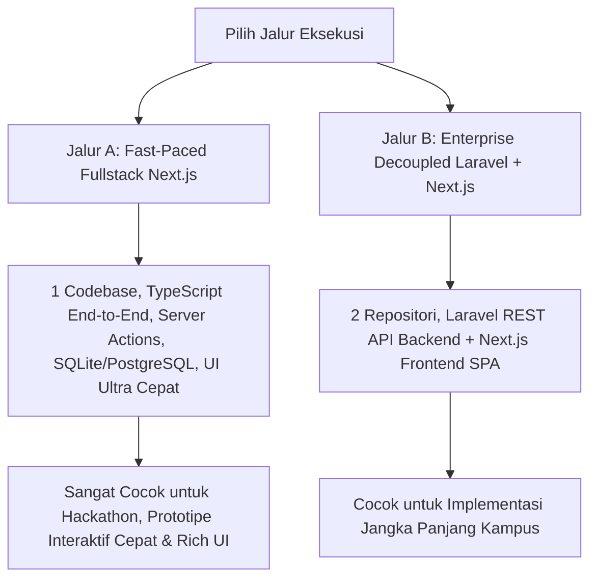
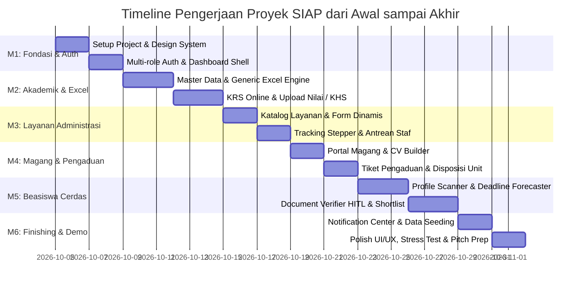

# RENCANA PENGERJAAN PROYEK SIAP POLNES (PROJECT EXECUTION PLAN)
# Panduan Eksekusi Teknis dari Awal (Day 0) hingga Siap Demo & Production

> **Dokumen Terkait:**
> - [PRD_SIAP_Lengkap.md](PRD_SIAP_Lengkap.md) — Product Requirements Document
> - [SIAP_PRD_Designed.html](SIAP_PRD_Designed.html) — PRD Visual Interactive View
> - [IMPLEMENTATION_PLAN_SIAP.md](IMPLEMENTATION_PLAN_SIAP.md) — Master Technical Architecture Blueprint

---

## 1. PENDEKATAN EKSEKUSI & PILIHAN STRATEGI TEKNOLOGI

Berdasarkan konteks proyek (**Hackathon / Proyek Mahasiswa POLNES**), terdapat 2 jalur eksekusi yang dapat dipilih:

> **Rekomendasi Jalur Hackathon (Jalur A):**  
> Menggunakan **Next.js 14+ (App Router, TypeScript, Tailwind CSS, Prisma ORM / PostgreSQL)** karena seluruh logika backend (API route/Server Actions) dan frontend visual berada dalam 1 ekosistem terpadu, menghilangkan friksi konfigurasi CORS/multi-server, serta memungkinkan pembuatan antarmuka modern yang *WOW* dan responsif dalam waktu singkat.

---

## 2. TIMELINE EKSEKUSI & MILESTONE ROADMAP

Rencana pengerjaan dibagi menjadi **6 Milestone Bertahap** yang terukur:

---

## 3. RINCIAN LANGKAH PENGERJAAN SETIAP FASE

### FASE 0: SETUP PROYEK & PONDASI DESIGN SYSTEM (HARI 1–2)
**Tujuan:** Membangun *scaffolding* aplikasi yang bersih, modern, dan siap menerima modul bisnis.

#### Checklist Pengerjaan:
1. **Inisialisasi Project**:
   - Inisialisasi Next.js (TypeScript, ESLint, Tailwind CSS, App Router).
   - Setup Prisma ORM dengan PostgreSQL (atau SQLite lokal untuk *instant preview*).
2. **Pondasi Design System & UI Components**:
   - Tentukan palet warna bernuansa kampus modern (Deep Navy `#0F172A`, Electric Blue `#2563EB`, Emerald Green `#10B981`, Amber Gold `#F59E0B`, dan Slate Surface `#F8FAFC`).
   - Implementasi komponen dasar: `Button`, `Badge`, `Modal`, `Input`, `Select`, `Card`, `Table`, `Tabs`, `Alert`, `EmptyState`.
   - Setup Dark/Light mode toggle.
3. **Data Seeder Awal**:
   - Akun uji coba untuk seluruh peran:
     - `mhs@polnes.ac.id` (Mahasiswa)
     - `dosen@polnes.ac.id` (Dosen Pengampu & Dosen Wali)
     - `admin.akd@polnes.ac.id` (Admin Akademik)
     - `staf.layanan@polnes.ac.id` (Staf Layanan)
     - `mitra@industri.com` (Mitra Perusahaan)
     - `beasiswa@polnes.ac.id` (Pengelola Beasiswa)
     - `pengaduan@polnes.ac.id` (Petugas Pengaduan)

---

### FASE 1: AUTHENTICATION, RBAC & SHELL LAYOUT (HARI 3–4)
**Tujuan:** Pengguna dapat login dan mengakses dashboard yang disesuaikan dengan peran masing-masing.

#### Checklist Pengerjaan:
1. **Autentikasi & Session**:
   - Form Login multi-aktor (NIM untuk Mahasiswa, NIP untuk Dosen/Staf, Email untuk Mitra).
   - Mock role-switcher di pojok antarmuka untuk mempermudah demonstrasi juri/evaluator.
2. **Dashboard Shell**:
   - Sidebar navigasi dinamis yang memfilter menu sesuai peran aktif (`MHS`, `DSN`, `ADM_AKD`, `STF_LYN`, `MTR`, `ADM_BSW`).
   - Header terpadu dengan profil pengguna, tanggal sistem (WITA), dan ikon lonceng notifikasi.
   - Halaman Dashboard ringkas untuk masing-masing peran (Statistik kartu, pintasan cepat, aktivitas terbaru).

---

### FASE 2: MODUL AKADEMIK / SIAKAD & EXCEL ENGINE (HARI 5–8)
**Tujuan:** KRS online mandiri, upload nilai via Excel tervalidasi, dan KHS berjalan.

#### Checklist Pengerjaan:
1. **Master Mata Kuliah & Penawaran Kelas**:
   - Halaman daftar mata kuliah per kurikulum & semester.
   - Manajemen jadwal dan kuota kelas.
2. **Engine KRS Online Mahasiswa (`FR-012`)**:
   - Antarmuka pemilihan mata kuliah interaktif.
   - Live checker: Indikator akumulasi SKS vs batas SKS maksimum.
   - Deteksi bentrok jadwal kuliah (visual warning).
   - Tombol "Ajukan KRS" dengan penguncian status `DIAJUKAN`.
3. **Workflow Persetujuan Dosen Wali (`FR-013`)**:
   - Dasbor Dosen Wali melihat daftar mahasiswa bimbingan.
   - Aksi: Setujui KRS atau Kembalikan untuk Revisi beserta catatan wajib.
4. **Excel Import Engine (`FR-014`, `FR-015`)**:
   - Fitur download template nilai Excel yang sudah terisi nama & NIM mahasiswa kelas tersebut.
   - Komponen Upload file `.xlsx` dengan alur: **Upload → Validation → Staging Preview (Grid) → Konfirmasi → Hasil**.
   - Formula konversi nilai angka ke nilai huruf dan bobot mutu otomatis.
5. **KHS & Riwayat Akademik (`FR-016`, `FR-017`)**:
   - Tampilan KHS per semester dan transkrip kumulatif lengkap dengan perhitungan IPS & IPK.

---

### FASE 3: MODUL LAYANAN ADMINISTRASI MAHASISWA (HARI 9–11)
**Tujuan:** Mahasiswa dapat mengurus surat kampus secara online dan memantau status pengambilan dokumen fisik/digital.

#### Checklist Pengerjaan:
1. **Katalog Jenis Layanan (`FR-020`)**:
   - Surat Keterangan Aktif Kuliah, Surat Pengantar Magang, Legalisir Ijazah/Transkrip, Surat Bebas Pustaka.
   - Informasi persyaratan berkas dan target estimasi hari kerja (SLA).
2. **Form Pengajuan Berkas (`FR-021`, `FR-022`)**:
   - Form isian tujuan pengajuan + upload persyaratan file (PDF/JPG preview).
   - Pembuatan nomor registrasi unik format `ADM-YYYYMM-NNNNN`.
3. **Tracking Stepper Real-Time (`FR-024`)**:
   - Stepper status visual: `Diajukan` → `Diverifikasi` → `Diproses` → `Selesai` → `Siap Diambil` → `Diambil`.
   - Countdown SLA hari kerja dan catatan petugas.
4. **Workspace Antrean Staf Layanan (`FR-023`)**:
   - Antrean kerja staf dengan filter status dan SLA indicator (Hijau: Aman, Merah: Terlambat).
   - Verifikasi berkas split-screen.
   - Aksi ubah status ke `Selesai` (upload file surat jadi untuk digital) atau `Siap Diambil` (set lokasi loket & jam layanan).

---

### FASE 4: MODUL MAGANG & PENGADUAN MAHASISWA (HARI 12–14)
**Tujuan:** Marketplace magang dua sisi dan kanal pengaduan resmi akuntabel.

#### Checklist Pengerjaan:
1. **Portal Magang Mahasiswa (`FR-030` s/d `FR-037`)**:
   - Builder CV Mahasiswa (Sinkronisasi otomatis data akademik, form keahlian, pengalaman, dan portofolio).
   - Opsi privasi mahasiswa: Menyembunyikan/menampilkan IPK ke mitra.
   - Marketplace lowongan magang dengan filter (Lokasi, Mode kerja Remote/Onsite, Bidang).
   - Fitur Kirim Lamaran (dengan snapshot CV permanen).
   - Dasbor Mitra: Membuka lowongan baru, melihat kandidat, ubah status (`Dilihat`, `Seleksi`, `Wawancara`, `Diterima`).
2. **Sistem Pengaduan Mahasiswa (`FR-040` s/d `FR-044`)**:
   - Form pengaduan online: Kategori (Akademik, Fasilitas, Keuangan, Etika), bukti foto/file, opsi "Rahasiakan Identitas".
   - Nomor tiket otomatis `TKT-YYYYMM-NNNNN`.
   - Panel Petugas Pengaduan: Verifikasi tiket dan disposisi ke unit terkait.
   - Thread tanggapan resmi (publik) dan catatan internal staf.
   - Fitur rating kepuasan (bintang 1–5) saat tiket selesai.

---

### FASE 5: MODUL BEASISWA CERDAS (HARI 15–17)
**Tujuan:** Sistem rekomendasi beasiswa proaktif dan seleksi transparan berbasis kriteria berbobot.

#### Checklist Pengerjaan:
1. **Database Beasiswa (`FR-050`, `FR-051`)**:
   - Katalog beasiswa internal & eksternal dengan kriteria terstruktur (IPK min, Semester min-maks, Prodi, Penghasilan orang tua).
2. **Profile Scanner Engine (`FR-053`)**:
   - Logika pencocokan otomatis antara profil mahasiswa login dengan kriteria beasiswa.
   - Menghasilkan Match Score 0–100 dan status (`LAYAK`, `BERPOTENSI`, `TIDAK_LAYAK`).
   - Modal "Mengapa Saya Cocok?": Menjelaskan transparansi kriteria yang lolos dan belum lolos.
3. **Deadline Forecaster Engine (`FR-054`)**:
   - Menghitung sisa hari kerja menuju penutupan pendaftaran.
   - Estimasi durasi pengurusan dokumen yang masih kurang.
   - Klasifikasi kesiapan: `SIAP`, `AMAN`, `BERISIKO`, `KRITIS`.
4. **Document Verifier dengan Human-in-the-Loop (`FR-057`)**:
   - Pre-check otomatis (simulasi OCR ekstraksi nama/NIM pada berkas unggahan).
   - Panel verifikator pengelola beasiswa: Manusia wajib mengklik persetujuan akhir sebelum berkas berstatus `VALID`.
5. **Shortlist Ranker Engine (`FR-058`)**:
   - Perhitungan skor peringkat berbobot: IPK (40%) + Kondisi Ekonomi (40%) + Prestasi (20%).
   - Tampilan peringkat transparan dengan justifikasi poin per kriteria yang dapat diaudit.

---

### FASE 6: NOTIFIKASI TERPADU, SEEDING DATA & POLISHING (HARI 18–20)
**Tujuan:** Mengintegrasikan seluruh modul ke notification center, melengkapi data demo, dan penyempurnaan UI/UX.

#### Checklist Pengerjaan:
1. **Notification Center (`FR-070`)**:
   - Lonceng notifikasi dengan counter unread real-time.
   - Kategori notifikasi: Akademik, Layanan, Magang, Pengaduan, Beasiswa.
   - Deep-linking: Klik notifikasi langsung membuka halaman transaksi terkait.
2. **Seeding Data Demo yang Kaya & Realistis**:
   - 10+ Mahasiswa dengan profil variatif (IPK tinggi, IPK sedang, prestasi lomba, dokumen lengkap/kurang).
   - 5+ Dosen dengan kelas mata kuliah terisi.
   - 6+ Contoh pengajuan layanan dengan berbagai variasi status (sedang diproses, siap diambil, selesai).
   - 4+ Lowongan magang aktif dari mitra perusahaan nyata/mitra lokal Kalimantan Timur.
   - 3+ Program Beasiswa aktif (KIP Kuliah, Beasiswa Prestasi POLNES, Beasiswa Pemprov Kaltim).
3. **UI/UX Polish & Wow Factor**:
   - Micro-animations, transisi status yang halus (*smooth transitions*).
   - Responsive check pada smartphone dan laptop.
   - Empty state informatif, loading skeleton, dan toast notification interaktif.

---

## 4. STRUKTUR TIM & PEMBAGIAN KERJA (ROLE-BASED WORK DISTRIBUTION)

| Peran | Tanggung Jawab Utama |
|---|---|
| **Fullstack Lead / Architect** | Setup repositori, database schema, Prisma migrations, routing Next.js, rule engine KRS, Profile Scanner, dan Shortlist Ranker logic. |
| **Frontend & UI/UX Specialist** | Pembuatan Design System Tailwind, layout dashboard responsif, interaksi form stepper, visualisasi tracking status, dan styling komponen visual. |
| **Backend & Integration Specialist** | Logika CRUD API, Excel import processor, upload storage handler, state machine transisi status, dan notification dispatcher. |
| **QA, Data & Presentation Specialist** | Pembuatan data seeder POLNES, skenario uji coba alur end-to-end, verifikasi edge cases (bentrok KRS, kuota penuh, file error), dan penyiapan skrip demo. |

---

## 5. REKOMENDASI TINDAKAN SEGERA (NEXT IMMEDIATE ACTIONS)

Untuk memulai pengerjaan secara konkret di workspace ini, langkah pertama yang disarankan:

1. **Inisialisasi Project Scaffolding**:
   Membuat fondasi aplikasi web Next.js di workspace proyek ini (`frontend/`).
2. **Setup Skema Database & Mock Provider**:
   Membuat data model untuk User, Mahasiswa, Dosen, Kelas, Layanan, Magang, dan Beasiswa.
3. **Membangun Shell Antarmuka Pertama**:
   Menyiapkan login multi-role dan dashboard utama agar aplikasi langsung dapat dijalankan (`npm run dev`) dan dilihat di browser.
