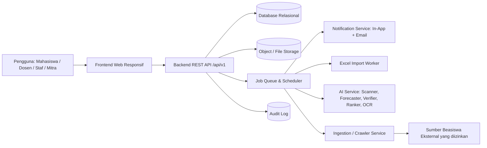

# PRD — SIAP (Sistem Informasi Akademik & Pelayanan)

> **Product Requirements Document**
> Platform terintegrasi SIAKAD dan Layanan Mahasiswa POLNES

---

## Daftar Isi

0. [Analisis Pra-PRD](#0-analisis-pra-prd)
1. [Document Information](#1-document-information)
2. [Product Overview](#2-product-overview)
3. [Background & Problem Statement](#3-background--problem-statement)
4. [Goals & Objectives](#4-goals--objectives)
5. [Non-Goals](#5-non-goals)
6. [Target Users & Personas](#6-target-users--personas)
7. [User Roles & Access Control](#7-user-roles--access-control)
8. [Product Scope](#8-product-scope)
9. [Functional Requirements](#9-functional-requirements)
10. [Detail Requirements Setiap Modul](#10-detail-requirements-setiap-modul)
11. [End-to-End User Flow](#11-end-to-end-user-flow)
12. [Business Rules](#12-business-rules)
13. [Data Requirements](#13-data-requirements)
14. [Database / ERD Requirements](#14-database--erd-requirements)
15. [API Requirements](#15-api-requirements)
16. [Non-Functional Requirements](#16-non-functional-requirements)
17. [Security Requirements](#17-security-requirements)
18. [Excel Import Requirements](#18-excel-import-requirements)
19. [AI Requirements](#19-ai-requirements)
20. [External Data / Crawling Requirements](#20-external-data--crawling-requirements)
21. [UI/UX Requirements](#21-uiux-requirements)
22. [Notification Matrix](#22-notification-matrix)
23. [Status & State Management](#23-status--state-management)
24. [Reporting & Analytics](#24-reporting--analytics)
25. [Audit Trail](#25-audit-trail)
26. [MVP Definition](#26-mvp-definition)
27. [Development Roadmap](#27-development-roadmap)
28. [Testing Requirements](#28-testing-requirements)
29. [Product Acceptance Criteria](#29-product-acceptance-criteria)
30. [Risk Analysis](#30-risk-analysis)
31. [Assumptions & Constraints](#31-assumptions--constraints)
32. [Open Questions](#32-open-questions)
33. [Definition of Done](#33-definition-of-done)
34. [Final Product Summary](#34-final-product-summary)

---

## Legenda Label Informasi

Dokumen ini membedakan sumber setiap pernyataan secara eksplisit:

| Label | Arti | Contoh Penggunaan |
|---|---|---|
| **[REQ]** | Requirement yang **diberikan langsung** oleh pemilik produk (brief awal). | KRS online, Excel import, tracking status layanan. |
| **[ASUMSI]** | Anggapan kerja tim penyusun agar desain dapat dilanjutkan. Harus dikonfirmasi, tetapi tidak menghambat pengembangan. | Kampus menggunakan email institusi. |
| **[REKOMENDASI]** | Usulan tim penyusun berdasarkan praktik terbaik; boleh diterima/ditolak. | Status `DIAMBIL` setelah `SIAP_DIAMBIL`. |
| **[PERLU VALIDASI]** | Informasi spesifik POLNES yang **belum tersedia** dan **wajib** dikonfirmasi ke pihak kampus sebelum diimplementasikan secara final. | Skala nilai, batas SKS, nama unit layanan. |

> [!IMPORTANT]
> Seluruh nilai default yang bersifat aturan kampus (batas SKS, skala nilai, SLA layanan, jenis layanan, kategori pengaduan, dsb.) dirancang **dapat dikonfigurasi** oleh admin sehingga keputusan final POLNES dapat diterapkan tanpa perubahan kode.

---

## 0. Analisis Pra-PRD

### 0.1 Analisis Masalah

| # | Masalah | Dampak | Sumber |
|---|---|---|---|
| P-01 | Mahasiswa harus datang ke kampus berkali-kali untuk mengurus layanan administrasi (pengajuan, cek status, pengambilan dokumen). | Waktu terbuang, antrean, kepastian status rendah. | [REQ] |
| P-02 | Fungsi akademik (SIAKAD) dan layanan mahasiswa berada di kanal terpisah / belum terintegrasi. | Data terfragmentasi, pengalaman pengguna tidak konsisten, input ganda. | [REQ] (konsep integrasi) — kondisi sistem eksisting [PERLU VALIDASI] |
| P-03 | Input data akademik dan nilai dilakukan manual / berulang. | Rentan salah ketik, lambat, sulit diaudit. | [REQ] (kebutuhan import Excel) |
| P-04 | Mahasiswa kesulitan mendapatkan tempat magang; mitra kesulitan menjangkau kandidat. | Keterlambatan magang, peluang kerja sama hilang. | [REQ] |
| P-05 | Pengaduan mahasiswa tidak memiliki kanal resmi yang terlacak (nomor tiket, status, tanggapan). | Pengaduan tidak tertangani, tidak ada akuntabilitas. | [REQ] |
| P-06 | Informasi beasiswa bersifat pasif (hanya daftar); mahasiswa yang layak sering tidak tahu atau terlambat menyiapkan dokumen. | Peluang beasiswa terlewat, beban verifikasi manual tinggi bagi pengelola. | [REQ] |
| P-07 | Notifikasi tersebar di berbagai kanal informal. | Informasi penting (deadline, perubahan status) terlewat. | [REQ] |
| P-08 | Data kuantitatif (jumlah mahasiswa, volume layanan, rata-rata waktu proses saat ini) belum tersedia. | Target KPI belum dapat dikalibrasi. | [PERLU VALIDASI] |

### 0.2 Analisis Stakeholder

| Stakeholder | Kepentingan | Pengaruh | Keterlibatan |
|---|---|---|---|
| Mahasiswa | Layanan cepat, transparan, dapat diakses dari mana saja. | Tinggi (pengguna utama) | Pengguna aktif, UAT |
| Dosen Wali / Pembimbing Akademik | Persetujuan KRS mudah, melihat progres mahasiswa bimbingan. | Sedang | Pengguna, UAT |
| Dosen Pengampu | Upload nilai cepat dan akurat. | Sedang | Pengguna |
| Bagian Akademik (nama unit [PERLU VALIDASI]) | Kelola data akademik, import, periode KRS. | Tinggi | Pengguna utama back-office, pemilik data akademik |
| Unit Layanan Administrasi (nama unit [PERLU VALIDASI]) | Mengelola pengajuan dokumen, mengurangi antrean. | Tinggi | Pengguna back-office |
| Unit Penanganan Pengaduan (nama unit [PERLU VALIDASI]) | Menangani pengaduan terstruktur. | Sedang | Pengguna back-office |
| Koordinator Magang / Unit Kerja Sama (nama unit [PERLU VALIDASI]) | Kurasi mitra dan lowongan. | Sedang | Pengguna back-office |
| Mitra Industri | Menjaring kandidat magang. | Sedang | Pengguna eksternal |
| Pengelola / Komite Beasiswa (nama unit [PERLU VALIDASI]) | Seleksi beasiswa efisien dan dapat diaudit. | Tinggi | Pengguna back-office, pengambil keputusan |
| Pimpinan (Direktur/Wakil Direktur/Ketua Jurusan) [PERLU VALIDASI struktur] | Data & laporan kinerja layanan. | Tinggi | Pembaca dashboard, sponsor |
| UPT TIK / Pengelola TI Kampus (nama unit [PERLU VALIDASI]) | Keamanan, infrastruktur, integrasi. | Tinggi | Deployment, operasional |
| Tim Pengembang (mahasiswa) | Scope realistis, dokumentasi jelas. | Sedang | Pembangun sistem |

### 0.3 Target Pengguna

- **Primer:** Mahasiswa aktif POLNES (jumlah [PERLU VALIDASI]).
- **Sekunder (internal):** Dosen wali, dosen pengampu, staf akademik, staf layanan, petugas pengaduan, koordinator magang, pengelola beasiswa.
- **Sekunder (eksternal):** Mitra industri/instansi penyedia magang.
- **Tersier:** Pimpinan (konsumen laporan), Super Admin/TI.

### 0.4 Kebutuhan Bisnis

| ID | Kebutuhan Bisnis | Sumber |
|---|---|---|
| KB-01 | Menyatukan SIAKAD dan layanan mahasiswa dalam satu platform. | [REQ] |
| KB-02 | Digitalisasi pengajuan layanan administrasi hingga pengambilan dokumen. | [REQ] |
| KB-03 | Mengurangi input manual data akademik melalui import Excel yang tervalidasi. | [REQ] |
| KB-04 | Memperluas akses mahasiswa ke peluang magang melalui ekosistem mitra. | [REQ] |
| KB-05 | Menyediakan kanal pengaduan resmi yang akuntabel. | [REQ] |
| KB-06 | Meningkatkan jumlah mahasiswa layak yang mendaftar beasiswa dan mempercepat seleksi secara auditable. | [REQ] |
| KB-07 | Menyediakan data operasional untuk pengambilan keputusan pimpinan. | [REKOMENDASI] |
| KB-08 | Kepatuhan terhadap perlindungan data pribadi (UU No. 27 Tahun 2022 tentang Pelindungan Data Pribadi). | [REKOMENDASI] — kebijakan internal kampus [PERLU VALIDASI] |

### 0.5 Kebutuhan Pengguna

| Pengguna | Kebutuhan Utama |
|---|---|
| Mahasiswa | Isi KRS online, lihat nilai/riwayat, ajukan layanan tanpa datang berulang, pantau status, cari magang, lapor masalah, dapat rekomendasi beasiswa yang relevan, satu pusat notifikasi. |
| Dosen Wali | Melihat dan menyetujui/menolak KRS mahasiswa bimbingan dengan catatan. |
| Dosen Pengampu | Upload nilai via Excel dengan preview dan validasi. |
| Staf Akademik | Kelola mata kuliah, periode, penawaran kelas, import data massal, riwayat import. |
| Staf Layanan | Antrean pengajuan, verifikasi persyaratan, ubah status, unggah dokumen hasil. |
| Petugas Pengaduan | Verifikasi, disposisi, tanggapan, tutup tiket. |
| Mitra | Buat lowongan, lihat & kelola pelamar. |
| Pengelola Beasiswa | Kelola database beasiswa, verifikasi dokumen dibantu sistem, shortlist dengan skor yang dapat dijelaskan, jadwal wawancara, monitoring pencairan. |
| Pimpinan | Dashboard ringkas lintas modul. |

### 0.6 Solusi yang Diusulkan

SIAP adalah aplikasi web responsif (mobile-friendly) dengan arsitektur modular:

**Rekomendasi teknologi** [REKOMENDASI] (dapat diganti sesuai kompetensi tim):

| Lapisan | Rekomendasi | Alternatif |
|---|---|---|
| Frontend | Next.js (React) + TypeScript, CSS Modules / Vanilla CSS | Vue/Nuxt, Laravel Blade/Inertia |
| Backend API | Laravel 11 (PHP 8.3) REST + Sanctum | NestJS (Node.js), Django REST |
| Database | PostgreSQL 16 | MySQL 8 / MariaDB |
| Queue/Cache | Redis | Database queue (untuk skala kecil) |
| File Storage | MinIO (S3-compatible) / disk privat server | Cloud S3 |
| AI/OCR Service | Python FastAPI + Tesseract/PaddleOCR + scikit-learn; LLM opsional | Rule engine di backend utama |
| Crawler | Python (Scrapy / httpx + BeautifulSoup), wajib cek robots.txt | Kurasi manual |
| Email | SMTP institusi [PERLU VALIDASI] | Layanan transactional email |
| Deployment | Docker Compose di server kampus [PERLU VALIDASI] | VPS |

### 0.7 Prioritas Fitur (Ringkas)

| Prioritas | Ringkasan |
|---|---|
| **P0 – Must Have** | Auth & RBAC, master data akademik, import Excel (mahasiswa, mata kuliah, nilai) dengan validasi-preview-konfirmasi, KRS + persetujuan, nilai/KHS/riwayat, layanan administrasi end-to-end, pengaduan end-to-end, magang inti, database beasiswa internal + Profile Scanner berbasis aturan + pendaftaran + checklist dokumen dengan verifikasi manusia, pusat notifikasi in-app, audit log. |
| **P1 – Should Have** | Email notification, reminder deadline, Deadline Forecaster, Shortlist Ranker, Personal Outreach Agent (berbasis template), kurasi beasiswa eksternal manual, wawancara & pengumuman, laporan & ekspor, viewer audit trail. |
| **P2 – Could Have** | OCR & AI pre-check dokumen, crawling beasiswa eksternal, monitoring pencairan, preferensi notifikasi, rekomendasi lowongan, rating & reopen pengaduan, cetak transkrip PDF. |
| **P3 – Future** | WhatsApp/push notification, aplikasi mobile native, SSO/integrasi SIAKAD eksisting & PDDikti, personalisasi pesan berbasis LLM, analitik prediktif. |

Detail lengkap di [Bagian 26](#26-mvp-definition).

### 0.8 Dependensi

| ID | Dependensi | Dampak Jika Tidak Terpenuhi | Status |
|---|---|---|---|
| D-01 | Data master mahasiswa, dosen, prodi, mata kuliah dari kampus (format Excel). | Modul akademik & beasiswa tidak dapat berjalan. | [PERLU VALIDASI] |
| D-02 | Aturan akademik resmi (skala nilai, batas SKS, prasyarat, periode KRS). | Validasi KRS/nilai tidak akurat. | [PERLU VALIDASI] |
| D-03 | Daftar jenis layanan administrasi beserta persyaratan & SLA. | Katalog layanan kosong. | [PERLU VALIDASI] |
| D-04 | Daftar kategori pengaduan & unit penanggung jawab. | Disposisi tidak dapat dilakukan. | [PERLU VALIDASI] |
| D-05 | Kriteria & bobot beasiswa internal. | Profile Scanner & Ranker tidak dapat dikonfigurasi. | [PERLU VALIDASI] |
| D-06 | Server/hosting & domain kampus, SMTP. | Deployment & email tertunda. | [PERLU VALIDASI] |
| D-07 | Izin penggunaan data pribadi mahasiswa untuk pemrosesan otomatis (profiling beasiswa). | Fitur proaktif beasiswa tidak boleh aktif. | [PERLU VALIDASI] |
| D-08 | Izin/ToS sumber beasiswa eksternal. | Crawling tidak boleh dilakukan; fallback kurasi manual. | [PERLU VALIDASI] |
| D-09 | Ketergantungan antar modul internal: Akademik → Beasiswa (IPK, semester), Akademik → Magang (prodi, semester), Notifikasi → semua modul. | Urutan pengembangan harus mengikuti dependensi ini. | Internal |

### 0.9 Risiko Utama (Ringkas)

Scope terlalu besar untuk tim mahasiswa; data akademik tidak tersedia/tidak bersih; kebocoran data pribadi; bias/kesalahan AI; crawling melanggar ToS; resistensi adopsi staf. Analisis lengkap di [Bagian 30](#30-risk-analysis).

### 0.10 Batasan Sistem

- SIAP **tidak** menjadi sumber kebenaran tunggal untuk data akademik resmi sampai ada keputusan kampus [PERLU VALIDASI]; pada MVP data akademik masuk melalui import Excel.
- SIAP **tidak** memproses pembayaran (UKT, biaya layanan).
- AI **tidak** mengambil keputusan final (verifikasi dokumen, penerimaan beasiswa).
- Crawling hanya untuk sumber yang diizinkan.
- Tanda tangan elektronik tersertifikasi pada dokumen resmi berada di luar scope MVP.

---

## 1. Document Information

| Atribut | Nilai |
|---|---|
| Nama Dokumen | Product Requirements Document — SIAP |
| Nama Produk | SIAP — Sistem Informasi Akademik & Pelayanan |
| Institusi | POLNES (Politeknik Negeri Samarinda) |
| Versi Dokumen | 1.0 (Draft untuk Validasi) |
| Tanggal | 4 Oktober 2026 |
| Status | Draft — menunggu validasi stakeholder kampus |
| Penyusun | Tim Produk SIAP (PM, SA, BA, UI/UX, Architect) |
| Pemilik Produk | [PERLU VALIDASI] |
| Reviewer | Perwakilan Akademik, Layanan, Kemahasiswaan, UPT TIK [PERLU VALIDASI] |
| Klasifikasi | Internal |
| Bahasa Antarmuka | Bahasa Indonesia |
| Zona Waktu Sistem | WITA (UTC+8) [ASUMSI: lokasi kampus di Samarinda] |

### 1.1 Riwayat Revisi

| Versi | Tanggal | Penulis | Perubahan |
|---|---|---|---|
| 0.1 | 2026-10-04 | Tim Produk | Analisis awal & kerangka |
| 1.0 | 2026-10-04 | Tim Produk | PRD lengkap untuk validasi |

### 1.2 Persetujuan

| Peran | Nama | Tanda Tangan | Tanggal |
|---|---|---|---|
| Product Owner | [PERLU VALIDASI] | | |
| Perwakilan Akademik | [PERLU VALIDASI] | | |
| Perwakilan UPT TIK | [PERLU VALIDASI] | | |
| Tech Lead | [PERLU VALIDASI] | | |

### 1.3 Glosarium

| Istilah | Definisi |
|---|---|
| SIAKAD | Sistem Informasi Akademik. |
| KRS | Kartu Rencana Studi — daftar mata kuliah yang direncanakan diambil pada satu semester. |
| KHS | Kartu Hasil Studi — hasil nilai per semester. |
| SKS | Satuan Kredit Semester. |
| IPS / IPK | Indeks Prestasi Semester / Kumulatif. |
| Dosen Wali / PA | Pembimbing akademik yang menyetujui KRS. |
| Mitra | Perusahaan/instansi penyedia lowongan magang. |
| HITL | Human-in-the-loop — manusia memvalidasi keluaran AI. |
| OCR | Optical Character Recognition. |
| SLA | Service Level Agreement — target waktu penyelesaian. |
| Readiness Score | Skor kesiapan mahasiswa terhadap suatu beasiswa (Deadline Forecaster). |
| Match Score | Skor kecocokan profil terhadap kriteria beasiswa (Profile Scanner). |
| Shortlist Score | Skor berbobot untuk membantu seleksi (Shortlist Ranker). |
| Import Batch | Satu sesi proses import file Excel. |
| RBAC | Role-Based Access Control. |

---

## 2. Product Overview

### 2.1 Ringkasan Produk

**SIAP** adalah platform web terintegrasi yang menggabungkan fungsi **SIAKAD** dan **layanan mahasiswa** POLNES dalam satu aplikasi [REQ]. SIAP mencakup enam modul:

| # | Modul | Deskripsi Singkat | Sumber |
|---|---|---|---|
| M1 | Akademik / SIAKAD | KRS online, mata kuliah, nilai, riwayat akademik, import Excel tervalidasi. | [REQ] |
| M2 | Layanan Administrasi | Pengajuan dokumen online, upload persyaratan, tracking, notifikasi siap diambil. | [REQ] |
| M3 | Magang | Marketplace lowongan magang antara mahasiswa dan mitra. | [REQ] |
| M4 | Pengaduan Mahasiswa | Tiket pengaduan dengan tracking & tindak lanjut. | [REQ] |
| M5 | Beasiswa Cerdas | Database beasiswa + agen proaktif (scanner, forecaster, outreach, verifier, ranker, seleksi & follow-up). | [REQ] |
| M6 | Notifikasi Terintegrasi | Satu pusat notifikasi lintas modul. | [REQ] |
| M0 | Platform Core | Autentikasi, RBAC, master data, audit, dashboard, laporan. | [REKOMENDASI] (diperlukan untuk menjalankan M1–M6) |

### 2.2 Value Proposition

| Untuk | Nilai |
|---|---|
| Mahasiswa | "Satu aplikasi untuk semua urusan kampus — dari KRS sampai beasiswa — dengan status yang selalu jelas." |
| Staf/Unit | "Antrean kerja terstruktur, data tervalidasi, dan jejak audit lengkap." |
| Mitra | "Akses langsung ke kandidat magang yang relevan." |
| Pimpinan | "Visibilitas real-time atas kinerja layanan." |

### 2.3 Prinsip Produk

1. **Transparansi status** — setiap transaksi memiliki status, riwayat, dan notifikasi.
2. **Validasi sebelum komit** — data massal selalu melalui preview & konfirmasi.
3. **AI sebagai asisten, bukan pengambil keputusan** — human-in-the-loop wajib.
4. **Konfigurasi, bukan hardcode** — aturan kampus dapat diatur admin.
5. **Privacy by design** — akses data minimum sesuai kebutuhan peran.
6. **Mobile-first untuk mahasiswa**, desktop-optimized untuk back-office.

---

## 3. Background & Problem Statement

### 3.1 Latar Belakang

Layanan akademik dan kemahasiswaan di perguruan tinggi umumnya melibatkan banyak unit dan proses yang masih bergantung pada kehadiran fisik, berkas kertas, dan komunikasi informal. Pemilik produk menyampaikan bahwa mahasiswa POLNES perlu dapat mengajukan layanan administrasi **tanpa harus datang berkali-kali ke kampus** [REQ], mahasiswa perlu dibantu **mendapatkan tempat magang** [REQ], dan sistem beasiswa perlu bersifat **proaktif** [REQ].

Kondisi sistem eksisting POLNES (apakah sudah ada SIAKAD, sistem apa yang digunakan, apakah memiliki API, bagaimana alur layanan saat ini) **belum tersedia** dalam brief [PERLU VALIDASI].

### 3.2 Problem Statement

> Mahasiswa POLNES membutuhkan satu kanal digital yang terintegrasi untuk urusan akademik dan layanan kemahasiswaan, karena proses saat ini (berdasarkan brief) menuntut kehadiran berulang, informasi status yang tidak pasti, data akademik yang diinput manual, akses peluang magang dan beasiswa yang terbatas, serta kanal pengaduan yang belum terlacak. Akibatnya waktu mahasiswa dan staf terbuang, peluang terlewat, dan akuntabilitas layanan sulit diukur.

### 3.3 Problem per Modul

| Modul | Problem | Solusi SIAP |
|---|---|---|
| Akademik | Input data & nilai manual, KRS rawan kesalahan. | Import Excel tervalidasi, KRS online dengan validasi aturan otomatis. |
| Administrasi | Datang berulang untuk cek status. | Pengajuan online, tracking, notifikasi selesai/siap diambil. |
| Magang | Mahasiswa sulit menemukan tempat; mitra sulit menjangkau. | Portal lowongan dua sisi. |
| Pengaduan | Tidak ada nomor tiket & tindak lanjut terukur. | Sistem tiket dengan status & SLA. |
| Beasiswa | Informasi pasif, verifikasi manual berat. | Agen proaktif + verifikasi terbantu + scoring dapat diaudit. |
| Notifikasi | Informasi tersebar. | Notification center terpadu. |

---

## 4. Goals & Objectives

### 4.1 Goals

| ID | Goal |
|---|---|
| G-01 | Menyediakan satu platform terpadu untuk akademik dan layanan mahasiswa. |
| G-02 | Mengurangi kebutuhan kunjungan fisik untuk layanan administrasi. |
| G-03 | Meningkatkan akurasi dan kecepatan input data akademik. |
| G-04 | Meningkatkan akses mahasiswa terhadap peluang magang. |
| G-05 | Menyediakan kanal pengaduan yang akuntabel dan terukur. |
| G-06 | Meningkatkan partisipasi mahasiswa layak dalam program beasiswa dan efisiensi seleksi. |
| G-07 | Menjamin keamanan dan privasi data. |

### 4.2 Objectives & KPI

> [!NOTE]
> Nilai target bersifat **[REKOMENDASI]** dan harus dikalibrasi setelah baseline kondisi saat ini diketahui **[PERLU VALIDASI]**.

| ID | Objective (terukur) | Metrik | Target Awal | Goal |
|---|---|---|---|---|
| OBJ-01 | Adopsi mahasiswa | % mahasiswa aktif yang login ≥1× per semester | ≥ 70% pada semester pertama go-live | G-01 |
| OBJ-02 | Pengajuan layanan online | % pengajuan layanan via SIAP dibanding total | ≥ 80% dalam 6 bulan | G-02 |
| OBJ-03 | Kunjungan fisik per layanan | Rata-rata kunjungan per pengajuan | ≤ 1 (hanya pengambilan dokumen fisik) | G-02 |
| OBJ-04 | Kualitas import | % baris import yang lolos validasi pada percobaan pertama | ≥ 95% setelah 2 siklus | G-03 |
| OBJ-05 | Waktu input nilai | Waktu dosen mengunggah nilai satu kelas | ≤ 5 menit | G-03 |
| OBJ-06 | Lowongan magang | Jumlah lowongan aktif per semester | Baseline [PERLU VALIDASI] +X% | G-04 |
| OBJ-07 | SLA pengaduan | % pengaduan diverifikasi dalam SLA | ≥ 90% | G-05 |
| OBJ-08 | Partisipasi beasiswa | % mahasiswa yang dinotifikasi layak lalu mendaftar | ≥ 30% | G-06 |
| OBJ-09 | Efisiensi verifikasi | Rata-rata waktu verifikasi per berkas beasiswa | Turun ≥ 40% dari baseline | G-06 |
| OBJ-10 | Keamanan | Insiden kebocoran data | 0 insiden kritis | G-07 |

---

## 5. Non-Goals

Hal-hal berikut **tidak** termasuk dalam scope produk (setidaknya hingga MVP + P2):

| ID | Non-Goal | Alasan |
|---|---|---|
| NG-01 | Pembayaran online (UKT, biaya layanan, payment gateway). | Kompleksitas regulasi & integrasi keuangan. |
| NG-02 | Pengganti penuh sistem keuangan/kepegawaian kampus. | Di luar domain. |
| NG-03 | Learning Management System (materi kuliah, tugas, ujian online). | Domain berbeda. |
| NG-04 | Penjadwalan kuliah otomatis (timetabling optimizer). | Kompleks; jadwal diimport. |
| NG-05 | Tanda tangan elektronik tersertifikasi (BSrE/PSrE) pada dokumen resmi. | Butuh integrasi resmi; P3. |
| NG-06 | Keputusan otomatis oleh AI untuk penerimaan beasiswa/validasi dokumen. | Wajib otoritas manusia. |
| NG-07 | Sinkronisasi otomatis ke PDDikti/Feeder. | Butuh akses resmi; P3 [PERLU VALIDASI]. |
| NG-08 | Crawling sumber yang tidak mengizinkan (robots.txt/ToS). | Etika & hukum. |
| NG-09 | Aplikasi mobile native pada MVP. | Web responsif cukup; P3. |
| NG-10 | Pencocokan otomatis (auto-placement) mahasiswa ke mitra magang. | Keputusan oleh mitra & mahasiswa. |

---

## 6. Target Users & Personas

### 6.1 Segmentasi Pengguna

| Segmen | Perangkat Dominan [ASUMSI] | Frekuensi | Literasi Digital [ASUMSI] |
|---|---|---|---|
| Mahasiswa | Smartphone | Harian–mingguan; puncak saat KRS | Tinggi |
| Dosen | Laptop + smartphone | Musiman (KRS, akhir semester) | Sedang |
| Staf back-office | Desktop | Harian | Sedang |
| Mitra | Laptop | Mingguan saat rekrutmen | Sedang–tinggi |
| Pimpinan | Laptop/tablet | Mingguan | Sedang |

### 6.2 Personas

> Persona berikut adalah **persona ilustratif [ASUMSI]**, bukan data riil POLNES.

#### Persona 1 — Rina, Mahasiswa Semester 5 (D3)
- **Tujuan:** Mengisi KRS tanpa bentrok, mengurus surat keterangan aktif kuliah untuk beasiswa, mencari tempat magang.
- **Frustrasi:** Harus bolak-balik ke bagian layanan hanya untuk tanya "sudah jadi belum?"; sering tahu info beasiswa saat deadline sudah dekat.
- **Kebutuhan dari SIAP:** Tracking status real-time, notifikasi dokumen siap diambil, rekomendasi beasiswa yang relevan dengan checklist dokumen.

#### Persona 2 — Pak Andi, Dosen Wali & Pengampu
- **Tujuan:** Menyetujui KRS 30 mahasiswa bimbingan dan mengunggah nilai 4 kelas.
- **Frustrasi:** Format nilai berbeda-beda, salah ketik NIM.
- **Kebutuhan:** Template Excel baku, preview dengan penanda error per baris, persetujuan KRS massal dengan catatan.

#### Persona 3 — Bu Sari, Staf Akademik
- **Tujuan:** Mengimport data mahasiswa baru dan mata kuliah tiap semester.
- **Frustrasi:** Data duplikat, sulit melacak siapa mengubah apa.
- **Kebutuhan:** Validasi berlapis, laporan error yang dapat diunduh, riwayat import dan audit trail.

#### Persona 4 — Mas Dedi, Staf Layanan Administrasi
- **Tujuan:** Memproses 50+ pengajuan surat per minggu.
- **Kebutuhan:** Antrean dengan filter status & SLA, checklist persyaratan, tombol ubah status cepat, unggah dokumen hasil.

#### Persona 5 — Ibu Maya, HR Mitra Industri
- **Tujuan:** Merekrut 5 mahasiswa magang bidang jaringan.
- **Kebutuhan:** Posting lowongan cepat, daftar kandidat dengan CV, ubah status kandidat, notifikasi otomatis ke kandidat.

#### Persona 6 — Pak Budi, Pengelola Beasiswa
- **Tujuan:** Menyeleksi 300 pendaftar untuk 40 kuota.
- **Frustrasi:** Memeriksa kelengkapan berkas satu per satu; sulit menjelaskan dasar peringkat.
- **Kebutuhan:** Pre-check dokumen, skor berbobot dengan justifikasi, keputusan final tetap di tangannya, log audit.

#### Persona 7 — Petugas Pengaduan
- **Tujuan:** Menyalurkan pengaduan ke unit yang tepat dan memastikan tindak lanjut.
- **Kebutuhan:** Dashboard tiket per kategori & SLA, disposisi, template tanggapan.

#### Persona 8 — Pimpinan
- **Tujuan:** Memantau kinerja layanan.
- **Kebutuhan:** Dashboard ringkas & laporan berkala.

---

## 7. User Roles & Access Control

### 7.1 Daftar Role

| Kode Role | Nama Role | Deskripsi | Scope Data |
|---|---|---|---|
| `MHS` | Mahasiswa | Pengguna utama layanan. | Data milik sendiri. |
| `DSN` | Dosen | Dosen pengampu; upload nilai kelas yang diampu. | Kelas yang diampu. |
| `DWL` | Dosen Wali | Menyetujui KRS mahasiswa bimbingan (role tambahan pada dosen). | Mahasiswa bimbingan. |
| `ADM_AKD` | Admin Akademik | Kelola master akademik, periode, import, koreksi nilai. | Seluruh / per jurusan [PERLU VALIDASI]. |
| `STF_LYN` | Staf Layanan Administrasi | Memproses pengajuan layanan. | Jenis layanan yang ditugaskan. |
| `PTG_ADU` | Petugas Pengaduan | Verifikasi & disposisi pengaduan. | Seluruh pengaduan (kecuali conflict of interest). |
| `UNIT_ADU` | Unit Penindak Lanjut | Menanggapi pengaduan yang didisposisikan. | Pengaduan yang didisposisikan ke unitnya. |
| `KRD_MGG` | Koordinator Magang | Verifikasi mitra, moderasi lowongan, monitoring. | Seluruh data magang. |
| `MTR` | Mitra | Kelola lowongan & pelamar sendiri. | Lowongan & pelamar milik mitra. |
| `ADM_BSW` | Pengelola Beasiswa | Kelola beasiswa, verifikasi dokumen, seleksi. | Beasiswa yang dikelola. |
| `KMT_BSW` | Komite/Penilai Beasiswa | Menilai wawancara, menetapkan keputusan. | Beasiswa yang ditugaskan. |
| `PMP` | Pimpinan | Read-only dashboard & laporan agregat. | Agregat (tanpa PII detail kecuali diizinkan). |
| `SUPER` | Super Admin | Kelola user, role, konfigurasi sistem. | Seluruh sistem (akses data sensitif dibatasi & dilog). |

**Catatan:** Satu pengguna dapat memiliki lebih dari satu role (mis. `DSN` + `DWL`) [REKOMENDASI].

### 7.2 Model Akses

- **RBAC** (role → permission) dikombinasikan dengan **scope/ownership check** (ABAC sederhana): mis. dosen hanya dapat mengunggah nilai untuk `kelas_kuliah` di mana ia tercatat sebagai pengampu.
- Permission dinamai `modul.resource.aksi` (contoh: `akademik.nilai.import`, `layanan.pengajuan.update_status`).

### 7.3 Matriks Akses (Ringkas)

Keterangan: **C**=Create, **R**=Read, **U**=Update, **D**=Delete/Arsip, **A**=Approve/Ubah Status, **O**=hanya milik sendiri/scope, **–**=tidak ada akses.

| Resource | MHS | DSN | DWL | ADM_AKD | STF_LYN | PTG_ADU | UNIT_ADU | KRD_MGG | MTR | ADM_BSW | KMT_BSW | PMP | SUPER |
|---|---|---|---|---|---|---|---|---|---|---|---|---|---|
| User & Role | R(O) | R(O) | R(O) | R | – | – | – | – | R(O) | – | – | – | CRUD |
| Mata Kuliah & Periode | R | R | R | CRUD | – | – | – | – | – | – | – | R | R |
| Penawaran Kelas | R | R(O) | R | CRUD | – | – | – | – | – | – | – | R | R |
| KRS | CRU(O) | – | R,A(O) | R,U | – | – | – | – | – | – | – | R(agg) | R |
| Nilai | R(O) | C,U(O)* | R(O) | CRUD,A | – | – | – | – | – | R(terbatas) | – | R(agg) | R |
| Import Excel | – | C,R(O) | – | C,R | – | – | – | – | – | C,R (beasiswa) | – | – | R |
| Pengajuan Layanan | CR(O),D** | – | – | – | R,U,A | – | – | – | – | – | – | R(agg) | R |
| Jenis Layanan | R | – | – | – | R | – | – | – | – | – | – | – | CRUD |
| Pengaduan | CR(O) | – | – | – | – | R,U,A | R,U(O) | – | – | – | – | R(agg) | R |
| Mitra | – | – | – | – | – | – | – | R,A | RU(O) | – | – | R(agg) | CRUD |
| Lowongan | R | – | – | – | – | – | – | R,A,D | CRUD(O) | – | – | R(agg) | R |
| Lamaran | CR(O),D** | – | – | – | – | – | – | R | R,A(O) | – | – | R(agg) | R |
| Beasiswa | R | – | – | – | – | – | – | – | – | CRUD | R(O) | R(agg) | R |
| Pendaftaran Beasiswa | CR(O),D** | – | – | – | – | – | – | – | – | R,A | R,A(O) | R(agg) | R |
| Notifikasi | R,U(O) | R,U(O) | R,U(O) | R,U(O) | R,U(O) | R,U(O) | R,U(O) | R,U(O) | R,U(O) | R,U(O) | R,U(O) | R,U(O) | R |
| Audit Log | – | – | – | R (modulnya) | – | – | – | – | – | R (modulnya) | – | – | R |
| Laporan | – | R(O) | R(O) | R | R | R | R(O) | R | R(O) | R | R(O) | R | R |

\* Hanya sebelum nilai dikunci; setelah dikunci melalui alur koreksi (lihat BR-018).
\** "D" untuk mahasiswa berarti **membatalkan** (bukan menghapus), sesuai aturan status masing-masing modul.

### 7.4 Aturan Akses Tambahan

- Akses `SUPER` ke data sensitif (nilai, dokumen pribadi) wajib tercatat di audit log dengan alasan akses [REKOMENDASI].
- `PMP` hanya melihat data agregat; akses detail per individu memerlukan permission tambahan [REKOMENDASI].
- `MTR` hanya melihat data pelamar yang melamar ke lowongannya dan hanya field yang diizinkan mahasiswa (lihat BR-044).

---

## 8. Product Scope

### 8.1 In-Scope (keseluruhan produk)

| Modul | In-Scope |
|---|---|
| M0 Core | Login, reset password, manajemen user/role, profil, master data (jurusan, prodi, periode), konfigurasi (status, kategori, jenis layanan), dashboard, laporan, audit log. |
| M1 Akademik | Mata kuliah, periode akademik, penawaran kelas, KRS + persetujuan dosen wali, import data akademik (mahasiswa, dosen, mata kuliah, penawaran kelas), import nilai, KHS, riwayat akademik/transkrip (tampilan), riwayat import. |
| M2 Administrasi | Katalog layanan, pengajuan, upload persyaratan, verifikasi, proses, unggah hasil, tracking, riwayat, notifikasi selesai/siap diambil. |
| M3 Magang | Registrasi & verifikasi mitra, CRUD lowongan, pencarian & filter, detail, profil/CV, lamaran, kelola pelamar, tracking. |
| M4 Pengaduan | Pembuatan tiket, kategori, lampiran, verifikasi, disposisi, tanggapan, tracking, riwayat. |
| M5 Beasiswa | Database internal & eksternal (kurasi manual + crawling terizin), Profile Scanner, Deadline Forecaster, Personal Outreach Agent, pendaftaran, Document Verifier (checklist, OCR, pre-check, revisi, HITL), Shortlist Ranker (explainable), wawancara, pengumuman, dokumen tambahan, monitoring pencairan, follow-up. |
| M6 Notifikasi | In-app notification center, email, reminder deadline, preferensi. |

### 8.2 Out-of-Scope

Lihat [Bagian 5 — Non-Goals](#5-non-goals).

### 8.3 Scope per Rilis

| Rilis | Isi | Referensi |
|---|---|---|
| MVP (P0) | Fitur inti seluruh modul (lihat Bagian 26). | Bagian 26 |
| Rilis 1.1 (P1) | Fitur cerdas beasiswa tahap 1, email, laporan. | Bagian 26 |
| Rilis 1.2 (P2) | OCR, crawling, pencairan, preferensi. | Bagian 26 |
| Future (P3) | Integrasi & kanal tambahan. | Bagian 26 |

---
