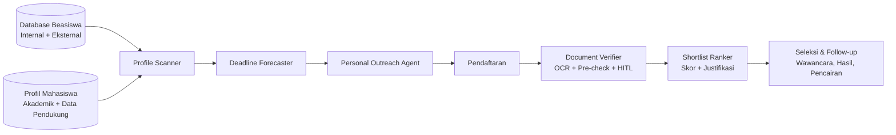

### 10.3 Modul Magang (M3)

> [!NOTE]
> Kebijakan magang POLNES (syarat semester minimum, durasi, apakah magang wajib per prodi, mekanisme kerja sama/MoU dengan mitra) **[PERLU VALIDASI]**.

#### FR-030 — Registrasi & Verifikasi Mitra

- **Nama fitur:** Registrasi & Verifikasi Mitra
- **Tujuan:** Memastikan hanya mitra sah yang dapat membuka lowongan.
- **Aktor:** MTR (calon mitra), KRD_MGG.
- **Deskripsi:** Calon mitra mendaftar (nama instansi, bidang usaha, alamat, website, kontak PIC, email, dokumen legalitas opsional [PERLU VALIDASI dokumen yang disyaratkan]). Koordinator magang memverifikasi → `AKTIF` atau `DITOLAK`. Alternatif: akun mitra dibuat langsung oleh koordinator.
- **User Story:** As a mitra industri, I want mendaftar sebagai mitra SIAP, so that saya dapat membuka lowongan magang untuk mahasiswa POLNES.
- **Preconditions:** Email PIC valid.
- **Trigger:** Halaman "Daftar Mitra".
- **Main Flow:** 1) Isi form; 2) Verifikasi email (tautan); 3) Status `PENDING_VERIFIKASI`; 4) Koordinator meninjau → `AKTIF`; 5) Notifikasi ke mitra.
- **Alternative Flow:** A1: Koordinator membuat akun mitra langsung → `AKTIF`. A2: Koordinator meminta kelengkapan data.
- **Exception Flow:** E1: Email sudah terdaftar → ditolak. E2: Ditolak → `DITOLAK` + alasan. E3: Mitra melanggar → `NONAKTIF`, lowongannya ditutup otomatis.
- **Input:** Data instansi & PIC, dokumen legalitas.
- **Process:** Validasi → simpan → verifikasi email → antrean verifikasi → audit.
- **Output:** Akun mitra.
- **Business Rules:** BR-007, BR-040.
- **Validation:** Email format valid; website URL valid (opsional); captcha pada form publik (SEC-018).
- **Acceptance Criteria:**
  - AC1: Given mitra mendaftar dan verifikasi email, When koordinator menyetujui, Then status `AKTIF` dan mitra dapat membuat lowongan.
  - AC2: Given mitra `PENDING_VERIFIKASI`, When mencoba mempublikasi lowongan, Then ditolak.
  - AC3: Given mitra dinonaktifkan, When disimpan, Then semua lowongan `DIBUKA` milik mitra menjadi `DITUTUP` dan pelamar aktif dinotifikasi.
- **Priority:** P0

#### FR-031 — Pengelolaan Lowongan

- **Nama fitur:** Pengelolaan Lowongan
- **Tujuan:** Mitra membuat dan mengelola lowongan magang.
- **Aktor:** MTR (milik sendiri), KRD_MGG (moderasi).
- **Deskripsi:** CRUD lowongan: judul, deskripsi, bidang/kategori, prodi yang relevan, kualifikasi, keterampilan, lokasi, mode kerja (onsite/remote/hybrid), durasi, kuota, tunjangan (opsional), tanggal buka-tutup, dokumen yang diminta. Status: `DRAFT` → `DIBUKA` → `DITUTUP`/`KEDALUWARSA`; moderasi opsional sebelum publikasi (`MENUNGGU_MODERASI`) [REKOMENDASI; PERLU VALIDASI apakah diperlukan].
- **User Story:** As a mitra, I want membuat dan mengelola lowongan, so that mahasiswa yang sesuai dapat melamar.
- **Preconditions:** Mitra `AKTIF`.
- **Trigger:** Menu "Lowongan Saya".
- **Main Flow:** 1) Buat lowongan; 2) Simpan draft / publikasi; 3) (Jika moderasi aktif) koordinator menyetujui; 4) Lowongan `DIBUKA` & tampil di pencarian; 5) Tutup manual atau otomatis saat tanggal tutup.
- **Alternative Flow:** A1: Duplikasi lowongan lama. A2: Perpanjang tanggal tutup. A3: Koordinator menurunkan lowongan yang melanggar → `DITUTUP` + alasan.
- **Exception Flow:** E1: Tanggal tutup < tanggal buka → ditolak. E2: Mengubah lowongan yang sudah memiliki pelamar → field kritis (kualifikasi) memunculkan peringatan & notifikasi ke pelamar [REKOMENDASI].
- **Input:** Data lowongan.
- **Process:** Validasi → sanitasi HTML deskripsi (SEC-010) → simpan → scheduler penutupan.
- **Output:** Lowongan.
- **Business Rules:** BR-040, BR-041.
- **Validation:** Judul 5–150 karakter; kuota ≥ 1; tanggal valid.
- **Acceptance Criteria:**
  - AC1: Given mitra aktif mempublikasi lowongan valid, When moderasi tidak aktif, Then lowongan langsung `DIBUKA` dan tampil di pencarian mahasiswa.
  - AC2: Given tanggal tutup terlewati, When scheduler berjalan, Then lowongan berstatus `KEDALUWARSA` dan tombol lamar nonaktif.
  - AC3: Given deskripsi berisi `<script>`, When disimpan, Then script disanitasi.
- **Priority:** P0

#### FR-032 — Pencarian & Filter Lowongan

- **Nama fitur:** Pencarian & Filter Lowongan
- **Tujuan:** Mahasiswa menemukan lowongan relevan dengan cepat.
- **Aktor:** MHS.
- **Deskripsi:** Pencarian kata kunci (judul, mitra, keterampilan) dan filter: bidang, prodi relevan, lokasi, mode kerja, durasi, berbayar/tidak, tanggal tutup. Urutkan: terbaru, deadline terdekat, relevansi. Simpan lowongan (bookmark) [REKOMENDASI].
- **User Story:** As a mahasiswa, I want mencari dan memfilter lowongan, so that saya menemukan tempat magang yang sesuai.
- **Preconditions:** Login sebagai MHS.
- **Trigger:** Menu "Magang".
- **Main Flow:** Input kata kunci/filter → hasil terpaginasi (kartu lowongan) → klik detail.
- **Alternative Flow:** A1: Bookmark lowongan.
- **Exception Flow:** E1: Tidak ada hasil → empty state + saran melonggarkan filter.
- **Input:** q, filter[], sort, page.
- **Process:** Query full-text (index) hanya lowongan `DIBUKA` milik mitra `AKTIF`.
- **Output:** Daftar lowongan.
- **Business Rules:** BR-040, BR-041.
- **Validation:** Panjang q ≤ 100; parameter filter whitelist.
- **Acceptance Criteria:**
  - AC1: Given filter "Remote" dan prodi "X", When diterapkan, Then hanya lowongan remote yang relevan dengan prodi X tampil.
  - AC2: Given lowongan `DITUTUP`, When mencari, Then lowongan tidak tampil.
  - AC3: Given 1.000 lowongan, When mencari, Then respons ≤ 2 detik (NFR-001).
- **Priority:** P0

#### FR-033 — Detail Lowongan

- **Nama fitur:** Detail Lowongan
- **Tujuan:** Menyajikan informasi lengkap sebelum melamar.
- **Aktor:** MHS.
- **Deskripsi:** Menampilkan deskripsi, kualifikasi, profil mitra, lokasi, durasi, kuota, tanggal tutup, dokumen yang diminta, status lamaran mahasiswa (jika sudah melamar), indikator kelengkapan profil terhadap syarat lowongan.
- **User Story:** As a mahasiswa, I want melihat detail lowongan, so that saya bisa menilai kecocokan sebelum melamar.
- **Preconditions:** Lowongan `DIBUKA` (atau mahasiswa sudah melamar).
- **Trigger:** Klik kartu lowongan.
- **Main Flow:** Tampilkan detail → tombol "Lamar" (FR-035).
- **Alternative Flow:** A1: Sudah melamar → tombol berganti "Lihat Status Lamaran".
- **Exception Flow:** E1: Lowongan dihapus/ditutup → info "Lowongan tidak lagi tersedia".
- **Input:** lowongan_id.
- **Process:** Ambil data + cek status lamaran.
- **Output:** Halaman detail.
- **Business Rules:** BR-042, BR-043.
- **Validation:** —
- **Acceptance Criteria:**
  - AC1: Given mahasiswa sudah melamar, When membuka detail, Then tombol "Lamar" tidak tersedia dan status lamaran ditampilkan.
- **Priority:** P0

#### FR-034 — Profil / CV Mahasiswa

- **Nama fitur:** Profil / CV
- **Tujuan:** Mahasiswa memiliki CV terstruktur yang dapat dikirim ke mitra.
- **Aktor:** MHS.
- **Deskripsi:** Builder CV: ringkasan diri, pendidikan (otomatis dari data akademik), keterampilan, pengalaman/proyek, organisasi, sertifikat, portofolio (URL), unggah CV PDF opsional. Pengaturan privasi: izinkan mitra melihat IPK (ya/tidak).
- **User Story:** As a mahasiswa, I want membuat profil/CV di SIAP, so that saya dapat melamar dengan cepat tanpa menyiapkan berkas berulang.
- **Preconditions:** Login.
- **Trigger:** Menu "Profil Magang/CV".
- **Main Flow:** Isi bagian CV → simpan → indikator kelengkapan.
- **Alternative Flow:** A1: Unggah CV PDF sendiri. A2: Pratinjau CV seperti dilihat mitra.
- **Exception Flow:** E1: URL portofolio tidak valid → error.
- **Input:** Data CV.
- **Process:** Validasi → simpan → sanitasi teks.
- **Output:** CV.
- **Business Rules:** BR-043, BR-044.
- **Validation:** Field wajib minimal: ringkasan, ≥1 keterampilan, kontak [REKOMENDASI].
- **Acceptance Criteria:**
  - AC1: Given mahasiswa menonaktifkan "tampilkan IPK", When mitra melihat lamaran, Then IPK tidak ditampilkan.
  - AC2: Given CV belum memenuhi field wajib, When mahasiswa melamar, Then diarahkan melengkapi CV.
- **Priority:** P0

#### FR-035 — Kirim Lamaran

- **Nama fitur:** Kirim Lamaran
- **Tujuan:** Mahasiswa melamar lowongan secara online.
- **Aktor:** MHS.
- **Deskripsi:** Mahasiswa memilih lowongan, meninjau CV snapshot, menambahkan surat lamaran singkat (opsional), melampirkan dokumen yang diminta, dan mengirim. Snapshot CV disimpan saat melamar.
- **User Story:** As a mahasiswa, I want mengirim lamaran magang secara online, so that saya dapat melamar banyak mitra tanpa datang langsung.
- **Preconditions:** Lowongan `DIBUKA`; CV lengkap (BR-043); belum melamar lowongan ini (BR-042); memenuhi kelayakan (BR-046).
- **Trigger:** Tombol "Lamar".
- **Main Flow:** 1) Review CV; 2) Lampirkan dokumen; 3) Konfirmasi persetujuan berbagi data ke mitra; 4) Kirim → `DIKIRIM`; 5) Notifikasi ke mahasiswa & mitra.
- **Alternative Flow:** A1: Mahasiswa menarik lamaran sebelum keputusan akhir → `DIBATALKAN`.
- **Exception Flow:** E1: Lowongan ditutup saat proses → gagal dengan pesan. E2: Batas lamaran aktif tercapai → ditolak (BR-042).
- **Input:** lowongan_id, cover_letter, dokumen[], consent.
- **Process:** Validasi → snapshot CV → simpan → notifikasi → audit.
- **Output:** Lamaran `DIKIRIM`.
- **Business Rules:** BR-042, BR-043, BR-044, BR-046.
- **Validation:** Consent wajib dicentang; dokumen wajib lowongan terlampir.
- **Acceptance Criteria:**
  - AC1: Given syarat terpenuhi, When mahasiswa mengirim lamaran, Then status `DIKIRIM` dan mitra menerima notifikasi pelamar baru.
  - AC2: Given mahasiswa sudah melamar, When mencoba melamar lagi via API, Then respons 409.
  - AC3: Given CV diubah setelah melamar, When mitra melihat lamaran, Then yang tampil adalah snapshot saat melamar.
- **Priority:** P0

#### FR-036 — Kelola Pelamar & Ubah Status Kandidat

- **Nama fitur:** Kelola Pelamar
- **Tujuan:** Mitra menyeleksi kandidat secara terstruktur.
- **Aktor:** MTR.
- **Deskripsi:** Daftar pelamar per lowongan (filter status, prodi), lihat CV snapshot & dokumen, ubah status: `DILIHAT` (otomatis saat dibuka), `SELEKSI`, `WAWANCARA` (dengan jadwal & lokasi/link), `DITERIMA`, `DITOLAK`. Catatan internal mitra (tidak terlihat mahasiswa).
- **User Story:** As a mitra, I want melihat kandidat dan mengubah status mereka, so that proses rekrutmen tertata dan kandidat mendapat kepastian.
- **Preconditions:** Lowongan milik mitra.
- **Trigger:** Menu "Pelamar".
- **Main Flow:** Pilih lowongan → daftar pelamar → buka profil → ubah status (+ pesan ke kandidat) → notifikasi ke mahasiswa.
- **Alternative Flow:** A1: Ubah status massal (mis. tolak semua yang tidak terpilih setelah kuota terpenuhi). A2: Unduh CV (dicatat audit).
- **Exception Flow:** E1: Transisi tidak sah → ditolak (BR-009). E2: Kuota terpenuhi → peringatan saat menerima kandidat tambahan.
- **Input:** lamaran_id[], status, pesan, jadwal_wawancara.
- **Process:** Cek ownership → state machine → simpan → notifikasi → audit.
- **Output:** Status kandidat ter-update.
- **Business Rules:** BR-007, BR-009, BR-044, BR-045.
- **Validation:** Jadwal wawancara wajib saat status `WAWANCARA`; alasan opsional saat `DITOLAK` (template sopan disediakan).
- **Acceptance Criteria:**
  - AC1: Given mitra membuka lamaran `DIKIRIM`, When halaman detail terbuka, Then status otomatis `DILIHAT`.
  - AC2: Given status diubah ke `WAWANCARA` dengan jadwal, When disimpan, Then mahasiswa menerima notifikasi berisi jadwal.
  - AC3: Given mitra A, When mencoba mengakses pelamar lowongan mitra B, Then 404.
- **Priority:** P0

#### FR-037 — Tracking Status Lamaran

- **Nama fitur:** Tracking Lamaran
- **Tujuan:** Mahasiswa memantau seluruh lamaran.
- **Aktor:** MHS.
- **Deskripsi:** Daftar lamaran dengan status, timeline, jadwal wawancara, pesan dari mitra. Saat `DITERIMA`, mahasiswa mengonfirmasi penerimaan (`DIKONFIRMASI_MAHASISWA`) atau menolak tawaran [REKOMENDASI].
- **User Story:** As a mahasiswa, I want melacak status lamaran, so that saya tahu perkembangan setiap lamaran.
- **Preconditions:** Memiliki lamaran.
- **Trigger:** Menu "Lamaran Saya".
- **Main Flow:** Tampilkan daftar → detail timeline.
- **Alternative Flow:** A1: Konfirmasi/menolak tawaran; jika konfirmasi, sistem menyarankan menarik lamaran lain yang masih aktif (BR-045).
- **Exception Flow:** E1: Lowongan dihapus → lamaran tetap terlihat dengan label "Lowongan ditutup".
- **Input:** —
- **Process:** Query lamaran milik sendiri.
- **Output:** Daftar & timeline.
- **Business Rules:** BR-003, BR-045.
- **Validation:** Ownership.
- **Acceptance Criteria:**
  - AC1: Given status lamaran berubah, When mahasiswa membuka daftar, Then status terbaru tampil dan notifikasi tersedia di pusat notifikasi.
  - AC2: Given lamaran `DITERIMA`, When mahasiswa mengonfirmasi, Then mitra & koordinator magang menerima notifikasi.
- **Priority:** P0

#### FR-038 — Rekomendasi Lowongan Berbasis Profil

- **Nama fitur:** Rekomendasi Lowongan
- **Tujuan:** Membantu mahasiswa yang belum mendapat tempat magang menemukan lowongan relevan.
- **Aktor:** Sistem, MHS.
- **Deskripsi:** Mencocokkan prodi, keterampilan, dan preferensi lokasi mahasiswa dengan lowongan (rule-based + kemiripan teks), menampilkan alasan rekomendasi (AI-016).
- **User Story:** As a mahasiswa yang belum mendapat tempat magang, I want menerima rekomendasi lowongan yang cocok, so that saya tidak melewatkan peluang.
- **Preconditions:** Profil/CV terisi.
- **Trigger:** Lowongan baru dibuka / mahasiswa membuka beranda magang.
- **Main Flow:** Hitung skor kecocokan → tampilkan top-N dengan alasan → notifikasi (sesuai preferensi).
- **Alternative Flow:** A1: Mahasiswa memberi umpan balik "tidak relevan".
- **Exception Flow:** E1: Profil kosong → minta lengkapi profil.
- **Input:** Profil, lowongan aktif.
- **Process:** AI-016.
- **Output:** Daftar rekomendasi + alasan.
- **Business Rules:** BR-067 (frekuensi notifikasi), BR-070.
- **Validation:** —
- **Acceptance Criteria:**
  - AC1: Given mahasiswa prodi X dengan keterampilan "jaringan", When lowongan jaringan untuk prodi X dibuka, Then lowongan muncul di rekomendasi dengan alasan "cocok prodi & keterampilan".
- **Priority:** P2

---

### 10.4 Modul Pengaduan Mahasiswa (M4)

Alur status [REQ]: **Diajukan → Diverifikasi → Diproses → Ditindaklanjuti → Selesai**, ditambah [REKOMENDASI] `PERLU_INFO`, `DITOLAK`, `DIBUKA_KEMBALI` (P2). Kategori pengaduan & unit penanggung jawab **[PERLU VALIDASI]**; contoh ilustratif: Akademik, Sarana-Prasarana, Layanan Administrasi, Keuangan, Kekerasan/Perundungan, Lainnya.

> [!WARNING]
> Pengaduan sensitif (mis. kekerasan seksual, perundungan) dapat memiliki prosedur khusus dan satuan tugas tersendiri sesuai regulasi yang berlaku. Penanganan kategori sensitif **[PERLU VALIDASI]** dengan pihak kampus; sistem menyediakan kategori dengan akses terbatas.

#### FR-040 — Membuat Pengaduan

- **Nama fitur:** Membuat Pengaduan
- **Tujuan:** Mahasiswa menyampaikan pengaduan secara online dan terlacak.
- **Aktor:** MHS.
- **Deskripsi:** Form pengaduan: kategori, judul, deskripsi masalah, lokasi/waktu kejadian (opsional), lampiran bukti (maks 5 file), opsi "rahasiakan identitas dari unit penindak lanjut" [REKOMENDASI; kebijakan anonimitas PERLU VALIDASI]. Sistem membuat nomor tiket unik `TKT-YYYYMM-NNNNN`.
- **User Story:** As a mahasiswa, I want membuat pengaduan dengan bukti, so that masalah saya tercatat resmi dan dapat ditindaklanjuti.
- **Preconditions:** Login sebagai MHS.
- **Trigger:** Menu "Pengaduan" → "Buat Pengaduan".
- **Main Flow:** 1) Pilih kategori; 2) Isi deskripsi; 3) Lampirkan bukti; 4) Kirim → `DIAJUKAN` + nomor tiket; 5) Notifikasi ke pelapor & petugas.
- **Alternative Flow:** A1: Simpan draft. A2: Kategori sensitif → hanya petugas khusus yang dapat mengakses.
- **Exception Flow:** E1: Rate limit (maks 5 pengaduan/hari [REKOMENDASI]) → ditolak sementara. E2: Lampiran tidak valid → ditolak (BR-006).
- **Input:** kategori_id, judul, deskripsi, lokasi, waktu_kejadian, lampiran[], rahasiakan_identitas.
- **Process:** Validasi → sanitasi → generate tiket → hitung SLA → notifikasi → audit.
- **Output:** Tiket `DIAJUKAN`.
- **Business Rules:** BR-005, BR-006, BR-050, BR-051.
- **Validation:** Judul 5–150; deskripsi 20–5.000 karakter.
- **Acceptance Criteria:**
  - AC1: Given form valid, When dikirim, Then tiket dibuat dengan nomor unik dan status `DIAJUKAN`.
  - AC2: Given deskripsi < 20 karakter, When dikirim, Then validasi gagal.
  - AC3: Given opsi rahasiakan identitas aktif, When unit penindak lanjut membuka tiket, Then nama & NIM pelapor tersamarkan.
- **Priority:** P0

#### FR-041 — Verifikasi & Disposisi Pengaduan

- **Nama fitur:** Verifikasi & Disposisi
- **Tujuan:** Menyaring pengaduan valid dan menyalurkannya ke unit yang tepat.
- **Aktor:** PTG_ADU.
- **Deskripsi:** Petugas memeriksa tiket: valid → `DIVERIFIKASI` lalu disposisi ke unit (`DIPROSES`); kurang informasi → `PERLU_INFO`; tidak valid/spam/duplikat → `DITOLAK` (alasan wajib). Petugas dapat mengubah kategori dan prioritas (Rendah/Sedang/Tinggi/Darurat).
- **User Story:** As a petugas pengaduan, I want memverifikasi dan mendisposisikan tiket, so that setiap pengaduan ditangani unit yang berwenang.
- **Preconditions:** Tiket `DIAJUKAN` atau info tambahan diterima.
- **Trigger:** Tiket baru di antrean.
- **Main Flow:** 1) Buka tiket; 2) Verifikasi; 3) Pilih unit + prioritas + instruksi; 4) Status `DIPROSES`; 5) Notifikasi ke pelapor & unit.
- **Alternative Flow:** A1: `PERLU_INFO` → pelapor menambah info → kembali ke antrean verifikasi. A2: Gabungkan tiket duplikat (merge) [REKOMENDASI P1].
- **Exception Flow:** E1: Unit yang dituju terlibat dalam pengaduan → sistem memperingatkan (BR-055). E2: SLA verifikasi terlewati → eskalasi ke supervisor [PERLU VALIDASI].
- **Input:** tiket_id, aksi, unit_id, prioritas, catatan.
- **Process:** State machine → simpan → notifikasi → audit.
- **Output:** Tiket terdisposisi.
- **Business Rules:** BR-007, BR-009, BR-052, BR-053, BR-055.
- **Validation:** Unit wajib saat disposisi; alasan wajib saat `DITOLAK`/`PERLU_INFO`.
- **Acceptance Criteria:**
  - AC1: Given tiket valid, When petugas mendisposisikan ke unit, Then status `DIPROSES`, unit menerima notifikasi, pelapor melihat status baru.
  - AC2: Given tiket ditolak, When tanpa alasan, Then sistem menolak aksi.
  - AC3: Given tiket melewati SLA verifikasi, When dashboard dibuka, Then tiket ditandai merah.
- **Priority:** P0

#### FR-042 — Tanggapan & Tindak Lanjut

- **Nama fitur:** Tanggapan & Tindak Lanjut
- **Tujuan:** Unit memberikan respons dan menyelesaikan masalah.
- **Aktor:** UNIT_ADU, PTG_ADU.
- **Deskripsi:** Unit menambahkan tanggapan (publik ke pelapor) atau catatan internal, melampirkan bukti tindak lanjut, menetapkan `DITINDAKLANJUTI` saat aksi telah dilakukan, dan petugas/unit menetapkan `SELESAI` dengan tanggapan akhir.
- **User Story:** As a unit penindak lanjut, I want memberi tanggapan dan mencatat tindak lanjut, so that pelapor mengetahui penyelesaian masalahnya.
- **Preconditions:** Tiket didisposisikan ke unit.
- **Trigger:** Notifikasi disposisi.
- **Main Flow:** 1) Baca tiket; 2) Tambah tanggapan; 3) Lakukan aksi → `DITINDAKLANJUTI` + uraian; 4) Tutup → `SELESAI` + tanggapan akhir; 5) Notifikasi pelapor.
- **Alternative Flow:** A1: Unit mengembalikan ke petugas (salah disposisi) → kembali `DIVERIFIKASI` untuk disposisi ulang. A2: Diskusi berbalas dengan pelapor dalam tiket.
- **Exception Flow:** E1: Unit tidak berwenang → 403.
- **Input:** tiket_id, isi_tanggapan, tipe (publik/internal), lampiran, status.
- **Process:** Simpan → state machine → notifikasi → audit.
- **Output:** Tanggapan tercatat.
- **Business Rules:** BR-053.
- **Validation:** Tanggapan akhir wajib saat `SELESAI` (min 20 karakter).
- **Acceptance Criteria:**
  - AC1: Given catatan internal, When pelapor membuka tiket, Then catatan internal tidak terlihat.
  - AC2: Given unit menutup tiket, When tanpa tanggapan akhir, Then ditolak.
- **Priority:** P0

#### FR-043 — Tracking & Riwayat Pengaduan

- **Nama fitur:** Tracking & Riwayat Pengaduan
- **Tujuan:** Pelapor memantau perkembangan pengaduan.
- **Aktor:** MHS.
- **Deskripsi:** Daftar tiket milik sendiri (filter status/kategori), detail dengan stepper status, tanggapan publik, kolom balasan, dan pencarian nomor tiket.
- **User Story:** As a mahasiswa, I want melacak status dan tanggapan pengaduan, so that saya tahu tindak lanjut atas laporan saya.
- **Preconditions:** Memiliki tiket.
- **Trigger:** Menu "Pengaduan Saya" / notifikasi.
- **Main Flow:** Tampilkan daftar → detail timeline → balas jika `PERLU_INFO`.
- **Alternative Flow:** —
- **Exception Flow:** E1: Akses tiket orang lain → 404.
- **Input:** filter / nomor tiket.
- **Process:** Query milik sendiri.
- **Output:** Daftar & detail.
- **Business Rules:** BR-003, BR-054.
- **Validation:** Ownership.
- **Acceptance Criteria:**
  - AC1: Given tiket `PERLU_INFO`, When pelapor mengirim balasan, Then tiket kembali ke antrean verifikasi dan petugas dinotifikasi.
- **Priority:** P0

#### FR-044 — Penilaian Kepuasan & Buka Kembali Tiket

- **Nama fitur:** Rating & Reopen
- **Tujuan:** Mengukur kualitas penanganan dan menangani penyelesaian yang belum tuntas.
- **Aktor:** MHS.
- **Deskripsi:** Setelah `SELESAI`, pelapor memberi rating 1–5 + komentar; dapat membuka kembali tiket dalam 7 hari (`DIBUKA_KEMBALI`) dengan alasan.
- **User Story:** As a mahasiswa, I want menilai penanganan dan membuka kembali tiket bila belum tuntas, so that kualitas layanan pengaduan terjaga.
- **Preconditions:** Tiket `SELESAI`.
- **Trigger:** Notifikasi tiket selesai.
- **Main Flow:** Beri rating → simpan.
- **Alternative Flow:** A1: Reopen dalam batas waktu → `DIBUKA_KEMBALI` → masuk antrean petugas.
- **Exception Flow:** E1: Lewat 7 hari → reopen tidak tersedia; arahkan membuat tiket baru dengan referensi.
- **Input:** rating, komentar, alasan_reopen.
- **Process:** Simpan → state machine.
- **Output:** Rating / tiket dibuka kembali.
- **Business Rules:** BR-054.
- **Validation:** Rating 1–5.
- **Acceptance Criteria:**
  - AC1: Given tiket selesai 3 hari lalu, When pelapor reopen dengan alasan, Then status `DIBUKA_KEMBALI` dan petugas dinotifikasi.
- **Priority:** P2

---

### 10.5 Modul Beasiswa Cerdas (M5)

> [!IMPORTANT]
> Seluruh komponen "cerdas" pada modul ini bersifat **asistif**. Keputusan kelayakan final, validitas dokumen, dan penerimaan beasiswa **selalu** ditetapkan manusia berwenang (BR-061, BR-064, BR-066; AI-008).

#### FR-050 — Database Beasiswa Internal

- **Nama fitur:** Database Beasiswa Internal
- **Tujuan:** Mengelola program beasiswa yang dikelola/difasilitasi kampus.
- **Aktor:** ADM_BSW.
- **Deskripsi:** CRUD beasiswa: nama, penyelenggara, tipe (internal/eksternal), deskripsi, nilai manfaat, kuota, periode pendaftaran (buka–tutup), kriteria terstruktur (IPK min, semester min/maks, prodi, penghasilan orang tua maks, status tidak menerima beasiswa lain, dsb.), persyaratan dokumen (jenis, wajib, format, aturan pre-check), bobot kriteria shortlist (FR-058), tahapan seleksi, kontak.
- **User Story:** As a pengelola beasiswa, I want mengelola data beasiswa dengan kriteria terstruktur, so that sistem dapat mencocokkan mahasiswa secara otomatis.
- **Preconditions:** Login ADM_BSW.
- **Trigger:** Menu "Kelola Beasiswa".
- **Main Flow:** 1) Isi data & kriteria; 2) Definisikan persyaratan dokumen; 3) Simpan `DRAFT`; 4) Publikasi → `DIPUBLIKASI`; 5) Pada tanggal buka → `DIBUKA`; tanggal tutup → `DITUTUP`.
- **Alternative Flow:** A1: Duplikasi beasiswa periode lalu. A2: Kriteria naratif yang belum dapat distrukturkan disimpan sebagai teks dan ditandai "perlu cek manual".
- **Exception Flow:** E1: Kriteria kontradiktif (semester min > maks) → ditolak. E2: Mengubah kriteria setelah ada pendaftar → peringatan + audit + re-scan.
- **Input:** Data beasiswa, kriteria[], persyaratan[], bobot[].
- **Process:** Validasi → simpan → jadwalkan Profile Scanner saat publikasi.
- **Output:** Beasiswa.
- **Business Rules:** BR-062, BR-065.
- **Validation:** Tanggal tutup > buka; kuota ≥ 1; total bobot = 100%.
- **Acceptance Criteria:**
  - AC1: Given beasiswa dipublikasi, When disimpan, Then job Profile Scanner berjalan untuk seluruh mahasiswa aktif yang memenuhi syarat dasar.
  - AC2: Given total bobot ≠ 100%, When disimpan, Then validasi gagal.
- **Priority:** P0

#### FR-051 — Kurasi Beasiswa Eksternal (Manual)

- **Nama fitur:** Kurasi Beasiswa Eksternal Manual
- **Tujuan:** Menyediakan informasi beasiswa eksternal yang terpercaya tanpa bergantung pada crawling.
- **Aktor:** ADM_BSW.
- **Deskripsi:** Admin menginput beasiswa eksternal (tautan sumber resmi wajib, tanggal diperoleh, penyelenggara, deadline, kriteria yang dapat distrukturkan). Pendaftaran dilakukan di situs penyelenggara; SIAP membantu checklist & reminder. Status rekaman: `DRAFT` → `DIPUBLIKASI` → `KEDALUWARSA`.
- **User Story:** As a pengelola beasiswa, I want menambahkan beasiswa eksternal yang terverifikasi, so that mahasiswa mendapat informasi akurat dari sumber resmi.
- **Preconditions:** —
- **Trigger:** Menu "Beasiswa Eksternal" → "Tambah".
- **Main Flow:** Input → cek duplikasi (AI-017/§20.6) → publikasi → Profile Scanner berjalan.
- **Alternative Flow:** A1: Menyetujui kandidat dari hasil crawling (FR-052).
- **Exception Flow:** E1: Duplikat terdeteksi → tampilkan rekaman serupa untuk digabung/diabaikan.
- **Input:** Data beasiswa eksternal + URL sumber.
- **Process:** Validasi URL → dedup → simpan → atribusi.
- **Output:** Beasiswa eksternal terpublikasi dengan atribusi sumber.
- **Business Rules:** BR-060.
- **Validation:** URL sumber wajib (https); deadline wajib atau ditandai "tidak diketahui".
- **Acceptance Criteria:**
  - AC1: Given beasiswa eksternal dipublikasi, When mahasiswa membukanya, Then sumber, tanggal pembaruan terakhir, dan tautan resmi tampil, beserta disclaimer untuk memverifikasi di situs resmi.
  - AC2: Given deadline terlewati, When scheduler berjalan, Then status `KEDALUWARSA`.
- **Priority:** P1

#### FR-052 — Ingestion / Crawling Beasiswa Eksternal

- **Nama fitur:** Ingestion / Crawling Beasiswa Eksternal
- **Tujuan:** Mengumpulkan kandidat informasi beasiswa dari sumber yang **mengizinkan**.
- **Aktor:** Sistem (crawler), ADM_BSW (review).
- **Deskripsi:** Registry sumber dengan status izin; pengambilan via API/RSS/feed resmi (prioritas) atau crawling terbatas yang mematuhi robots.txt & ToS; normalisasi; deteksi duplikasi; hasil masuk antrean review (tidak otomatis tampil). Detail di Bagian 20.
- **User Story:** As a pengelola beasiswa, I want sistem mengumpulkan kandidat beasiswa dari sumber resmi yang diizinkan, so that database selalu mutakhir tanpa input manual penuh.
- **Preconditions:** Sumber terdaftar dengan status `DIIZINKAN` (review ToS & robots.txt tercatat).
- **Trigger:** Jadwal (mis. harian) atau manual "Jalankan sekarang".
- **Main Flow:** 1) Ambil daftar sumber aktif; 2) Cek robots.txt; 3) Ambil data dengan rate limit; 4) Ekstraksi & normalisasi; 5) Dedup; 6) Simpan sebagai `TERDETEKSI` → `MENUNGGU_REVIEW`; 7) Admin menyetujui → menjadi beasiswa eksternal `DIPUBLIKASI` (FR-051) atau `DITOLAK`.
- **Alternative Flow:** A1: Sumber menyediakan API → gunakan API, bukan scraping.
- **Exception Flow:** E1: robots.txt melarang → sumber dilewati & ditandai. E2: Struktur halaman berubah (0 item/selector gagal) → crawl job `GAGAL`, sumber `PERLU_PERBAIKAN`, admin dinotifikasi. E3: HTTP 429/5xx → backoff eksponensial, maks 3 percobaan.
- **Input:** Registry sumber.
- **Process:** Lihat Bagian 20.
- **Output:** Kandidat beasiswa di antrean review; log crawl job.
- **Business Rules:** BR-060.
- **Validation:** Lihat §20.7.
- **Acceptance Criteria:**
  - AC1: Given sumber dengan robots.txt `Disallow` pada path target, When crawler berjalan, Then path tidak diakses dan log mencatat "dilewati: robots.txt".
  - AC2: Given kandidat hasil crawling, When belum direview, Then kandidat tidak terlihat oleh mahasiswa.
  - AC3: Given sumber mengembalikan 0 item padahal sebelumnya ≥1, When job selesai, Then admin menerima peringatan kemungkinan perubahan struktur.
- **Priority:** P2

#### FR-053 — Profile Scanner

- **Nama fitur:** Profile Scanner
- **Tujuan:** Mencocokkan profil mahasiswa dengan kriteria beasiswa [REQ].
- **Aktor:** Sistem; MHS (melihat hasil).
- **Deskripsi:** Untuk setiap pasangan (mahasiswa, beasiswa terbuka), sistem mengevaluasi kriteria terstruktur dan menghasilkan: status kecocokan (`LAYAK`, `BERPOTENSI` — ada data yang belum lengkap, `TIDAK_LAYAK`), Match Score 0–100, daftar kriteria terpenuhi/tidak/tidak diketahui beserta alasan. Implementasi MVP **rule-based** deterministik (AI-001).
- **User Story:** As a mahasiswa, I want sistem menunjukkan beasiswa yang cocok dengan profil saya beserta alasannya, so that saya tidak melewatkan beasiswa yang layak saya ikuti.
- **Preconditions:** Beasiswa memiliki kriteria terstruktur; mahasiswa tidak opt-out (BR-069).
- **Trigger:** Beasiswa dipublikasi; profil/akademik mahasiswa berubah; jadwal harian.
- **Main Flow:** 1) Ambil profil (IPK, semester, prodi, status, data pendukung); 2) Evaluasi tiap kriteria; 3) Hitung skor; 4) Simpan hasil + versi aturan; 5) Tampilkan di "Beasiswa untuk Saya"; 6) Teruskan ke Deadline Forecaster & Outreach.
- **Alternative Flow:** A1: Data mahasiswa tidak lengkap → `BERPOTENSI` + ajakan melengkapi profil.
- **Exception Flow:** E1: Kriteria naratif tanpa struktur → ditandai "perlu cek manual" dan tidak memengaruhi skor. E2: Gagal proses → retry; hasil lama tetap ditampilkan dengan timestamp.
- **Input:** Profil mahasiswa, kriteria beasiswa.
- **Process:** AI-001, AI-007.
- **Output:** `scholarship_match` (status, skor, alasan per kriteria).
- **Business Rules:** BR-061, BR-069.
- **Validation:** Hanya mahasiswa `AKTIF`.
- **Acceptance Criteria:**
  - AC1: Given beasiswa IPK min 3,00 dan mahasiswa IPK 3,25, When scan berjalan, Then kriteria IPK ditandai "terpenuhi (3,25 ≥ 3,00)".
  - AC2: Given penghasilan orang tua belum diisi pada beasiswa yang mensyaratkannya, When scan, Then status `BERPOTENSI` dengan alasan "data penghasilan belum diisi".
  - AC3: Given hasil `LAYAK`, When ditampilkan, Then terdapat disclaimer bahwa hasil bukan keputusan resmi.
- **Priority:** P0

#### FR-054 — Deadline Forecaster

- **Nama fitur:** Deadline Forecaster
- **Tujuan:** Menghitung kesiapan mahasiswa berdasarkan deadline dan kebutuhan dokumen [REQ].
- **Aktor:** Sistem; MHS.
- **Deskripsi:** Untuk beasiswa `LAYAK`/`BERPOTENSI`, sistem menghitung **Readiness Score** dari kelengkapan dokumen, estimasi waktu penyiapan tiap dokumen yang belum ada (dikonfigurasi admin, mis. SKTM 3 hari [ASUMSI contoh]), dan sisa hari ke deadline. Output kategori: `SIAP`, `AMAN`, `BERISIKO`, `KRITIS`, `TIDAK_TERKEJAR`, plus rencana aksi berurutan. Formula di BR-068 / AI-002.
- **User Story:** As a mahasiswa, I want mengetahui apakah saya masih sempat menyiapkan dokumen sebelum deadline, so that saya dapat memprioritaskan persiapan beasiswa.
- **Preconditions:** Hasil Profile Scanner tersedia; beasiswa memiliki deadline.
- **Trigger:** Harian; saat dokumen diunggah; saat hasil scan berubah.
- **Main Flow:** Hitung dokumen kurang → estimasi hari penyiapan → bandingkan dengan sisa hari kerja → kategori + rencana aksi → simpan → picu reminder (FR-073).
- **Alternative Flow:** A1: Dokumen dapat diajukan via Layanan Administrasi (mis. surat aktif kuliah) → tautan langsung ke FR-021.
- **Exception Flow:** E1: Deadline tidak diketahui (eksternal) → kategori `TIDAK_DIKETAHUI`, hanya checklist.
- **Input:** Checklist dokumen, dokumen mahasiswa, deadline, estimasi waktu.
- **Process:** AI-002.
- **Output:** Readiness score, kategori, rencana aksi.
- **Business Rules:** BR-004, BR-068.
- **Validation:** —
- **Acceptance Criteria:**
  - AC1: Given 2 dokumen kurang dengan total estimasi 5 hari kerja dan sisa 3 hari kerja, When dihitung, Then kategori `TIDAK_TERKEJAR` atau `KRITIS` sesuai BR-068 dan alasannya ditampilkan.
  - AC2: Given dokumen terakhir diunggah, When dihitung ulang, Then kategori menjadi `SIAP`.
- **Priority:** P1

#### FR-055 — Personal Outreach Agent

- **Nama fitur:** Personal Outreach Agent
- **Tujuan:** Mengirim notifikasi personal berdasarkan kelayakan mahasiswa [REQ].
- **Aktor:** Sistem.
- **Deskripsi:** Mengirim pesan personal (in-app + email) kepada mahasiswa `LAYAK`/`BERPOTENSI` berisi alasan kecocokan, readiness, dokumen kurang, dan deadline. MVP menggunakan **template berparameter** (AI-003); personalisasi LLM adalah P3. Menghormati batas frekuensi dan preferensi.
- **User Story:** As a mahasiswa, I want menerima pemberitahuan personal tentang beasiswa yang cocok, so that saya segera bertindak sebelum deadline.
- **Preconditions:** Hasil scan & forecast tersedia; mahasiswa tidak opt-out dari notifikasi rekomendasi.
- **Trigger:** Hasil scan baru `LAYAK`/`BERPOTENSI`; perubahan kategori readiness ke `BERISIKO`/`KRITIS`.
- **Main Flow:** 1) Pilih kandidat penerima; 2) Terapkan aturan frekuensi (BR-067) & deduplikasi; 3) Render template; 4) Kirim; 5) Catat outreach log (terkirim, dibuka, diklik, mendaftar).
- **Alternative Flow:** A1: Admin meninjau & menyetujui kampanye outreach sebelum dikirim (opsional, dapat dikonfigurasi per beasiswa).
- **Exception Flow:** E1: Email gagal → in-app tetap terkirim, retry email. E2: Batas frekuensi tercapai → digabung dalam ringkasan mingguan (digest).
- **Input:** Hasil scan, forecast, template, preferensi.
- **Process:** AI-003.
- **Output:** Notifikasi + outreach log.
- **Business Rules:** BR-061, BR-067, BR-069, BR-070.
- **Validation:** Template tidak boleh menyatakan mahasiswa "pasti diterima".
- **Acceptance Criteria:**
  - AC1: Given mahasiswa `LAYAK` untuk beasiswa baru, When outreach berjalan, Then mahasiswa menerima pesan berisi nama beasiswa, alasan kecocokan, dokumen kurang, dan deadline.
  - AC2: Given mahasiswa sudah menerima 3 pesan rekomendasi minggu ini, When ada rekomendasi ke-4, Then masuk digest, bukan notifikasi terpisah.
  - AC3: Given mahasiswa opt-out rekomendasi, When outreach berjalan, Then tidak ada pesan rekomendasi yang dikirim.
- **Priority:** P1

#### FR-056 — Pendaftaran Beasiswa

- **Nama fitur:** Pendaftaran Beasiswa
- **Tujuan:** Mahasiswa mendaftar beasiswa internal secara online.
- **Aktor:** MHS.
- **Deskripsi:** Form pendaftaran (data otomatis dari profil + field tambahan), unggah dokumen per checklist, pernyataan kebenaran data, submit. Status: `DRAFT` → `DIAJUKAN` → (verifikasi dokumen, lihat FR-057) → … (Bagian 23.5).
- **User Story:** As a mahasiswa, I want mendaftar beasiswa dan mengunggah dokumen secara online, so that saya tidak perlu mengumpulkan berkas fisik.
- **Preconditions:** Beasiswa `DIBUKA`; sebelum deadline (BR-062); belum terdaftar pada beasiswa yang sama.
- **Trigger:** Tombol "Daftar".
- **Main Flow:** 1) Review data profil (snapshot); 2) Unggah dokumen; 3) Centang pernyataan; 4) Submit → `DIAJUKAN`; 5) Document Verifier pre-check berjalan (jika aktif); 6) Notifikasi.
- **Alternative Flow:** A1: Simpan draft. A2: Batal sebelum verifikasi dimulai → `DIBATALKAN`.
- **Exception Flow:** E1: Deadline lewat saat submit → ditolak (berdasarkan waktu server WITA). E2: Melanggar aturan double funding (BR-063) → peringatan/blokir sesuai konfigurasi.
- **Input:** beasiswa_id, field tambahan, dokumen[], pernyataan.
- **Process:** Validasi → snapshot profil → simpan → antrean verifikasi.
- **Output:** Pendaftaran `DIAJUKAN`, nomor `BSW-YYYYMM-NNNNN`.
- **Business Rules:** BR-005, BR-062, BR-063.
- **Validation:** Dokumen wajib lengkap; pernyataan dicentang.
- **Acceptance Criteria:**
  - AC1: Given beasiswa dibuka dan dokumen lengkap, When submit sebelum deadline, Then status `DIAJUKAN` dan nomor pendaftaran dibuat.
  - AC2: Given waktu server melewati deadline, When submit, Then ditolak meskipun halaman dibuka sebelum deadline.
- **Priority:** P0

#### FR-057 — Document Verifier

- **Nama fitur:** Document Verifier
- **Tujuan:** Mempercepat verifikasi dokumen dengan checklist, pre-check otomatis, dan verifikasi manusia [REQ].
- **Aktor:** Sistem (pre-check), ADM_BSW (verifikator).
- **Deskripsi:**
  - **Checklist persyaratan** (P0): daftar dokumen wajib per beasiswa dengan status per item.
  - **OCR bila diperlukan** (P2): ekstraksi teks dari PDF/gambar (AI-004).
  - **Pemeriksaan awal** (P2): kecocokan jenis dokumen, nama/NIM pada dokumen vs profil, keterbacaan, tanggal kedaluwarsa, nominal penghasilan vs input (AI-005), dengan confidence.
  - **Identifikasi dokumen kurang/salah** (P0 untuk "kurang"; P2 untuk "salah" berbasis AI).
  - **Permintaan revisi** (P0): verifikator menandai item `PERLU_REVISI` + catatan → mahasiswa memperbaiki sebelum batas revisi.
  - **Human-in-the-loop** (P0): status `VALID` hanya diberikan verifikator (BR-064).
- **User Story:** As a pengelola beasiswa, I want sistem memeriksa awal dokumen dan menandai kejanggalan, so that saya cukup fokus pada dokumen yang bermasalah dan tetap memegang keputusan akhir.
- **Preconditions:** Pendaftaran `DIAJUKAN`.
- **Trigger:** Pendaftaran masuk / revisi diunggah.
- **Main Flow:**
  1. Sistem menjalankan pre-check (bila aktif) → hasil per dokumen: `LOLOS_PRECHECK` / `PERLU_PERHATIAN` + alasan + confidence.
  2. Pendaftaran masuk antrean verifikasi (urutkan: perlu perhatian dahulu).
  3. Verifikator membuka panel berdampingan (dokumen + data profil + hasil pre-check).
  4. Verifikator menetapkan tiap item: `VALID` / `PERLU_REVISI` / `DITOLAK`.
  5. Semua wajib `VALID` → pendaftaran `TERVERIFIKASI`; ada revisi → `PERLU_REVISI` + notifikasi.
- **Alternative Flow:** A1: Pre-check tidak aktif/gagal → verifikasi manual penuh (fallback, AI-010). A2: Verifikator tidak setuju dengan pre-check → override + alasan (dicatat untuk evaluasi model).
- **Exception Flow:** E1: Batas revisi lewat → pendaftaran `TIDAK_LOLOS` (alasan: dokumen tidak lengkap) [PERLU VALIDASI kebijakan]. E2: OCR gagal membaca → `PERLU_PERHATIAN: tidak terbaca`.
- **Input:** Dokumen, profil snapshot, aturan pre-check.
- **Process:** AI-004, AI-005, AI-008, AI-009, AI-011.
- **Output:** Status verifikasi per dokumen & pendaftaran; log keputusan.
- **Business Rules:** BR-007, BR-032 (diterapkan analog untuk batas revisi beasiswa), BR-064.
- **Validation:** Catatan wajib untuk `PERLU_REVISI`/`DITOLAK`; override pre-check wajib alasan.
- **Acceptance Criteria:**
  - AC1: Given pre-check menyatakan `LOLOS_PRECHECK`, When verifikator belum bertindak, Then status dokumen tetap `MENUNGGU_VERIFIKASI` (bukan `VALID`).
  - AC2: Given nama pada KTM hasil OCR berbeda dengan profil, When pre-check, Then ditandai `PERLU_PERHATIAN` dengan alasan dan confidence.
  - AC3: Given verifikator menandai `PERLU_REVISI`, When disimpan, Then mahasiswa menerima notifikasi berisi item & catatan revisi.
  - AC4: Given layanan AI tidak tersedia, When pendaftaran masuk, Then pendaftaran tetap masuk antrean manual tanpa error bagi mahasiswa.
- **Priority:** P0 (checklist, revisi, HITL) / P2 (OCR & AI pre-check)

#### FR-058 — Shortlist Ranker

- **Nama fitur:** Shortlist Ranker
- **Tujuan:** Memberikan scoring berbobot dengan justifikasi yang dapat diaudit [REQ].
- **Aktor:** Sistem, ADM_BSW, KMT_BSW.
- **Deskripsi:** Untuk pendaftar `TERVERIFIKASI`, sistem menghitung Shortlist Score = Σ(bobot_i × skor_ternormalisasi_i) berdasarkan kriteria yang dikonfigurasi (mis. IPK, kondisi ekonomi, prestasi, keaktifan organisasi — kriteria & bobot [PERLU VALIDASI]). Setiap skor disertai rincian kontribusi per kriteria, data sumber, versi aturan, dan waktu perhitungan. Admin menetapkan shortlist (`SHORTLIST`) atau `TIDAK_LOLOS` secara manual — dapat mengikuti atau menyimpang dari urutan dengan alasan tercatat.
- **User Story:** As a pengelola beasiswa, I want peringkat berbobot dengan penjelasan per kriteria, so that seleksi lebih cepat, adil, dan dapat dipertanggungjawabkan.
- **Preconditions:** Bobot terkunci (BR-065); pendaftar `TERVERIFIKASI`.
- **Trigger:** Admin menekan "Hitung Skor" setelah verifikasi ditutup.
- **Main Flow:** 1) Kunci bobot; 2) Hitung skor; 3) Tampilkan tabel peringkat + panel justifikasi; 4) Admin memilih shortlist; 5) Simpan keputusan + alasan; 6) Notifikasi tahap berikutnya.
- **Alternative Flow:** A1: Skor seri → tie-breaker terkonfigurasi (mis. kondisi ekonomi, lalu IPK) [PERLU VALIDASI]. A2: Hitung ulang setelah koreksi data → versi skor baru, versi lama tetap tersimpan.
- **Exception Flow:** E1: Data kriteria kosong → skor kriteria 0 dengan alasan "data tidak tersedia" dan ditandai untuk ditinjau.
- **Input:** Data terverifikasi, bobot, aturan normalisasi.
- **Process:** AI-006, AI-007, AI-012.
- **Output:** `shortlist_score` + `shortlist_score_detail`.
- **Business Rules:** BR-065, BR-066.
- **Validation:** Total bobot 100%; hanya data terverifikasi yang dipakai.
- **Acceptance Criteria:**
  - AC1: Given bobot IPK 40% dan ekonomi 60%, When skor dihitung, Then skor total sama dengan perhitungan manual dan rincian tiap kriteria ditampilkan.
  - AC2: Given admin memilih kandidat di luar urutan peringkat, When menyimpan, Then alasan wajib diisi dan tercatat di audit.
  - AC3: Given bobot diubah setelah dikunci, When disimpan, Then wajib justifikasi, versi baru dibuat, dan audit mencatat perubahan.
- **Priority:** P1

#### FR-059 — Penjadwalan Wawancara

- **Nama fitur:** Penjadwalan Wawancara
- **Tujuan:** Mengatur jadwal wawancara kandidat shortlist.
- **Aktor:** ADM_BSW, KMT_BSW, MHS.
- **Deskripsi:** Admin membuat slot (tanggal, jam, lokasi/link, pewawancara), menugaskan kandidat (manual/otomatis berurutan), mahasiswa mengonfirmasi kehadiran atau meminta jadwal ulang (sekali [REKOMENDASI]). Pewawancara mengisi form penilaian.
- **User Story:** As a pengelola beasiswa, I want menjadwalkan wawancara dan mengirim undangan otomatis, so that kandidat mendapat informasi jelas dan tepat waktu.
- **Preconditions:** Kandidat `SHORTLIST`.
- **Trigger:** Menu "Wawancara".
- **Main Flow:** Buat slot → assign → undangan terkirim → konfirmasi mahasiswa → wawancara → input nilai.
- **Alternative Flow:** A1: Permintaan jadwal ulang → admin menyetujui slot baru.
- **Exception Flow:** E1: Bentrok slot pewawancara → ditolak. E2: Kandidat tidak hadir → `TIDAK_HADIR` [kebijakan PERLU VALIDASI].
- **Input:** Slot, kandidat, pewawancara.
- **Process:** Validasi bentrok → simpan → notifikasi → reminder H-1.
- **Output:** Jadwal & undangan.
- **Business Rules:** BR-004, BR-071.
- **Validation:** Slot di masa depan; kapasitas slot.
- **Acceptance Criteria:**
  - AC1: Given kandidat diassign ke slot, When disimpan, Then kandidat menerima notifikasi berisi waktu (WITA) dan lokasi/link.
  - AC2: Given H-1 wawancara, When scheduler berjalan, Then reminder terkirim ke kandidat dan pewawancara.
- **Priority:** P1

#### FR-060 — Pengumuman Hasil & Permintaan Dokumen Tambahan

- **Nama fitur:** Pengumuman & Dokumen Tambahan
- **Tujuan:** Menyampaikan hasil seleksi dan meminta dokumen lanjutan.
- **Aktor:** ADM_BSW, KMT_BSW, MHS.
- **Deskripsi:** Komite menetapkan keputusan final (`DITERIMA` / `TIDAK_LOLOS` / `CADANGAN` [REKOMENDASI]) — wajib oleh pengguna berwenang. Admin mempublikasikan pengumuman (serentak). Untuk penerima, admin dapat meminta dokumen tambahan (mis. buku rekening, pakta integritas [ASUMSI contoh]) dengan deadline.
- **User Story:** As a mahasiswa, I want menerima notifikasi hasil dan permintaan dokumen tambahan, so that saya bisa segera melengkapi proses penerimaan.
- **Preconditions:** Proses seleksi selesai.
- **Trigger:** Admin menekan "Publikasikan Hasil".
- **Main Flow:** Tetapkan keputusan → review → publikasi → notifikasi individual → (penerima) permintaan dokumen tambahan → unggah → verifikasi.
- **Alternative Flow:** A1: Penerima mengundurkan diri → kandidat `CADANGAN` teratas dapat dipromosikan oleh admin.
- **Exception Flow:** E1: Keputusan belum lengkap untuk semua kandidat → publikasi ditolak.
- **Input:** Keputusan per kandidat, daftar dokumen tambahan, deadline.
- **Process:** Simpan → publikasi atomik → notifikasi → audit.
- **Output:** Status final & permintaan dokumen.
- **Business Rules:** BR-066.
- **Validation:** Hanya KMT_BSW/ADM_BSW berwenang yang dapat menetapkan keputusan.
- **Acceptance Criteria:**
  - AC1: Given semua kandidat memiliki keputusan, When dipublikasi, Then seluruh kandidat menerima notifikasi hasil pada waktu yang sama.
  - AC2: Given AI/skor merekomendasikan kandidat, When tidak ada keputusan manusia, Then status kandidat tidak berubah menjadi `DITERIMA`.
- **Priority:** P1

#### FR-061 — Monitoring Pencairan & Follow-up

- **Nama fitur:** Monitoring Pencairan & Follow-up
- **Tujuan:** Memantau penyaluran dana dan kewajiban penerima.
- **Aktor:** ADM_BSW, MHS.
- **Deskripsi:** Pencatatan tahap pencairan (termin, nominal, tanggal rencana, status: `DIJADWALKAN` → `DIPROSES` → `DICAIRKAN` / `TERTUNDA`), konfirmasi penerimaan oleh mahasiswa, kewajiban lanjutan (laporan IPK per semester, laporan kegiatan) dengan reminder. SIAP **tidak** mentransfer dana (NG-01).
- **User Story:** As a pengelola beasiswa, I want memantau status pencairan dan kewajiban penerima, so that penyaluran tepat waktu dan penerima tetap memenuhi syarat.
- **Preconditions:** Pendaftaran `DITERIMA`.
- **Trigger:** Penetapan jadwal pencairan.
- **Main Flow:** Buat jadwal termin → update status → mahasiswa konfirmasi → follow-up kewajiban → laporan.
- **Alternative Flow:** A1: Import status pencairan via Excel dari unit keuangan (P2) mengikuti alur Bagian 18.
- **Exception Flow:** E1: Penerima tidak lagi memenuhi syarat (mis. IPK turun) → peringatan ke admin; keputusan penghentian oleh manusia.
- **Input:** Termin, nominal, status, bukti.
- **Process:** Simpan → notifikasi → reminder.
- **Output:** Riwayat pencairan.
- **Business Rules:** BR-066.
- **Validation:** Nominal > 0.
- **Acceptance Criteria:**
  - AC1: Given status termin menjadi `DICAIRKAN`, When disimpan, Then mahasiswa dinotifikasi dan diminta konfirmasi penerimaan.
- **Priority:** P2

---

### 10.6 Modul Notifikasi Terintegrasi (M6)

#### FR-070 — Pusat Notifikasi In-App

- **Nama fitur:** Notification Center
- **Tujuan:** Satu pusat notifikasi lintas modul [REQ].
- **Aktor:** Semua.
- **Deskripsi:** Ikon lonceng dengan badge jumlah belum dibaca, panel/daftar notifikasi dengan filter kategori (Akademik, Administrasi, Magang, Pengaduan, Beasiswa, Deadline, Sistem), tandai dibaca/semua dibaca, deep link ke objek terkait. Real-time via polling (MVP, 30–60 detik) atau WebSocket/SSE (P1) [REKOMENDASI].
- **User Story:** As a pengguna, I want satu tempat untuk melihat semua notifikasi, so that saya tidak melewatkan informasi penting.
- **Preconditions:** Login.
- **Trigger:** Event domain (perubahan status, deadline, dsb.).
- **Main Flow:** Event → Notification Service membuat notifikasi sesuai matriks (Bagian 22) → tampil di pusat notifikasi → pengguna klik → diarahkan ke objek & ditandai dibaca.
- **Alternative Flow:** A1: Tandai semua dibaca.
- **Exception Flow:** E1: Objek terkait sudah tidak dapat diakses → pesan "Konten tidak tersedia".
- **Input:** Event.
- **Process:** Resolusi penerima → render template → simpan → push.
- **Output:** Notifikasi.
- **Business Rules:** BR-008, BR-070, BR-072.
- **Validation:** Penerima hanya pengguna berhak atas objek terkait.
- **Acceptance Criteria:**
  - AC1: Given status pengajuan berubah menjadi `SIAP_DIAMBIL`, When event terjadi, Then mahasiswa menerima notifikasi kategori Administrasi dengan deep link ≤ 60 detik.
  - AC2: Given 5 notifikasi belum dibaca, When "tandai semua dibaca", Then badge menjadi 0.
- **Priority:** P0

#### FR-071 — Notifikasi Email

- **Nama fitur:** Notifikasi Email
- **Tujuan:** Menjangkau pengguna di luar aplikasi untuk event penting.
- **Aktor:** Sistem.
- **Deskripsi:** Email transaksional untuk event berprioritas tinggi (Bagian 22) melalui queue dengan retry; template HTML responsif; tautan ke SIAP (tanpa data sensitif berlebihan di isi email).
- **User Story:** As a mahasiswa, I want menerima email untuk pembaruan penting, so that saya tetap tahu meski tidak membuka aplikasi.
- **Preconditions:** Email terverifikasi; SMTP tersedia [PERLU VALIDASI].
- **Trigger:** Event dengan kanal email.
- **Main Flow:** Enqueue → kirim → catat status (`TERKIRIM`/`GAGAL`).
- **Alternative Flow:** A1: Digest harian/mingguan untuk notifikasi prioritas rendah.
- **Exception Flow:** E1: Gagal kirim → retry 3× (backoff) → `GAGAL` + log.
- **Input:** Event, template.
- **Process:** Queue worker.
- **Output:** Email terkirim + log.
- **Business Rules:** BR-070.
- **Validation:** Email valid.
- **Acceptance Criteria:**
  - AC1: Given SMTP sementara gagal, When retry berhasil pada percobaan ke-2, Then status `TERKIRIM` dan tidak ada email ganda.
- **Priority:** P1

#### FR-072 — Preferensi Notifikasi

- **Nama fitur:** Preferensi Notifikasi
- **Tujuan:** Pengguna mengatur kanal & jenis notifikasi non-wajib.
- **Aktor:** Semua.
- **Deskripsi:** Matriks kategori × kanal (in-app/email) untuk notifikasi non-transaksional (rekomendasi beasiswa/lowongan, digest). Notifikasi transaksional & keamanan tidak dapat dimatikan (BR-070).
- **User Story:** As a pengguna, I want mengatur notifikasi yang saya terima, so that saya tidak terganggu notifikasi yang tidak relevan.
- **Preconditions:** Login.
- **Trigger:** Menu "Pengaturan Notifikasi".
- **Main Flow:** Ubah toggle → simpan.
- **Alternative Flow:** A1: Opt-out dari tautan di email rekomendasi.
- **Exception Flow:** E1: Mencoba mematikan notifikasi wajib → toggle terkunci dengan penjelasan.
- **Input:** Preferensi.
- **Process:** Simpan.
- **Output:** Preferensi tersimpan.
- **Business Rules:** BR-069, BR-070.
- **Validation:** —
- **Acceptance Criteria:**
  - AC1: Given email rekomendasi beasiswa dimatikan, When outreach berjalan, Then hanya notifikasi in-app yang dikirim (jika in-app aktif).
- **Priority:** P2

#### FR-073 — Reminder Deadline Terjadwal

- **Nama fitur:** Reminder Deadline
- **Tujuan:** Mengingatkan deadline lintas modul.
- **Aktor:** Sistem.
- **Deskripsi:** Scheduler mengirim pengingat untuk: penutupan KRS, batas revisi layanan/beasiswa, deadline beasiswa (untuk mahasiswa `LAYAK`/terdaftar draft), jadwal wawancara, tanggal tutup lowongan yang dibookmark, batas pengambilan dokumen.
- **User Story:** As a mahasiswa, I want diingatkan sebelum deadline, so that saya tidak terlambat.
- **Preconditions:** Objek memiliki deadline.
- **Trigger:** Cron (mis. setiap jam).
- **Main Flow:** Cari objek dengan deadline H-7/H-3/H-1 (BR-071) → cek belum dikirim (idempotent) → kirim.
- **Alternative Flow:** —
- **Exception Flow:** E1: Pengguna sudah menyelesaikan aksi → reminder dibatalkan.
- **Input:** Objek berdeadline.
- **Process:** Scheduler idempotent (kunci unik objek+offset).
- **Output:** Notifikasi reminder.
- **Business Rules:** BR-004, BR-071.
- **Validation:** —
- **Acceptance Criteria:**
  - AC1: Given KRS mahasiswa masih `DRAFT` dan periode KRS tutup besok, When scheduler berjalan, Then mahasiswa menerima reminder H-1 tepat satu kali.
  - AC2: Given KRS sudah `DIAJUKAN`, When scheduler berjalan, Then reminder KRS tidak dikirim.
- **Priority:** P1

---

### 10.7 Modul Core Lanjutan

#### FR-080 — Dashboard per Role

- **Nama fitur:** Dashboard
- **Tujuan:** Ringkasan kerja & informasi relevan saat login.
- **Aktor:** Semua.
- **Deskripsi:**
  - MHS: status KRS, IPK, pengajuan aktif, lamaran aktif, pengaduan aktif, beasiswa untuk saya + readiness, deadline terdekat.
  - DSN/DWL: KRS menunggu persetujuan, kelas & status input nilai.
  - Staf: antrean per status, SLA terlambat.
  - MTR: lowongan aktif, pelamar baru.
  - ADM_BSW: pendaftar, antrean verifikasi, progres seleksi.
  - PMP: KPI agregat lintas modul.
- **User Story:** As a pengguna, I want melihat ringkasan pekerjaan dan informasi penting di dashboard, so that saya tahu apa yang harus dilakukan.
- **Preconditions:** Login.
- **Trigger:** Login / menu Beranda.
- **Main Flow:** Muat widget sesuai role (lazy load).
- **Alternative Flow:** —
- **Exception Flow:** E1: Widget gagal dimuat → widget lain tetap tampil dengan pesan "coba lagi".
- **Input:** —
- **Process:** Agregasi (cache 1–5 menit untuk agregat berat).
- **Output:** Dashboard.
- **Business Rules:** BR-001.
- **Validation:** Data sesuai scope.
- **Acceptance Criteria:**
  - AC1: Given dosen wali dengan 3 KRS menunggu, When membuka dashboard, Then widget menampilkan angka 3 dengan tautan ke daftar.
- **Priority:** P0

#### FR-081 — Laporan & Ekspor

- **Nama fitur:** Laporan & Ekspor
- **Tujuan:** Menyediakan laporan operasional (Bagian 24).
- **Aktor:** Back-office, PMP.
- **Deskripsi:** Laporan terfilter (periode, prodi, status) dengan ekspor .xlsx/.csv/.pdf. Ekspor data pribadi dicatat audit dan dilindungi dari formula injection (SEC-028).
- **User Story:** As a pimpinan, I want laporan layanan per periode, so that saya dapat mengevaluasi kinerja unit.
- **Preconditions:** Permission laporan.
- **Trigger:** Menu "Laporan".
- **Main Flow:** Pilih laporan → filter → tampil → ekspor (async bila besar).
- **Alternative Flow:** A1: Ekspor besar → diproses background & notifikasi tautan unduh (kedaluwarsa 24 jam).
- **Exception Flow:** E1: Tidak ada data → laporan kosong dengan keterangan.
- **Input:** Jenis laporan, filter.
- **Process:** Query agregat.
- **Output:** Laporan & file.
- **Business Rules:** —
- **Validation:** Rentang tanggal ≤ 1 tahun per ekspor [REKOMENDASI].
- **Acceptance Criteria:**
  - AC1: Given filter periode, When ekspor .xlsx, Then file berisi data sesuai filter dan sel yang diawali `=`,`+`,`-`,`@` di-escape.
- **Priority:** P1

#### FR-082 — Audit Trail Viewer

- **Nama fitur:** Audit Trail Viewer
- **Tujuan:** Menelusuri aktivitas sistem (Bagian 25).
- **Aktor:** SUPER; admin modul (terbatas modulnya).
- **Deskripsi:** Pencarian log berdasarkan aktor, aksi, entitas, rentang waktu, IP; detail perubahan (before/after dengan masking field sensitif); ekspor.
- **User Story:** As a super admin, I want menelusuri siapa mengubah apa dan kapan, so that setiap perubahan dapat dipertanggungjawabkan.
- **Preconditions:** Permission audit.
- **Trigger:** Menu "Audit Log".
- **Main Flow:** Filter → daftar → detail.
- **Alternative Flow:** A1: Dari halaman entitas → "Lihat riwayat perubahan".
- **Exception Flow:** —
- **Input:** Filter.
- **Process:** Query read-only.
- **Output:** Daftar log.
- **Business Rules:** BR-003.
- **Validation:** Log tidak dapat diubah/dihapus melalui aplikasi.
- **Acceptance Criteria:**
  - AC1: Given nilai dikoreksi, When admin membuka audit log entitas nilai, Then tampil aktor, waktu, nilai lama, nilai baru, alasan, IP.
- **Priority:** P1

#### FR-083 — Konfigurasi Master Data & Aturan

- **Nama fitur:** Konfigurasi Master Data & Aturan
- **Tujuan:** Menyimpan aturan kampus sebagai konfigurasi.
- **Aktor:** SUPER, ADM_AKD (aturan akademik).
- **Deskripsi:** Kelola: jurusan, prodi, kurikulum, ruang, tabel konversi nilai, aturan batas SKS, status mahasiswa, kategori pengaduan & unit, jenis layanan (FR-020), SLA, template notifikasi, template Excel (versi), hari libur (untuk perhitungan hari kerja), parameter sistem (ukuran file, batas frekuensi outreach).
- **User Story:** As a super admin, I want mengonfigurasi aturan dan master data, so that sistem sesuai kebijakan kampus tanpa mengubah kode.
- **Preconditions:** Permission konfigurasi.
- **Trigger:** Menu "Pengaturan".
- **Main Flow:** Pilih konfigurasi → ubah → validasi → simpan (versi + berlaku mulai) → audit.
- **Alternative Flow:** A1: Import master via Excel.
- **Exception Flow:** E1: Konfigurasi masih dipakai (mis. kategori dengan tiket aktif) → hanya dapat dinonaktifkan.
- **Input:** Data konfigurasi.
- **Process:** Validasi → versioning → invalidasi cache.
- **Output:** Konfigurasi aktif.
- **Business Rules:** BR-008, BR-017, BR-011.
- **Validation:** Tabel konversi nilai tidak tumpang tindih dan mencakup 0–100.
- **Acceptance Criteria:**
  - AC1: Given tabel konversi diubah dengan rentang tumpang tindih, When disimpan, Then ditolak.
  - AC2: Given konfigurasi baru berlaku mulai periode berikutnya, When periode berjalan, Then perhitungan tetap memakai versi lama.
- **Priority:** P0

---
