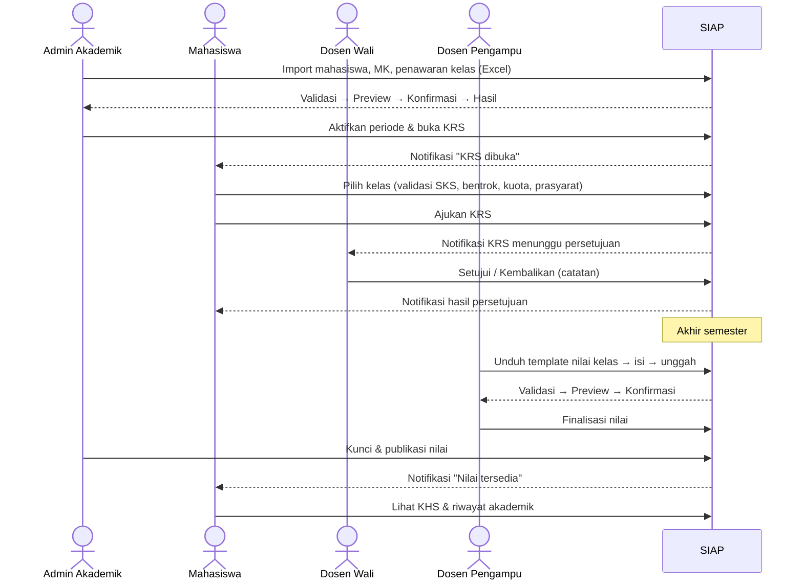
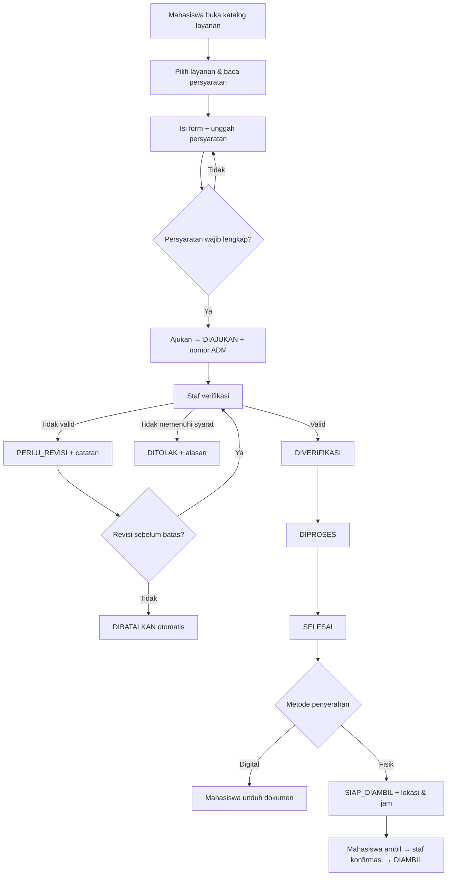
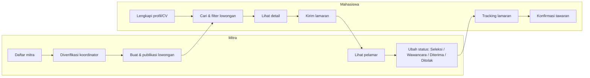
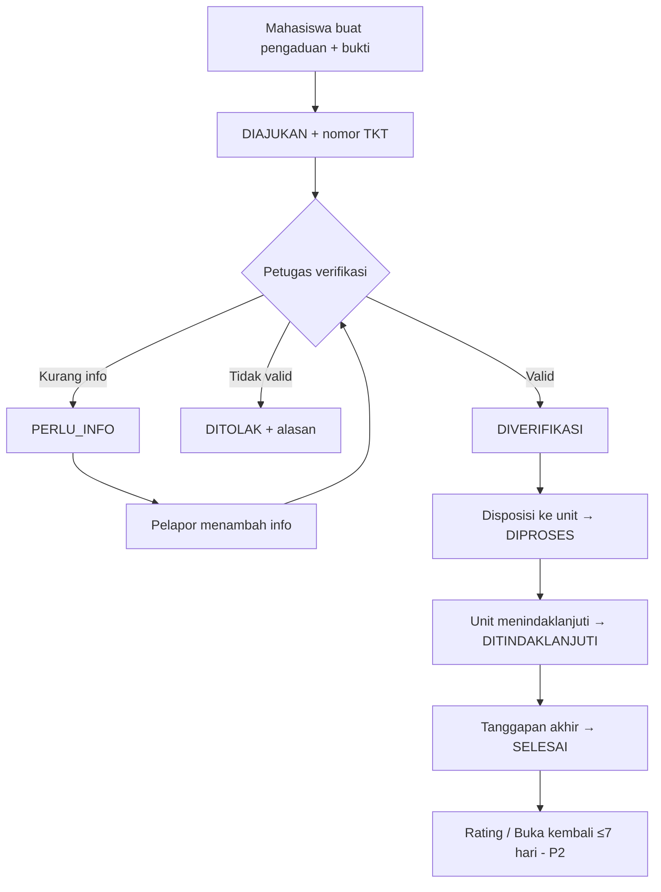
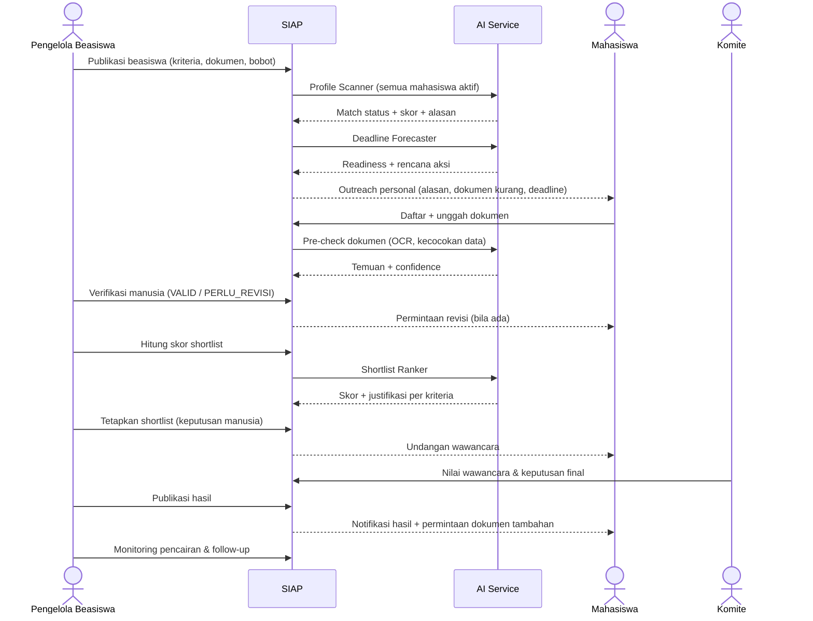
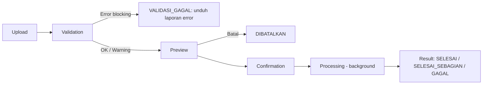

## 11. End-to-End User Flow

### 11.1 Flow Akademik: KRS → Nilai → KHS



### 11.2 Flow Layanan Administrasi



### 11.3 Flow Magang



### 11.4 Flow Pengaduan



### 11.5 Flow Beasiswa Cerdas



### 11.6 Flow Import Excel (Generik)



---

## 12. Business Rules

### 12.1 Aturan Umum

| ID | Aturan | Sumber |
|---|---|---|
| BR-001 | Setiap pengguna wajib memiliki minimal satu role; akses ditentukan oleh role **dan** scope data. | [REKOMENDASI] |
| BR-002 | NIM bersifat unik; satu NIM hanya memiliki satu akun mahasiswa. NIP/NIDN dosen unik. | [REKOMENDASI] |
| BR-003 | Setiap perubahan status pada entitas bertracking wajib dicatat di riwayat status (status lama, status baru, aktor, waktu, catatan). | [REQ] tracking / [REKOMENDASI] detail |
| BR-004 | Seluruh deadline & timestamp ditampilkan dalam WITA (UTC+8); disimpan dalam UTC. Perhitungan "hari kerja" mengecualikan Sabtu, Minggu, dan hari libur yang dikonfigurasi. | [ASUMSI] |
| BR-005 | Format nomor referensi: `ADM-YYYYMM-NNNNN` (layanan), `TKT-YYYYMM-NNNNN` (pengaduan), `BSW-YYYYMM-NNNNN` (pendaftaran beasiswa), `LMR-YYYYMM-NNNNN` (lamaran), `IMP-YYYYMMDD-NNNN` (import batch). Nomor unik dan tidak dipakai ulang. | [REKOMENDASI] |
| BR-006 | File unggahan default: PDF, JPG, JPEG, PNG; maks 5 MB per file; dapat dikonfigurasi per persyaratan. File Excel import: `.xlsx`, maks 5 MB. | [REKOMENDASI] — batas final [PERLU VALIDASI] |
| BR-007 | Setiap status penolakan, revisi, atau koreksi (`DITOLAK`, `PERLU_REVISI`, `PERLU_INFO`, `DIKOREKSI`, override AI) wajib menyertakan alasan. | [REKOMENDASI] |
| BR-008 | Data transaksional tidak dihapus permanen melalui aplikasi (soft delete/arsip); master yang sudah direferensikan hanya dapat dinonaktifkan. | [REKOMENDASI] |
| BR-009 | Transisi status hanya boleh mengikuti state machine yang didefinisikan di Bagian 23; transisi lain ditolak oleh backend. | [REKOMENDASI] |

### 12.2 Aturan Akademik

| ID | Aturan | Sumber |
|---|---|---|
| BR-010 | KRS hanya dapat diisi/diajukan dalam rentang tanggal KRS periode aktif (dan perubahan KRS dalam rentang perubahan). | [REQ] KRS / tanggal [PERLU VALIDASI] |
| BR-011 | Batas SKS maksimal per semester ditentukan oleh aturan terkonfigurasi (mis. berdasarkan IPS semester sebelumnya). Default sementara: 24 SKS [ASUMSI]. | [PERLU VALIDASI] |
| BR-012 | Mahasiswa tidak boleh mengambil mata kuliah yang sama lebih dari sekali dalam satu semester dan tidak boleh memilih kelas dengan jadwal bentrok. | [REKOMENDASI] |
| BR-013 | Jika mata kuliah memiliki prasyarat, mahasiswa harus telah lulus prasyarat (nilai minimum terkonfigurasi). | [PERLU VALIDASI] apakah POLNES menerapkan prasyarat |
| BR-014 | Jumlah peserta kelas tidak boleh melebihi kuota; reservasi kuota dilakukan secara atomik saat KRS diajukan. | [REKOMENDASI] |
| BR-015 | KRS yang `DISETUJUI` terkunci; perubahan hanya melalui mekanisme perubahan KRS dalam periode perubahan dan memerlukan persetujuan ulang. | [PERLU VALIDASI] |
| BR-016 | Hanya mahasiswa berstatus `AKTIF` yang dapat mengisi KRS. Syarat tambahan (mis. status pembayaran) [PERLU VALIDASI] — jika diperlukan, status diimport dari unit terkait. | [PERLU VALIDASI] |
| BR-017 | Konversi nilai angka → huruf → bobot mengikuti tabel konversi aktif yang dikonfigurasi. Contoh default untuk pengembangan: A (≥85)=4,0; B (70–84,99)=3,0; C (55–69,99)=2,0; D (40–54,99)=1,0; E (<40)=0 [ASUMSI — wajib diganti dengan skala resmi]. | [PERLU VALIDASI] |
| BR-018 | Nilai hanya dapat diunggah/diubah oleh dosen pengampu kelas (status `DRAFT`) atau admin akademik. Setelah `DIPUBLIKASI`, perubahan hanya melalui koreksi oleh ADM_AKD dengan alasan dan tercatat audit. | [REKOMENDASI] |
| BR-019 | IPS = Σ(bobot × SKS) / ΣSKS mata kuliah semester tersebut. IPK dihitung atas seluruh mata kuliah; untuk mata kuliah yang diulang digunakan nilai terbaik [ASUMSI] atau terakhir. | [PERLU VALIDASI] |
| BR-020 | Import hanya menerima template versi aktif (dideteksi via sheet metadata / header). | [REKOMENDASI] |
| BR-021 | Data import tidak boleh ditulis ke tabel utama sebelum pengguna mengonfirmasi preview. Konfirmasi hanya dapat dilakukan bila tidak ada error blocking (mode all-or-nothing) atau, untuk tipe yang mengizinkan mode parsial, pengguna secara eksplisit memilih memproses baris valid saja. | [REQ] alur import |
| BR-022 | Jika hash file identik dengan batch yang sudah `SELESAI` untuk tipe yang sama, sistem menampilkan peringatan duplikasi dan meminta konfirmasi tambahan. | [REKOMENDASI] |
| BR-023 | Import nilai selalu menggunakan mode all-or-nothing. | [REKOMENDASI] |
| BR-024 | Pengembalian KRS oleh dosen wali wajib disertai catatan. | [REKOMENDASI] |
| BR-025 | Import nilai hanya untuk mahasiswa yang tercatat pada KRS `DISETUJUI` di kelas tersebut. | [REKOMENDASI] |

### 12.3 Aturan Layanan Administrasi

| ID | Aturan | Sumber |
|---|---|---|
| BR-030 | Pengajuan hanya dapat diajukan jika seluruh persyaratan wajib telah diunggah. | [REQ] upload persyaratan |
| BR-031 | Mahasiswa hanya dapat membatalkan pengajuan saat status `DIAJUKAN` (belum diverifikasi). | [REKOMENDASI] |
| BR-032 | Status `PERLU_REVISI` memiliki batas revisi (default 7 hari kalender [REKOMENDASI]). Jika lewat, pengajuan otomatis `DIBATALKAN` dengan alasan sistem "batas revisi terlewati". | [REKOMENDASI] |
| BR-033 | SLA (hari kerja) ditetapkan per jenis layanan; dihitung sejak `DIAJUKAN` hingga `SELESAI`, waktu selama `PERLU_REVISI` tidak dihitung. | [PERLU VALIDASI] nilai SLA |
| BR-034 | Untuk metode `FISIK`, status `SIAP_DIAMBIL` wajib mencantumkan lokasi, jam layanan, dan batas pengambilan; pengambilan dikonfirmasi staf (`DIAMBIL`) dengan identitas pengambil. | [REQ] siap diambil / [REKOMENDASI] detail |
| BR-035 | Untuk metode `DIGITAL`, status `SELESAI` wajib disertai file hasil dan merupakan status final. | [REKOMENDASI] |
| BR-036 | Setiap jenis layanan dapat memiliki syarat kelayakan (mis. status mahasiswa aktif). | [PERLU VALIDASI] |

### 12.4 Aturan Magang

| ID | Aturan | Sumber |
|---|---|---|
| BR-040 | Hanya mitra berstatus `AKTIF` yang dapat mempublikasi lowongan. | [REKOMENDASI] |
| BR-041 | Lowongan otomatis `KEDALUWARSA` setelah tanggal tutup (23:59 WITA). | [REKOMENDASI] |
| BR-042 | Mahasiswa hanya dapat melamar satu kali per lowongan; jumlah maksimum lamaran aktif bersamaan dapat dikonfigurasi (default tanpa batas [ASUMSI]). | [PERLU VALIDASI] |
| BR-043 | Mahasiswa wajib melengkapi field CV minimum sebelum melamar. | [REKOMENDASI] |
| BR-044 | Mitra hanya dapat melihat data pelamar pada lowongannya, terbatas pada snapshot CV dan dokumen yang dilampirkan; IPK hanya tampil bila diizinkan mahasiswa. | [REKOMENDASI] |
| BR-045 | Jika mahasiswa mengonfirmasi tawaran, sistem menyarankan (tidak otomatis) penarikan lamaran aktif lain. Kebijakan wajib menarik [PERLU VALIDASI]. | [REKOMENDASI] |
| BR-046 | Syarat kelayakan magang (mis. semester minimum per prodi) dapat dikonfigurasi. | [PERLU VALIDASI] |

### 12.5 Aturan Pengaduan

| ID | Aturan | Sumber |
|---|---|---|
| BR-050 | Setiap pengaduan memperoleh nomor tiket unik saat diajukan. | [REQ] |
| BR-051 | Identitas pelapor hanya terlihat oleh petugas berwenang; opsi menyamarkan identitas dari unit penindak lanjut tersedia. Pengaduan anonim penuh (tanpa login) [PERLU VALIDASI]. | [REKOMENDASI] |
| BR-052 | SLA verifikasi default 2 hari kerja; SLA penyelesaian per kategori & prioritas. | [PERLU VALIDASI] |
| BR-053 | `DITOLAK` wajib alasan; `SELESAI` wajib tanggapan akhir kepada pelapor. | [REKOMENDASI] |
| BR-054 | Pelapor dapat menambah informasi saat `PERLU_INFO`; reopen diizinkan maksimal 7 hari setelah `SELESAI` (P2). | [REKOMENDASI] |
| BR-055 | Pengaduan tidak boleh didisposisikan kepada unit/petugas yang menjadi pihak teradu (conflict of interest); sistem memberi peringatan bila petugas menandai keterlibatan. | [REKOMENDASI] |

### 12.6 Aturan Beasiswa

| ID | Aturan | Sumber |
|---|---|---|
| BR-060 | Beasiswa eksternal (manual maupun hasil crawling) tidak tampil ke mahasiswa sebelum direview dan dipublikasi admin; wajib mencantumkan sumber resmi. | [REKOMENDASI] |
| BR-061 | Hasil Profile Scanner, Deadline Forecaster, dan Outreach hanyalah rekomendasi, bukan keputusan kelayakan resmi; antarmuka wajib menampilkan disclaimer. | [REQ] AI bukan keputusan final |
| BR-062 | Pendaftaran beasiswa internal hanya dapat dilakukan saat status beasiswa `DIBUKA` dan sebelum deadline berdasarkan waktu server. | [REKOMENDASI] |
| BR-063 | Aturan larangan penerimaan ganda (double funding) dikonfigurasi per beasiswa (blokir/peringatan/tidak berlaku). | [PERLU VALIDASI] |
| BR-064 | Status dokumen `VALID` dan status pendaftaran `TERVERIFIKASI` hanya dapat ditetapkan oleh verifikator manusia. | [REQ] HITL |
| BR-065 | Bobot kriteria shortlist ditetapkan sebelum pendaftaran dibuka dan dikunci saat scoring dimulai; perubahan setelah dikunci memerlukan justifikasi, membuat versi baru, dan tercatat audit. | [REKOMENDASI] |
| BR-066 | Keputusan shortlist, penerimaan, dan penghentian beasiswa ditetapkan oleh pengguna berwenang (ADM_BSW/KMT_BSW); skor hanya alat bantu. Penyimpangan dari urutan skor wajib alasan. | [REQ] |
| BR-067 | Outreach rekomendasi maksimal 3 notifikasi individual per mahasiswa per minggu; kelebihan digabung dalam digest mingguan. Pesan identik tidak dikirim ulang dalam 7 hari. | [REKOMENDASI] |
| BR-068 | Readiness (Deadline Forecaster): `slack = sisa_hari_kerja − (Σ estimasi_hari_dokumen_kurang + 1 hari buffer)`. Kategori: `SIAP` (semua dokumen lengkap), `AMAN` (slack ≥ 5), `BERISIKO` (2 ≤ slack < 5), `KRITIS` (0 ≤ slack < 2), `TIDAK_TERKEJAR` (slack < 0), `TIDAK_DIKETAHUI` (tanpa deadline). Readiness Score = 100 bila lengkap; selain itu `round(100 × (0,6 × rasio_kelengkapan + 0,4 × clamp(slack/10, 0, 1)))`. Parameter dapat dikonfigurasi. | [REKOMENDASI] |
| BR-069 | Pemrosesan profil untuk rekomendasi beasiswa memerlukan dasar pemrosesan yang sah sesuai kebijakan kampus; mahasiswa dapat menonaktifkan rekomendasi proaktif (opt-out) tanpa memengaruhi hak mendaftar. | [REKOMENDASI] — dasar hukum [PERLU VALIDASI] |

### 12.7 Aturan Notifikasi

| ID | Aturan | Sumber |
|---|---|---|
| BR-070 | Notifikasi transaksional (perubahan status transaksi milik pengguna) dan keamanan bersifat wajib (in-app tidak dapat dimatikan). Notifikasi rekomendasi/promosi dapat dimatikan. | [REKOMENDASI] |
| BR-071 | Reminder deadline dikirim pada H-7, H-3, dan H-1 (dapat dikonfigurasi per jenis); setiap reminder dikirim maksimal satu kali per objek per offset. | [REKOMENDASI] |
| BR-072 | Notifikasi in-app disimpan 12 bulan, kemudian diarsipkan. | [REKOMENDASI] — kebijakan retensi [PERLU VALIDASI] |

---

## 13. Data Requirements

### 13.1 Klasifikasi Data

| Kelas | Contoh | Perlakuan |
|---|---|---|
| **Publik** | Katalog layanan, daftar lowongan (untuk pengguna login), info beasiswa terpublikasi. | Akses pengguna terautentikasi. |
| **Internal** | Mata kuliah, jadwal, statistik agregat. | Akses sesuai role. |
| **Rahasia (Pribadi)** | Nama, NIM, kontak, alamat, nilai, IPK, CV. | RBAC + ownership; masking di log. |
| **Sangat Rahasia (Pribadi Spesifik/Sensitif)** | NIK, data ekonomi keluarga, dokumen identitas, isi pengaduan sensitif, data kesehatan (bila ada). | Enkripsi field-level, akses minimum, audit setiap akses, retensi terbatas. |

> [!NOTE]
> Penentuan data mana yang termasuk "data pribadi spesifik" mengikuti UU PDP dan kebijakan kampus **[PERLU VALIDASI]**. SIAP sebaiknya **tidak** mengumpulkan NIK kecuali benar-benar disyaratkan oleh beasiswa tertentu [REKOMENDASI].

### 13.2 Sumber Data

| Data | Sumber | Metode Masuk | Pemilik Data |
|---|---|---|---|
| Mahasiswa, dosen, prodi | Bagian akademik [PERLU VALIDASI] | Import Excel (MVP); integrasi API (P3) | Akademik |
| Mata kuliah, kurikulum, penawaran | Bagian akademik | Import Excel / input manual | Akademik |
| KRS | Mahasiswa | Input aplikasi | Akademik |
| Nilai | Dosen | Import Excel / input grid | Akademik |
| Pengajuan layanan | Mahasiswa | Input aplikasi | Unit layanan |
| Mitra & lowongan | Mitra | Input aplikasi | Unit magang/kerja sama |
| Pengaduan | Mahasiswa | Input aplikasi | Unit pengaduan |
| Beasiswa internal | Pengelola beasiswa | Input aplikasi | Unit beasiswa |
| Beasiswa eksternal | Sumber eksternal resmi | Kurasi manual / API / crawling terizin | Unit beasiswa (kurator) |
| Data pendukung beasiswa | Mahasiswa | Input profil + dokumen | Mahasiswa / unit beasiswa |

### 13.3 Kualitas Data

| Dimensi | Requirement |
|---|---|
| Akurasi | Validasi format & referensi pada setiap input/import. |
| Kelengkapan | Field wajib ditegakkan di backend; indikator kelengkapan profil. |
| Konsistensi | Foreign key & enum status; satu sumber kebenaran per entitas. |
| Keunikan | Unique constraint (NIM, kode MK per kurikulum, nomor referensi). |
| Ketepatan waktu | Hasil Profile Scanner diperbarui ≤ 24 jam setelah perubahan data. |
| Keterlacakan | `created_by`, `updated_by`, timestamps, audit log, `import_batch_id` pada data hasil import. |

### 13.4 Retensi Data [REKOMENDASI — PERLU VALIDASI]

| Data | Retensi Aktif | Setelahnya |
|---|---|---|
| Data akademik (nilai, KRS) | Permanen | — |
| Pengajuan layanan + dokumen persyaratan | 2 tahun setelah final | Arsip; file persyaratan dihapus, metadata disimpan |
| Dokumen hasil layanan digital | 1 tahun | Dihapus dari storage; dapat diajukan ulang |
| Pengaduan | 3 tahun | Anonimisasi |
| Lamaran magang | 2 tahun | Anonimisasi |
| Dokumen beasiswa | Selama program + 2 tahun | Hapus file; simpan keputusan & skor |
| File Excel import asli | 1 tahun | Hapus; metadata & laporan disimpan |
| Audit log | Minimal 3 tahun | Arsip read-only |
| Log inferensi AI | 2 tahun | Arsip agregat |

---

## 14. Database / ERD Requirements

### 14.1 Prinsip Desain

- RDBMS (PostgreSQL direkomendasikan), normalisasi hingga 3NF untuk data transaksional.
- PK: `BIGINT` auto-increment (internal) + `uuid` publik untuk ID yang muncul di URL/API (mencegah enumerasi) [REKOMENDASI].
- Kolom standar setiap tabel: `created_at`, `updated_at`, `created_by`, `updated_by`; tabel transaksional + `deleted_at` (soft delete) dan `version` (optimistic locking).
- Status disimpan sebagai `VARCHAR` dengan CHECK constraint / tabel referensi status.
- Riwayat status: tabel per modul `*_status_history` (lebih mudah di-query & di-index daripada polymorphic) [REKOMENDASI].
- File: tabel `files` terpusat, direferensikan oleh tabel lampiran per modul.

### 14.2 ERD Tingkat Tinggi

```mermaid
erDiagram
    USERS ||--o{ USER_ROLES : has
    ROLES ||--o{ USER_ROLES : assigned
    ROLES ||--o{ ROLE_PERMISSIONS : grants
    PERMISSIONS ||--o{ ROLE_PERMISSIONS : included
    USERS ||--o| MAHASISWA : "is"
    USERS ||--o| DOSEN : "is"
    USERS ||--o| MITRA_USERS : "is"
    JURUSAN ||--o{ PROGRAM_STUDI : contains
    PROGRAM_STUDI ||--o{ MAHASISWA : enrolls
    PROGRAM_STUDI ||--o{ KURIKULUM : has
    KURIKULUM ||--o{ MATA_KULIAH : contains
    MATA_KULIAH ||--o{ PRASYARAT_MK : requires
    DOSEN ||--o{ MAHASISWA : "dosen wali"
    PERIODE_AKADEMIK ||--o{ KELAS_KULIAH : offers
    MATA_KULIAH ||--o{ KELAS_KULIAH : "offered as"
    KELAS_KULIAH ||--o{ KELAS_DOSEN : taught_by
    DOSEN ||--o{ KELAS_DOSEN : teaches
    KELAS_KULIAH ||--o{ JADWAL_KELAS : scheduled
    MAHASISWA ||--o{ KRS : submits
    PERIODE_AKADEMIK ||--o{ KRS : "for"
    KRS ||--o{ KRS_DETAIL : contains
    KELAS_KULIAH ||--o{ KRS_DETAIL : selected
    KRS_DETAIL ||--o| NILAI : graded
    IMPORT_BATCHES ||--o{ IMPORT_ROW_ERRORS : reports
    JENIS_LAYANAN ||--o{ PERSYARATAN_LAYANAN : requires
    MAHASISWA ||--o{ PENGAJUAN_LAYANAN : submits
    JENIS_LAYANAN ||--o{ PENGAJUAN_LAYANAN : "type of"
    PENGAJUAN_LAYANAN ||--o{ PENGAJUAN_DOKUMEN : attaches
    PENGAJUAN_LAYANAN ||--o{ PENGAJUAN_STATUS_HISTORY : tracks
    MITRA ||--o{ MITRA_USERS : employs
    MITRA ||--o{ LOWONGAN : posts
    MAHASISWA ||--o| CV_PROFIL : owns
    LOWONGAN ||--o{ LAMARAN : receives
    MAHASISWA ||--o{ LAMARAN : applies
    LAMARAN ||--o{ LAMARAN_STATUS_HISTORY : tracks
    KATEGORI_PENGADUAN ||--o{ PENGADUAN : classifies
    MAHASISWA ||--o{ PENGADUAN : reports
    UNIT ||--o{ PENGADUAN : handles
    PENGADUAN ||--o{ TANGGAPAN_PENGADUAN : has
    PENGADUAN ||--o{ PENGADUAN_STATUS_HISTORY : tracks
    BEASISWA ||--o{ KRITERIA_BEASISWA : defines
    BEASISWA ||--o{ PERSYARATAN_BEASISWA : requires
    BEASISWA ||--o{ BOBOT_SHORTLIST : weighs
    SUMBER_BEASISWA ||--o{ BEASISWA : "source of"
    SUMBER_BEASISWA ||--o{ CRAWL_JOBS : crawled
    BEASISWA ||--o{ SCHOLARSHIP_MATCH : evaluated
    MAHASISWA ||--o{ SCHOLARSHIP_MATCH : matched
    BEASISWA ||--o{ PENDAFTARAN_BEASISWA : receives
    MAHASISWA ||--o{ PENDAFTARAN_BEASISWA : applies
    PENDAFTARAN_BEASISWA ||--o{ DOKUMEN_BEASISWA : attaches
    DOKUMEN_BEASISWA ||--o{ VERIFIKASI_DOKUMEN : verified
    PENDAFTARAN_BEASISWA ||--o{ SHORTLIST_SCORE : scored
    SHORTLIST_SCORE ||--o{ SHORTLIST_SCORE_DETAIL : explains
    PENDAFTARAN_BEASISWA ||--o| WAWANCARA : interviewed
    PENDAFTARAN_BEASISWA ||--o{ PENCAIRAN : disbursed
    USERS ||--o{ NOTIFIKASI : receives
    USERS ||--o{ AUDIT_LOGS : performs
    FILES ||--o{ PENGAJUAN_DOKUMEN : stored
    FILES ||--o{ DOKUMEN_BEASISWA : stored
```



### 14.3 Spesifikasi Entitas Utama

> Notasi: **PK** = Primary Key, **FK** = Foreign Key, **UQ** = Unique, **NN** = Not Null, **IDX** = Index.

#### 14.3.1 Core

| Tabel | Atribut Utama | Kunci & Constraint |
|---|---|---|
| `users` | id, uuid, identifier, email, password_hash, name, phone, status (`AKTIF`/`NONAKTIF`/`DIBLOKIR`), must_change_password, failed_login_count, locked_until, last_login_at | PK id; UQ uuid, identifier, email; NN identifier, password_hash, status |
| `roles` | id, code, name | PK id; UQ code |
| `permissions` | id, code (`modul.resource.aksi`), description | PK id; UQ code |
| `user_roles` | user_id, role_id, scope_type, scope_id | PK (user_id, role_id, scope_type, scope_id); FK user_id→users, role_id→roles |
| `role_permissions` | role_id, permission_id | PK komposit; FK |
| `units` | id, code, name, type (akademik/layanan/pengaduan/beasiswa/dll) | PK id; UQ code |
| `files` | id, uuid, storage_key, original_name, mime_type, size_bytes, sha256, uploaded_by, scan_status | PK id; UQ uuid, storage_key; FK uploaded_by→users; IDX sha256 |
| `audit_logs` | id, actor_id, actor_role, action, entity_type, entity_id, before (JSONB, masked), after (JSONB, masked), reason, ip, user_agent, request_id, created_at | PK id; FK actor_id→users (nullable untuk sistem); IDX (entity_type, entity_id), (actor_id, created_at) |
| `system_configs` | id, key, value (JSONB), version, effective_from | PK id; UQ (key, version) |
| `holidays` | id, date, description | PK id; UQ date |

#### 14.3.2 Akademik

| Tabel | Atribut Utama | Kunci & Constraint |
|---|---|---|
| `jurusan` | id, kode, nama | PK; UQ kode |
| `program_studi` | id, jurusan_id, kode, nama, jenjang (D3/D4/…) [PERLU VALIDASI] | PK; FK jurusan_id; UQ kode |
| `kurikulum` | id, prodi_id, nama, tahun, status | PK; FK prodi_id |
| `mahasiswa` | id, user_id, nim, nama, prodi_id, angkatan, kelas, dosen_wali_id, status_akademik, semester_berjalan, ipk_cache, total_sks_cache, import_batch_id | PK; UQ nim, user_id; FK user_id, prodi_id, dosen_wali_id→dosen, import_batch_id |
| `mahasiswa_data_pendukung` | mahasiswa_id, penghasilan_ortu (encrypted), jumlah_tanggungan, prestasi (JSONB), organisasi (JSONB), opt_out_rekomendasi | PK mahasiswa_id; FK |
| `dosen` | id, user_id, nip, nidn, nama, prodi_id | PK; UQ nip, nidn (nullable unique), user_id |
| `mata_kuliah` | id, kurikulum_id, kode, nama, sks, semester, jenis, status | PK; UQ (kurikulum_id, kode); CHECK sks > 0 |
| `prasyarat_mk` | mk_id, prasyarat_mk_id, nilai_minimum | PK komposit; FK keduanya→mata_kuliah; CHECK mk_id ≠ prasyarat_mk_id |
| `periode_akademik` | id, tahun_akademik, tipe (`GANJIL`/`GENAP`/`PENDEK`), status, tgl_krs_mulai/selesai, tgl_perubahan_mulai/selesai, tgl_nilai_mulai/selesai | PK; UQ (tahun_akademik, tipe); partial UQ status='AKTIF' |
| `kelas_kuliah` | id, uuid, periode_id, mk_id, nama_kelas, kuota, terisi, status_nilai (`DRAFT`/`DIFINALISASI`/`DIPUBLIKASI`) | PK; UQ (periode_id, mk_id, nama_kelas); CHECK 0 ≤ terisi ≤ kuota |
| `kelas_dosen` | kelas_id, dosen_id, peran (koordinator/anggota) | PK komposit; FK |
| `jadwal_kelas` | id, kelas_id, hari, jam_mulai, jam_selesai, ruang_id | PK; FK; CHECK jam_selesai > jam_mulai |
| `krs` | id, uuid, mahasiswa_id, periode_id, status, total_sks, diajukan_at, disetujui_at, disetujui_oleh, catatan_dosen_wali, version | PK; UQ (mahasiswa_id, periode_id); FK |
| `krs_detail` | id, krs_id, kelas_id | PK; UQ (krs_id, kelas_id); FK |
| `krs_status_history` | id, krs_id, from_status, to_status, actor_id, note, created_at | PK; FK |
| `nilai` | id, krs_detail_id, nilai_komponen (JSONB), nilai_angka, nilai_huruf, bobot, status, import_batch_id, konversi_version | PK; UQ krs_detail_id; FK; CHECK 0 ≤ nilai_angka ≤ 100 |
| `nilai_koreksi` | id, nilai_id, nilai_lama, nilai_baru, alasan, file_id, actor_id, created_at | PK; FK |
| `import_batches` | id, uuid, kode (`IMP-…`), tipe, mode, status, file_id, file_sha256, template_version, total_rows, valid_rows, error_rows, warning_rows, inserted, updated, uploaded_by, confirmed_by, confirmed_at, started_at, finished_at, ref_kelas_id (nilai), parent_batch_id | PK; UQ kode; FK file_id, uploaded_by, parent_batch_id→import_batches |
| `import_row_errors` | id, batch_id, row_number, column, value, severity (`ERROR`/`WARNING`), code, message | PK; FK batch_id; IDX batch_id |
| `import_staging_rows` | id, batch_id, row_number, payload (JSONB), is_valid, action (`INSERT`/`UPDATE`/`SKIP`) | PK; FK batch_id (dihapus setelah selesai + retensi) |

#### 14.3.3 Layanan Administrasi

| Tabel | Atribut Utama | Kunci & Constraint |
|---|---|---|
| `jenis_layanan` | id, kode, nama, deskripsi, unit_id, sla_hari_kerja, metode_penyerahan, form_schema (JSONB), kelayakan (JSONB), status, version | PK; UQ (kode, version); FK unit_id |
| `persyaratan_layanan` | id, jenis_layanan_id, nama, wajib, allowed_mime[], max_size_mb, template_file_id, urutan | PK; FK |
| `pengajuan_layanan` | id, uuid, nomor (`ADM-…`), mahasiswa_id, jenis_layanan_id, jenis_layanan_version, form_data (JSONB), metode_penyerahan, status, sla_due_at, revisi_due_at, file_hasil_id, info_pengambilan (JSONB), diambil_oleh, diambil_at, version | PK; UQ nomor, uuid; FK; IDX (status, jenis_layanan_id), (mahasiswa_id) |
| `pengajuan_dokumen` | id, pengajuan_id, persyaratan_id, file_id, status_verifikasi (`MENUNGGU`/`VALID`/`TIDAK_VALID`), catatan, is_current | PK; FK |
| `pengajuan_status_history` | id, pengajuan_id, from_status, to_status, actor_id, note, created_at | PK; FK; IDX pengajuan_id |

#### 14.3.4 Magang

| Tabel | Atribut Utama | Kunci & Constraint |
|---|---|---|
| `mitra` | id, uuid, nama, bidang, alamat, website, logo_file_id, status, verified_by, verified_at, alasan_penolakan | PK; UQ uuid |
| `mitra_users` | user_id, mitra_id, jabatan | PK user_id; FK |
| `lowongan` | id, uuid, mitra_id, judul, deskripsi (sanitized), bidang, prodi_ids[], kualifikasi, keterampilan[], lokasi, mode_kerja, durasi_bulan, kuota, tunjangan, tgl_buka, tgl_tutup, dokumen_diminta (JSONB), status | PK; FK mitra_id; CHECK tgl_tutup ≥ tgl_buka; IDX full-text (judul, deskripsi, keterampilan) |
| `cv_profil` | mahasiswa_id, ringkasan, keterampilan[], pengalaman (JSONB), sertifikat (JSONB), portofolio_urls[], cv_file_id, tampilkan_ipk | PK mahasiswa_id; FK |
| `lamaran` | id, uuid, nomor (`LMR-…`), lowongan_id, mahasiswa_id, cv_snapshot (JSONB), cover_letter, status, consent_at, jadwal_wawancara (JSONB), catatan_mitra | PK; UQ (lowongan_id, mahasiswa_id), nomor; FK |
| `lamaran_dokumen` | id, lamaran_id, file_id, jenis | PK; FK |
| `lamaran_status_history` | id, lamaran_id, from_status, to_status, actor_id, note, created_at | PK; FK |
| `lowongan_bookmark` | mahasiswa_id, lowongan_id | PK komposit |

#### 14.3.5 Pengaduan

| Tabel | Atribut Utama | Kunci & Constraint |
|---|---|---|
| `kategori_pengaduan` | id, nama, unit_default_id, is_sensitif, sla_verifikasi_hari, sla_selesai_hari, status | PK; FK |
| `pengaduan` | id, uuid, nomor (`TKT-…`), pelapor_id, kategori_id, judul, deskripsi (encrypted bila sensitif), lokasi, waktu_kejadian, rahasiakan_identitas, prioritas, unit_id, status, sla_verifikasi_due, sla_selesai_due, rating, rating_komentar, closed_at | PK; UQ nomor; FK; IDX (status, kategori_id, unit_id) |
| `pengaduan_lampiran` | id, pengaduan_id, tanggapan_id (nullable), file_id | PK; FK |
| `tanggapan_pengaduan` | id, pengaduan_id, author_id, tipe (`PUBLIK`/`INTERNAL`/`BALASAN_PELAPOR`), isi, created_at | PK; FK |
| `pengaduan_status_history` | id, pengaduan_id, from_status, to_status, actor_id, note, created_at | PK; FK |

#### 14.3.6 Beasiswa

| Tabel | Atribut Utama | Kunci & Constraint |
|---|---|---|
| `sumber_beasiswa` | id, nama, base_url, metode (`API`/`RSS`/`CRAWL`/`MANUAL`), status_izin (`DIIZINKAN`/`DILARANG`/`BELUM_DIREVIEW`), tos_review_at, tos_catatan, robots_checked_at, jadwal_cron, status (`AKTIF`/`PERLU_PERBAIKAN`/`NONAKTIF`), parser_version | PK; UQ base_url |
| `crawl_jobs` | id, sumber_id, status, started_at, finished_at, items_found, items_new, items_duplicate, error_message | PK; FK |
| `beasiswa` | id, uuid, tipe (`INTERNAL`/`EKSTERNAL`), nama, penyelenggara, deskripsi, manfaat, kuota, tgl_buka, tgl_tutup, deadline_known, status, sumber_id, sumber_url, retrieved_at, dedup_hash, created_by | PK; FK sumber_id (nullable); IDX dedup_hash, status |
| `kriteria_beasiswa` | id, beasiswa_id, field (`ipk`,`semester`,`prodi`,`penghasilan_ortu`,…), operator (`>=`,`<=`,`IN`,`=`,`NOT_RECEIVING`), nilai (JSONB), wajib, teks_naratif | PK; FK |
| `persyaratan_beasiswa` | id, beasiswa_id, jenis_dokumen, wajib, allowed_mime[], estimasi_hari_penyiapan, precheck_rules (JSONB), layanan_terkait_id | PK; FK; FK layanan_terkait_id→jenis_layanan |
| `bobot_shortlist` | id, beasiswa_id, version, kriteria, bobot_persen, normalisasi (JSONB), locked_at, justifikasi | PK; UQ (beasiswa_id, version, kriteria) |
| `scholarship_match` | id, beasiswa_id, mahasiswa_id, status (`LAYAK`/`BERPOTENSI`/`TIDAK_LAYAK`), match_score, detail (JSONB alasan per kriteria), rule_version, readiness_score, readiness_kategori, rencana_aksi (JSONB), computed_at | PK; UQ (beasiswa_id, mahasiswa_id); FK |
| `outreach_logs` | id, beasiswa_id, mahasiswa_id, template_id, channel, sent_at, opened_at, clicked_at, registered_at | PK; FK |
| `pendaftaran_beasiswa` | id, uuid, nomor (`BSW-…`), beasiswa_id, mahasiswa_id, profil_snapshot (JSONB), status, revisi_due_at, keputusan, keputusan_oleh, keputusan_alasan, version | PK; UQ (beasiswa_id, mahasiswa_id), nomor; FK |
| `dokumen_beasiswa` | id, pendaftaran_id, persyaratan_id, file_id, status (lihat 23.6), is_current, is_tambahan | PK; FK |
| `ai_precheck_results` | id, dokumen_id, model_version, findings (JSONB), confidence, ocr_text_ref, created_at | PK; FK |
| `verifikasi_dokumen` | id, dokumen_id, verifikator_id, status, catatan, override_ai, created_at | PK; FK |
| `shortlist_score` | id, pendaftaran_id, bobot_version, total_score, rank, computed_at, is_current | PK; FK |
| `shortlist_score_detail` | id, score_id, kriteria, nilai_mentah, nilai_normal, bobot, kontribusi, sumber_data, catatan | PK; FK |
| `wawancara_slot` | id, beasiswa_id, mulai, selesai, lokasi_atau_link, kapasitas | PK; FK |
| `wawancara` | id, pendaftaran_id, slot_id, status (`DIJADWALKAN`/`DIKONFIRMASI`/`HADIR`/`TIDAK_HADIR`/`DIJADWAL_ULANG`), nilai (JSONB), pewawancara_ids[] | PK; UQ pendaftaran_id; FK |
| `pencairan` | id, pendaftaran_id, termin, nominal, tgl_rencana, tgl_cair, status, bukti_file_id, dikonfirmasi_mahasiswa_at | PK; UQ (pendaftaran_id, termin); FK; CHECK nominal > 0 |
| `pendaftaran_status_history` | id, pendaftaran_id, from_status, to_status, actor_id, note, created_at | PK; FK |

#### 14.3.7 Notifikasi & AI

| Tabel | Atribut Utama | Kunci & Constraint |
|---|---|---|
| `notifikasi` | id, user_id, kategori, judul, isi, deep_link, entity_type, entity_id, prioritas, read_at, created_at | PK; FK user_id; IDX (user_id, read_at, created_at) |
| `notifikasi_email_log` | id, notifikasi_id, to_email, status, attempts, last_error, sent_at | PK; FK |
| `notifikasi_preferensi` | user_id, kategori, channel, enabled | PK komposit; FK |
| `notifikasi_template` | id, kode_event, channel, subject, body, version | PK; UQ (kode_event, channel, version) |
| `reminder_sent` | entity_type, entity_id, user_id, offset_key | PK komposit (idempotensi) |
| `ai_inference_logs` | id, component (`SCANNER`/`FORECASTER`/`OUTREACH`/`OCR`/`PRECHECK`/`RANKER`/`LOWONGAN_REC`/`EXTRACTOR`), model_or_rule_version, input_ref, input_hash, output (JSONB), confidence, latency_ms, status, created_at | PK; IDX (component, created_at) |

### 14.4 Relationship & Cardinality (Ringkas)

| Relasi | Kardinalitas | Keterangan |
|---|---|---|
| users – mahasiswa | 1 : 0..1 | Satu user maksimal satu profil mahasiswa. |
| program_studi – mahasiswa | 1 : N | |
| dosen – mahasiswa (wali) | 1 : N | |
| mahasiswa – krs | 1 : N (satu per periode) | UQ (mahasiswa_id, periode_id). |
| krs – krs_detail | 1 : N | |
| krs_detail – nilai | 1 : 0..1 | |
| kelas_kuliah – dosen | M : N | via kelas_dosen. |
| jenis_layanan – pengajuan | 1 : N | |
| pengajuan – dokumen | 1 : N | |
| mitra – lowongan | 1 : N | |
| lowongan – lamaran | 1 : N | UQ (lowongan_id, mahasiswa_id). |
| beasiswa – pendaftaran | 1 : N | UQ (beasiswa_id, mahasiswa_id). |
| pendaftaran – shortlist_score | 1 : N (versi) | Hanya satu `is_current`. |
| shortlist_score – detail | 1 : N | Satu baris per kriteria. |
| beasiswa – scholarship_match – mahasiswa | M : N | Tabel asosiasi berisi hasil scan. |
| import_batches – import_row_errors | 1 : N | |

### 14.5 Integritas Data

- **Referential integrity:** semua FK `ON DELETE RESTRICT` untuk data transaksional; `ON DELETE CASCADE` hanya untuk tabel detail murni (mis. `import_staging_rows`).
- **Konkurensi:** reservasi kuota kelas & kuota lowongan memakai transaksi dengan `SELECT … FOR UPDATE`; entitas berstatus memakai kolom `version` (optimistic locking).
- **Idempotensi:** nomor referensi dibuat via sequence per bulan; endpoint submit menerima header `Idempotency-Key` untuk mencegah pengajuan ganda akibat double-click/retry.
- **Konsistensi turunan:** `ipk_cache`, `total_sks_cache`, `kelas_kuliah.terisi` dihitung ulang oleh job dan diverifikasi berkala (rekonsiliasi harian).
- **Enum/status:** CHECK constraint atau tabel referensi; transisi divalidasi di service layer (BR-009).
- **Enkripsi field:** `penghasilan_ortu`, NIK (jika ada), isi pengaduan sensitif — dienkripsi di level aplikasi (SEC-020).

---

## 15. API Requirements

### 15.1 Konvensi Umum

| Aspek | Ketentuan |
|---|---|
| Gaya | RESTful JSON over HTTPS |
| Base URL | `https://{domain}/api/v1` |
| Versioning | Prefix path `/v1`; perubahan breaking → `/v2` |
| Format waktu | ISO 8601 UTC (`2026-10-04T14:53:00Z`); klien menampilkan WITA |
| ID publik | UUID |
| Pagination | `?page=1&per_page=20` (maks 100); respons memuat `meta.total`, `meta.page`, `meta.per_page` |
| Sorting/filter | `?sort=-created_at&filter[status]=DIAJUKAN` (whitelist field) |
| Idempotensi | Header `Idempotency-Key` (UUID) wajib pada POST submit transaksi |
| Autentikasi | Bearer token (Laravel Sanctum/JWT akses 15 menit + refresh token httpOnly cookie 7 hari) **atau** session cookie httpOnly + CSRF untuk SPA satu domain [REKOMENDASI pilih satu saat desain teknis] |
| Otorisasi | Middleware permission (`modul.resource.aksi`) + policy ownership/scope di setiap endpoint |
| Rate limit | Lihat SEC-018; header `X-RateLimit-Limit`, `X-RateLimit-Remaining`, `Retry-After` |
| Dokumentasi | OpenAPI 3.1 (Swagger UI hanya di non-production) |

### 15.2 Format Respons

**Sukses:**
```json
{
  "success": true,
  "data": { },
  "meta": { "page": 1, "per_page": 20, "total": 125 },
  "request_id": "b6f1c1e2-..."
}
```

**Error:**
```json
{
  "success": false,
  "error": {
    "code": "VALIDATION_ERROR",
    "message": "Data yang dikirim tidak valid.",
    "details": [
      { "field": "deskripsi", "code": "MIN_LENGTH", "message": "Minimal 20 karakter." }
    ]
  },
  "request_id": "b6f1c1e2-..."
}
```

### 15.3 Kode Error Standar

| HTTP | `error.code` | Kapan |
|---|---|---|
| 400 | `BAD_REQUEST` | Format request salah (JSON rusak). |
| 401 | `UNAUTHENTICATED` | Token tidak ada/kedaluwarsa. |
| 403 | `FORBIDDEN` | Tidak punya permission. |
| 404 | `NOT_FOUND` | Resource tidak ada **atau** bukan milik pengguna (anti-enumerasi). |
| 409 | `CONFLICT` / `DUPLICATE` / `VERSION_CONFLICT` | Duplikasi, konflik versi (optimistic lock). |
| 413 | `PAYLOAD_TOO_LARGE` | File melebihi batas. |
| 415 | `UNSUPPORTED_MEDIA_TYPE` | Tipe file tidak diizinkan. |
| 422 | `VALIDATION_ERROR` / `INVALID_STATE_TRANSITION` / `BUSINESS_RULE_VIOLATION` | Validasi field, transisi status tidak sah, pelanggaran BR (mis. `QUOTA_FULL`, `SKS_LIMIT_EXCEEDED`, `SCHEDULE_CONFLICT`, `PERIOD_CLOSED`, `DEADLINE_PASSED`). |
| 423 | `LOCKED` | Akun terkunci / data dikunci (nilai terkunci). |
| 429 | `RATE_LIMITED` | Melebihi rate limit. |
| 500 | `INTERNAL_ERROR` | Kesalahan server (tanpa stack trace ke klien). |
| 503 | `SERVICE_UNAVAILABLE` | Layanan dependen (AI/OCR/email) tidak tersedia; endpoint inti tetap berfungsi. |

### 15.4 Daftar Endpoint

#### Auth & Core

| Method | Endpoint | Deskripsi | Permission | FR |
|---|---|---|---|---|
| POST | `/auth/login` | Login | Publik (rate limited) | FR-001 |
| POST | `/auth/logout` | Logout & revoke token | Login | FR-001 |
| POST | `/auth/refresh` | Perbarui access token | Refresh token | FR-001 |
| POST | `/auth/forgot-password` | Minta tautan reset | Publik | FR-004 |
| POST | `/auth/reset-password` | Reset dengan token | Publik | FR-004 |
| PUT | `/me/password` | Ganti password | Login | FR-004 |
| GET | `/me` | Profil + role + permission | Login | FR-003 |
| PATCH | `/me/profile` | Update profil | Login | FR-003 |
| POST | `/me/active-role` | Ganti role aktif | Login | FR-001 |
| GET/POST | `/admin/users` | Daftar / buat user | `core.user.read/create` | FR-002 |
| GET/PATCH | `/admin/users/{uuid}` | Detail / ubah user | `core.user.update` | FR-002 |
| PUT | `/admin/users/{uuid}/roles` | Set role & scope | `core.user.assign_role` | FR-002 |
| GET/PUT | `/admin/configs/{key}` | Konfigurasi | `core.config.manage` | FR-083 |
| GET | `/dashboard` | Widget sesuai role | Login | FR-080 |
| GET | `/reports/{type}` | Laporan | `report.{type}.read` | FR-081 |
| POST | `/reports/{type}/export` | Ekspor async | `report.{type}.export` | FR-081 |
| GET | `/admin/audit-logs` | Audit trail | `core.audit.read` | FR-082 |
| POST | `/files` | Upload file (multipart) | Login | FR-022 |
| GET | `/files/{uuid}/download` | Unduh (cek otorisasi, signed URL singkat) | Pemilik/berwenang | FR-022 |

#### Akademik

| Method | Endpoint | Deskripsi | Permission | FR |
|---|---|---|---|---|
| GET/POST | `/akademik/mata-kuliah` | Daftar / buat MK | `akademik.mk.*` | FR-010 |
| PATCH/DELETE | `/akademik/mata-kuliah/{uuid}` | Ubah / nonaktifkan | `akademik.mk.update` | FR-010 |
| GET/POST | `/akademik/periode` | Periode | `akademik.periode.*` | FR-011 |
| POST | `/akademik/periode/{uuid}/activate` | Aktifkan periode | `akademik.periode.update` | FR-011 |
| GET/POST | `/akademik/kelas` | Penawaran kelas | `akademik.kelas.*` | FR-011 |
| GET | `/akademik/krs/current` | KRS mahasiswa periode aktif + kelas tersedia | MHS | FR-012 |
| PUT | `/akademik/krs/current/items` | Set kelas (draft) | MHS | FR-012 |
| POST | `/akademik/krs/current/submit` | Ajukan KRS | MHS | FR-012 |
| POST | `/akademik/krs/current/withdraw` | Tarik pengajuan | MHS | FR-012 |
| GET | `/akademik/dosen-wali/krs` | KRS bimbingan | DWL | FR-013 |
| POST | `/akademik/dosen-wali/krs/decisions` | Setujui/kembalikan (batch) | DWL | FR-013 |
| GET | `/akademik/kelas/{uuid}/nilai` | Grid nilai kelas | DSN(O)/ADM_AKD | FR-015 |
| GET | `/akademik/kelas/{uuid}/nilai/template` | Unduh template terisi | DSN(O) | FR-015 |
| PATCH | `/akademik/kelas/{uuid}/nilai` | Ubah nilai manual (draft) | DSN(O) | FR-015 |
| POST | `/akademik/kelas/{uuid}/nilai/finalize` | Finalisasi | DSN(O) | FR-015 |
| POST | `/akademik/kelas/{uuid}/nilai/publish` | Kunci & publikasi | ADM_AKD | FR-015 |
| POST | `/akademik/nilai/{uuid}/koreksi` | Koreksi nilai | ADM_AKD | FR-016 |
| GET | `/akademik/khs?periode={uuid}` | KHS | MHS/DWL/ADM | FR-016 |
| GET | `/akademik/riwayat` | Riwayat akademik | MHS/DWL/ADM | FR-017 |
| GET/POST | `/akademik/mahasiswa` | Data mahasiswa | ADM_AKD | FR-019 |
| GET/PATCH | `/akademik/mahasiswa/{uuid}` | Detail / ubah | ADM_AKD | FR-019 |

#### Import Excel (generik untuk semua tipe)

| Method | Endpoint | Deskripsi | FR |
|---|---|---|---|
| GET | `/imports/templates/{type}` | Unduh template versi aktif | FR-014/015 |
| POST | `/imports` | Upload file (`type`, `mode`, `file`, `ref_id` opsional) → batch `DIUNGGAH`, validasi async | FR-014/015 |
| GET | `/imports/{uuid}` | Status & ringkasan batch | FR-018 |
| GET | `/imports/{uuid}/preview?page=&only=errors` | Baris preview + error/warning | FR-014 |
| GET | `/imports/{uuid}/error-report` | Unduh laporan error .xlsx | FR-018 |
| POST | `/imports/{uuid}/confirm` | Konfirmasi (`process_valid_only` bila mode parsial) | FR-014 |
| POST | `/imports/{uuid}/cancel` | Batalkan | FR-014 |
| GET | `/imports` | Riwayat (filter tipe/status/tanggal) | FR-018 |

#### Layanan Administrasi

| Method | Endpoint | Deskripsi | Permission | FR |
|---|---|---|---|---|
| GET | `/layanan/jenis` | Katalog | Login | FR-020 |
| POST/PATCH | `/admin/layanan/jenis[/{uuid}]` | Kelola jenis layanan | `layanan.jenis.manage` | FR-020 |
| POST | `/layanan/pengajuan` | Buat draft | MHS | FR-021 |
| PATCH | `/layanan/pengajuan/{uuid}` | Ubah draft/revisi | MHS(O) | FR-021 |
| PUT | `/layanan/pengajuan/{uuid}/dokumen/{persyaratan_id}` | Lampirkan file | MHS(O) | FR-022 |
| POST | `/layanan/pengajuan/{uuid}/submit` | Ajukan | MHS(O) | FR-021 |
| POST | `/layanan/pengajuan/{uuid}/cancel` | Batalkan | MHS(O) | FR-021 |
| GET | `/layanan/pengajuan` | Riwayat milik sendiri | MHS | FR-025 |
| GET | `/layanan/pengajuan/{uuid}` | Detail + timeline | MHS(O)/STF | FR-024 |
| GET | `/staf/layanan/antrean` | Antrean (filter status/SLA) | STF_LYN | FR-023 |
| POST | `/staf/layanan/pengajuan/{uuid}/verifikasi` | Hasil checklist per dokumen | STF_LYN | FR-023 |
| POST | `/staf/layanan/pengajuan/{uuid}/transition` | Ubah status (`to_status`, `note`, `version`, payload) | STF_LYN | FR-023 |

#### Magang

| Method | Endpoint | Deskripsi | Permission | FR |
|---|---|---|---|---|
| POST | `/magang/mitra/register` | Registrasi mitra | Publik (captcha) | FR-030 |
| GET | `/koordinator/magang/mitra` | Antrean verifikasi mitra | KRD_MGG | FR-030 |
| POST | `/koordinator/magang/mitra/{uuid}/transition` | Setujui/tolak/nonaktifkan | KRD_MGG | FR-030 |
| GET/POST | `/mitra/lowongan` | Lowongan milik mitra | MTR | FR-031 |
| PATCH | `/mitra/lowongan/{uuid}` | Ubah lowongan | MTR(O) | FR-031 |
| POST | `/mitra/lowongan/{uuid}/transition` | Publikasi/tutup | MTR(O)/KRD_MGG | FR-031 |
| GET | `/magang/lowongan` | Cari & filter | MHS | FR-032 |
| GET | `/magang/lowongan/{uuid}` | Detail | MHS | FR-033 |
| GET/PUT | `/magang/cv` | CV milik sendiri | MHS | FR-034 |
| POST | `/magang/lowongan/{uuid}/lamaran` | Kirim lamaran | MHS | FR-035 |
| GET | `/magang/lamaran` | Lamaran saya | MHS | FR-037 |
| POST | `/magang/lamaran/{uuid}/withdraw` | Tarik lamaran | MHS(O) | FR-035 |
| POST | `/magang/lamaran/{uuid}/offer-response` | Konfirmasi/tolak tawaran | MHS(O) | FR-037 |
| GET | `/mitra/lowongan/{uuid}/pelamar` | Daftar pelamar | MTR(O) | FR-036 |
| POST | `/mitra/lamaran/{uuid}/transition` | Ubah status kandidat | MTR(O) | FR-036 |
| GET | `/magang/rekomendasi` | Rekomendasi lowongan | MHS | FR-038 |

#### Pengaduan

| Method | Endpoint | Deskripsi | Permission | FR |
|---|---|---|---|---|
| GET | `/pengaduan/kategori` | Kategori aktif | Login | FR-040 |
| POST | `/pengaduan` | Buat pengaduan | MHS | FR-040 |
| GET | `/pengaduan` | Pengaduan saya | MHS | FR-043 |
| GET | `/pengaduan/{uuid}` | Detail (tanggapan publik) | MHS(O)/PTG/UNIT | FR-043 |
| POST | `/pengaduan/{uuid}/balasan` | Balasan pelapor | MHS(O) | FR-043 |
| POST | `/pengaduan/{uuid}/rating` | Rating | MHS(O) | FR-044 |
| POST | `/pengaduan/{uuid}/reopen` | Buka kembali | MHS(O) | FR-044 |
| GET | `/petugas/pengaduan` | Antrean | PTG_ADU/UNIT_ADU | FR-041 |
| POST | `/petugas/pengaduan/{uuid}/transition` | Verifikasi/disposisi/tolak/selesai | PTG_ADU/UNIT_ADU | FR-041/042 |
| POST | `/petugas/pengaduan/{uuid}/tanggapan` | Tanggapan publik/internal | PTG_ADU/UNIT_ADU | FR-042 |

#### Beasiswa

| Method | Endpoint | Deskripsi | Permission | FR |
|---|---|---|---|---|
| GET | `/beasiswa` | Daftar beasiswa terpublikasi | Login | FR-050/051 |
| GET | `/beasiswa/{uuid}` | Detail | Login | FR-050 |
| GET | `/beasiswa/untuk-saya` | Hasil Profile Scanner + readiness | MHS | FR-053/054 |
| GET | `/beasiswa/{uuid}/kecocokan` | Rincian alasan per kriteria | MHS | FR-053 |
| POST/PATCH | `/admin/beasiswa[/{uuid}]` | Kelola beasiswa | ADM_BSW | FR-050/051 |
| POST | `/admin/beasiswa/{uuid}/transition` | Publikasi/tutup | ADM_BSW | FR-050 |
| GET/POST | `/admin/beasiswa/sumber` | Registry sumber eksternal | ADM_BSW | FR-052 |
| POST | `/admin/beasiswa/sumber/{id}/run` | Jalankan ingestion | ADM_BSW | FR-052 |
| GET | `/admin/beasiswa/kandidat-eksternal` | Antrean review hasil crawling | ADM_BSW | FR-052 |
| POST | `/admin/beasiswa/kandidat-eksternal/{id}/review` | Setujui/tolak/gabung | ADM_BSW | FR-052 |
| POST | `/beasiswa/{uuid}/pendaftaran` | Buat draft pendaftaran | MHS | FR-056 |
| PUT | `/beasiswa/pendaftaran/{uuid}/dokumen/{persyaratan_id}` | Lampirkan dokumen | MHS(O) | FR-056 |
| POST | `/beasiswa/pendaftaran/{uuid}/submit` | Submit | MHS(O) | FR-056 |
| GET | `/beasiswa/pendaftaran` | Pendaftaran saya | MHS | FR-056 |
| GET | `/admin/beasiswa/{uuid}/verifikasi` | Antrean verifikasi | ADM_BSW | FR-057 |
| POST | `/admin/beasiswa/dokumen/{id}/verifikasi` | Putusan per dokumen | ADM_BSW | FR-057 |
| POST | `/admin/beasiswa/{uuid}/bobot/lock` | Kunci bobot | ADM_BSW | FR-058 |
| POST | `/admin/beasiswa/{uuid}/shortlist/compute` | Hitung skor (async) | ADM_BSW | FR-058 |
| GET | `/admin/beasiswa/{uuid}/shortlist` | Peringkat + justifikasi | ADM_BSW/KMT_BSW | FR-058 |
| POST | `/admin/beasiswa/pendaftaran/{uuid}/transition` | Shortlist/tidak lolos/keputusan | ADM_BSW/KMT_BSW | FR-058/060 |
| GET/POST | `/admin/beasiswa/{uuid}/wawancara/slot` | Slot wawancara | ADM_BSW | FR-059 |
| POST | `/beasiswa/wawancara/{id}/respond` | Konfirmasi/jadwal ulang | MHS(O) | FR-059 |
| POST | `/admin/beasiswa/{uuid}/publish-results` | Publikasi hasil | ADM_BSW | FR-060 |
| GET/POST | `/admin/beasiswa/pendaftaran/{uuid}/pencairan` | Kelola termin | ADM_BSW | FR-061 |

#### Notifikasi

| Method | Endpoint | Deskripsi | FR |
|---|---|---|---|
| GET | `/notifikasi?kategori=&unread=` | Daftar notifikasi | FR-070 |
| GET | `/notifikasi/unread-count` | Jumlah belum dibaca | FR-070 |
| POST | `/notifikasi/{id}/read` | Tandai dibaca | FR-070 |
| POST | `/notifikasi/read-all` | Tandai semua dibaca | FR-070 |
| GET/PUT | `/notifikasi/preferensi` | Preferensi | FR-072 |

### 15.5 Contoh Spesifikasi Detail

#### POST `/auth/login`

```http
POST /api/v1/auth/login
Content-Type: application/json

{ "identifier": "2023123456", "password": "********" }
```

Respons 200:
```json
{
  "success": true,
  "data": {
    "access_token": "eyJ...",
    "expires_in": 900,
    "user": { "uuid": "…", "name": "Rina", "roles": ["MHS"], "active_role": "MHS", "must_change_password": false }
  }
}
```

Error: 401 `UNAUTHENTICATED` (kredensial salah, pesan generik), 423 `LOCKED` (akun terkunci, `retry_after`), 429 `RATE_LIMITED`.

#### POST `/akademik/krs/current/submit`

- **Auth:** Bearer; role `MHS`.
- **Header:** `Idempotency-Key`.
- **Request:** `{ "version": 3 }`
- **Validasi:** periode KRS terbuka (BR-010), status mahasiswa aktif (BR-016), SKS (BR-011), bentrok (BR-012), prasyarat (BR-013), kuota (BR-014).
- **Respons 200:** `{ "data": { "uuid": "…", "status": "DIAJUKAN", "total_sks": 22, "items": [ … ] } }`
- **Error 422:**
```json
{
  "success": false,
  "error": {
    "code": "BUSINESS_RULE_VIOLATION",
    "message": "KRS tidak dapat diajukan.",
    "details": [
      { "code": "QUOTA_FULL", "kelas_uuid": "…", "message": "Kuota kelas Basis Data - A penuh." },
      { "code": "SKS_LIMIT_EXCEEDED", "message": "Total 26 SKS melebihi batas 24 SKS." }
    ]
  }
}
```

#### POST `/imports`

- **Auth:** `ADM_AKD` (tipe akademik) / `DSN` (tipe `NILAI` untuk kelas yang diampu) / `ADM_BSW` (tipe beasiswa).
- **Request (multipart):** `type=MAHASISWA|DOSEN|MATA_KULIAH|KELAS|DOSEN_WALI|NILAI|NILAI_HISTORIS|PENCAIRAN`, `mode=INSERT_ONLY|UPSERT`, `ref_id` (uuid kelas untuk `NILAI`), `file`.
- **Respons 202:**
```json
{ "success": true, "data": { "uuid": "…", "kode": "IMP-20261004-0012", "status": "MEMVALIDASI" } }
```
- **Error:** 413 (file >5 MB), 415 (bukan .xlsx), 422 `TEMPLATE_MISMATCH`, 403 (bukan pengampu).

#### GET `/imports/{uuid}`

```json
{
  "success": true,
  "data": {
    "kode": "IMP-20261004-0012",
    "type": "NILAI",
    "status": "SIAP_PREVIEW",
    "summary": { "total": 40, "valid": 38, "error": 2, "warning": 1, "to_insert": 38, "to_update": 0 },
    "can_confirm": false,
    "blocking_reason": "Import nilai menggunakan mode all-or-nothing; perbaiki 2 baris error.",
    "duplicate_of": null
  }
}
```

#### POST `/staf/layanan/pengajuan/{uuid}/transition`

```json
{
  "to_status": "SIAP_DIAMBIL",
  "version": 5,
  "note": "Dokumen dapat diambil.",
  "payload": {
    "lokasi": "[PERLU VALIDASI: nama loket/ruang]",
    "jam_layanan": "Senin–Jumat 08.00–15.00 WITA",
    "batas_pengambilan": "2026-10-20"
  }
}
```
Error: 422 `INVALID_STATE_TRANSITION` (mis. dari `DIAJUKAN`), 409 `VERSION_CONFLICT`, 422 `VALIDATION_ERROR` (payload kurang).

#### GET `/beasiswa/{uuid}/kecocokan`

```json
{
  "success": true,
  "data": {
    "status": "BERPOTENSI",
    "match_score": 75,
    "rule_version": "scanner-1.2.0",
    "computed_at": "2026-10-04T10:00:00Z",
    "criteria": [
      { "field": "ipk", "result": "TERPENUHI", "detail": "IPK 3,25 ≥ 3,00" },
      { "field": "semester", "result": "TERPENUHI", "detail": "Semester 5 dalam rentang 3–6" },
      { "field": "penghasilan_ortu", "result": "TIDAK_DIKETAHUI", "detail": "Data penghasilan orang tua belum diisi" }
    ],
    "readiness": { "kategori": "BERISIKO", "score": 58, "missing_documents": ["SKTM"], "action_plan": ["Ajukan SKTM ke kelurahan (estimasi 3 hari kerja)"] },
    "disclaimer": "Hasil ini adalah rekomendasi sistem dan bukan keputusan kelayakan resmi."
  }
}
```

#### GET `/admin/beasiswa/{uuid}/shortlist`

```json
{
  "data": [
    {
      "pendaftaran_uuid": "…",
      "rank": 1,
      "total_score": 86.4,
      "bobot_version": 2,
      "details": [
        { "kriteria": "ipk", "nilai_mentah": 3.6, "nilai_normal": 90, "bobot": 40, "kontribusi": 36.0, "sumber_data": "Data akademik terverifikasi" },
        { "kriteria": "ekonomi", "nilai_mentah": "Rp1.500.000", "nilai_normal": 84, "bobot": 60, "kontribusi": 50.4, "sumber_data": "Slip/SKTM — VALID oleh verifikator" }
      ],
      "flags": []
    }
  ]
}
```

---
